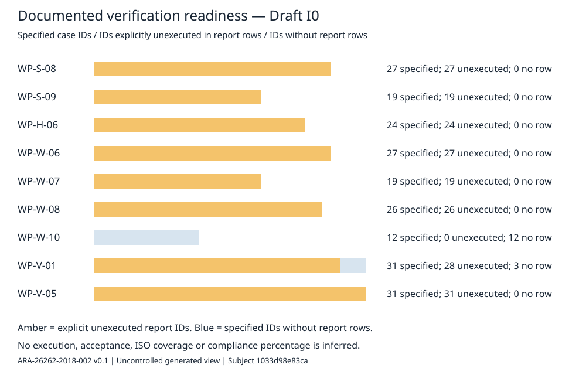

# ISO 26262 assessment follow-up — hardware change and verification readiness

| Field | Value |
|---|---|
| Record | ARA-26262-2018-002 |
| Revision / status | 0.1 / Draft; human verification and approval pending |
| Date | 2026-10-15 UTC |
| Author / documentary assessor | Codex (OpenAI AI assistant), I0; no independent confirmation/FSA credit |
| Subject revision | `1033d98e83ca592d6654eb3b3c9c36877c08e4fe` |
| Prior assessment | [ARA-26262-2018-001 v0.2](../iso26262-2018/README.md), subject `20569e916c9359243739b71e4dc79876aec48cc0`; preserved unchanged |
| Controlled sources | [findings.json](findings.json); immutable Git source objects identified in [assessment.json](assessment.json) |
| Generated views | [Spreadsheet](Assessment_followup.xlsx), [source annotations](Annotated_followup.html), [readiness diagram](verification_readiness.svg), CSV exports |
| Distribution | Generated downloads are uncontrolled copies; no Excel edit supplies a disposition |
| Review / impact | [I0 review record](../../01-management/reviews/RR-2026-ASMT-002.md); [change impact](../../07-supporting/impact/change-2026-10-15-assessment-followup.md) |

The new hardware source review changes the harness basis from a presumed electromechanical relay to powered analog switches. This follow-up evaluates documentary impacts and verification readiness. It does not independently authenticate the schematic, vendor ratings, shipped parts or physical failure behavior. The vendor datasheet and bench measurements remain prerequisites; the hardware review itself says its rating quotations are unconfirmed. ISO normative verdicts remain **Not assessed**, pending accessible licensed source and qualified review.

## Findings and author handoff

Six observations are open. Proposed roles are not personnel appointments; tasks are unassigned. Exact quotes, source hashes, related original finding IDs, bounded author actions and closure evidence are in [assessment.json](assessment.json) and the spreadsheet. The [original author protocol](../iso26262-2018/AUTHORING_PROTOCOL.md) applies to this supplement too.

| ID | Priority | Documentary observation | Proposed role |
|---|---|---|---|
| B01 | P0 | The hardware review explicitly leaves the shared VIN dependency unapplied in the DFA | Hardware analyst / DFA owner |
| B02 | P1 | WP-H-03 still contains the older generic FMEDA summary while the source review reports revised metrics | Hardware metrics owner |
| B03 | P1 | Siren criteria mix last-heartbeat and detection clock origins; 0.5 s and approximately 0.56 s cannot be compared without event definitions | System timing owner / test lead |
| B04 | P1 | Fault-injection coverage expressly leaves SFMEA-33 through SFMEA-40 without mapped cases | Safety analysis owner / test lead |
| B05 | P2 | Management and hardware review records both use RR-2026-010; use full paths until a controlled identifier migration is agreed | Configuration manager / audit author |
| B06 | P2 | VS-VAL-30, VS-VAL-31 and VS-VAL-32 have specifications but no corresponding result-template row | Validation lead |

These priorities are triage, not verified ISO nonconformity severities. B02 is a source-to-summary reconciliation finding: this supplement has not independently recomputed the revised FMEDA or validated generic failure rates. B03 deliberately leaves the timing verdict unresolved. B04 repeats an author-acknowledged gap so it appears in the author queue; it is not a newly observed physical defect. B06 can be addressed by a reviewed template/cross-reference change; execution remains separate.

Prepare B01 and B02 together against the same hardware configuration, using DQ-209 as an unresolved decision input. Do not assume a selected design option or accept its residual risk. B03 requires the timing owner to establish event definitions before a test author changes a criterion. B04 then needs the current safety-analysis mechanisms and timing basis. B05 and B06 permit bounded document-control preparation. No task author may self-close a finding, approve evidence, pass a gate, or invent a result.

## Baseline crosswalk

[Changed work products](changed_work_products.csv) identifies WP-H-01, WP-H-02 and WP-H-06 as changed since the original subject. Their revised architecture, requirements and tests require reassessment. Supporting DFMEA/FMEDA, trace and generated files also changed; the three-WP list is explicitly limited to WP-named Markdown documents.

[Original-finding crosswalk](baseline_crosswalk.csv) checks all 22 original annotation source files and exact quotes. Those files are unchanged at this subject. That does **not** mean the surrounding argument is unchanged: the hardware changes affect A06–A08, A12, A14 and A20. All original findings remain open; this supplement does not supersede their evidence or reissue their old workbook against the new subject.

## Verification readiness census



| Work product | Specified case IDs | IDs explicitly unexecuted in report rows | Specified IDs without report rows |
|---|---|---|---|
| WP-S-08 | 27 | 27 | 0 |
| WP-S-09 | 19 | 19 | 0 |
| WP-H-06 | 24 | 24 | 0 |
| WP-W-06 | 27 | 27 | 0 |
| WP-W-07 | 19 | 19 | 0 |
| WP-W-08 | 26 | 26 | 0 |
| WP-W-10 | 12 | 0 | 12 |
| WP-V-01 | 31 | 28 | 3 |
| WP-V-05 | 31 | 31 | 0 |
| Total | 216 | 201 | 15 |

The extractor reads first-column VS case IDs and numeric ranges from Markdown tables; it preserves every matched row, section and source line in [test_rows.csv](test_rows.csv). It expands collapsed report ranges, including VS-UV-S1 through S4. Counts deduplicate IDs within each document. They do not count procedures/trials, executed tests, evidence acceptance, or ISO requirement coverage. WP-W-10 has a narrative current-status section rather than a per-case result table; missing rows alone are not proof of absent activity. This is a focused nine-document census, not a complete review of all 88 registered work products or all ISO clauses.

## Reproduce and review

Use Python 3 with `xlsxwriter==3.2.9` (also pinned in the [original isolated dependency list](../iso26262-2018/requirements.lock.txt)). The repository must retain the subject and original baseline Git objects.

```bash
python3 assurance/00-assessment/iso26262-followup/build_followup.py
python3 assurance/00-assessment/iso26262-followup/build_followup.py --check
```

The generator reads Git objects rather than mutable checkout files, rejects missing/ambiguous finding anchors and generates reproducible spreadsheet, CSV, JSON, HTML and SVG views. `--check` regenerates into a temporary directory and compares every generated artifact, including its hash manifest. Git controls the script, source configuration and this narrative; the manifest covers generated artifacts only. This advisory tool is unqualified and does not establish correctness of an assessment judgment.

Next prerequisites are accessible licensed 2018 sources for all parts, a verified normative inventory/applicability matrix, exact vehicle/harness configuration, primary vendor evidence, actual target/bench data and appropriately independent human reviews. The Windows OneDrive search URI previously supplied does not expose the source files to this cloud workspace. No complete end-to-end ISO assessment or release approval is claimed while these remain open.

| Revision | Date | Summary | Approval |
|---|---|---|---|
| 0.1 | 2026-10-15 | Hardware-change impact, six documentary observations, baseline crosswalk and nine-document verification census | Pending |
