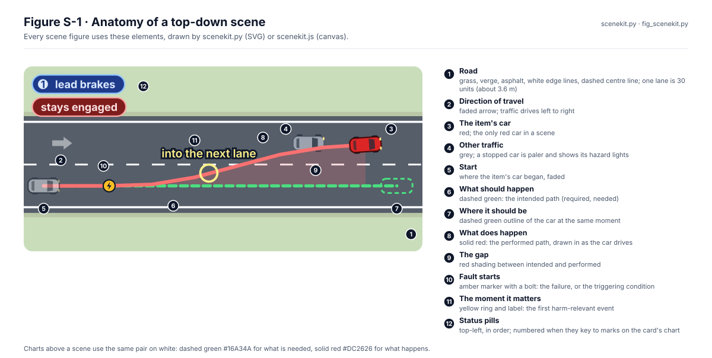
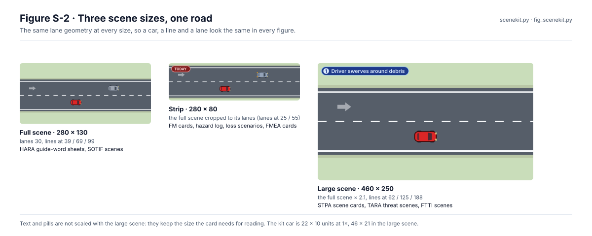

# Top-down scene style

Every figure that shows a car on a road draws it from one kit, so a car, a lane and a mark mean the same thing in the
HARA, SOTIF, STPA, TARA, FSC and FMEA figures and in the documentation pages. This page says what the elements mean,
which scene size to use, and how to draw and change them.

The kit has two halves that share one set of constants:

| File | Draws | Used by |
|---|---|---|
| [`scenekit.py`](scenekit.py) | SVG, for the generated figures (`--check` in CI) | every scene generator listed [below](#who-uses-it) |
| [`scenekit.js`](scenekit.js) | canvas, for pages that animate a scene live | mockups and explorers |

<p align="center">
  
</p>

*Figure S-1. The elements of a scene, drawn by the kit (`fig_scenekit.py`).*

## Rules

1. **One red car.** The item's car is red and is the only red car in a scene. Other traffic is grey; a stopped car is
   paler and shows its hazard lights.
2. **Green is what should happen, red is what does.** Dashed green for the intended path and the outline of where the
   car should be; solid red for the performed path; red shading for the gap between them. Charts over a scene use the
   same pair, darker, on white (`REQ`, `PERF`). A modification shown against today may use a solid green track.
3. **One fault, one moment.** The amber marker with a bolt is where the failure or triggering condition starts; the
   yellow ring and label is the first moment that matters. Use each at most once per scene.
4. **Pills top-left, in order.** Status pills stack down the top-left corner as the scene unfolds: blue for the driver,
   dark red for what goes wrong, green for what holds, slate for context. Number them when the numbers key to marks on
   the card's chart.
5. **Loops end where they matter.** Scenes loop every 6 s: 80 % driving, then a hold. A viewer that does not animate
   shows the static frame, so every animated element's static pose is its end state.
6. **Say what it is.** A scene explains a mechanism; it is not test or simulation output unless the sheet says it
   replays a run, and names the run.
7. **Text stays readable.** Labels and pills keep the size the card needs; they are not scaled with the large scene.
   Light text on the asphalt gets a dark halo (`road_label(..., halo=True)`).

## Scene sizes

<p align="center">
  
</p>

*Figure S-2. The same road at three sizes.*

| Size | Units | Use it for | Kit calls |
|---|---|---|---|
| Full scene | 280 × 130 | one scene per card | `straight_road()`, `curved_road(edge)`, `single_lane_road(d)` |
| Strip | 280 × 80 | two scenes per card (today and with a change) | `strip_road()`, coordinates `STRIP_*` |
| Large scene | 460 × 250 | cards whose scenes are written in 460 × 250 | `large_road()`, cars and marks scaled by `LARGE_K` |

## Drawing a scene

In a figure generator (SVG):

```python
sys.path.insert(0, str(REPO / "assurance" / "01-management" / "figures"))
import scenekit as sk

key = lambda x: sk.DRIVE * (x - 14) / 248                  # loop time at which the car passes x
path = [(14, 84), (120, 80), (200, 62), (250, 56)]
scene = [*sk.straight_road(),
         sk.intended_path([(14, 84), (262, 84)]),
         sk.performed_path(sk.d(path), sk.draw_on(path, [key(x) for x, _ in path])),
         sk.driving(path, sk.ego_body(), key),
         sk.fault_marker(120, 80, key(120)),
         sk.callout(200, 62, 6, "into the next lane", 51, key(200)),
         *sk.badges([("stays engaged", 0.3, None, "bad")], lambda t: sk.DRIVE * t)]
```

In a page (canvas), after inlining or loading `scenekit.js`:

```js
const k = scenekit, SK = k.SK;
const { ctx } = k.frame(canvas, SK.W, SK.H);               // draw in scene units from here
k.straightRoad(ctx, { dashOffset: travelled });
k.intendedPath(ctx, [[14, 84], [262, 84]]);
k.performedPath(ctx, track);
k.car(ctx, x, y, heading, "ego");
k.badges(ctx, [[1, "lead brakes", "drv"], ["stays engaged", "bad"]]);
```

## Changing the style

1. Change [`scenekit.py`](scenekit.py), and the matching drawing in [`scenekit.js`](scenekit.js).
2. If a colour, a geometry value, a scene size or the loop timing changed, run `python3 scenekit.py --js` to rewrite the
   constants block of `scenekit.js`.
3. Regenerate the figures with the commands below and look at them: every scene figure changes with the kit.
4. Run `python3 test_scenekit.py`.

CI holds the style in place:

- `scenekit.py --check` fails if the constants in `scenekit.js` are stale.
- `test_scenekit.py` fails if a generator draws the road from its own copy of the palette, if a card sizes a strip
  without `STRIP_H`, or if the large scene's lane lines move off 62 / 125 / 188.
- Each generator's own `--check` fails if its figures are stale.

## Who uses it

| Generator | Figures | Size | Regenerate |
|---|---|---|---|
| `02-concept/hara/guideword_scenes.py` | WP-C-03 guide-word sheets | full | `python3 assurance/02-concept/hara/hara_figures.py` |
| `02-concept/hara/hazlog_cards.py` | WP-C-03 hazard log | strip | `python3 assurance/02-concept/hara/hara_figures.py` |
| `02-concept/sotif/sotif_scenes.py` | WP-C-06 SOTIF scenes | full | `python3 assurance/02-concept/sotif/sotif_figures.py` |
| `02-concept/sotif/fm_scenes.py` | WP-C-07 modification cards | strip | `python3 assurance/02-concept/sotif/sotif_figures.py` |
| `08-analyses/figures/stpa_ls_scenes.py` | WP-A-05 loss scenarios | strip | `python3 assurance/08-analyses/figures/fig_a05_stpa.py` |
| `tools/safety/fmea_cards.py` | System FMEA cards | strip | `python3 tools/safety/fmea_cards.py` |
| `08-analyses/figures/stpa_scenes.py` | WP-A-05 scene cards | large | `python3 assurance/08-analyses/figures/fig_a05_stpa.py` |
| `02-concept/figures/fig_c09_scenes.py` | WP-C-09 threat scenes | large | `python3 assurance/02-concept/figures/fig_c09_scenes.py` |
| `02-concept/fsc/fsc_scenes.py` | WP-C-04 FTTI scenes | large | `python3 assurance/02-concept/fsc/fsc_figures.py` |
| `01-management/figures/fig_scenekit.py` | the two figures on this page | full, strip, large | `python3 assurance/01-management/figures/fig_scenekit.py` |
