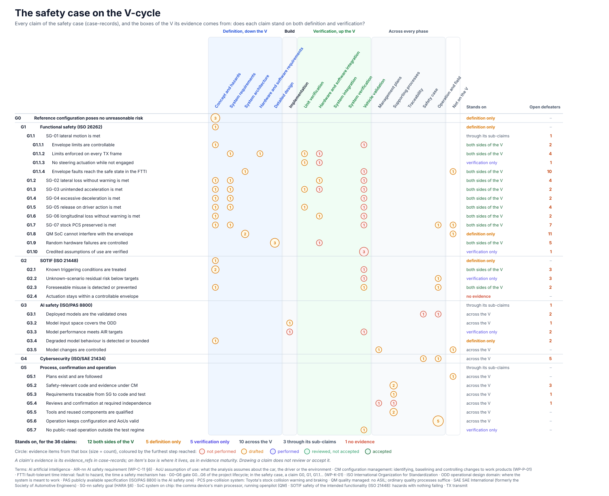

<!-- GENERATED by assurance/01-management/figures/fig_m00_vcycle.py from assurance/case-records. Do not edit. -->

# The safety case on the V-cycle

[← Back to the V-cycle](../../README.md#the-v-cycle) · [evidence maturity](evidence.md) · [Living Safety Case](../../README.md#living-safety-case) · [records](../../case-records/README.md)

  

*Every claim of the [safety case records](../../case-records/README.md), and the boxes of the V its evidence comes from. Drawing a claim does not review or accept it. Drawn by [`fig_m00_vcycle.py`](../figures/fig_m00_vcycle.py); CI fails if it is stale.*

## What each claim stands on

From the sides of the V its own evidence comes from: 12 both sides of the V; 5 definition only; 5 verification only; 10 across the V; 3 through its sub-claims; 1 no evidence.

| Claim | Stands on | Evidence, by box | Open defeaters | Status | Review |
|---|---|---|---|---|---|
| [G0](../../../assurance/case-records/claims/g0-top-level.yaml) Reference configuration poses no unreasonable risk | definition only | [Concept and hazards](concept-and-hazards.md): Sn-49, Sn-55, Sn-56 | — | draft | not-reviewed |
| &nbsp;&nbsp;[G1](../../../assurance/case-records/claims/g1-functional-safety.yaml) Functional safety (ISO 26262) | definition only | [Concept and hazards](concept-and-hazards.md): Sn-49 | — | draft | not-reviewed |
| &nbsp;&nbsp;&nbsp;&nbsp;[G1.1](../../../assurance/case-records/claims/g1-functional-safety.yaml) SG-01 lateral motion is met | through its sub-claims | — | DF-14 | draft | not-reviewed |
| &nbsp;&nbsp;&nbsp;&nbsp;&nbsp;&nbsp;[G1.1.1](../../../assurance/case-records/claims/g1-functional-safety.yaml) Envelope limits are controllable | both sides of the V | [Concept and hazards](concept-and-hazards.md): Sn-01; [Vehicle validation](vehicle-validation.md): Sn-20 | DF-28, DF-34 | draft | not-reviewed |
| &nbsp;&nbsp;&nbsp;&nbsp;&nbsp;&nbsp;[G1.1.2](../../../assurance/case-records/claims/g1-functional-safety.yaml) Limits enforced on every TX frame | both sides of the V | [System requirements](system-requirements.md): Sn-02; [Hardware and software requirements](hardware-and-software-requirements.md): Sn-03; [Unit verification](unit-verification.md): Sn-10; [Hardware and software integration](hardware-and-software-integration.md): Sn-12 | DF-03, DF-16, DF-27, DF-30 | draft | not-reviewed |
| &nbsp;&nbsp;&nbsp;&nbsp;&nbsp;&nbsp;[G1.1.3](../../../assurance/case-records/claims/g1-functional-safety.yaml) No steering actuation while not engaged | verification only | [Unit verification](unit-verification.md): Sn-10; [Hardware and software integration](hardware-and-software-integration.md): Sn-12 | DF-38 | draft | not-reviewed |
| &nbsp;&nbsp;&nbsp;&nbsp;&nbsp;&nbsp;[G1.1.4](../../../assurance/case-records/claims/g1-functional-safety.yaml) Envelope faults reach the safe state in the FTTI | both sides of the V | [System architecture](system-architecture.md): Sn-04; [Vehicle validation](vehicle-validation.md): Sn-13; Not on the V: Sn-15 | DF-01, DF-02, DF-03, DF-04, DF-05, DF-06, DF-29, DF-36, DF-40, DF-42 | draft | not-reviewed |
| &nbsp;&nbsp;&nbsp;&nbsp;[G1.2](../../../assurance/case-records/claims/g1-functional-safety.yaml) SG-02 lateral loss without warning is met | both sides of the V | [Concept and hazards](concept-and-hazards.md): Sn-01; [System requirements](system-requirements.md): Sn-02; [Hardware and software integration](hardware-and-software-integration.md): Sn-14; [Vehicle validation](vehicle-validation.md): Sn-13 | DF-07, DF-08, DF-36, DF-41 | draft | not-reviewed |
| &nbsp;&nbsp;&nbsp;&nbsp;[G1.3](../../../assurance/case-records/claims/g1-functional-safety.yaml) SG-03 unintended acceleration is met | both sides of the V | [Concept and hazards](concept-and-hazards.md): Sn-01; [System requirements](system-requirements.md): Sn-02; [Unit verification](unit-verification.md): Sn-10; [Hardware and software integration](hardware-and-software-integration.md): Sn-12; [Vehicle validation](vehicle-validation.md): Sn-21 | DF-14, DF-38 | draft | not-reviewed |
| &nbsp;&nbsp;&nbsp;&nbsp;[G1.4](../../../assurance/case-records/claims/g1-functional-safety.yaml) SG-04 excessive deceleration is met | both sides of the V | [Concept and hazards](concept-and-hazards.md): Sn-01; [System requirements](system-requirements.md): Sn-02; [Vehicle validation](vehicle-validation.md): Sn-21 | DF-09, DF-38 | draft | not-reviewed |
| &nbsp;&nbsp;&nbsp;&nbsp;[G1.5](../../../assurance/case-records/claims/g1-functional-safety.yaml) SG-05 release on driver action is met | both sides of the V | [Concept and hazards](concept-and-hazards.md): Sn-01; [System requirements](system-requirements.md): Sn-02; [Unit verification](unit-verification.md): Sn-10; [Vehicle validation](vehicle-validation.md): Sn-22 | DF-05, DF-10, DF-14, DF-36 | draft | not-reviewed |
| &nbsp;&nbsp;&nbsp;&nbsp;[G1.6](../../../assurance/case-records/claims/g1-functional-safety.yaml) SG-06 longitudinal loss without warning is met | both sides of the V | [Concept and hazards](concept-and-hazards.md): Sn-01; [Hardware and software integration](hardware-and-software-integration.md): Sn-14; [Vehicle validation](vehicle-validation.md): Sn-13 | DF-07, DF-41 | draft | not-reviewed |
| &nbsp;&nbsp;&nbsp;&nbsp;[G1.7](../../../assurance/case-records/claims/g1-functional-safety.yaml) SG-07 stock PCS preserved is met | both sides of the V | [Concept and hazards](concept-and-hazards.md): Sn-01; [System requirements](system-requirements.md): Sn-02; [Vehicle validation](vehicle-validation.md): Sn-23; [Operation and field](operation-and-field.md): Sn-30; Not on the V: Sn-15 | DF-11, DF-12, DF-14, DF-32, DF-33, DF-38, DF-39 | draft | not-reviewed |
| &nbsp;&nbsp;&nbsp;&nbsp;[G1.8](../../../assurance/case-records/claims/g1-functional-safety.yaml) QM SoC cannot interfere with the envelope | definition only | [System architecture](system-architecture.md): Sn-05, Sn-06; Not on the V: Sn-15 | DF-03, DF-06, DF-12, DF-18, DF-22, DF-29, DF-32, DF-34, DF-37, DF-39, DF-40 | draft | not-reviewed |
| &nbsp;&nbsp;&nbsp;&nbsp;[G1.9](../../../assurance/case-records/claims/g1-functional-safety.yaml) Random hardware failures are controlled | both sides of the V | [Detailed design](detailed-design.md): Sn-07, Sn-08, Sn-09; [Hardware and software integration](hardware-and-software-integration.md): Sn-11 | DF-01, DF-04, DF-13, DF-33, DF-42 | draft | not-reviewed |
| &nbsp;&nbsp;&nbsp;&nbsp;[G1.10](../../../assurance/case-records/claims/g1-functional-safety.yaml) Credited assumptions of use are verified | verification only | [Vehicle validation](vehicle-validation.md): Sn-20, Sn-21, Sn-22 | DF-14 | draft | not-reviewed |
| &nbsp;&nbsp;[G2](../../../assurance/case-records/claims/g2-sotif.yaml) SOTIF (ISO 21448) | definition only | [Concept and hazards](concept-and-hazards.md): Sn-48 | — | draft | not-reviewed |
| &nbsp;&nbsp;&nbsp;&nbsp;[G2.1](../../../assurance/case-records/claims/g2-sotif.yaml) Known triggering conditions are treated | both sides of the V | [Concept and hazards](concept-and-hazards.md): Sn-40, Sn-41; [Vehicle validation](vehicle-validation.md): Sn-42 | DF-07, DF-08, DF-15 | draft | not-reviewed |
| &nbsp;&nbsp;&nbsp;&nbsp;[G2.2](../../../assurance/case-records/claims/g2-sotif.yaml) Unknown-scenario residual risk below targets | verification only | [Vehicle validation](vehicle-validation.md): Sn-43; [Operation and field](operation-and-field.md): Sn-44 | DF-16, DF-35, DF-41 | draft | not-reviewed |
| &nbsp;&nbsp;&nbsp;&nbsp;[G2.3](../../../assurance/case-records/claims/g2-sotif.yaml) Foreseeable misuse is detected or prevented | both sides of the V | [Concept and hazards](concept-and-hazards.md): Sn-45; [Vehicle validation](vehicle-validation.md): Sn-46; [Operation and field](operation-and-field.md): Sn-47 | DF-17, DF-18 | draft | not-reviewed |
| &nbsp;&nbsp;&nbsp;&nbsp;[G2.4](../../../assurance/case-records/claims/g2-sotif.yaml) Actuation stays within a controllable envelope | no evidence | — | — | draft | not-reviewed |
| &nbsp;&nbsp;[G3](../../../assurance/case-records/claims/g3-ai-safety.yaml) AI safety (ISO/PAS 8800) | through its sub-claims | — | DF-15 | draft | not-reviewed |
| &nbsp;&nbsp;&nbsp;&nbsp;[G3.1](../../../assurance/case-records/claims/g3-ai-safety.yaml) Deployed models are the validated ones | across the V | [Safety case](safety-case.md): Sn-50; [Operation and field](operation-and-field.md): Sn-31 | DF-19, DF-31 | draft | not-reviewed |
| &nbsp;&nbsp;&nbsp;&nbsp;[G3.2](../../../assurance/case-records/claims/g3-ai-safety.yaml) Model input space covers the ODD | across the V | [Implementation](implementation.md): Sn-51 | DF-20 | draft | not-reviewed |
| &nbsp;&nbsp;&nbsp;&nbsp;[G3.3](../../../assurance/case-records/claims/g3-ai-safety.yaml) Model performance meets AIR targets | verification only | [Implementation](implementation.md): Sn-52; [Vehicle validation](vehicle-validation.md): Sn-42 | DF-16, DF-35 | draft | not-reviewed |
| &nbsp;&nbsp;&nbsp;&nbsp;[G3.4](../../../assurance/case-records/claims/g3-ai-safety.yaml) Degraded model behaviour is detected or bounded | definition only | [Concept and hazards](concept-and-hazards.md): Sn-53 | DF-08, DF-21 | draft | not-reviewed |
| &nbsp;&nbsp;&nbsp;&nbsp;[G3.5](../../../assurance/case-records/claims/g3-ai-safety.yaml) Model changes are controlled | across the V | [Management plans](management-plans.md): Sn-54; Not on the V: Sn-60 | — | draft | not-reviewed |
| &nbsp;&nbsp;[G4](../../../assurance/case-records/claims/g4-cybersecurity.yaml) Cybersecurity (ISO/SAE 21434) | across the V | [Safety case](safety-case.md): Sn-70; [Operation and field](operation-and-field.md): Sn-68 | DF-19, DF-22, DF-23, DF-29, DF-37 | draft | not-reviewed |
| &nbsp;&nbsp;[G5](../../../assurance/case-records/claims/g5-process-and-operation.yaml) Process, confirmation and operation | through its sub-claims | — | — | draft | not-reviewed |
| &nbsp;&nbsp;&nbsp;&nbsp;[G5.1](../../../assurance/case-records/claims/g5-process-and-operation.yaml) Plans exist and are followed | across the V | Not on the V: Sn-60 | — | draft | not-reviewed |
| &nbsp;&nbsp;&nbsp;&nbsp;[G5.2](../../../assurance/case-records/claims/g5-process-and-operation.yaml) Safety-relevant code and evidence under CM | across the V | [Supporting processes](supporting-processes.md): Sn-61, Sn-62 | DF-24, DF-30, DF-31 | draft | not-reviewed |
| &nbsp;&nbsp;&nbsp;&nbsp;[G5.3](../../../assurance/case-records/claims/g5-process-and-operation.yaml) Requirements traceable from SG to code and test | across the V | [Supporting processes](supporting-processes.md): Sn-63 | DF-25 | draft | not-reviewed |
| &nbsp;&nbsp;&nbsp;&nbsp;[G5.4](../../../assurance/case-records/claims/g5-process-and-operation.yaml) Reviews and confirmation at required independence | across the V | [Management plans](management-plans.md): Sn-65; [Supporting processes](supporting-processes.md): Sn-64 | DF-26 | draft | not-reviewed |
| &nbsp;&nbsp;&nbsp;&nbsp;[G5.5](../../../assurance/case-records/claims/g5-process-and-operation.yaml) Tools and reused components are qualified | across the V | [Supporting processes](supporting-processes.md): Sn-66, Sn-67 | — | draft | not-reviewed |
| &nbsp;&nbsp;&nbsp;&nbsp;[G5.6](../../../assurance/case-records/claims/g5-process-and-operation.yaml) Operation keeps configuration and AoUs valid | across the V | [Operation and field](operation-and-field.md): Sn-30, Sn-32, Sn-47, Sn-44, Sn-68 | — | draft | not-reviewed |
| &nbsp;&nbsp;&nbsp;&nbsp;[G5.7](../../../assurance/case-records/claims/g5-process-and-operation.yaml) No public-road operation outside the test regime | verification only | [Vehicle validation](vehicle-validation.md): Sn-69 | — | draft | not-reviewed |
