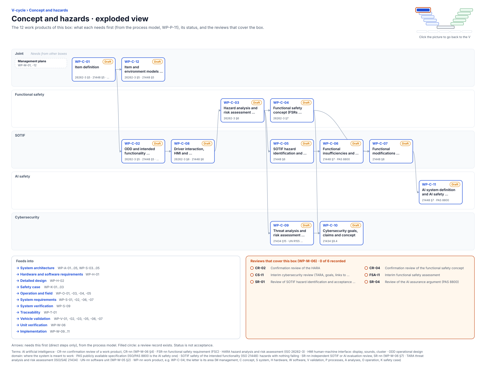

<!-- GENERATED by assurance/01-management/figures/fig_m00_vcycle.py from WP-M-00 and the process model. Do not edit. -->

# V-cycle: Concept and hazards

[← Back to the V-cycle](../../README.md#the-v-cycle) · folder: [`02-concept/`](../../02-concept/README.md)

  

*Click the picture to go back to the V. Drawn from the [register](../WP-M-00-work-product-register.md) and the [process model](../../process/README.md) by [`fig_m00_vcycle.py`](../figures/fig_m00_vcycle.py); CI fails if it is stale.*

## Work products

| Work product | Status | Gate | Discipline | Needs first |
|---|---|---|---|---|
| [WP-C-01 Item definition](../../02-concept/WP-C-01-item-definition.md) | Draft | G1 | Joint | — |
| [WP-C-02 ODD and intended functionality specification](../../02-concept/WP-C-02-odd-and-intended-functionality.md) | Draft | G1 | SOTIF | WP-C-01 |
| [WP-C-12 Item and environment models (reference car data, 3D model, scene library; index, no evidence credit)](../../02-concept/WP-C-12-item-and-environment-models.md) | Draft | G1 | Joint | WP-C-01 |
| [WP-C-08 Driver interaction, HMI and reasonably foreseeable misuse analysis](../../02-concept/WP-C-08-driver-hmi-misuse-analysis.md) | Draft | G1 | SOTIF | WP-C-02 |
| [WP-C-03 Hazard analysis and risk assessment, safety goals](../../02-concept/WP-C-03-hara.md) | Draft | G1 | Functional safety | WP-C-08 |
| [WP-C-04 Functional safety concept (FSRs, allocation, AoUs)](../../02-concept/WP-C-04-functional-safety-concept.md) | Draft | G1 | Functional safety | WP-C-03 |
| [WP-C-05 SOTIF hazard identification and risk evaluation, acceptance criteria](../../02-concept/WP-C-05-sotif-hazard-identification.md) | Draft | G1 | SOTIF | WP-C-03 |
| [WP-C-09 Threat analysis and risk assessment (TARA)](../../02-concept/WP-C-09-tara.md) | Draft | G1 | Cybersecurity | WP-C-03 |
| [WP-C-06 Functional insufficiencies and triggering conditions analysis](../../02-concept/WP-C-06-sotif-insufficiencies-triggering-conditions.md) | Draft | G1 | SOTIF | WP-C-05 |
| [WP-C-10 Cybersecurity goals, claims and concept](../../02-concept/WP-C-10-cybersecurity-goals-and-concept.md) | Draft | G1 | Cybersecurity | WP-C-04, WP-C-09 |
| [WP-C-07 Functional modifications addressing SOTIF risk](../../02-concept/WP-C-07-sotif-functional-modifications.md) | Draft | G1 | SOTIF | WP-C-04, WP-C-06 |
| [WP-C-11 AI system definition and AI safety requirements](../../02-concept/WP-C-11-ai-system-definition-and-safety-requirements.md) | Draft | G1 | AI safety | WP-C-07 |

## Needs from other boxes

- [Management plans](management-plans.md): WP-M-01, WP-M-12

## Feeds into

- [System architecture](system-architecture.md): WP-A-01, WP-A-02, WP-A-03, WP-A-04, WP-A-05, WP-S-03, WP-S-04, WP-S-05
- [Hardware and software requirements](hardware-and-software-requirements.md): WP-H-01
- [Detailed design](detailed-design.md): WP-H-02
- [Safety case](safety-case.md): WP-K-01, WP-K-02, WP-K-03
- [Operation and field](operation-and-field.md): WP-O-01, WP-O-03, WP-O-04, WP-O-05
- [System requirements](system-requirements.md): WP-S-01, WP-S-02, WP-S-06, WP-S-07
- [System verification](system-verification.md): WP-S-09
- [Traceability](traceability.md): WP-T-01
- [Vehicle validation](vehicle-validation.md): WP-V-01, WP-V-02, WP-V-03, WP-V-05, WP-V-06, WP-V-07
- [Unit verification](unit-verification.md): WP-W-06
- [Implementation](implementation.md): WP-W-09, WP-W-10, WP-W-11

## Reviews that cover this box

- No record yet: CR-02, Confirmation review of the HARA
- No record yet: CR-04, Confirmation review of the functional safety concept
- No record yet: CS-I1, Interim cybersecurity review (TARA, goals, links to safety goals)
- No record yet: FSA-I1, Interim functional safety assessment
- No record yet: SR-01, Review of SOTIF hazard identification and acceptance criteria
- No record yet: SR-04, Review of the AI assurance argument (PAS 8800)
