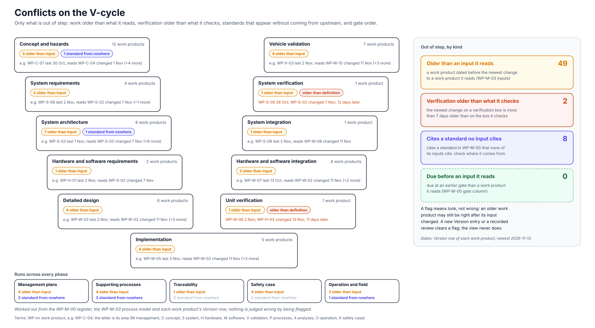

<!-- GENERATED by assurance/01-management/figures/fig_m00_vcycle.py. Do not edit. -->

# Conflicts on the V-cycle

[← Back to the V-cycle](../../README.md#the-v-cycle) · [change impact](impact.md) · [V-cycle over time](over-time.md)

  

*Only what is out of step. A flag means look, not wrong: an older work product may still be right after its input changed. A new Version entry or a recorded review clears a flag; the view never does. Drawn by [`fig_m00_vcycle.py`](../figures/fig_m00_vcycle.py); CI fails if it is stale.*

## Verification older than what it checks

The newest change on a verification box against the newest on the definition box opposite it; a gap of 7 days or fewer is not flagged.

| Verification box | Newest change | Checks | Newest change there | Days behind |
|---|---|---|---|---|
| [System verification](system-verification.md) | [WP-S-09](../../03-system/WP-S-09-system-verification.md) 2026-10-26 | [System requirements](system-requirements.md) | [WP-S-02](../../03-system/WP-S-02-technical-safety-requirements.md) 2026-11-07 | 12 |
| [Unit verification](unit-verification.md) | [WP-W-06](../../05-software/WP-W-06-software-unit-verification.md) 2026-11-02 | [Detailed design](detailed-design.md) | [WP-H-03](../../04-hardware/WP-H-03-hardware-safety-analysis-fmeda.md) 2026-11-13 | 11 |

## Older than an input it reads (49)

| Box | Work product | Last changed | Newer inputs |
|---|---|---|---|
| [Concept and hazards](concept-and-hazards.md) | [WP-C-07](../../02-concept/WP-C-07-sotif-functional-modifications.md) | 2026-10-30 | [WP-C-04](../../02-concept/WP-C-04-functional-safety-concept.md) 2026-11-01 |
| [Concept and hazards](concept-and-hazards.md) | [WP-C-08](../../02-concept/WP-C-08-driver-hmi-misuse-analysis.md) | 2026-10-23 | [WP-C-02](../../02-concept/WP-C-02-odd-and-intended-functionality.md) 2026-10-25, [WP-C-01](../../02-concept/WP-C-01-item-definition.md) 2026-10-25 |
| [Concept and hazards](concept-and-hazards.md) | [WP-C-09](../../02-concept/WP-C-09-tara.md) | 2026-10-26 | [WP-C-03](../../02-concept/WP-C-03-hara.md) 2026-10-30 |
| [Concept and hazards](concept-and-hazards.md) | [WP-C-10](../../02-concept/WP-C-10-cybersecurity-goals-and-concept.md) | 2026-10-25 | [WP-C-04](../../02-concept/WP-C-04-functional-safety-concept.md) 2026-11-01, [WP-C-09](../../02-concept/WP-C-09-tara.md) 2026-10-26 |
| [Concept and hazards](concept-and-hazards.md) | [WP-C-12](../../02-concept/WP-C-12-item-and-environment-models.md) | 2026-10-24 | [WP-C-01](../../02-concept/WP-C-01-item-definition.md) 2026-10-25 |
| [System requirements](system-requirements.md) | [WP-S-06](../../03-system/WP-S-06-requirements-production-operation.md) | 2026-11-02 | [WP-S-02](../../03-system/WP-S-02-technical-safety-requirements.md) 2026-11-07, [WP-S-07](../../03-system/WP-S-07-cybersecurity-requirements-architecture.md) 2026-11-03 |
| [System requirements](system-requirements.md) | [WP-S-07](../../03-system/WP-S-07-cybersecurity-requirements-architecture.md) | 2026-11-03 | [WP-S-02](../../03-system/WP-S-02-technical-safety-requirements.md) 2026-11-07 |
| [System architecture](system-architecture.md) | [WP-S-03](../../03-system/WP-S-03-technical-safety-concept-architecture.md) | 2026-11-01 | [WP-S-02](../../03-system/WP-S-02-technical-safety-requirements.md) 2026-11-07 |
| [System architecture](system-architecture.md) | [WP-S-05](../../03-system/WP-S-05-hsi-specification.md) | 2026-11-03 | [WP-S-02](../../03-system/WP-S-02-technical-safety-requirements.md) 2026-11-07 |
| [System architecture](system-architecture.md) | [WP-A-01](../../08-analyses/WP-A-01-asil-decomposition.md) | 2026-10-19 | [WP-S-02](../../03-system/WP-S-02-technical-safety-requirements.md) 2026-11-07, [WP-C-04](../../02-concept/WP-C-04-functional-safety-concept.md) 2026-11-01, [WP-C-03](../../02-concept/WP-C-03-hara.md) 2026-10-30, [WP-A-03](../../08-analyses/WP-A-03-dependent-failure-analysis.md) 2026-10-27, [WP-A-02](../../08-analyses/WP-A-02-coexistence-freedom-from-interference.md) 2026-10-27 |
| [System architecture](system-architecture.md) | [WP-A-02](../../08-analyses/WP-A-02-coexistence-freedom-from-interference.md) | 2026-10-27 | [WP-S-02](../../03-system/WP-S-02-technical-safety-requirements.md) 2026-11-07, [WP-S-03](../../03-system/WP-S-03-technical-safety-concept-architecture.md) 2026-11-01, [WP-C-04](../../02-concept/WP-C-04-functional-safety-concept.md) 2026-11-01 |
| [System architecture](system-architecture.md) | [WP-A-03](../../08-analyses/WP-A-03-dependent-failure-analysis.md) | 2026-10-27 | [WP-S-02](../../03-system/WP-S-02-technical-safety-requirements.md) 2026-11-07, [WP-S-03](../../03-system/WP-S-03-technical-safety-concept-architecture.md) 2026-11-01, [WP-C-04](../../02-concept/WP-C-04-functional-safety-concept.md) 2026-11-01 |
| [System architecture](system-architecture.md) | [WP-A-04](../../08-analyses/WP-A-04-system-fta-fmea.md) | 2026-10-29 | [WP-S-02](../../03-system/WP-S-02-technical-safety-requirements.md) 2026-11-07, [WP-C-04](../../02-concept/WP-C-04-functional-safety-concept.md) 2026-11-01, [WP-C-06](../../02-concept/WP-C-06-sotif-insufficiencies-triggering-conditions.md) 2026-10-30 |
| [System architecture](system-architecture.md) | [WP-A-05](../../08-analyses/WP-A-05-stpa.md) | 2026-10-21 | [WP-S-02](../../03-system/WP-S-02-technical-safety-requirements.md) 2026-11-07, [WP-C-06](../../02-concept/WP-C-06-sotif-insufficiencies-triggering-conditions.md) 2026-10-30, [WP-C-03](../../02-concept/WP-C-03-hara.md) 2026-10-30, [WP-C-01](../../02-concept/WP-C-01-item-definition.md) 2026-10-25, [WP-C-08](../../02-concept/WP-C-08-driver-hmi-misuse-analysis.md) 2026-10-23 |
| [Hardware and software requirements](hardware-and-software-requirements.md) | [WP-H-01](../../04-hardware/WP-H-01-hardware-safety-requirements.md) | 2026-11-02 | [WP-S-02](../../03-system/WP-S-02-technical-safety-requirements.md) 2026-11-07, [WP-S-05](../../03-system/WP-S-05-hsi-specification.md) 2026-11-03, [WP-H-02](../../04-hardware/WP-H-02-hardware-design.md) 2026-11-03 |
| [Detailed design](detailed-design.md) | [WP-W-03](../../05-software/WP-W-03-software-architecture.md) | 2026-11-02 | [WP-W-02](../../05-software/WP-W-02-software-safety-requirements.md) 2026-11-11 |
| [Detailed design](detailed-design.md) | [WP-W-04](../../05-software/WP-W-04-software-safety-analysis.md) | 2026-11-02 | [WP-W-02](../../05-software/WP-W-02-software-safety-requirements.md) 2026-11-11 |
| [Detailed design](detailed-design.md) | [WP-H-04](../../04-hardware/WP-H-04-hardware-metrics.md) | 2026-11-02 | [WP-H-03](../../04-hardware/WP-H-03-hardware-safety-analysis-fmeda.md) 2026-11-13 |
| [Detailed design](detailed-design.md) | [WP-H-05](../../04-hardware/WP-H-05-random-hardware-failures-pmhf.md) | 2026-11-01 | [WP-H-03](../../04-hardware/WP-H-03-hardware-safety-analysis-fmeda.md) 2026-11-13, [WP-H-04](../../04-hardware/WP-H-04-hardware-metrics.md) 2026-11-02 |
| [Vehicle validation](vehicle-validation.md) | [WP-V-03](../../06-validation/WP-V-03-sotif-known-scenarios.md) | 2026-11-02 | [WP-W-10](../../05-software/WP-W-10-ml-engineering.md) 2026-11-11 |
| [Vehicle validation](vehicle-validation.md) | [WP-V-04](../../06-validation/WP-V-04-sotif-unknown-scenarios.md) | 2026-10-25 | [WP-W-10](../../05-software/WP-W-10-ml-engineering.md) 2026-11-11, [WP-V-07](../../06-validation/WP-V-07-vehicle-test-operations.md) 2026-11-02, [WP-V-03](../../06-validation/WP-V-03-sotif-known-scenarios.md) 2026-11-02, [WP-V-02](../../06-validation/WP-V-02-sotif-vv-strategy.md) 2026-11-02 |
| [Vehicle validation](vehicle-validation.md) | [WP-V-05](../../06-validation/WP-V-05-fault-injection.md) | 2026-11-01 | [WP-S-02](../../03-system/WP-S-02-technical-safety-requirements.md) 2026-11-07, [WP-S-04](../../03-system/WP-S-04-timing-ftti-budget.md) 2026-11-02 |
| [Vehicle validation](vehicle-validation.md) | [WP-V-06](../../06-validation/WP-V-06-cybersecurity-validation.md) | 2026-10-23 | [WP-W-11](../../05-software/WP-W-11-cybersecurity-implementation-verification.md) 2026-11-11, [WP-S-07](../../03-system/WP-S-07-cybersecurity-requirements-architecture.md) 2026-11-03, [WP-V-07](../../06-validation/WP-V-07-vehicle-test-operations.md) 2026-11-02, [WP-C-09](../../02-concept/WP-C-09-tara.md) 2026-10-26, [WP-C-10](../../02-concept/WP-C-10-cybersecurity-goals-and-concept.md) 2026-10-25 |
| [System verification](system-verification.md) | [WP-S-09](../../03-system/WP-S-09-system-verification.md) | 2026-10-26 | [WP-S-02](../../03-system/WP-S-02-technical-safety-requirements.md) 2026-11-07, [WP-V-07](../../06-validation/WP-V-07-vehicle-test-operations.md) 2026-11-02, [WP-V-03](../../06-validation/WP-V-03-sotif-known-scenarios.md) 2026-11-02, [WP-S-08](../../03-system/WP-S-08-system-integration-test.md) 2026-11-02, [WP-V-05](../../06-validation/WP-V-05-fault-injection.md) 2026-11-01 |
| [System integration](system-integration.md) | [WP-S-08](../../03-system/WP-S-08-system-integration-test.md) | 2026-11-02 | [WP-W-08](../../05-software/WP-W-08-embedded-software-testing.md) 2026-11-11, [WP-S-02](../../03-system/WP-S-02-technical-safety-requirements.md) 2026-11-07, [WP-S-05](../../03-system/WP-S-05-hsi-specification.md) 2026-11-03 |
| [Hardware and software integration](hardware-and-software-integration.md) | [WP-W-07](../../05-software/WP-W-07-software-integration-verification.md) | 2026-10-13 | [WP-W-02](../../05-software/WP-W-02-software-safety-requirements.md) 2026-11-11, [WP-W-05](../../05-software/WP-W-05-software-unit-design.md) 2026-11-03, [WP-W-06](../../05-software/WP-W-06-software-unit-verification.md) 2026-11-02, [WP-W-03](../../05-software/WP-W-03-software-architecture.md) 2026-11-02 |
| [Hardware and software integration](hardware-and-software-integration.md) | [WP-H-06](../../04-hardware/WP-H-06-hardware-integration-verification.md) | 2026-10-27 | [WP-H-03](../../04-hardware/WP-H-03-hardware-safety-analysis-fmeda.md) 2026-11-13, [WP-H-02](../../04-hardware/WP-H-02-hardware-design.md) 2026-11-03, [WP-H-01](../../04-hardware/WP-H-01-hardware-safety-requirements.md) 2026-11-02, [WP-H-07](../../04-hardware/WP-H-07-hardware-component-qualification.md) 2026-11-01 |
| [Hardware and software integration](hardware-and-software-integration.md) | [WP-H-07](../../04-hardware/WP-H-07-hardware-component-qualification.md) | 2026-11-01 | [WP-H-03](../../04-hardware/WP-H-03-hardware-safety-analysis-fmeda.md) 2026-11-13, [WP-M-11](../WP-M-11-upstream-and-supplier-management.md) 2026-11-11, [WP-H-02](../../04-hardware/WP-H-02-hardware-design.md) 2026-11-03 |
| [Unit verification](unit-verification.md) | [WP-W-06](../../05-software/WP-W-06-software-unit-verification.md) | 2026-11-02 | [WP-P-07](../../07-supporting/WP-P-07-tool-classification-qualification.md) 2026-11-12, [WP-W-02](../../05-software/WP-W-02-software-safety-requirements.md) 2026-11-11, [WP-S-02](../../03-system/WP-S-02-technical-safety-requirements.md) 2026-11-07, [WP-W-05](../../05-software/WP-W-05-software-unit-design.md) 2026-11-03 |
| [Implementation](implementation.md) | [WP-W-05](../../05-software/WP-W-05-software-unit-design.md) | 2026-11-03 | [WP-W-02](../../05-software/WP-W-02-software-safety-requirements.md) 2026-11-11 |
| [Implementation](implementation.md) | [WP-W-09](../../05-software/WP-W-09-configuration-calibration-data.md) | 2026-10-27 | [WP-W-02](../../05-software/WP-W-02-software-safety-requirements.md) 2026-11-11, [WP-S-02](../../03-system/WP-S-02-technical-safety-requirements.md) 2026-11-07 |
| [Implementation](implementation.md) | [WP-W-10](../../05-software/WP-W-10-ml-engineering.md) | 2026-11-11 | [WP-P-07](../../07-supporting/WP-P-07-tool-classification-qualification.md) 2026-11-12 |
| [Implementation](implementation.md) | [WP-W-11](../../05-software/WP-W-11-cybersecurity-implementation-verification.md) | 2026-11-11 | [WP-P-07](../../07-supporting/WP-P-07-tool-classification-qualification.md) 2026-11-12 |
| [Management plans](management-plans.md) | [WP-M-04](../WP-M-04-organization-competence-safety-culture.md) | 2026-10-19 | [WP-M-02](../WP-M-02-safety-plan.md) 2026-10-23 |
| [Management plans](management-plans.md) | [WP-M-06](../WP-M-06-confirmation-measures-plan.md) | 2026-10-23 | [WP-M-05](../WP-M-05-quality-assurance-plan.md) 2026-11-11 |
| [Management plans](management-plans.md) | [WP-M-10](../WP-M-10-ai-safety-plan.md) | 2026-11-02 | [WP-M-09](../WP-M-09-cybersecurity-plan.md) 2026-11-11 |
| [Management plans](management-plans.md) | [WP-M-13](../WP-M-13-aspice-capability-baseline.md) | 2026-10-23 | [WP-P-04](../../07-supporting/WP-P-04-documentation-management.md) 2026-11-12, [WP-P-02](../../07-supporting/WP-P-02-change-management.md) 2026-11-12, [WP-M-05](../WP-M-05-quality-assurance-plan.md) 2026-11-11 |
| [Supporting processes](supporting-processes.md) | [WP-P-01](../../07-supporting/WP-P-01-configuration-management-plan.md) | 2026-10-22 | [WP-M-05](../WP-M-05-quality-assurance-plan.md) 2026-11-11, [WP-M-01](../WP-M-01-assurance-strategy.md) 2026-10-23 |
| [Supporting processes](supporting-processes.md) | [WP-P-03](../../07-supporting/WP-P-03-problem-resolution.md) | 2026-10-14 | [WP-M-05](../WP-M-05-quality-assurance-plan.md) 2026-11-11, [WP-M-02](../WP-M-02-safety-plan.md) 2026-10-23 |
| [Supporting processes](supporting-processes.md) | [WP-P-06](../../07-supporting/WP-P-06-requirements-management-traceability.md) | 2026-10-22 | [WP-M-02](../WP-M-02-safety-plan.md) 2026-10-23 |
| [Supporting processes](supporting-processes.md) | [WP-P-08](../../07-supporting/WP-P-08-software-component-qualification.md) | 2026-10-23 | [WP-W-02](../../05-software/WP-W-02-software-safety-requirements.md) 2026-11-11, [WP-W-03](../../05-software/WP-W-03-software-architecture.md) 2026-11-02, [WP-A-02](../../08-analyses/WP-A-02-coexistence-freedom-from-interference.md) 2026-10-27 |
| [Traceability](traceability.md) | [WP-T-01](../../trace/README.md) | 2026-10-26 | [WP-C-11](../../02-concept/WP-C-11-ai-system-definition-and-safety-requirements.md) 2026-11-02, [WP-C-04](../../02-concept/WP-C-04-functional-safety-concept.md) 2026-11-01, [WP-C-05](../../02-concept/WP-C-05-sotif-hazard-identification.md) 2026-10-30, [WP-C-03](../../02-concept/WP-C-03-hara.md) 2026-10-30 |
| [Safety case](safety-case.md) | [WP-K-01](../../10-safety-case/WP-K-01-safety-case.md) | 2026-10-30 | [WP-C-11](../../02-concept/WP-C-11-ai-system-definition-and-safety-requirements.md) 2026-11-02, [WP-C-04](../../02-concept/WP-C-04-functional-safety-concept.md) 2026-11-01 |
| [Safety case](safety-case.md) | [WP-K-02](../../10-safety-case/WP-K-02-sotif-release-argument.md) | 2026-10-30 | [WP-W-10](../../05-software/WP-W-10-ml-engineering.md) 2026-11-11, [WP-V-03](../../06-validation/WP-V-03-sotif-known-scenarios.md) 2026-11-02, [WP-V-02](../../06-validation/WP-V-02-sotif-vv-strategy.md) 2026-11-02 |
| [Safety case](safety-case.md) | [WP-K-03](../../10-safety-case/WP-K-03-cybersecurity-case.md) | 2026-10-23 | [WP-W-11](../../05-software/WP-W-11-cybersecurity-implementation-verification.md) 2026-11-11, [WP-S-07](../../03-system/WP-S-07-cybersecurity-requirements-architecture.md) 2026-11-03, [WP-C-09](../../02-concept/WP-C-09-tara.md) 2026-10-26, [WP-C-10](../../02-concept/WP-C-10-cybersecurity-goals-and-concept.md) 2026-10-25 |
| [Safety case](safety-case.md) | [WP-K-04](../../10-safety-case/WP-K-04-functional-safety-assessment.md) | 2026-10-12 | [WP-V-01](../../06-validation/WP-V-01-safety-validation.md) 2026-11-02, [WP-V-05](../../06-validation/WP-V-05-fault-injection.md) 2026-11-01, [WP-K-01](../../10-safety-case/WP-K-01-safety-case.md) 2026-10-30 |
| [Operation and field](operation-and-field.md) | [WP-O-02](../../09-production-operation/WP-O-02-operation-service-decommissioning.md) | 2026-10-25 | [WP-O-01](../../09-production-operation/WP-O-01-installation-and-provisioning-control.md) 2026-11-11, [WP-S-06](../../03-system/WP-S-06-requirements-production-operation.md) 2026-11-02 |
| [Operation and field](operation-and-field.md) | [WP-O-03](../../09-production-operation/WP-O-03-user-information-safety-warnings.md) | 2026-10-23 | [WP-S-06](../../03-system/WP-S-06-requirements-production-operation.md) 2026-11-02, [WP-C-03](../../02-concept/WP-C-03-hara.md) 2026-10-30, [WP-C-02](../../02-concept/WP-C-02-odd-and-intended-functionality.md) 2026-10-25 |
| [Operation and field](operation-and-field.md) | [WP-O-05](../../09-production-operation/WP-O-05-cybersecurity-incident-response-updates.md) | 2026-11-11 | [WP-P-02](../../07-supporting/WP-P-02-change-management.md) 2026-11-12 |

## Cites a standard no input cites (8)

| Box | Work product | Standard |
|---|---|---|
| [Concept and hazards](concept-and-hazards.md) | [WP-C-02](../../02-concept/WP-C-02-odd-and-intended-functionality.md) | ISO/PAS 8800 |
| [System architecture](system-architecture.md) | [WP-S-03](../../03-system/WP-S-03-technical-safety-concept-architecture.md) | ISO 21448 |
| [Management plans](management-plans.md) | [WP-M-01](../WP-M-01-assurance-strategy.md) | ISO 21448, ISO/PAS 8800 |
| [Management plans](management-plans.md) | [WP-M-04](../WP-M-04-organization-competence-safety-culture.md) | ISO/SAE 21434 |
| [Supporting processes](supporting-processes.md) | [WP-P-03](../../07-supporting/WP-P-03-problem-resolution.md) | ISO 21448 |
| [Supporting processes](supporting-processes.md) | [WP-P-08](../../07-supporting/WP-P-08-software-component-qualification.md) | ISO/SAE 21434 |
| [Supporting processes](supporting-processes.md) | [WP-P-11](../../process/README.md) | ISO/PAS 8800 |
| [Operation and field](operation-and-field.md) | [WP-O-04](../../09-production-operation/WP-O-04-field-monitoring.md) | ISO/SAE 21434 |

## Due before an input it reads (0)

None: every work product is due at or after the gate of each work product it reads.
