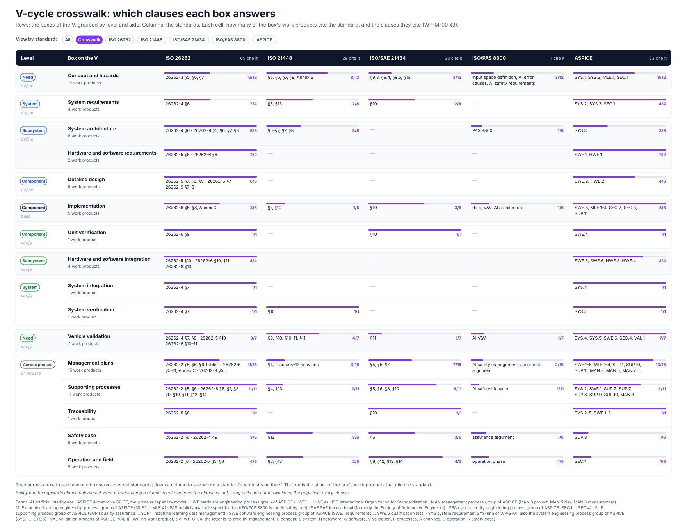

<!-- GENERATED by assurance/01-management/figures/fig_m00_vcycle.py from WP-M-00 §3. Do not edit. -->

# V-cycle crosswalk

View by standard: [All](../../README.md#the-v-cycle) · **Crosswalk** · [ISO 26262](standard-iso26262.md) · [ISO 21448](standard-iso21448.md) · [ISO/SAE 21434](standard-iso21434.md) · [ISO/PAS 8800](standard-pas8800.md) · [ASPICE](standard-aspice.md)

  

*Every box of the V against every standard: how many of its work products cite the standard in the [register](../WP-M-00-work-product-register.md), and which clauses. Citing a clause is not meeting it. Drawn by [`fig_m00_vcycle.py`](../figures/fig_m00_vcycle.py); CI fails if it is stale.*

## The crosswalk in full

Each box opens its exploded view; each standard's heading opens the page that links every work product citing it.

| Level | Box | [ISO 26262](standard-iso26262.md) | [ISO 21448](standard-iso21448.md) | [ISO/SAE 21434](standard-iso21434.md) | [ISO/PAS 8800](standard-pas8800.md) | [ASPICE](standard-aspice.md) |
|---|---|---|---|---|---|---|
| Need (define) | [Concept and hazards](concept-and-hazards.md) | 6 of 12: 26262-3 §5, §6, §7 | 8 of 12: §5, §6, §7, §8, Annex B | 3 of 12: §9.3, §9.4, §9.5, §15 | 3 of 12: input space definition, AI error causes, AI safety requirements | 8 of 12: SYS.1, SYS.2, MLE.1, SEC.1 |
| System (define) | [System requirements](system-requirements.md) | 2 of 4: 26262-4 §6 | 2 of 4: §5, §13 | 2 of 4: §10 | — | 4 of 4: SYS.2, SYS.3, SEC.1 |
| Subsystem (define) | [System architecture](system-architecture.md) | 8 of 8: 26262-4 §6 · 26262-9 §5, §6, §7, §8 | 3 of 8: §6–§7, §7, §8 | — | 1 of 8: PAS 8800 | 3 of 8: SYS.3 |
| Subsystem (define) | [Hardware and software requirements](hardware-and-software-requirements.md) | 2 of 2: 26262-5 §6 · 26262-6 §6 | — | — | — | 2 of 2: SWE.1, HWE.1 |
| Component (define) | [Detailed design](detailed-design.md) | 6 of 6: 26262-5 §7, §8, §9 · 26262-6 §7 · 26262-9 §7–8 | — | — | — | 4 of 6: SWE.2, HWE.2 |
| Component (build) | [Implementation](implementation.md) | 3 of 5: 26262-6 §5, §8, Annex C | 1 of 5: §7, §10 | 3 of 5: §10 | 1 of 5: data, V&V, AI architecture | 5 of 5: SWE.3, MLE.1–4, SEC.2, SEC.3, SUP.11 |
| Component (verify) | [Unit verification](unit-verification.md) | 1 of 1: 26262-6 §9 | — | 1 of 1: §10 | — | 1 of 1: SWE.4 |
| Subsystem (verify) | [Hardware and software integration](hardware-and-software-integration.md) | 4 of 4: 26262-5 §10 · 26262-6 §10, §11 · 26262-8 §13 | — | — | — | 3 of 4: SWE.5, SWE.6, HWE.3, HWE.4 |
| System (verify) | [System integration](system-integration.md) | 1 of 1: 26262-4 §7 | — | — | — | 1 of 1: SYS.4 |
| System (verify) | [System verification](system-verification.md) | 1 of 1: 26262-4 §7 | 1 of 1: §10 | — | — | 1 of 1: SYS.5 |
| Need (verify) | [Vehicle validation](vehicle-validation.md) | 3 of 7: 26262-4 §7, §8 · 26262-5 §10 · 26262-6 §10–11 | 4 of 7: §9, §10, §10–11, §11 | 1 of 7: §11 | 1 of 7: AI V&V | 7 of 7: SYS.4, SYS.5, SWE.6, SEC.4, VAL.1 |
| Across phases (all phases) | [Management plans](management-plans.md) | 9 of 15: 26262-2 §5, §6, §6 Table 1 · 26262-6 §5–11, Annex C · 26262-8 §5, §6–12, §8 | 3 of 15: §4, Clause 5–13 activities | 7 of 15: §5, §6, §7 | 2 of 15: AI safety management, assurance argument | 13 of 15: SWE.1–6, MLE.1–4, SUP.1, SUP.10, SUP.11, MAN.3, MAN.5, MAN.7, ACQ.4, All in scope |
| Across phases (all phases) | [Supporting processes](supporting-processes.md) | 11 of 11: 26262-2 §5, §6 · 26262-8 §6, §7, §8, §9, §10, §11, §12, §14 | 2 of 11: §4, §13 | 8 of 11: §5, §6, §8, §10 | 1 of 11: AI safety lifecycle | 8 of 11: SYS.2, SWE.1, SUP.2, SUP.7, SUP.8, SUP.9, SUP.10, MAN.3 |
| Across phases (all phases) | [Traceability](traceability.md) | 1 of 1: 26262-8 §6 | — | 1 of 1: §10 | — | 1 of 1: SYS.2–5, SWE.1–6 |
| Across phases (all phases) | [Safety case](safety-case.md) | 3 of 6: 26262-2 §6 · 26262-4 §9 | 3 of 6: §12 | 3 of 6: §6 | 1 of 6: assurance argument | 1 of 6: SUP.8 |
| Across phases (all phases) | [Operation and field](operation-and-field.md) | 4 of 5: 26262-2 §7 · 26262-7 §5, §6 | 2 of 5: §6, §13 | 4 of 5: §8, §12, §13, §14 | 1 of 5: operation phase | 1 of 5: SEC.* |
