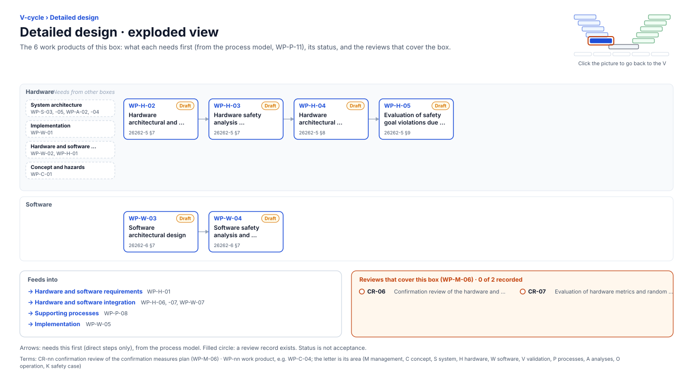

<!-- GENERATED by assurance/01-management/figures/fig_m00_vcycle.py from WP-M-00 and the process model. Do not edit. -->

# V-cycle: Detailed design

[← Back to the V-cycle](../../README.md#the-v-cycle) · folder: [`05-software/`](../../05-software/README.md)

  

*Click the picture to go back to the V. Drawn from the [register](../WP-M-00-work-product-register.md) and the [process model](../../process/README.md) by [`fig_m00_vcycle.py`](../figures/fig_m00_vcycle.py); CI fails if it is stale.*

## Work products

| Work product | Status | Gate | Discipline | Needs first |
|---|---|---|---|---|
| [WP-H-02 Hardware architectural and detailed design (device, panda MCU, harness, relay)](../../04-hardware/WP-H-02-hardware-design.md) | Draft | G3 | Hardware | — |
| [WP-W-03 Software architectural design](../../05-software/WP-W-03-software-architecture.md) | Draft | G3 | Software | — |
| [WP-H-03 Hardware safety analysis (FMEA/FMEDA)](../../04-hardware/WP-H-03-hardware-safety-analysis-fmeda.md) | Draft | G3 | Hardware | WP-H-02 |
| [WP-W-04 Software safety analysis and software-level DFA](../../05-software/WP-W-04-software-safety-analysis.md) | Draft | G3 | Software | WP-W-03 |
| [WP-H-04 Hardware architectural metrics (SPFM, LFM)](../../04-hardware/WP-H-04-hardware-metrics.md) | Draft | G3 | Hardware | WP-H-03 |
| [WP-H-05 Evaluation of safety goal violations due to random HW failures (PMHF)](../../04-hardware/WP-H-05-random-hardware-failures-pmhf.md) | Draft | G3 | Hardware | WP-H-04 |

## Needs from other boxes

- [System architecture](system-architecture.md): WP-S-03, WP-A-02, WP-A-04, WP-S-05
- [Implementation](implementation.md): WP-W-01
- [Hardware and software requirements](hardware-and-software-requirements.md): WP-W-02, WP-H-01
- [Concept and hazards](concept-and-hazards.md): WP-C-01

## Feeds into

- [Hardware and software requirements](hardware-and-software-requirements.md): WP-H-01
- [Hardware and software integration](hardware-and-software-integration.md): WP-H-06, WP-H-07, WP-W-07
- [Supporting processes](supporting-processes.md): WP-P-08
- [Implementation](implementation.md): WP-W-05

## Reviews that cover this box

- No record yet: CR-06, Confirmation review of the hardware and software safety analyses
- No record yet: CR-07, Evaluation of hardware metrics and random hardware failure targets
