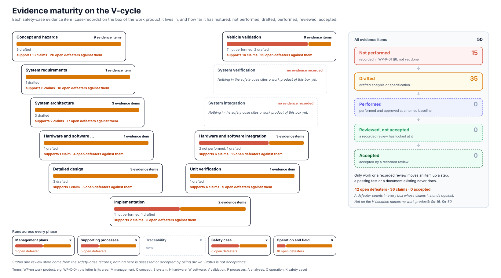

<!-- GENERATED by assurance/01-management/figures/fig_m00_vcycle.py from assurance/case-records. Do not edit. -->

# Evidence maturity

[← Back to the V-cycle](../../README.md#the-v-cycle) · [Living Safety Case](../../README.md#living-safety-case) · [records](../../case-records/README.md)

  

*Every evidence item of the [safety case records](../../case-records/README.md) on the box of the work product it lives in. Only work or a recorded review moves an item up a step. Drawn by [`fig_m00_vcycle.py`](../figures/fig_m00_vcycle.py); CI fails if it is stale.*

## Evidence items by box

| Box | Evidence | Step | Review | Claims | Lives in |
|---|---|---|---|---|---|
| [Concept and hazards](concept-and-hazards.md) | Sn-01 Functional safety requirements FSR-01.01…FSR-07.05 | Drafted | not-reviewed | G1.1.1, G1.2, G1.3, G1.4, G1.5, G1.6, G1.7 | [WP-C-04](../../02-concept/WP-C-04-functional-safety-concept.md) |
| [Concept and hazards](concept-and-hazards.md) | Sn-40 Insufficiencies and triggering conditions | Drafted | not-reviewed | G2.1 | [WP-C-06](../../02-concept/WP-C-06-sotif-insufficiencies-triggering-conditions.md) |
| [Concept and hazards](concept-and-hazards.md) | Sn-41 Functional modifications | Drafted | not-reviewed | G2.1 | [WP-C-07](../../02-concept/WP-C-07-sotif-functional-modifications.md) |
| [Concept and hazards](concept-and-hazards.md) | Sn-45 Misuse analysis | Drafted | not-reviewed | G2.3 | [WP-C-08](../../02-concept/WP-C-08-driver-hmi-misuse-analysis.md) |
| [Concept and hazards](concept-and-hazards.md) | Sn-48 SOTIF hazards and acceptance criteria | Drafted | not-reviewed | G2 | [WP-C-05](../../02-concept/WP-C-05-sotif-hazard-identification.md) |
| [Concept and hazards](concept-and-hazards.md) | Sn-49 Hazard analysis and risk assessment | Drafted | not-reviewed | G0, G1 | [WP-C-03](../../02-concept/WP-C-03-hara.md) |
| [Concept and hazards](concept-and-hazards.md) | Sn-53 AI runtime supervision design, AIR-nn | Drafted | not-reviewed | G3.4 | [WP-C-11](../../02-concept/WP-C-11-ai-system-definition-and-safety-requirements.md) |
| [Concept and hazards](concept-and-hazards.md) | Sn-55 Item definition | Drafted | not-reviewed | G0 | [WP-C-01](../../02-concept/WP-C-01-item-definition.md) |
| [Concept and hazards](concept-and-hazards.md) | Sn-56 ODD specification | Drafted | not-reviewed | G0 | [WP-C-02](../../02-concept/WP-C-02-odd-and-intended-functionality.md) |
| [System requirements](system-requirements.md) | Sn-02 Technical safety requirements | Drafted | not-reviewed | G1.1.2, G1.2, G1.3, G1.4, G1.5, G1.7 | [WP-S-02](../../03-system/WP-S-02-technical-safety-requirements.md) |
| [System architecture](system-architecture.md) | Sn-04 FTTI and timing budget | Drafted | not-reviewed | G1.1.4 | [WP-S-04](../../03-system/WP-S-04-timing-ftti-budget.md) |
| [System architecture](system-architecture.md) | Sn-05 FFI analysis | Drafted | not-reviewed | G1.8 | [WP-A-02](../../08-analyses/WP-A-02-coexistence-freedom-from-interference.md) |
| [System architecture](system-architecture.md) | Sn-06 Dependent failure analysis | Drafted | not-reviewed | G1.8 | [WP-A-03](../../08-analyses/WP-A-03-dependent-failure-analysis.md) |
| [Hardware and software requirements](hardware-and-software-requirements.md) | Sn-03 Software safety requirements | Drafted | not-reviewed | G1.1.2 | [WP-W-02](../../05-software/WP-W-02-software-safety-requirements.md) |
| [Detailed design](detailed-design.md) | Sn-07 Hardware FMEDA | Drafted | not-reviewed | G1.9 | [WP-H-03](../../04-hardware/WP-H-03-hardware-safety-analysis-fmeda.md) |
| [Detailed design](detailed-design.md) | Sn-08 Hardware architectural metrics | Drafted | not-reviewed | G1.9 | [WP-H-04](../../04-hardware/WP-H-04-hardware-metrics.md) |
| [Detailed design](detailed-design.md) | Sn-09 Random HW failure evaluation | Drafted | not-reviewed | G1.9 | [WP-H-05](../../04-hardware/WP-H-05-random-hardware-failures-pmhf.md) |
| [Vehicle validation](vehicle-validation.md) | Sn-13 Fault injection | Not performed | not-reviewed | G1.1.4, G1.2, G1.6 | [WP-V-05](../../06-validation/WP-V-05-fault-injection.md) |
| [Vehicle validation](vehicle-validation.md) | Sn-20 Vehicle controllability and EPS characterisation (AOU-01/02) | Not performed | not-reviewed | G1.1.1, G1.10 | [WP-V-01](../../06-validation/WP-V-01-safety-validation.md) |
| [Vehicle validation](vehicle-validation.md) | Sn-21 PCM ACC envelope test (AOU-05) | Not performed | not-reviewed | G1.3, G1.4, G1.10 | [WP-V-01](../../06-validation/WP-V-01-safety-validation.md) |
| [Vehicle validation](vehicle-validation.md) | Sn-22 Brake override test (AOU-03) | Not performed | not-reviewed | G1.5, G1.10 | [WP-V-01](../../06-validation/WP-V-01-safety-validation.md) |
| [Vehicle validation](vehicle-validation.md) | Sn-23 Stock PCS target test (AOU-04) | Not performed | not-reviewed | G1.7 | [WP-V-01](../../06-validation/WP-V-01-safety-validation.md) |
| [Vehicle validation](vehicle-validation.md) | Sn-42 Known-scenario evaluation | Not performed | not-reviewed | G2.1, G3.3 | [WP-V-03](../../06-validation/WP-V-03-sotif-known-scenarios.md) |
| [Vehicle validation](vehicle-validation.md) | Sn-43 Unknown-scenario evaluation | Not performed | not-reviewed | G2.2 | [WP-V-04](../../06-validation/WP-V-04-sotif-unknown-scenarios.md) |
| [Vehicle validation](vehicle-validation.md) | Sn-46 DM performance tests | Drafted | not-reviewed | G2.3 | [WP-V-03](../../06-validation/WP-V-03-sotif-known-scenarios.md) |
| [Vehicle validation](vehicle-validation.md) | Sn-69 Vehicle test operations and records | Drafted | not-reviewed | G5.7 | [WP-V-07](../../06-validation/WP-V-07-vehicle-test-operations.md) |
| [Hardware and software integration](hardware-and-software-integration.md) | Sn-11 HW component qualification | Not performed | not-reviewed | G1.9 | [WP-H-07](../../04-hardware/WP-H-07-hardware-component-qualification.md) |
| [Hardware and software integration](hardware-and-software-integration.md) | Sn-12 HIL tests of the envelope | Not performed | not-reviewed | G1.1.2, G1.1.3, G1.3 | [WP-W-08](../../05-software/WP-W-08-embedded-software-testing.md) |
| [Hardware and software integration](hardware-and-software-integration.md) | Sn-14 SW integration / process replay | Drafted | not-reviewed | G1.2, G1.6 | [WP-W-07](../../05-software/WP-W-07-software-integration-verification.md) |
| [Unit verification](unit-verification.md) | Sn-10 opendbc safety unit tests (100% line coverage gate, MISRA, mutation, UBSan) | Drafted | not-reviewed | G1.1.2, G1.1.3, G1.3, G1.5 | [WP-W-06](../../05-software/WP-W-06-software-unit-verification.md) |
| [Implementation](implementation.md) | Sn-51 Dataset / ODD coverage analysis | Drafted | not-reviewed | G3.2 | [WP-W-10](../../05-software/WP-W-10-ml-engineering.md) |
| [Implementation](implementation.md) | Sn-52 Model test reports | Not performed | not-reviewed | G3.3 | [WP-W-10](../../05-software/WP-W-10-ml-engineering.md) |
| [Management plans](management-plans.md) | Sn-54 AI safety plan | Drafted | not-reviewed | G3.5 | [WP-M-10](../WP-M-10-ai-safety-plan.md) |
| [Management plans](management-plans.md) | Sn-65 Confirmation reviews, audit, FSA | Not performed | not-reviewed | G5.4 | [WP-M-06](../WP-M-06-confirmation-measures-plan.md) |
| [Supporting processes](supporting-processes.md) | Sn-61 CM and change management | Drafted | not-reviewed | G5.2 | [WP-P-01](../../07-supporting/WP-P-01-configuration-management-plan.md) |
| [Supporting processes](supporting-processes.md) | Sn-62 Baseline manifest | Not performed | not-reviewed | G5.2 | [WP-P-01](../../07-supporting/WP-P-01-configuration-management-plan.md) |
| [Supporting processes](supporting-processes.md) | Sn-63 Traceability procedure and data, trace check report | Drafted | not-reviewed | G5.3 | [WP-P-06](../../07-supporting/WP-P-06-requirements-management-traceability.md) |
| [Supporting processes](supporting-processes.md) | Sn-64 Verification review records | Not performed | not-reviewed | G5.4 | [WP-P-05](../../07-supporting/WP-P-05-verification-review-procedure.md) |
| [Supporting processes](supporting-processes.md) | Sn-66 Tool qualification | Drafted | not-reviewed | G5.5 | [WP-P-07](../../07-supporting/WP-P-07-tool-classification-qualification.md) |
| [Supporting processes](supporting-processes.md) | Sn-67 SW component qualification | Drafted | not-reviewed | G5.5 | [WP-P-08](../../07-supporting/WP-P-08-software-component-qualification.md) |
| [Safety case](safety-case.md) | Sn-50 Model hashes in release record | Not performed | not-reviewed | G3.1 | [WP-K-06](../../10-safety-case/WP-K-06-release-record.md) |
| [Safety case](safety-case.md) | Sn-70 Cybersecurity case | Drafted | not-reviewed | G4 | [WP-K-03](../../10-safety-case/WP-K-03-cybersecurity-case.md) |
| [Operation and field](operation-and-field.md) | Sn-30 Installation and provisioning control; installation records | Drafted | not-reviewed | G1.7, G5.6 | [WP-O-01](../../09-production-operation/WP-O-01-installation-and-provisioning-control.md) |
| [Operation and field](operation-and-field.md) | Sn-31 Model hash check at installation (INS-18) | Not performed | not-reviewed | G3.1 | [WP-O-01](../../09-production-operation/WP-O-01-installation-and-provisioning-control.md) |
| [Operation and field](operation-and-field.md) | Sn-32 Operation, service, decommissioning | Drafted | not-reviewed | G5.6 | [WP-O-02](../../09-production-operation/WP-O-02-operation-service-decommissioning.md) |
| [Operation and field](operation-and-field.md) | Sn-44 Field monitoring | Drafted | not-reviewed | G2.2, G5.6 | [WP-O-04](../../09-production-operation/WP-O-04-field-monitoring.md) |
| [Operation and field](operation-and-field.md) | Sn-47 User information and briefing | Drafted | not-reviewed | G2.3, G5.6 | [WP-O-03](../../09-production-operation/WP-O-03-user-information-safety-warnings.md) |
| [Operation and field](operation-and-field.md) | Sn-68 CS incident response and updates | Drafted | not-reviewed | G4, G5.6 | [WP-O-05](../../09-production-operation/WP-O-05-cybersecurity-incident-response-updates.md) |

## Evidence not placed on the V

Its location names no work product of the register.

- Sn-15 panda firmware host unit tests (watchdog, heartbeat monitor, heartbeat-loss siren, reference lock, IRQ priorities, EPS-fault siren): Drafted, `.github/workflows/safety.yaml`
- Sn-60 Management plans: Drafted, `assurance/01-management/`
