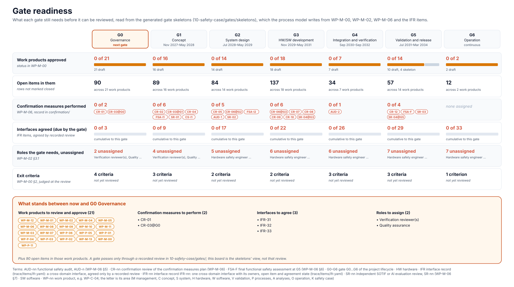

<!-- GENERATED by assurance/01-management/figures/fig_m00_vcycle.py from the gate skeletons. Do not edit. -->

# Gate readiness

[← Back to the V-cycle](../../README.md#the-v-cycle) · gates: [G0](../../10-safety-case/gates/skeletons/G0-skeleton.md) · [G1](../../10-safety-case/gates/skeletons/G1-skeleton.md) · [G2](../../10-safety-case/gates/skeletons/G2-skeleton.md) · [G3](../../10-safety-case/gates/skeletons/G3-skeleton.md) · [G4](../../10-safety-case/gates/skeletons/G4-skeleton.md) · [G5](../../10-safety-case/gates/skeletons/G5-skeleton.md) · [G6](../../10-safety-case/gates/skeletons/G6-skeleton.md) · [gate records](../../10-safety-case/gates/README.md)

  

*Each gate's needs, read from its generated review skeleton. The skeletons are written by the [process model](../../process/README.md) and checked in CI; a gate passes only through a recorded review in [10-safety-case/gates/](../../10-safety-case/gates/README.md). Drawn by [`fig_m00_vcycle.py`](../figures/fig_m00_vcycle.py); CI fails if it is stale.*

| Gate | Work products approved | Open items | Measures performed | Interfaces agreed | Roles unassigned | Exit criteria |
|---|---|---|---|---|---|---|
| [G0 Governance](../../10-safety-case/gates/skeletons/G0-skeleton.md) | 0 of 21 | 91 | 0 of 2 | 0 of 3 | 2 | 4 |
| [G1 Concept](../../10-safety-case/gates/skeletons/G1-skeleton.md) | 0 of 16 | 89 | 0 of 6 | 0 of 9 | 4 | 3 |
| [G2 System design](../../10-safety-case/gates/skeletons/G2-skeleton.md) | 0 of 14 | 84 | 0 of 5 | 0 of 17 | 5 | 2 |
| [G3 HW/SW development](../../10-safety-case/gates/skeletons/G3-skeleton.md) | 0 of 18 | 139 | 0 of 6 | 0 of 22 | 6 | 2 |
| [G4 Integration and verification](../../10-safety-case/gates/skeletons/G4-skeleton.md) | 0 of 7 | 34 | 0 of 1 | 0 of 26 | 6 | 3 |
| [G5 Validation and release](../../10-safety-case/gates/skeletons/G5-skeleton.md) | 0 of 14 | 57 | 0 of 4 | 0 of 29 | 7 | 3 |
| [G6 Operation](../../10-safety-case/gates/skeletons/G6-skeleton.md) | 0 of 2 | 12 | 0 of 0 | 0 of 33 | 7 | 1 |

## What stands between now and G0 Governance

From the [G0 skeleton](../../10-safety-case/gates/skeletons/G0-skeleton.md).

Work products to review and approve:

- [WP-M-12 Impact analysis of the openpilot-derived baseline (modification of existing item)](../WP-M-12-impact-analysis.md): Draft, 5 open items
- [WP-M-01 Assurance strategy and lifecycle tailoring](../WP-M-01-assurance-strategy.md): Draft, 0 open items
- [WP-M-02 Functional safety plan](../WP-M-02-safety-plan.md): Draft, 6 open items
- [WP-M-04 Organization-specific rules, safety culture, competence management](../WP-M-04-organization-competence-safety-culture.md): Draft, 5 open items
- [WP-M-05 Quality management and quality assurance plan](../WP-M-05-quality-assurance-plan.md): Draft, 2 open items
- [WP-M-06 Confirmation measures plan (reviews, audit, assessment, independence)](../WP-M-06-confirmation-measures-plan.md): Draft, 5 open items
- [WP-M-08 SOTIF plan](../WP-M-08-sotif-plan.md): Draft, 5 open items
- [WP-M-09 Cybersecurity plan](../WP-M-09-cybersecurity-plan.md): Draft, 8 open items
- [WP-M-10 AI safety management plan](../WP-M-10-ai-safety-plan.md): Draft, 6 open items
- [WP-M-11 Upstream (comma.ai) and supplier management, development interface agreements](../WP-M-11-upstream-and-supplier-management.md): Draft, 4 open items
- [WP-M-03 Project plan (scope, WBS, schedule, resources)](../WP-M-03-project-plan.md): Draft, 5 open items
- [WP-M-07 Project risk management plan and register](../WP-M-07-risk-management.md): Draft, 3 open items
- [WP-P-06 Requirements management and traceability procedure](../../07-supporting/WP-P-06-requirements-management-traceability.md): Draft, 5 open items
- [WP-P-05 Verification and review procedure](../../07-supporting/WP-P-05-verification-review-procedure.md): Draft, 4 open items
- [WP-P-01 Configuration management plan (incl. safety-relevant file list, baselines, submodules)](../../07-supporting/WP-P-01-configuration-management-plan.md): Draft, 6 open items
- [WP-P-04 Documentation management](../../07-supporting/WP-P-04-documentation-management.md): Draft, 6 open items
- [WP-P-03 Problem resolution management](../../07-supporting/WP-P-03-problem-resolution.md): Draft, 5 open items
- [WP-P-02 Change management plan](../../07-supporting/WP-P-02-change-management.md): Draft, 5 open items
- [WP-M-13 ASPICE capability baseline (self-assessment)](../WP-M-13-aspice-capability-baseline.md): Draft, 4 open items
- [WP-M-00 Work product register](../WP-M-00-work-product-register.md): Draft, 0 open items
- [WP-P-11 Integrated process model and generated process maps (all phases G0–G6 modelled)](../../process/README.md): Draft, 2 open items

Confirmation measures to perform:

- CR-01 Confirmation review of the impact analysis
- CR-03@G0 Confirmation review of the safety plan and tailoring

Interfaces to agree:

- IFR-31: The cybersecurity manager carries the interface to safety
- IFR-32: The AI safety lead supplies model insufficiencies to the SOTIF lead
- IFR-33: Supplier information on the ML models bounds the AI claims

Roles to assign:

- Verification reviewer(s)
- Quality assurance

Exit criteria, judged at the review:

- Plans approved
- Roles assigned
- CM and change control running
- Every confirmation measure assigned to this gate performed, or deferral documented (WP-M-02 §10)
