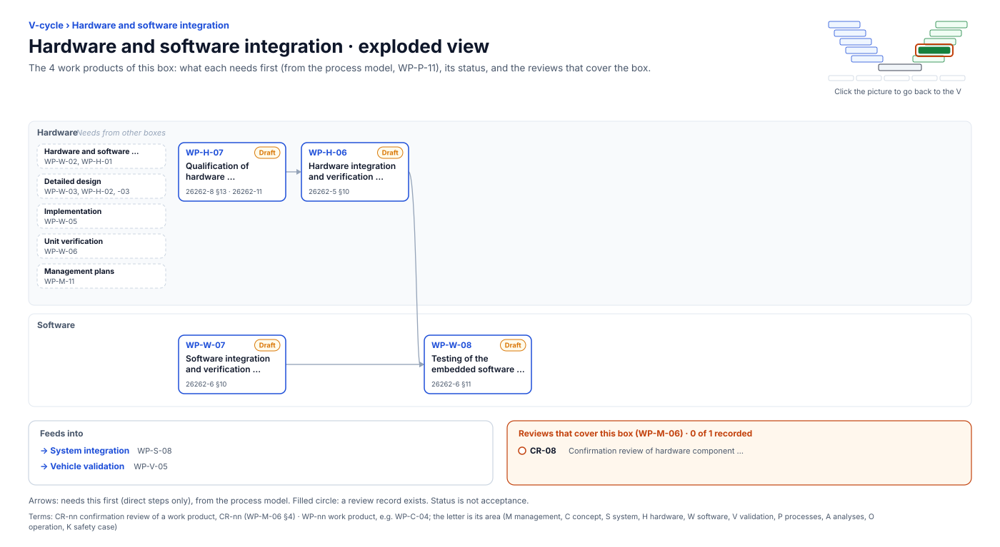

<!-- GENERATED by assurance/01-management/figures/fig_m00_vcycle.py from WP-M-00 and the process model. Do not edit. -->

# V-cycle: Hardware and software integration

[← Back to the V-cycle](../../README.md#the-v-cycle) · folder: [`05-software/`](../../05-software/README.md)

  

*Click the picture to go back to the V. Drawn from the [register](../WP-M-00-work-product-register.md) and the [process model](../../process/README.md) by [`fig_m00_vcycle.py`](../figures/fig_m00_vcycle.py); CI fails if it is stale.*

## Work products

| Work product | Status | Gate | Discipline | Needs first |
|---|---|---|---|---|
| [WP-H-07 Qualification of hardware components (comma device, STM32H7, harness)](../../04-hardware/WP-H-07-hardware-component-qualification.md) | Draft | G3 | Hardware | — |
| [WP-W-07 Software integration and verification specification and report](../../05-software/WP-W-07-software-integration-verification.md) | Draft | G4 | Software | — |
| [WP-H-06 Hardware integration and verification specification and report](../../04-hardware/WP-H-06-hardware-integration-verification.md) | Draft | G4 | Hardware | WP-H-07 |
| [WP-W-08 Testing of the embedded software (SW qualification, HIL)](../../05-software/WP-W-08-embedded-software-testing.md) | Draft | G4 | Software | WP-H-06, WP-W-07 |

## Needs from other boxes

- [Hardware and software requirements](hardware-and-software-requirements.md): WP-W-02, WP-H-01
- [Detailed design](detailed-design.md): WP-W-03, WP-H-02, WP-H-03
- [Implementation](implementation.md): WP-W-05
- [Unit verification](unit-verification.md): WP-W-06
- [Management plans](management-plans.md): WP-M-11

## Feeds into

- [System integration](system-integration.md): WP-S-08
- [Vehicle validation](vehicle-validation.md): WP-V-05

## Reviews that cover this box

- No record yet: CR-08, Confirmation review of hardware component qualification
