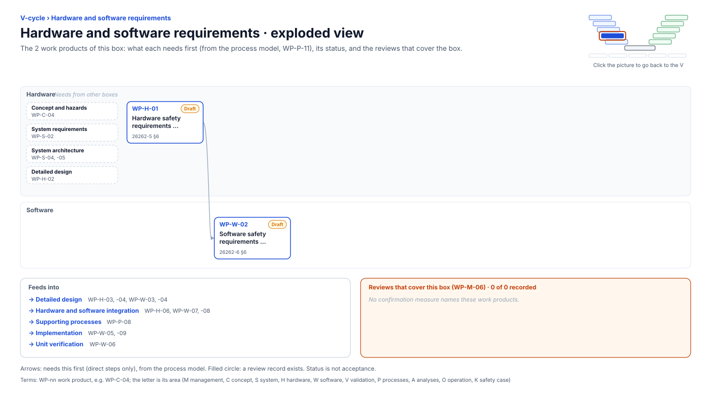

<!-- GENERATED by assurance/01-management/figures/fig_m00_vcycle.py from WP-M-00 and the process model. Do not edit. -->

# V-cycle: Hardware and software requirements

[← Back to the V-cycle](../../README.md#the-v-cycle) · folder: [`04-hardware/`](../../04-hardware/README.md)

  

*Click the picture to go back to the V. Drawn from the [register](../WP-M-00-work-product-register.md) and the [process model](../../process/README.md) by [`fig_m00_vcycle.py`](../figures/fig_m00_vcycle.py); CI fails if it is stale.*

## Work products

| Work product | Status | Gate | Discipline | Needs first |
|---|---|---|---|---|
| [WP-H-01 Hardware safety requirements specification](../../04-hardware/WP-H-01-hardware-safety-requirements.md) | Draft | G3 | Hardware | — |
| [WP-W-02 Software safety requirements specification](../../05-software/WP-W-02-software-safety-requirements.md) | Draft | G3 | Software | WP-H-01 |

## Needs from other boxes

- [Concept and hazards](concept-and-hazards.md): WP-C-04
- [System requirements](system-requirements.md): WP-S-02
- [System architecture](system-architecture.md): WP-S-04, WP-S-05
- [Detailed design](detailed-design.md): WP-H-02

## Feeds into

- [Detailed design](detailed-design.md): WP-H-03, WP-H-04, WP-W-03, WP-W-04
- [Hardware and software integration](hardware-and-software-integration.md): WP-H-06, WP-W-07, WP-W-08
- [Supporting processes](supporting-processes.md): WP-P-08
- [Implementation](implementation.md): WP-W-05, WP-W-09
- [Unit verification](unit-verification.md): WP-W-06

## Reviews that cover this box

None.
