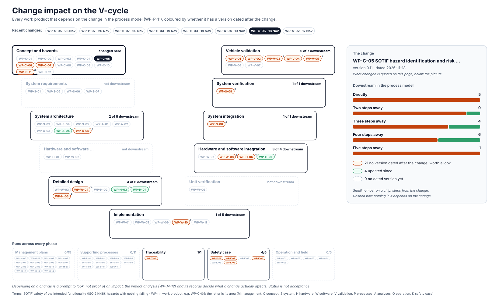

<!-- GENERATED by assurance/01-management/figures/fig_m00_vcycle.py from WP-M-00, the work products' Version rows and the process model. Do not edit. -->

# Change impact: WP-C-05 SOTIF hazard identification and risk evaluation, acceptance criteria

[← Back to the V-cycle](../../README.md#the-v-cycle) · Recent changes: [WP-P-07 · 20 Nov](impact-wp-p-07.md) · [WP-H-07 · 20 Nov](impact-wp-h-07.md) · [WP-H-04 · 19 Nov](impact-wp-h-04.md) · [WP-H-03 · 19 Nov](impact-wp-h-03.md) · [WP-A-04 · 19 Nov](impact-wp-a-04.md) · **WP-C-05 · 18 Nov** · [WP-S-05 · 17 Nov](impact-wp-s-05.md) · [WP-S-02 · 17 Nov](impact-wp-s-02.md) · [All changes](impact.md)

  

*The change: WP-C-05 version 0.11, dated 2026-11-18*

Depending on a change is a prompt to look, not proof of an impact: the [impact analysis (WP-M-12)](../WP-M-12-impact-analysis.md) and its records decide what a change actually affects.

## Downstream work products

| Work product | Steps | Its last dated version | Since the change |
|---|---|---|---|
| [WP-C-06 Functional insufficiencies and triggering conditions analysis](../../02-concept/WP-C-06-sotif-insufficiencies-triggering-conditions.md) | 1 | 2026-10-30 | worth a look |
| [WP-K-01 Safety case (GSN, integrated FuSa, SOTIF and AI argument)](../../10-safety-case/WP-K-01-safety-case.md) | 1 | 2026-10-30 | worth a look |
| [WP-K-02 SOTIF achievement evaluation and release recommendation](../../10-safety-case/WP-K-02-sotif-release-argument.md) | 1 | 2026-10-30 | worth a look |
| [WP-T-01 Requirements and traceability data (machine-readable), consistency evidence](../../trace/README.md) | 1 | 2026-10-26 | worth a look |
| [WP-V-02 SOTIF verification and validation strategy, validation targets](../../06-validation/WP-V-02-sotif-vv-strategy.md) | 1 | 2026-11-02 | worth a look |
| [WP-A-04 System-level safety analyses (FTA, FMEA)](../../08-analyses/WP-A-04-system-fta-fmea.md) | 2 | 2026-11-19 | updated |
| [WP-A-05 System-theoretic process analysis (STPA)](../../08-analyses/WP-A-05-stpa.md) | 2 | 2026-10-21 | worth a look |
| [WP-C-07 Functional modifications addressing SOTIF risk](../../02-concept/WP-C-07-sotif-functional-modifications.md) | 2 | 2026-10-30 | worth a look |
| [WP-C-11 AI system definition and AI safety requirements](../../02-concept/WP-C-11-ai-system-definition-and-safety-requirements.md) | 2 | 2026-11-02 | worth a look |
| [WP-K-04 Functional safety assessment report (performed independently, I3)](../../10-safety-case/WP-K-04-functional-safety-assessment.md) | 2 | 2026-10-12 | worth a look |
| [WP-K-06 Release for production / release record](../../10-safety-case/WP-K-06-release-record.md) | 2 | 2026-11-11 | worth a look |
| [WP-V-03 Evaluation of known hazardous scenarios](../../06-validation/WP-V-03-sotif-known-scenarios.md) | 2 | 2026-11-02 | worth a look |
| [WP-V-04 Evaluation of unknown hazardous scenarios](../../06-validation/WP-V-04-sotif-unknown-scenarios.md) | 2 | 2026-10-25 | worth a look |
| [WP-W-10 ML engineering: model requirements, data management, training, testing, deployment](../../05-software/WP-W-10-ml-engineering.md) | 2 | 2026-11-11 | worth a look |
| [WP-H-03 Hardware safety analysis (FMEA/FMEDA)](../../04-hardware/WP-H-03-hardware-safety-analysis-fmeda.md) | 3 | 2026-11-19 | updated |
| [WP-S-09 System verification (qualification) specification and report](../../03-system/WP-S-09-system-verification.md) | 3 | 2026-10-26 | worth a look |
| [WP-V-05 Fault injection test specification and report](../../06-validation/WP-V-05-fault-injection.md) | 3 | 2026-11-01 | worth a look |
| [WP-W-04 Software safety analysis and software-level DFA](../../05-software/WP-W-04-software-safety-analysis.md) | 3 | 2026-11-02 | worth a look |
| [WP-H-04 Hardware architectural metrics (SPFM, LFM)](../../04-hardware/WP-H-04-hardware-metrics.md) | 4 | 2026-11-19 | updated |
| [WP-H-05 Evaluation of safety goal violations due to random HW failures (PMHF)](../../04-hardware/WP-H-05-random-hardware-failures-pmhf.md) | 4 | 2026-11-01 | worth a look |
| [WP-H-06 Hardware integration and verification specification and report](../../04-hardware/WP-H-06-hardware-integration-verification.md) | 4 | 2026-10-27 | worth a look |
| [WP-H-07 Qualification of hardware components (comma device, STM32H7, harness)](../../04-hardware/WP-H-07-hardware-component-qualification.md) | 4 | 2026-11-20 | updated |
| [WP-S-08 System integration and test strategy, specification and report](../../03-system/WP-S-08-system-integration-test.md) | 4 | 2026-11-02 | worth a look |
| [WP-V-01 Safety validation plan, specification and report](../../06-validation/WP-V-01-safety-validation.md) | 4 | 2026-11-02 | worth a look |
| [WP-W-08 Testing of the embedded software (SW qualification, HIL)](../../05-software/WP-W-08-embedded-software-testing.md) | 5 | 2026-11-11 | worth a look |
