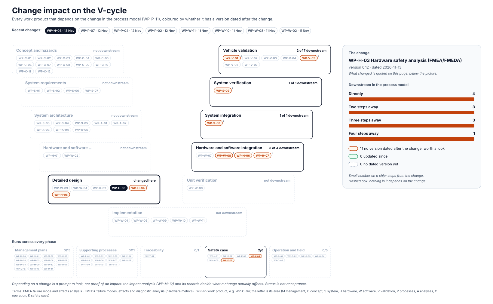

<!-- GENERATED by assurance/01-management/figures/fig_m00_vcycle.py from WP-M-00, the work products' Version rows and the process model. Do not edit. -->

# Change impact: WP-H-03 Hardware safety analysis (FMEA/FMEDA)

[← Back to the V-cycle](../../README.md#the-v-cycle) · Recent changes: **WP-H-03 · 13 Nov** · [WP-P-07 · 12 Nov](impact-wp-p-07.md) · [WP-P-04 · 12 Nov](impact-wp-p-04.md) · [WP-P-02 · 12 Nov](impact-wp-p-02.md) · [WP-W-11 · 11 Nov](impact-wp-w-11.md) · [WP-W-10 · 11 Nov](impact-wp-w-10.md) · [WP-W-08 · 11 Nov](impact-wp-w-08.md) · [WP-W-02 · 11 Nov](impact-wp-w-02.md) · [All changes](impact.md)

  

*The change: WP-H-03 version 0.12, dated 2026-11-13: §6.5: component-level FMEDA of the harness box v3, part by part, with its roll-up check against the goal FMEDAs and the four FMEDA outputs; findings: the two goal FMEDAs split the DG419LE differently (OI-11), and Q6, R1, R4, R5 are in no goal FMEDA (OI-12); AI-drafted*

Depending on a change is a prompt to look, not proof of an impact: the [impact analysis (WP-M-12)](../WP-M-12-impact-analysis.md) and its records decide what a change actually affects.

## Downstream work products

| Work product | Steps | Its last dated version | Since the change |
|---|---|---|---|
| [WP-H-04 Hardware architectural metrics (SPFM, LFM)](../../04-hardware/WP-H-04-hardware-metrics.md) | 1 | 2026-11-02 | worth a look |
| [WP-H-05 Evaluation of safety goal violations due to random HW failures (PMHF)](../../04-hardware/WP-H-05-random-hardware-failures-pmhf.md) | 1 | 2026-11-01 | worth a look |
| [WP-H-06 Hardware integration and verification specification and report](../../04-hardware/WP-H-06-hardware-integration-verification.md) | 1 | 2026-10-27 | worth a look |
| [WP-H-07 Qualification of hardware components (comma device, STM32H7, harness)](../../04-hardware/WP-H-07-hardware-component-qualification.md) | 1 | 2026-11-01 | worth a look |
| [WP-S-08 System integration and test strategy, specification and report](../../03-system/WP-S-08-system-integration-test.md) | 2 | 2026-11-02 | worth a look |
| [WP-V-05 Fault injection test specification and report](../../06-validation/WP-V-05-fault-injection.md) | 2 | 2026-11-01 | worth a look |
| [WP-W-08 Testing of the embedded software (SW qualification, HIL)](../../05-software/WP-W-08-embedded-software-testing.md) | 2 | 2026-11-11 | worth a look |
| [WP-K-04 Functional safety assessment report (performed independently, I3)](../../10-safety-case/WP-K-04-functional-safety-assessment.md) | 3 | 2026-10-12 | worth a look |
| [WP-S-09 System verification (qualification) specification and report](../../03-system/WP-S-09-system-verification.md) | 3 | 2026-10-26 | worth a look |
| [WP-V-01 Safety validation plan, specification and report](../../06-validation/WP-V-01-safety-validation.md) | 3 | 2026-11-02 | worth a look |
| [WP-K-06 Release for production / release record](../../10-safety-case/WP-K-06-release-record.md) | 4 | 2026-11-11 | worth a look |
