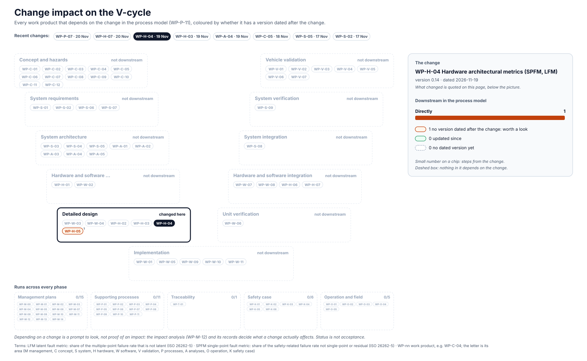

<!-- GENERATED by assurance/01-management/figures/fig_m00_vcycle.py from WP-M-00, the work products' Version rows and the process model. Do not edit. -->

# Change impact: WP-H-04 Hardware architectural metrics (SPFM, LFM)

[← Back to the V-cycle](../../README.md#the-v-cycle) · Recent changes: [WP-H-07 · 20 Nov](impact-wp-h-07.md) · **WP-H-04 · 19 Nov** · [WP-H-03 · 19 Nov](impact-wp-h-03.md) · [WP-A-04 · 19 Nov](impact-wp-a-04.md) · [WP-P-07 · 18 Nov](impact-wp-p-07.md) · [WP-C-05 · 18 Nov](impact-wp-c-05.md) · [WP-S-05 · 17 Nov](impact-wp-s-05.md) · [WP-S-02 · 17 Nov](impact-wp-s-02.md) · [All changes](impact.md)

  

*The change: WP-H-04 version 0.14, dated 2026-11-19: §5.2: SG-01, SG-02/03/06 and SG-05 estimates from FMEDA SG-001 rev 0.9, which applies the harness box component FMEDA findings of WP-H-03 §6.5: SPFM 96.96 %, ASIL C missed by 0.04 points; SG-05 90.54 %; planned measures 99.2 % / 94.9 %; OI-6 updated; AI-drafted*

Depending on a change is a prompt to look, not proof of an impact: the [impact analysis (WP-M-12)](../WP-M-12-impact-analysis.md) and its records decide what a change actually affects.

## Downstream work products

| Work product | Steps | Its last dated version | Since the change |
|---|---|---|---|
| [WP-H-05 Evaluation of safety goal violations due to random HW failures (PMHF)](../../04-hardware/WP-H-05-random-hardware-failures-pmhf.md) | 1 | 2026-11-01 | worth a look |
