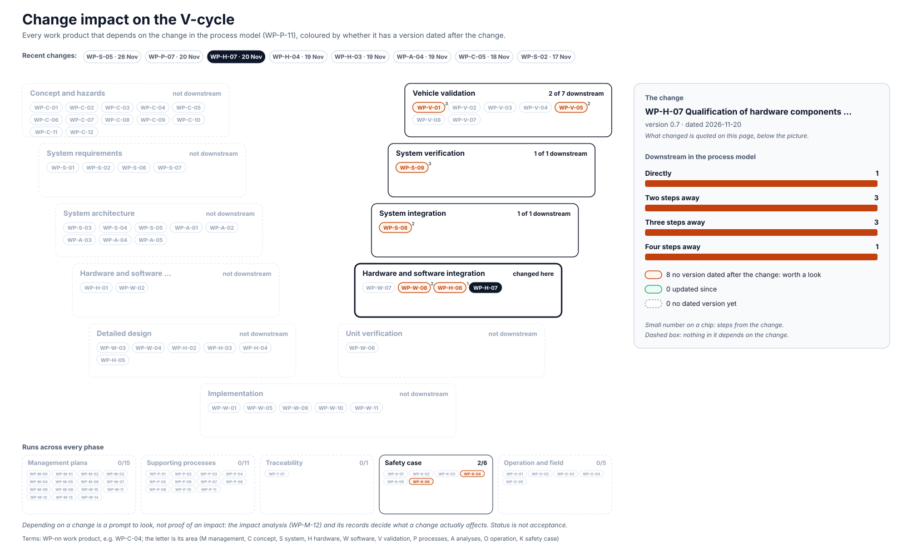

<!-- GENERATED by assurance/01-management/figures/fig_m00_vcycle.py from WP-M-00, the work products' Version rows and the process model. Do not edit. -->

# Change impact: WP-H-07 Qualification of hardware components (comma device, STM32H7, harness)

[← Back to the V-cycle](../../README.md#the-v-cycle) · Recent changes: [WP-P-07 · 20 Nov](impact-wp-p-07.md) · **WP-H-07 · 19 Nov** · [WP-H-04 · 19 Nov](impact-wp-h-04.md) · [WP-H-03 · 19 Nov](impact-wp-h-03.md) · [WP-A-04 · 19 Nov](impact-wp-a-04.md) · [WP-C-05 · 18 Nov](impact-wp-c-05.md) · [WP-S-05 · 17 Nov](impact-wp-s-05.md) · [WP-S-02 · 17 Nov](impact-wp-s-02.md) · [All changes](impact.md)

  

*The change: WP-H-07 version 0.6, dated 2026-11-19: §7: the Part 11 records now live in the 04-hardware/semiconductors folder, with a method demonstration of the MCU split and of measured diagnostic coverage on an open core; demonstration only, no change to the plan or to any claim; AI-drafted*

Depending on a change is a prompt to look, not proof of an impact: the [impact analysis (WP-M-12)](../WP-M-12-impact-analysis.md) and its records decide what a change actually affects.

## Downstream work products

| Work product | Steps | Its last dated version | Since the change |
|---|---|---|---|
| [WP-H-06 Hardware integration and verification specification and report](../../04-hardware/WP-H-06-hardware-integration-verification.md) | 1 | 2026-10-27 | worth a look |
| [WP-S-08 System integration and test strategy, specification and report](../../03-system/WP-S-08-system-integration-test.md) | 2 | 2026-11-02 | worth a look |
| [WP-V-05 Fault injection test specification and report](../../06-validation/WP-V-05-fault-injection.md) | 2 | 2026-11-01 | worth a look |
| [WP-W-08 Testing of the embedded software (SW qualification, HIL)](../../05-software/WP-W-08-embedded-software-testing.md) | 2 | 2026-11-11 | worth a look |
| [WP-K-04 Functional safety assessment report (performed independently, I3)](../../10-safety-case/WP-K-04-functional-safety-assessment.md) | 3 | 2026-10-12 | worth a look |
| [WP-S-09 System verification (qualification) specification and report](../../03-system/WP-S-09-system-verification.md) | 3 | 2026-10-26 | worth a look |
| [WP-V-01 Safety validation plan, specification and report](../../06-validation/WP-V-01-safety-validation.md) | 3 | 2026-11-02 | worth a look |
| [WP-K-06 Release for production / release record](../../10-safety-case/WP-K-06-release-record.md) | 4 | 2026-11-11 | worth a look |
