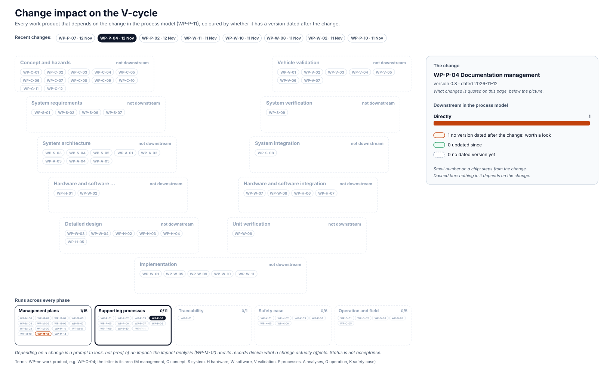

<!-- GENERATED by assurance/01-management/figures/fig_m00_vcycle.py from WP-M-00, the work products' Version rows and the process model. Do not edit. -->

# Change impact: WP-P-04 Documentation management

[← Back to the V-cycle](../../README.md#the-v-cycle) · Recent changes: [WP-P-07 · 12 Nov](impact-wp-p-07.md) · **WP-P-04 · 12 Nov** · [WP-P-02 · 12 Nov](impact-wp-p-02.md) · [WP-W-11 · 11 Nov](impact-wp-w-11.md) · [WP-W-10 · 11 Nov](impact-wp-w-10.md) · [WP-W-08 · 11 Nov](impact-wp-w-08.md) · [WP-W-02 · 11 Nov](impact-wp-w-02.md) · [WP-P-10 · 11 Nov](impact-wp-p-10.md) · [All changes](impact.md)

  

*The change: WP-P-04 version 0.8, dated 2026-11-12: OI-7: the wiki pages carry the ledger version next to the first link to each work product, a generated Work product versions page and the ledger source in the footer; an X above 0 from before the ledger is not presented as a gate approval*

Depending on a change is a prompt to look, not proof of an impact: the [impact analysis (WP-M-12)](../WP-M-12-impact-analysis.md) and its records decide what a change actually affects.

## Downstream work products

| Work product | Steps | Its last dated version | Since the change |
|---|---|---|---|
| [WP-M-13 ASPICE capability baseline (self-assessment)](../WP-M-13-aspice-capability-baseline.md) | 1 | 2026-10-23 | worth a look |
