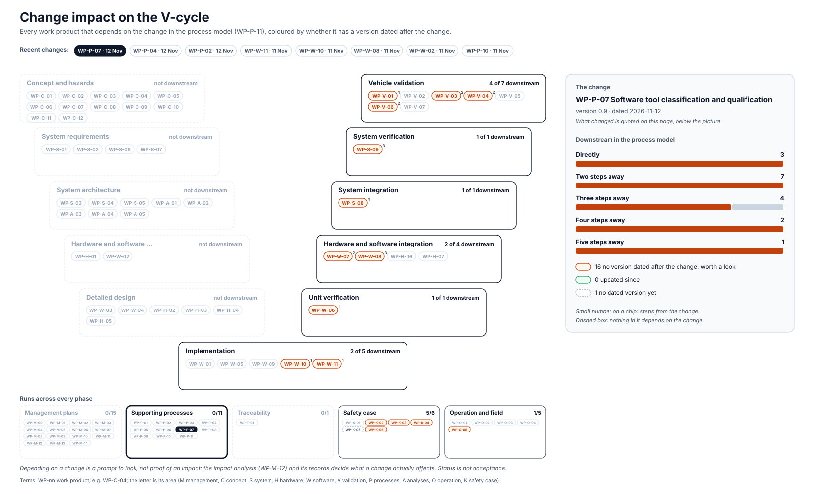

<!-- GENERATED by assurance/01-management/figures/fig_m00_vcycle.py from WP-M-00, the work products' Version rows and the process model. Do not edit. -->

# Change impact: WP-P-07 Software tool classification and qualification

[← Back to the V-cycle](../../README.md#the-v-cycle) · Recent changes: **WP-P-07 · 12 Nov** · [WP-P-04 · 12 Nov](impact-wp-p-04.md) · [WP-P-02 · 12 Nov](impact-wp-p-02.md) · [WP-W-11 · 11 Nov](impact-wp-w-11.md) · [WP-W-10 · 11 Nov](impact-wp-w-10.md) · [WP-W-08 · 11 Nov](impact-wp-w-08.md) · [WP-W-02 · 11 Nov](impact-wp-w-02.md) · [WP-P-10 · 11 Nov](impact-wp-p-10.md) · [All changes](impact.md)

  

*The change: WP-P-07 version 0.9, dated 2026-11-12*

Depending on a change is a prompt to look, not proof of an impact: the [impact analysis (WP-M-12)](../WP-M-12-impact-analysis.md) and its records decide what a change actually affects.

## Downstream work products

| Work product | Steps | Its last dated version | Since the change |
|---|---|---|---|
| [WP-W-06 Software unit verification specification and report (static analysis, MISRA, coverage, mutation)](../../05-software/WP-W-06-software-unit-verification.md) | 1 | 2026-11-02 | worth a look |
| [WP-W-10 ML engineering: model requirements, data management, training, testing, deployment](../../05-software/WP-W-10-ml-engineering.md) | 1 | 2026-11-11 | worth a look |
| [WP-W-11 Cybersecurity implementation and verification](../../05-software/WP-W-11-cybersecurity-implementation-verification.md) | 1 | 2026-11-11 | worth a look |
| [WP-K-02 SOTIF achievement evaluation and release recommendation](../../10-safety-case/WP-K-02-sotif-release-argument.md) | 2 | 2026-10-30 | worth a look |
| [WP-K-03 Cybersecurity case](../../10-safety-case/WP-K-03-cybersecurity-case.md) | 2 | 2026-10-23 | worth a look |
| [WP-O-05 Cybersecurity incident response, vulnerability management and software updates](../../09-production-operation/WP-O-05-cybersecurity-incident-response-updates.md) | 2 | 2026-11-11 | worth a look |
| [WP-V-03 Evaluation of known hazardous scenarios](../../06-validation/WP-V-03-sotif-known-scenarios.md) | 2 | 2026-11-02 | worth a look |
| [WP-V-04 Evaluation of unknown hazardous scenarios](../../06-validation/WP-V-04-sotif-unknown-scenarios.md) | 2 | 2026-10-25 | worth a look |
| [WP-V-06 Cybersecurity validation and penetration testing](../../06-validation/WP-V-06-cybersecurity-validation.md) | 2 | 2026-10-23 | worth a look |
| [WP-W-07 Software integration and verification specification and report](../../05-software/WP-W-07-software-integration-verification.md) | 2 | 2026-10-13 | worth a look |
| [WP-K-05 Cybersecurity assessment report (performed independently)](../../10-safety-case/WP-K-05-cybersecurity-assessment.md) | 3 | — | undated |
| [WP-K-06 Release for production / release record](../../10-safety-case/WP-K-06-release-record.md) | 3 | 2026-11-11 | worth a look |
| [WP-S-09 System verification (qualification) specification and report](../../03-system/WP-S-09-system-verification.md) | 3 | 2026-10-26 | worth a look |
| [WP-W-08 Testing of the embedded software (SW qualification, HIL)](../../05-software/WP-W-08-embedded-software-testing.md) | 3 | 2026-11-11 | worth a look |
| [WP-S-08 System integration and test strategy, specification and report](../../03-system/WP-S-08-system-integration-test.md) | 4 | 2026-11-02 | worth a look |
| [WP-V-01 Safety validation plan, specification and report](../../06-validation/WP-V-01-safety-validation.md) | 4 | 2026-11-02 | worth a look |
| [WP-K-04 Functional safety assessment report (performed independently, I3)](../../10-safety-case/WP-K-04-functional-safety-assessment.md) | 5 | 2026-10-12 | worth a look |
