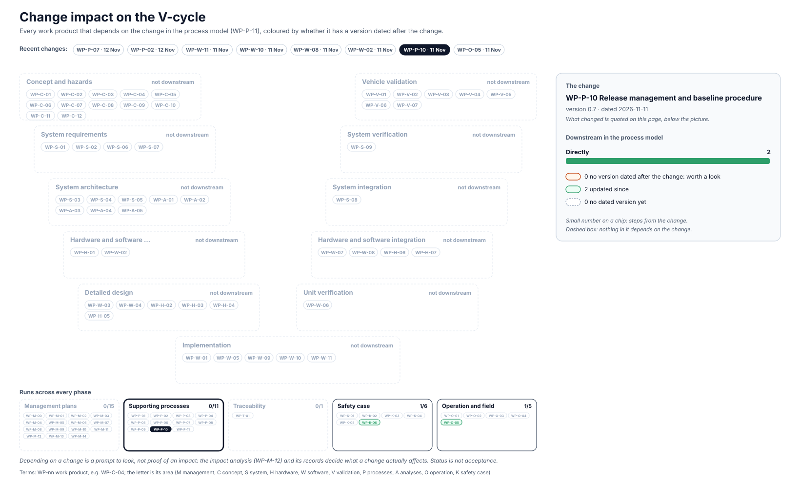

<!-- GENERATED by assurance/01-management/figures/fig_m00_vcycle.py from WP-M-00, the work products' Version rows and the process model. Do not edit. -->

# Change impact: WP-P-10 Release management and baseline procedure

[← Back to the V-cycle](../../README.md#the-v-cycle) · Recent changes: [WP-P-07 · 12 Nov](impact-wp-p-07.md) · [WP-P-02 · 12 Nov](impact-wp-p-02.md) · [WP-W-11 · 11 Nov](impact-wp-w-11.md) · [WP-W-10 · 11 Nov](impact-wp-w-10.md) · [WP-W-08 · 11 Nov](impact-wp-w-08.md) · [WP-W-02 · 11 Nov](impact-wp-w-02.md) · **WP-P-10 · 11 Nov** · [WP-O-05 · 11 Nov](impact-wp-o-05.md) · [All changes](impact.md)

  

*The change: WP-P-10 version 0.7, dated 2026-11-11: §4 step 4, §5, OI-2: a copy of every pinned AGNOS image and toolchain wheel goes, by hash, into the signed release assets (DQ-171 A); release-relevant verification results go into the signed release assets and everyday runs stay as CI artifacts (DQ-173 A); §7: release-record signatures are a signed git tag plus a signed commit of the filled record by each signer (DQ-180 A); the lead's answers of 2026-11-11; the steps are required, not yet done*

Depending on a change is a prompt to look, not proof of an impact: the [impact analysis (WP-M-12)](../WP-M-12-impact-analysis.md) and its records decide what a change actually affects.

## Downstream work products

| Work product | Steps | Its last dated version | Since the change |
|---|---|---|---|
| [WP-K-06 Release for production / release record](../../10-safety-case/WP-K-06-release-record.md) | 1 | 2026-11-11 | updated |
| [WP-O-05 Cybersecurity incident response, vulnerability management and software updates](../../09-production-operation/WP-O-05-cybersecurity-incident-response-updates.md) | 1 | 2026-11-11 | updated |
