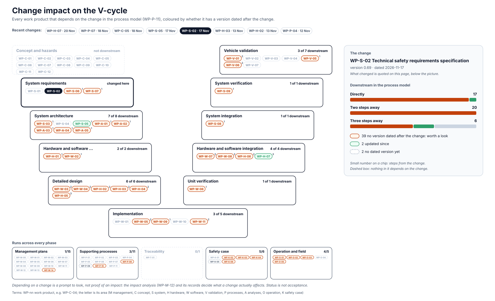

<!-- GENERATED by assurance/01-management/figures/fig_m00_vcycle.py from WP-M-00, the work products' Version rows and the process model. Do not edit. -->

# Change impact: WP-S-02 Technical safety requirements specification

[← Back to the V-cycle](../../README.md#the-v-cycle) · Recent changes: [WP-H-07 · 19 Nov](impact-wp-h-07.md) · [WP-P-07 · 18 Nov](impact-wp-p-07.md) · [WP-C-05 · 18 Nov](impact-wp-c-05.md) · [WP-S-05 · 17 Nov](impact-wp-s-05.md) · **WP-S-02 · 17 Nov** · [WP-H-03 · 13 Nov](impact-wp-h-03.md) · [WP-H-02 · 13 Nov](impact-wp-h-02.md) · [WP-P-04 · 12 Nov](impact-wp-p-04.md) · [All changes](impact.md)

  

*The change: WP-S-02 version 0.69, dated 2026-11-17: TSR-410: CRC-32C coverage named field by field, following the WP-S-05 §4.1 layout; no change in what is protected*

Depending on a change is a prompt to look, not proof of an impact: the [impact analysis (WP-M-12)](../WP-M-12-impact-analysis.md) and its records decide what a change actually affects.

## Downstream work products

| Work product | Steps | Its last dated version | Since the change |
|---|---|---|---|
| [WP-A-01 ASIL decomposition rationale](../../08-analyses/WP-A-01-asil-decomposition.md) | 1 | 2026-10-19 | worth a look |
| [WP-A-02 Coexistence of elements and freedom from interference](../../08-analyses/WP-A-02-coexistence-freedom-from-interference.md) | 1 | 2026-10-27 | worth a look |
| [WP-A-03 Dependent failure analysis](../../08-analyses/WP-A-03-dependent-failure-analysis.md) | 1 | 2026-10-27 | worth a look |
| [WP-A-04 System-level safety analyses (FTA, FMEA)](../../08-analyses/WP-A-04-system-fta-fmea.md) | 1 | 2026-10-29 | worth a look |
| [WP-A-05 System-theoretic process analysis (STPA)](../../08-analyses/WP-A-05-stpa.md) | 1 | 2026-10-21 | worth a look |
| [WP-H-01 Hardware safety requirements specification](../../04-hardware/WP-H-01-hardware-safety-requirements.md) | 1 | 2026-11-02 | worth a look |
| [WP-M-14 ISO 26262-6 software lifecycle implementation specification (future work; activation deferred, D-14)](../WP-M-14-iso26262-6-implementation-specification.md) | 1 | 2026-11-11 | worth a look |
| [WP-S-03 Technical safety concept and system architectural design](../../03-system/WP-S-03-technical-safety-concept-architecture.md) | 1 | 2026-11-01 | worth a look |
| [WP-S-05 Hardware-software interface specification](../../03-system/WP-S-05-hsi-specification.md) | 1 | 2026-11-17 | updated |
| [WP-S-06 Requirements for production, operation, service and decommissioning](../../03-system/WP-S-06-requirements-production-operation.md) | 1 | 2026-11-02 | worth a look |
| [WP-S-07 Cybersecurity requirements and architectural design](../../03-system/WP-S-07-cybersecurity-requirements-architecture.md) | 1 | 2026-11-03 | worth a look |
| [WP-S-08 System integration and test strategy, specification and report](../../03-system/WP-S-08-system-integration-test.md) | 1 | 2026-11-02 | worth a look |
| [WP-S-09 System verification (qualification) specification and report](../../03-system/WP-S-09-system-verification.md) | 1 | 2026-10-26 | worth a look |
| [WP-V-05 Fault injection test specification and report](../../06-validation/WP-V-05-fault-injection.md) | 1 | 2026-11-01 | worth a look |
| [WP-W-02 Software safety requirements specification](../../05-software/WP-W-02-software-safety-requirements.md) | 1 | 2026-11-11 | worth a look |
| [WP-W-06 Software unit verification specification and report (static analysis, MISRA, coverage, mutation)](../../05-software/WP-W-06-software-unit-verification.md) | 1 | 2026-11-02 | worth a look |
| [WP-W-09 Safety-related configuration and calibration data (car params, fingerprints, limits, model weights)](../../05-software/WP-W-09-configuration-calibration-data.md) | 1 | 2026-10-27 | worth a look |
| [WP-H-02 Hardware architectural and detailed design (device, panda MCU, harness, relay)](../../04-hardware/WP-H-02-hardware-design.md) | 2 | 2026-11-13 | worth a look |
| [WP-H-03 Hardware safety analysis (FMEA/FMEDA)](../../04-hardware/WP-H-03-hardware-safety-analysis-fmeda.md) | 2 | 2026-11-13 | worth a look |
| [WP-H-04 Hardware architectural metrics (SPFM, LFM)](../../04-hardware/WP-H-04-hardware-metrics.md) | 2 | 2026-11-02 | worth a look |
| [WP-H-06 Hardware integration and verification specification and report](../../04-hardware/WP-H-06-hardware-integration-verification.md) | 2 | 2026-10-27 | worth a look |
| [WP-K-03 Cybersecurity case](../../10-safety-case/WP-K-03-cybersecurity-case.md) | 2 | 2026-10-23 | worth a look |
| [WP-K-04 Functional safety assessment report (performed independently, I3)](../../10-safety-case/WP-K-04-functional-safety-assessment.md) | 2 | 2026-10-12 | worth a look |
| [WP-O-01 Installation, provisioning and production control](../../09-production-operation/WP-O-01-installation-and-provisioning-control.md) | 2 | 2026-11-11 | worth a look |
| [WP-O-02 Operation, service (maintenance, repair) and decommissioning](../../09-production-operation/WP-O-02-operation-service-decommissioning.md) | 2 | 2026-10-25 | worth a look |
| [WP-O-03 User information and safety warnings](../../09-production-operation/WP-O-03-user-information-safety-warnings.md) | 2 | 2026-10-23 | worth a look |
| [WP-O-05 Cybersecurity incident response, vulnerability management and software updates](../../09-production-operation/WP-O-05-cybersecurity-incident-response-updates.md) | 2 | 2026-11-11 | worth a look |
| [WP-P-08 Qualification of software components (third-party and upstream software)](../../07-supporting/WP-P-08-software-component-qualification.md) | 2 | 2026-10-23 | worth a look |
| [WP-P-10 Release management and baseline procedure](../../07-supporting/WP-P-10-release-management.md) | 2 | 2026-11-11 | worth a look |
| [WP-V-01 Safety validation plan, specification and report](../../06-validation/WP-V-01-safety-validation.md) | 2 | 2026-11-02 | worth a look |
| [WP-V-06 Cybersecurity validation and penetration testing](../../06-validation/WP-V-06-cybersecurity-validation.md) | 2 | 2026-10-23 | worth a look |
| [WP-W-03 Software architectural design](../../05-software/WP-W-03-software-architecture.md) | 2 | 2026-11-02 | worth a look |
| [WP-W-04 Software safety analysis and software-level DFA](../../05-software/WP-W-04-software-safety-analysis.md) | 2 | 2026-11-02 | worth a look |
| [WP-W-05 Software unit design and implementation](../../05-software/WP-W-05-software-unit-design.md) | 2 | 2026-11-03 | worth a look |
| [WP-W-07 Software integration and verification specification and report](../../05-software/WP-W-07-software-integration-verification.md) | 2 | 2026-10-13 | worth a look |
| [WP-W-08 Testing of the embedded software (SW qualification, HIL)](../../05-software/WP-W-08-embedded-software-testing.md) | 2 | 2026-11-11 | worth a look |
| [WP-W-11 Cybersecurity implementation and verification](../../05-software/WP-W-11-cybersecurity-implementation-verification.md) | 2 | 2026-11-11 | worth a look |
| [WP-H-05 Evaluation of safety goal violations due to random HW failures (PMHF)](../../04-hardware/WP-H-05-random-hardware-failures-pmhf.md) | 3 | 2026-11-01 | worth a look |
| [WP-H-07 Qualification of hardware components (comma device, STM32H7, harness)](../../04-hardware/WP-H-07-hardware-component-qualification.md) | 3 | 2026-11-19 | updated |
| [WP-K-02 SOTIF achievement evaluation and release recommendation](../../10-safety-case/WP-K-02-sotif-release-argument.md) | 3 | 2026-10-30 | worth a look |
| [WP-K-05 Cybersecurity assessment report (performed independently)](../../10-safety-case/WP-K-05-cybersecurity-assessment.md) | 3 | — | undated |
| [WP-K-06 Release for production / release record](../../10-safety-case/WP-K-06-release-record.md) | 3 | 2026-11-11 | worth a look |
| [WP-P-09 Proven-in-use argument evaluation](../../07-supporting/WP-P-09-proven-in-use.md) | 3 | — | undated |
