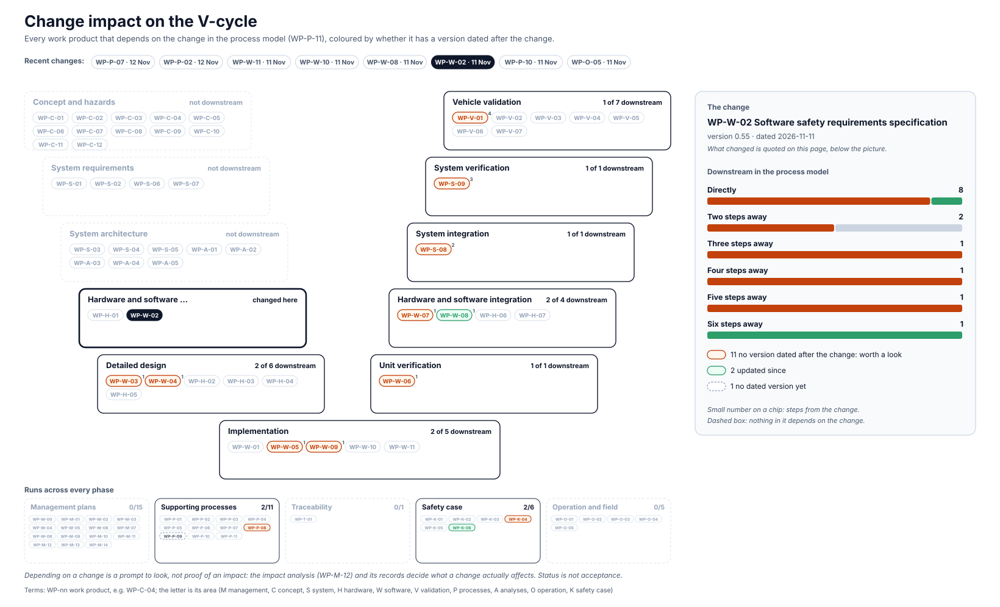

<!-- GENERATED by assurance/01-management/figures/fig_m00_vcycle.py from WP-M-00, the work products' Version rows and the process model. Do not edit. -->

# Change impact: WP-W-02 Software safety requirements specification

[← Back to the V-cycle](../../README.md#the-v-cycle) · Recent changes: [WP-H-03 · 13 Nov](impact-wp-h-03.md) · [WP-P-07 · 12 Nov](impact-wp-p-07.md) · [WP-P-04 · 12 Nov](impact-wp-p-04.md) · [WP-P-02 · 12 Nov](impact-wp-p-02.md) · [WP-W-11 · 11 Nov](impact-wp-w-11.md) · [WP-W-10 · 11 Nov](impact-wp-w-10.md) · [WP-W-08 · 11 Nov](impact-wp-w-08.md) · **WP-W-02 · 11 Nov** · [All changes](impact.md)

  

*The change: WP-W-02 version 0.55, dated 2026-11-11: SWSR-303i added: while selfdriveState is not alive, controlsd publishes carControl not enabled, so the PCM cruise cancel is sent when selfdrived stops, the lead's decision DQ-439 A; implemented in controls/controlsd.py, unit-tested through the Toyota CarInterface, mutant CA-1; §13 updated; OI-18 extended to this case; AI-drafted, I0*

Depending on a change is a prompt to look, not proof of an impact: the [impact analysis (WP-M-12)](../WP-M-12-impact-analysis.md) and its records decide what a change actually affects.

## Downstream work products

| Work product | Steps | Its last dated version | Since the change |
|---|---|---|---|
| [WP-P-08 Qualification of software components (third-party and upstream software)](../../07-supporting/WP-P-08-software-component-qualification.md) | 1 | 2026-10-23 | worth a look |
| [WP-W-03 Software architectural design](../../05-software/WP-W-03-software-architecture.md) | 1 | 2026-11-02 | worth a look |
| [WP-W-04 Software safety analysis and software-level DFA](../../05-software/WP-W-04-software-safety-analysis.md) | 1 | 2026-11-02 | worth a look |
| [WP-W-05 Software unit design and implementation](../../05-software/WP-W-05-software-unit-design.md) | 1 | 2026-11-03 | worth a look |
| [WP-W-06 Software unit verification specification and report (static analysis, MISRA, coverage, mutation)](../../05-software/WP-W-06-software-unit-verification.md) | 1 | 2026-11-02 | worth a look |
| [WP-W-07 Software integration and verification specification and report](../../05-software/WP-W-07-software-integration-verification.md) | 1 | 2026-10-13 | worth a look |
| [WP-W-08 Testing of the embedded software (SW qualification, HIL)](../../05-software/WP-W-08-embedded-software-testing.md) | 1 | 2026-11-11 | updated |
| [WP-W-09 Safety-related configuration and calibration data (car params, fingerprints, limits, model weights)](../../05-software/WP-W-09-configuration-calibration-data.md) | 1 | 2026-10-27 | worth a look |
| [WP-P-09 Proven-in-use argument evaluation](../../07-supporting/WP-P-09-proven-in-use.md) | 2 | — | undated |
| [WP-S-08 System integration and test strategy, specification and report](../../03-system/WP-S-08-system-integration-test.md) | 2 | 2026-11-02 | worth a look |
| [WP-S-09 System verification (qualification) specification and report](../../03-system/WP-S-09-system-verification.md) | 3 | 2026-10-26 | worth a look |
| [WP-V-01 Safety validation plan, specification and report](../../06-validation/WP-V-01-safety-validation.md) | 4 | 2026-11-02 | worth a look |
| [WP-K-04 Functional safety assessment report (performed independently, I3)](../../10-safety-case/WP-K-04-functional-safety-assessment.md) | 5 | 2026-10-12 | worth a look |
| [WP-K-06 Release for production / release record](../../10-safety-case/WP-K-06-release-record.md) | 6 | 2026-11-11 | updated |
