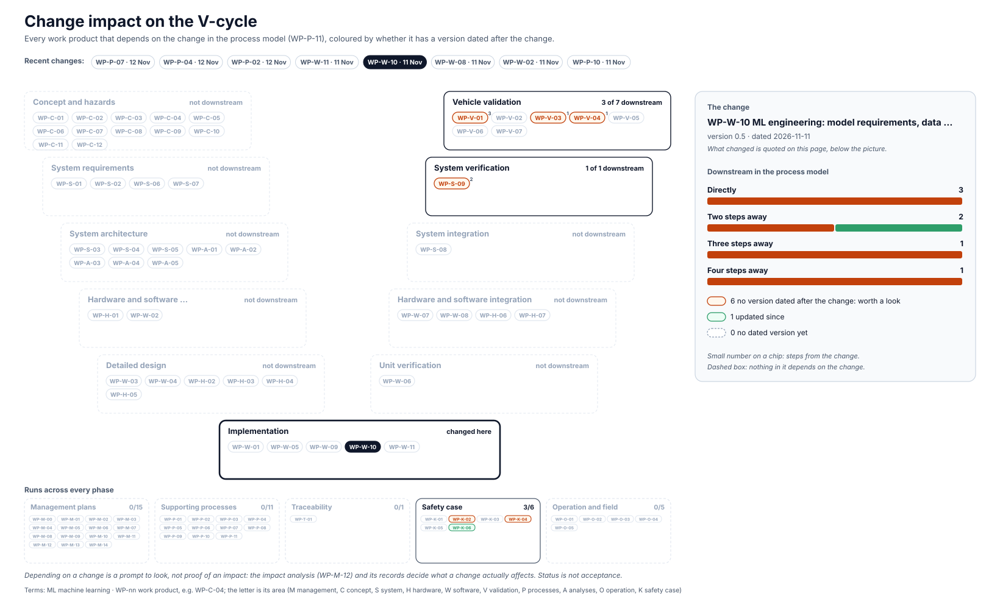

<!-- GENERATED by assurance/01-management/figures/fig_m00_vcycle.py from WP-M-00, the work products' Version rows and the process model. Do not edit. -->

# Change impact: WP-W-10 ML engineering: model requirements, data management, training, testing, deployment

[← Back to the V-cycle](../../README.md#the-v-cycle) · Recent changes: [WP-P-07 · 12 Nov](impact-wp-p-07.md) · [WP-P-04 · 12 Nov](impact-wp-p-04.md) · [WP-P-02 · 12 Nov](impact-wp-p-02.md) · [WP-W-11 · 11 Nov](impact-wp-w-11.md) · **WP-W-10 · 11 Nov** · [WP-W-08 · 11 Nov](impact-wp-w-08.md) · [WP-W-02 · 11 Nov](impact-wp-w-02.md) · [WP-P-10 · 11 Nov](impact-wp-p-10.md) · [All changes](impact.md)

  

*The change: WP-W-10 version 0.5, dated 2026-11-11: OI-6 narrowed: the VS-ML-01 tolerances come from an FP16 error budget derived analytically, then confirmed on DS-REF, DQ-179 A (lead, 2026-11-11)*

Depending on a change is a prompt to look, not proof of an impact: the [impact analysis (WP-M-12)](../WP-M-12-impact-analysis.md) and its records decide what a change actually affects.

## Downstream work products

| Work product | Steps | Its last dated version | Since the change |
|---|---|---|---|
| [WP-K-02 SOTIF achievement evaluation and release recommendation](../../10-safety-case/WP-K-02-sotif-release-argument.md) | 1 | 2026-10-30 | worth a look |
| [WP-V-03 Evaluation of known hazardous scenarios](../../06-validation/WP-V-03-sotif-known-scenarios.md) | 1 | 2026-11-02 | worth a look |
| [WP-V-04 Evaluation of unknown hazardous scenarios](../../06-validation/WP-V-04-sotif-unknown-scenarios.md) | 1 | 2026-10-25 | worth a look |
| [WP-K-06 Release for production / release record](../../10-safety-case/WP-K-06-release-record.md) | 2 | 2026-11-11 | updated |
| [WP-S-09 System verification (qualification) specification and report](../../03-system/WP-S-09-system-verification.md) | 2 | 2026-10-26 | worth a look |
| [WP-V-01 Safety validation plan, specification and report](../../06-validation/WP-V-01-safety-validation.md) | 3 | 2026-11-02 | worth a look |
| [WP-K-04 Functional safety assessment report (performed independently, I3)](../../10-safety-case/WP-K-04-functional-safety-assessment.md) | 4 | 2026-10-12 | worth a look |
