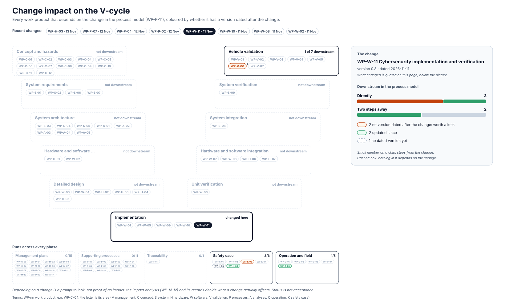

<!-- GENERATED by assurance/01-management/figures/fig_m00_vcycle.py from WP-M-00, the work products' Version rows and the process model. Do not edit. -->

# Change impact: WP-W-11 Cybersecurity implementation and verification

[← Back to the V-cycle](../../README.md#the-v-cycle) · Recent changes: [WP-H-03 · 13 Nov](impact-wp-h-03.md) · [WP-H-02 · 13 Nov](impact-wp-h-02.md) · [WP-P-07 · 12 Nov](impact-wp-p-07.md) · [WP-P-04 · 12 Nov](impact-wp-p-04.md) · [WP-P-02 · 12 Nov](impact-wp-p-02.md) · **WP-W-11 · 11 Nov** · [WP-W-10 · 11 Nov](impact-wp-w-10.md) · [WP-W-08 · 11 Nov](impact-wp-w-08.md) · [All changes](impact.md)

  

*The change: WP-W-11 version 0.8, dated 2026-11-11: §5.1: AGNOS followed through comma's notices only, the other uncovered components by the monthly manual search, DQ-432 C (lead, 2026-11-11)*

Depending on a change is a prompt to look, not proof of an impact: the [impact analysis (WP-M-12)](../WP-M-12-impact-analysis.md) and its records decide what a change actually affects.

## Downstream work products

| Work product | Steps | Its last dated version | Since the change |
|---|---|---|---|
| [WP-K-03 Cybersecurity case](../../10-safety-case/WP-K-03-cybersecurity-case.md) | 1 | 2026-10-23 | worth a look |
| [WP-O-05 Cybersecurity incident response, vulnerability management and software updates](../../09-production-operation/WP-O-05-cybersecurity-incident-response-updates.md) | 1 | 2026-11-11 | updated |
| [WP-V-06 Cybersecurity validation and penetration testing](../../06-validation/WP-V-06-cybersecurity-validation.md) | 1 | 2026-10-23 | worth a look |
| [WP-K-05 Cybersecurity assessment report (performed independently)](../../10-safety-case/WP-K-05-cybersecurity-assessment.md) | 2 | — | undated |
| [WP-K-06 Release for production / release record](../../10-safety-case/WP-K-06-release-record.md) | 2 | 2026-11-11 | updated |
