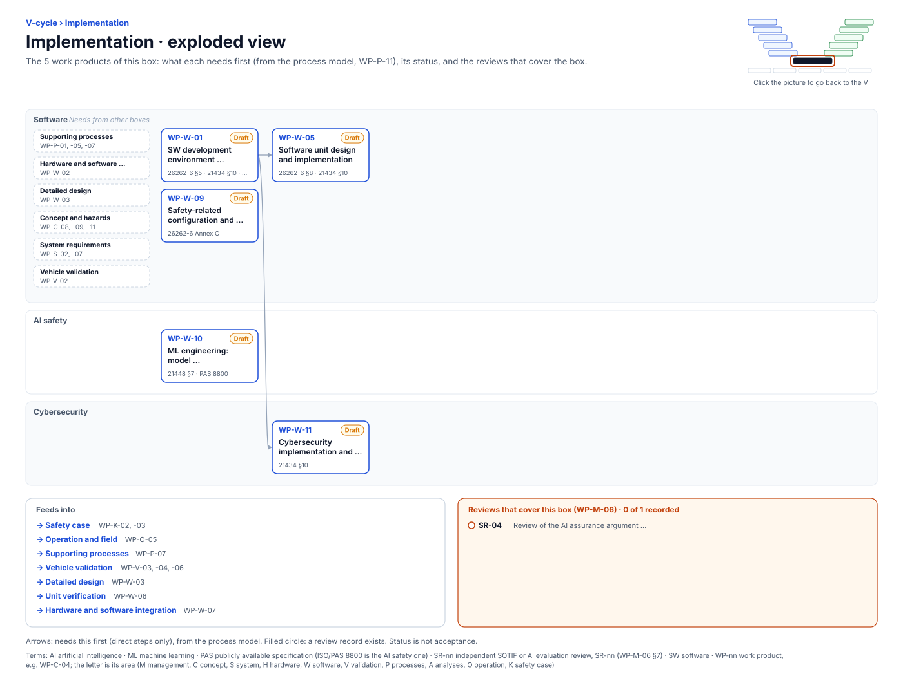

<!-- GENERATED by assurance/01-management/figures/fig_m00_vcycle.py from WP-M-00 and the process model. Do not edit. -->

# V-cycle: Implementation

[← Back to the V-cycle](../../README.md#the-v-cycle) · folder: [`05-software/`](../../05-software/README.md)

  

*Click the picture to go back to the V. Drawn from the [register](../WP-M-00-work-product-register.md) and the [process model](../../process/README.md) by [`fig_m00_vcycle.py`](../figures/fig_m00_vcycle.py); CI fails if it is stale.*

## Work products

| Work product | Status | Gate | Discipline | Needs first |
|---|---|---|---|---|
| [WP-W-01 SW development environment, languages and coding guidelines](../../05-software/WP-W-01-software-development-environment-guidelines.md) | Draft | G3 | Software | — |
| [WP-W-09 Safety-related configuration and calibration data (car params, fingerprints, limits, model weights)](../../05-software/WP-W-09-configuration-calibration-data.md) | Draft | G3 | Software | — |
| [WP-W-10 ML engineering: model requirements, data management, training, testing, deployment](../../05-software/WP-W-10-ml-engineering.md) | Draft | G3 | AI safety | — |
| [WP-W-05 Software unit design and implementation](../../05-software/WP-W-05-software-unit-design.md) | Draft | G3 | Software | WP-W-01 |
| [WP-W-11 Cybersecurity implementation and verification](../../05-software/WP-W-11-cybersecurity-implementation-verification.md) | Draft | G3 | Cybersecurity | WP-W-01 |

## Needs from other boxes

- [Supporting processes](supporting-processes.md): WP-P-01, WP-P-05, WP-P-07
- [Hardware and software requirements](hardware-and-software-requirements.md): WP-W-02
- [Detailed design](detailed-design.md): WP-W-03
- [Concept and hazards](concept-and-hazards.md): WP-C-08, WP-C-11, WP-C-09
- [System requirements](system-requirements.md): WP-S-02, WP-S-07
- [Vehicle validation](vehicle-validation.md): WP-V-02

## Feeds into

- [Safety case](safety-case.md): WP-K-02, WP-K-03
- [Operation and field](operation-and-field.md): WP-O-05
- [Supporting processes](supporting-processes.md): WP-P-07
- [Vehicle validation](vehicle-validation.md): WP-V-03, WP-V-04, WP-V-06
- [Detailed design](detailed-design.md): WP-W-03
- [Unit verification](unit-verification.md): WP-W-06
- [Hardware and software integration](hardware-and-software-integration.md): WP-W-07

## Reviews that cover this box

- No record yet: SR-04, Review of the AI assurance argument (PAS 8800)
