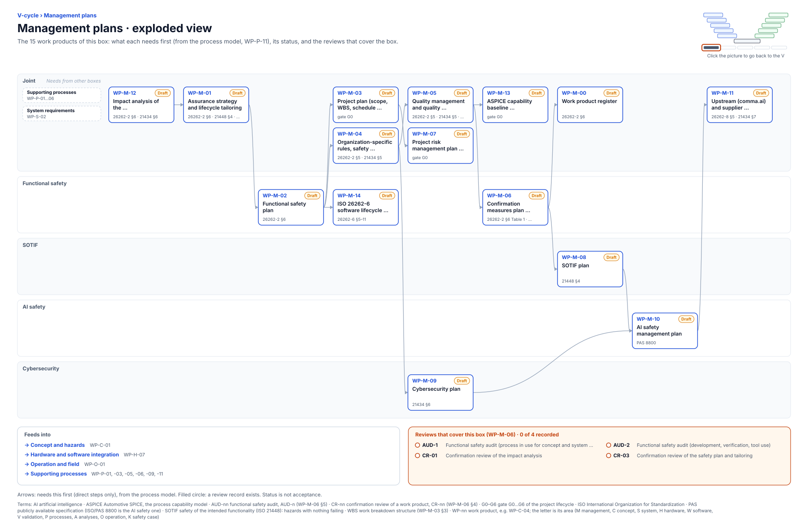

<!-- GENERATED by assurance/01-management/figures/fig_m00_vcycle.py from WP-M-00 and the process model. Do not edit. -->

# V-cycle: Management plans

[← Back to the V-cycle](../../README.md#the-v-cycle) · folder: [`01-management/`](../../01-management/README.md)

  

*Click the picture to go back to the V. Drawn from the [register](../WP-M-00-work-product-register.md) and the [process model](../../process/README.md) by [`fig_m00_vcycle.py`](../figures/fig_m00_vcycle.py); CI fails if it is stale.*

## Work products

| Work product | Status | Gate | Discipline | Needs first |
|---|---|---|---|---|
| [WP-M-12 Impact analysis of the openpilot-derived baseline (modification of existing item)](../WP-M-12-impact-analysis.md) | Draft | G0 | Joint | — |
| [WP-M-01 Assurance strategy and lifecycle tailoring](../WP-M-01-assurance-strategy.md) | Draft | G0 | Joint | WP-M-12 |
| [WP-M-02 Functional safety plan](../WP-M-02-safety-plan.md) | Draft | G0 | Functional safety | WP-M-01 |
| [WP-M-03 Project plan (scope, WBS, schedule, resources)](../WP-M-03-project-plan.md) | Draft | G0 | Joint | WP-M-02 |
| [WP-M-04 Organization-specific rules, safety culture, competence management](../WP-M-04-organization-competence-safety-culture.md) | Draft | G0 | Joint | WP-M-02 |
| [WP-M-14 ISO 26262-6 software lifecycle implementation specification (future work; activation deferred, D-14)](../WP-M-14-iso26262-6-implementation-specification.md) | Draft | G2 (activation), G3–G4 (use) | Functional safety | WP-M-02 |
| [WP-M-05 Quality management and quality assurance plan](../WP-M-05-quality-assurance-plan.md) | Draft | G0 | Joint | WP-M-04 |
| [WP-M-07 Project risk management plan and register](../WP-M-07-risk-management.md) | Draft | G0 | Joint | WP-M-03 |
| [WP-M-09 Cybersecurity plan](../WP-M-09-cybersecurity-plan.md) | Draft | G0 | Cybersecurity | WP-M-04 |
| [WP-M-06 Confirmation measures plan (reviews, audit, assessment, independence)](../WP-M-06-confirmation-measures-plan.md) | Draft | G0 | Functional safety | WP-M-05 |
| [WP-M-13 ASPICE capability baseline (self-assessment)](../WP-M-13-aspice-capability-baseline.md) | Draft | G0 | Joint | WP-M-05 |
| [WP-M-00 Work product register](../WP-M-00-work-product-register.md) | Draft | G0 | Joint | WP-M-06 |
| [WP-M-08 SOTIF plan](../WP-M-08-sotif-plan.md) | Draft | G0 | SOTIF | WP-M-06 |
| [WP-M-10 AI safety management plan](../WP-M-10-ai-safety-plan.md) | Draft | G0 | AI safety | WP-M-08, WP-M-09 |
| [WP-M-11 Upstream (comma.ai) and supplier management, development interface agreements](../WP-M-11-upstream-and-supplier-management.md) | Draft | G0 | Joint | WP-M-10 |

## Needs from other boxes

- [Supporting processes](supporting-processes.md): WP-P-01, WP-P-02, WP-P-03, WP-P-04, WP-P-05, WP-P-06
- [System requirements](system-requirements.md): WP-S-02

## Feeds into

- [Concept and hazards](concept-and-hazards.md): WP-C-01
- [Hardware and software integration](hardware-and-software-integration.md): WP-H-07
- [Operation and field](operation-and-field.md): WP-O-01
- [Supporting processes](supporting-processes.md): WP-P-01, WP-P-03, WP-P-05, WP-P-06, WP-P-09, WP-P-11

## Reviews that cover this box

- No record yet: AUD-1, Functional safety audit (process in use for concept and system design)
- No record yet: AUD-2, Functional safety audit (development, verification, tool use)
- No record yet: CR-01, Confirmation review of the impact analysis
- No record yet: CR-03, Confirmation review of the safety plan and tailoring
