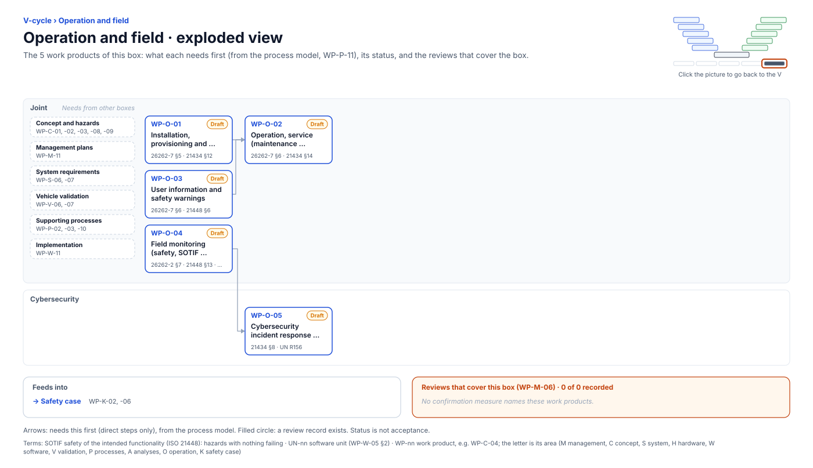

<!-- GENERATED by assurance/01-management/figures/fig_m00_vcycle.py from WP-M-00 and the process model. Do not edit. -->

# V-cycle: Operation and field

[← Back to the V-cycle](../../README.md#the-v-cycle) · folder: [`09-production-operation/`](../../09-production-operation/README.md)

  

*Click the picture to go back to the V. Drawn from the [register](../WP-M-00-work-product-register.md) and the [process model](../../process/README.md) by [`fig_m00_vcycle.py`](../figures/fig_m00_vcycle.py); CI fails if it is stale.*

## Work products

| Work product | Status | Gate | Discipline | Needs first |
|---|---|---|---|---|
| [WP-O-01 Installation, provisioning and production control](../../09-production-operation/WP-O-01-installation-and-provisioning-control.md) | Draft | G5 | Joint | — |
| [WP-O-03 User information and safety warnings](../../09-production-operation/WP-O-03-user-information-safety-warnings.md) | Draft | G5 | Joint | — |
| [WP-O-04 Field monitoring (safety, SOTIF and AI) and crash reporting](../../09-production-operation/WP-O-04-field-monitoring.md) | Draft | G1 (development slice: the §3.3 data path for the first road drives, DQ-122 A), G6 (the rest) | Joint | — |
| [WP-O-02 Operation, service (maintenance, repair) and decommissioning](../../09-production-operation/WP-O-02-operation-service-decommissioning.md) | Draft | G5 | Joint | WP-O-01, WP-O-03 |
| [WP-O-05 Cybersecurity incident response, vulnerability management and software updates](../../09-production-operation/WP-O-05-cybersecurity-incident-response-updates.md) | Draft | G6 | Cybersecurity | WP-O-04 |

## Needs from other boxes

- [Concept and hazards](concept-and-hazards.md): WP-C-01, WP-C-02, WP-C-03, WP-C-08, WP-C-09
- [Management plans](management-plans.md): WP-M-11
- [System requirements](system-requirements.md): WP-S-06, WP-S-07
- [Vehicle validation](vehicle-validation.md): WP-V-07, WP-V-06
- [Supporting processes](supporting-processes.md): WP-P-02, WP-P-03, WP-P-10
- [Implementation](implementation.md): WP-W-11

## Feeds into

- [Safety case](safety-case.md): WP-K-02, WP-K-06

## Reviews that cover this box

None.
