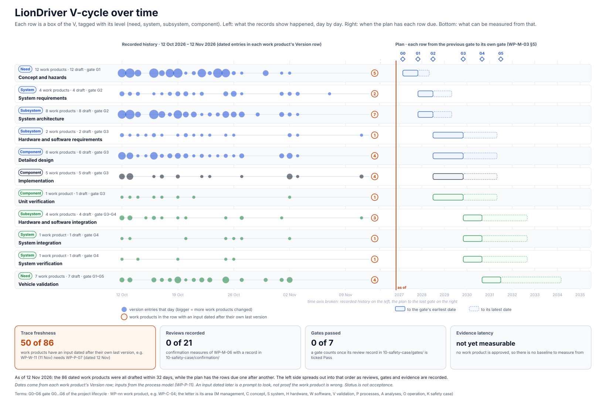

<!-- GENERATED by assurance/01-management/figures/fig_m00_vcycle.py from WP-M-00, WP-M-03 and the process model. Do not edit. -->

# V-cycle over time

[← Back to the V-cycle](../../README.md#the-v-cycle) · [exploded views](README.md)

  

*Each row is a box of the V, tagged with its level: need, system, subsystem or component. Left: the days on which its work products got a dated version entry. Right: the plan, from the previous gate to the row's own gate. Drawn by [`fig_m00_vcycle.py`](../figures/fig_m00_vcycle.py); CI fails if it is stale.*

## Work products with an input dated after their own last version

A prompt to look, not proof the work product is wrong: the input may have changed in a way that does not affect it.

| Work product | Its last version | Input dated later | Input's last version |
|---|---|---|---|
| WP-A-01 | 2026-10-19 | WP-S-02 | 2026-11-07 |
| WP-A-02 | 2026-10-27 | WP-S-02 | 2026-11-07 |
| WP-A-03 | 2026-10-27 | WP-S-02 | 2026-11-07 |
| WP-A-04 | 2026-10-29 | WP-S-02 | 2026-11-07 |
| WP-A-05 | 2026-10-21 | WP-S-02 | 2026-11-07 |
| WP-C-07 | 2026-10-30 | WP-C-04 | 2026-11-01 |
| WP-C-08 | 2026-10-23 | WP-C-02 | 2026-10-25 |
| WP-C-09 | 2026-10-26 | WP-C-03 | 2026-10-30 |
| WP-C-10 | 2026-10-25 | WP-C-04 | 2026-11-01 |
| WP-C-12 | 2026-10-24 | WP-C-01 | 2026-10-25 |
| WP-H-01 | 2026-11-02 | WP-H-02 | 2026-11-13 |
| WP-H-04 | 2026-11-02 | WP-H-03 | 2026-11-13 |
| WP-H-05 | 2026-11-01 | WP-H-03 | 2026-11-13 |
| WP-H-06 | 2026-10-27 | WP-H-03 | 2026-11-13 |
| WP-H-07 | 2026-11-01 | WP-H-03 | 2026-11-13 |
| WP-K-01 | 2026-10-30 | WP-C-11 | 2026-11-02 |
| WP-K-02 | 2026-10-30 | WP-W-10 | 2026-11-11 |
| WP-K-03 | 2026-10-23 | WP-W-11 | 2026-11-11 |
| WP-K-04 | 2026-10-12 | WP-V-01 | 2026-11-02 |
| WP-M-04 | 2026-10-19 | WP-M-02 | 2026-10-23 |
| WP-M-06 | 2026-10-23 | WP-M-05 | 2026-11-11 |
| WP-M-10 | 2026-11-02 | WP-M-09 | 2026-11-11 |
| WP-M-13 | 2026-10-23 | WP-P-04 | 2026-11-12 |
| WP-O-02 | 2026-10-25 | WP-O-01 | 2026-11-11 |
| WP-O-03 | 2026-10-23 | WP-S-06 | 2026-11-02 |
| WP-O-05 | 2026-11-11 | WP-P-02 | 2026-11-12 |
| WP-P-01 | 2026-10-22 | WP-M-05 | 2026-11-11 |
| WP-P-03 | 2026-10-14 | WP-M-05 | 2026-11-11 |
| WP-P-06 | 2026-10-22 | WP-M-02 | 2026-10-23 |
| WP-P-08 | 2026-10-23 | WP-W-02 | 2026-11-11 |
| WP-S-03 | 2026-11-01 | WP-S-02 | 2026-11-07 |
| WP-S-05 | 2026-11-03 | WP-S-02 | 2026-11-07 |
| WP-S-06 | 2026-11-02 | WP-S-02 | 2026-11-07 |
| WP-S-07 | 2026-11-03 | WP-S-02 | 2026-11-07 |
| WP-S-08 | 2026-11-02 | WP-W-08 | 2026-11-11 |
| WP-S-09 | 2026-10-26 | WP-S-02 | 2026-11-07 |
| WP-T-01 | 2026-10-26 | WP-C-11 | 2026-11-02 |
| WP-V-03 | 2026-11-02 | WP-W-10 | 2026-11-11 |
| WP-V-04 | 2026-10-25 | WP-W-10 | 2026-11-11 |
| WP-V-05 | 2026-11-01 | WP-S-02 | 2026-11-07 |
| WP-V-06 | 2026-10-23 | WP-W-11 | 2026-11-11 |
| WP-W-03 | 2026-11-02 | WP-W-02 | 2026-11-11 |
| WP-W-04 | 2026-11-02 | WP-W-02 | 2026-11-11 |
| WP-W-05 | 2026-11-03 | WP-W-02 | 2026-11-11 |
| WP-W-06 | 2026-11-02 | WP-P-07 | 2026-11-12 |
| WP-W-07 | 2026-10-13 | WP-W-02 | 2026-11-11 |
| WP-W-09 | 2026-10-27 | WP-W-02 | 2026-11-11 |
| WP-W-10 | 2026-11-11 | WP-P-07 | 2026-11-12 |
| WP-W-11 | 2026-11-11 | WP-P-07 | 2026-11-12 |

## Work products with no dated version entry

Still at a first version with no date, so they are not drawn on the history and not in the freshness check.

- WP-K-05
- WP-P-05
- WP-P-09
