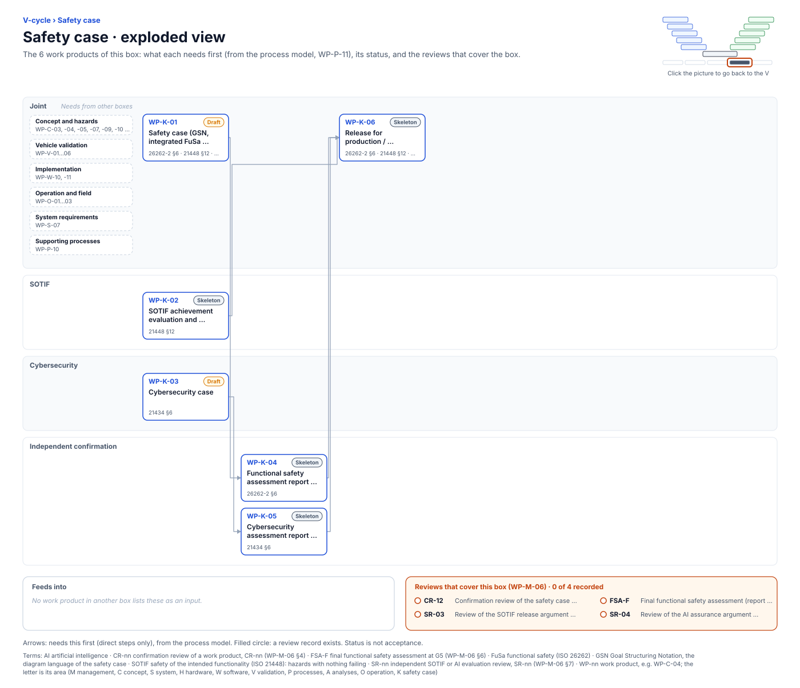

<!-- GENERATED by assurance/01-management/figures/fig_m00_vcycle.py from WP-M-00 and the process model. Do not edit. -->

# V-cycle: Safety case

[← Back to the V-cycle](../../README.md#the-v-cycle) · folder: [`10-safety-case/`](../../10-safety-case/README.md)

  

*Click the picture to go back to the V. Drawn from the [register](../WP-M-00-work-product-register.md) and the [process model](../../process/README.md) by [`fig_m00_vcycle.py`](../figures/fig_m00_vcycle.py); CI fails if it is stale.*

## Work products

| Work product | Status | Gate | Discipline | Needs first |
|---|---|---|---|---|
| [WP-K-01 Safety case (GSN, integrated FuSa, SOTIF and AI argument)](../../10-safety-case/WP-K-01-safety-case.md) | Draft | G1→G5 (living) | Joint | — |
| [WP-K-02 SOTIF achievement evaluation and release recommendation](../../10-safety-case/WP-K-02-sotif-release-argument.md) | Skeleton | G5 | SOTIF | — |
| [WP-K-03 Cybersecurity case](../../10-safety-case/WP-K-03-cybersecurity-case.md) | Draft | G5 | Cybersecurity | — |
| [WP-K-04 Functional safety assessment report (performed independently, I3)](../../10-safety-case/WP-K-04-functional-safety-assessment.md) | Skeleton | G5 | Independent confirmation | WP-K-01 |
| [WP-K-05 Cybersecurity assessment report (performed independently)](../../10-safety-case/WP-K-05-cybersecurity-assessment.md) | Skeleton | G5 | Independent confirmation | WP-K-03 |
| [WP-K-06 Release for production / release record](../../10-safety-case/WP-K-06-release-record.md) | Skeleton | G5 | Joint | WP-K-02, WP-K-04, WP-K-05 |

## Needs from other boxes

- [Concept and hazards](concept-and-hazards.md): WP-C-03, WP-C-04, WP-C-05, WP-C-10, WP-C-11, WP-C-07, WP-C-09
- [Vehicle validation](vehicle-validation.md): WP-V-02, WP-V-03, WP-V-04, WP-V-06, WP-V-01, WP-V-05
- [Implementation](implementation.md): WP-W-10, WP-W-11
- [Operation and field](operation-and-field.md): WP-O-03, WP-O-01, WP-O-02
- [System requirements](system-requirements.md): WP-S-07
- [Supporting processes](supporting-processes.md): WP-P-10

## Feeds into

None.

## Reviews that cover this box

- No record yet: CR-12, Confirmation review of the safety case (completeness)
- No record yet: FSA-F, Final functional safety assessment (report WP-K-04)
- No record yet: SR-03, Review of the SOTIF release argument and residual risk
- No record yet: SR-04, Review of the AI assurance argument (PAS 8800)
