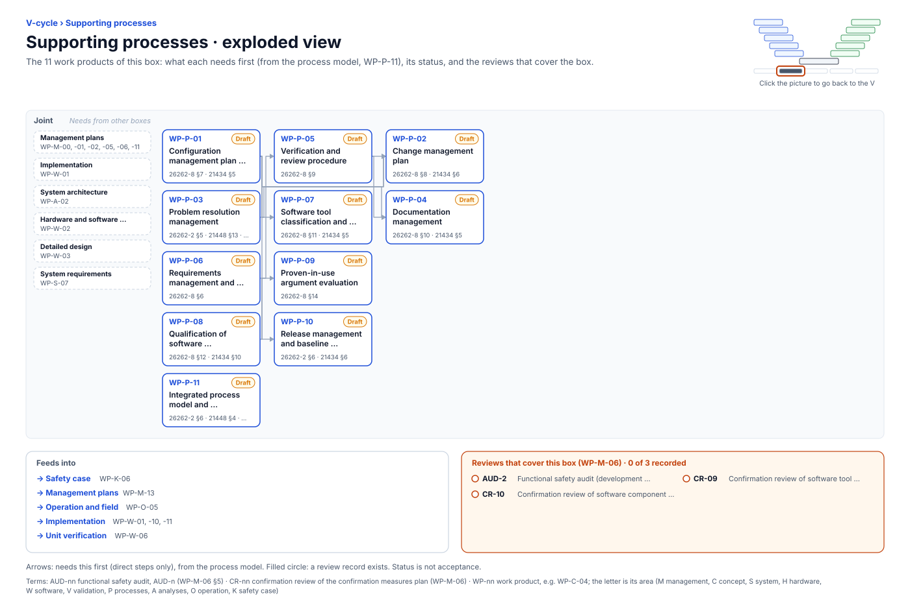

<!-- GENERATED by assurance/01-management/figures/fig_m00_vcycle.py from WP-M-00 and the process model. Do not edit. -->

# V-cycle: Supporting processes

[← Back to the V-cycle](../../README.md#the-v-cycle) · folder: [`07-supporting/`](../../07-supporting/README.md)

  

*Click the picture to go back to the V. Drawn from the [register](../WP-M-00-work-product-register.md) and the [process model](../../process/README.md) by [`fig_m00_vcycle.py`](../figures/fig_m00_vcycle.py); CI fails if it is stale.*

## Work products

| Work product | Status | Gate | Discipline | Needs first |
|---|---|---|---|---|
| [WP-P-01 Configuration management plan (incl. safety-relevant file list, baselines, submodules)](../../07-supporting/WP-P-01-configuration-management-plan.md) | Draft | G0 | Joint | — |
| [WP-P-03 Problem resolution management](../../07-supporting/WP-P-03-problem-resolution.md) | Draft | G0 | Joint | — |
| [WP-P-06 Requirements management and traceability procedure](../../07-supporting/WP-P-06-requirements-management-traceability.md) | Draft | G0 | Joint | — |
| [WP-P-08 Qualification of software components (third-party and upstream software)](../../07-supporting/WP-P-08-software-component-qualification.md) | Draft | G3 | Joint | — |
| [WP-P-11 Integrated process model and generated process maps (all phases G0–G6 modelled)](../../process/README.md) | Draft | G0 | Joint | — |
| [WP-P-05 Verification and review procedure](../../07-supporting/WP-P-05-verification-review-procedure.md) | Draft | G0 | Joint | WP-P-06 |
| [WP-P-07 Software tool classification and qualification](../../07-supporting/WP-P-07-tool-classification-qualification.md) | Draft | G3 | Joint | WP-P-01 |
| [WP-P-09 Proven-in-use argument evaluation](../../07-supporting/WP-P-09-proven-in-use.md) | Draft | G3 | Joint | WP-P-08 |
| [WP-P-10 Release management and baseline procedure](../../07-supporting/WP-P-10-release-management.md) | Draft | G5 | Joint | WP-P-01 |
| [WP-P-02 Change management plan](../../07-supporting/WP-P-02-change-management.md) | Draft | G0 | Joint | WP-P-01, WP-P-03, WP-P-05 |
| [WP-P-04 Documentation management](../../07-supporting/WP-P-04-documentation-management.md) | Draft | G0 | Joint | WP-P-01, WP-P-05 |

## Needs from other boxes

- [Management plans](management-plans.md): WP-M-01, WP-M-05, WP-M-02, WP-M-06, WP-M-11, WP-M-00
- [Implementation](implementation.md): WP-W-01
- [System architecture](system-architecture.md): WP-A-02
- [Hardware and software requirements](hardware-and-software-requirements.md): WP-W-02
- [Detailed design](detailed-design.md): WP-W-03
- [System requirements](system-requirements.md): WP-S-07

## Feeds into

- [Safety case](safety-case.md): WP-K-06
- [Management plans](management-plans.md): WP-M-13
- [Operation and field](operation-and-field.md): WP-O-05
- [Implementation](implementation.md): WP-W-01, WP-W-10, WP-W-11
- [Unit verification](unit-verification.md): WP-W-06

## Reviews that cover this box

- No record yet: AUD-2, Functional safety audit (development, verification, tool use)
- No record yet: CR-09, Confirmation review of software tool qualification
- No record yet: CR-10, Confirmation review of software component qualification
