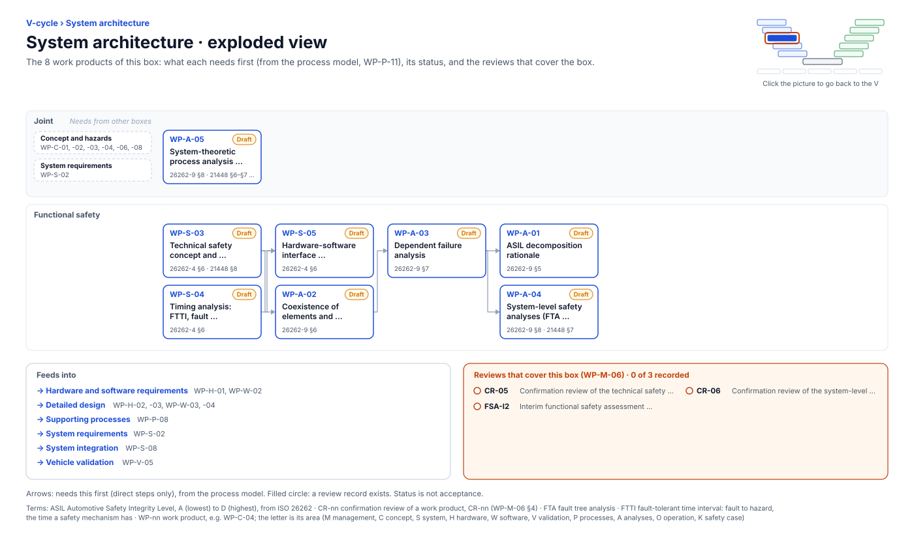

<!-- GENERATED by assurance/01-management/figures/fig_m00_vcycle.py from WP-M-00 and the process model. Do not edit. -->

# V-cycle: System architecture

[← Back to the V-cycle](../../README.md#the-v-cycle) · folder: [`08-analyses/`](../../08-analyses/README.md)

  

*Click the picture to go back to the V. Drawn from the [register](../WP-M-00-work-product-register.md) and the [process model](../../process/README.md) by [`fig_m00_vcycle.py`](../figures/fig_m00_vcycle.py); CI fails if it is stale.*

## Work products

| Work product | Status | Gate | Discipline | Needs first |
|---|---|---|---|---|
| [WP-A-05 System-theoretic process analysis (STPA)](../../08-analyses/WP-A-05-stpa.md) | Draft | G2 | Joint | — |
| [WP-S-03 Technical safety concept and system architectural design](../../03-system/WP-S-03-technical-safety-concept-architecture.md) | Draft | G2 | Functional safety | — |
| [WP-S-04 Timing analysis: FTTI, fault detection and reaction budget](../../03-system/WP-S-04-timing-ftti-budget.md) | Draft | G2 | Functional safety | — |
| [WP-A-02 Coexistence of elements and freedom from interference](../../08-analyses/WP-A-02-coexistence-freedom-from-interference.md) | Draft | G2 | Functional safety | WP-S-03 |
| [WP-S-05 Hardware-software interface specification](../../03-system/WP-S-05-hsi-specification.md) | Draft | G2 | Functional safety | WP-S-03, WP-S-04 |
| [WP-A-03 Dependent failure analysis](../../08-analyses/WP-A-03-dependent-failure-analysis.md) | Draft | G2 | Functional safety | WP-A-02 |
| [WP-A-01 ASIL decomposition rationale](../../08-analyses/WP-A-01-asil-decomposition.md) | Draft | G2 | Functional safety | WP-A-03 |
| [WP-A-04 System-level safety analyses (FTA, FMEA)](../../08-analyses/WP-A-04-system-fta-fmea.md) | Draft | G2 | Functional safety | WP-A-03 |

## Needs from other boxes

- [Concept and hazards](concept-and-hazards.md): WP-C-04, WP-C-02, WP-C-03, WP-C-08, WP-C-01, WP-C-06
- [System requirements](system-requirements.md): WP-S-02

## Feeds into

- [Hardware and software requirements](hardware-and-software-requirements.md): WP-H-01, WP-W-02
- [Detailed design](detailed-design.md): WP-H-02, WP-H-03, WP-W-03, WP-W-04
- [Supporting processes](supporting-processes.md): WP-P-08
- [System requirements](system-requirements.md): WP-S-02
- [System integration](system-integration.md): WP-S-08
- [Vehicle validation](vehicle-validation.md): WP-V-05

## Reviews that cover this box

- No record yet: CR-05, Confirmation review of the technical safety concept
- No record yet: CR-06, Confirmation review of the system-level safety analyses
- No record yet: FSA-I2, Interim functional safety assessment (TSC, FFI/DFA, hardware route)
