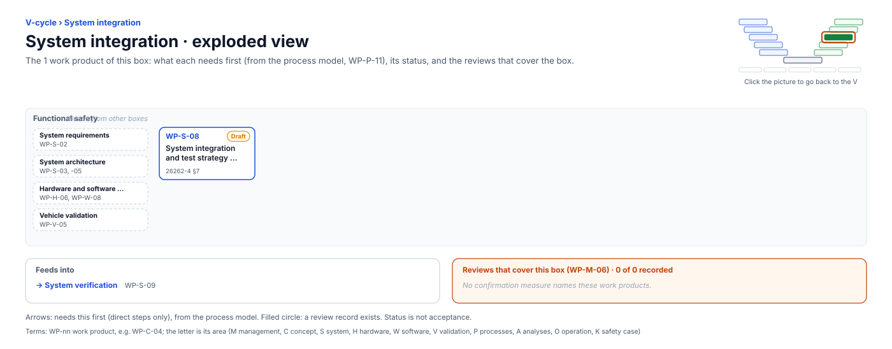

<!-- GENERATED by assurance/01-management/figures/fig_m00_vcycle.py from WP-M-00 and the process model. Do not edit. -->

# V-cycle: System integration

[← Back to the V-cycle](../../README.md#the-v-cycle) · folder: [`03-system/`](../../03-system/README.md)

  

*Click the picture to go back to the V. Drawn from the [register](../WP-M-00-work-product-register.md) and the [process model](../../process/README.md) by [`fig_m00_vcycle.py`](../figures/fig_m00_vcycle.py); CI fails if it is stale.*

## Work products

| Work product | Status | Gate | Discipline | Needs first |
|---|---|---|---|---|
| [WP-S-08 System integration and test strategy, specification and report](../../03-system/WP-S-08-system-integration-test.md) | Draft | G4 | Functional safety | — |

## Needs from other boxes

- [System requirements](system-requirements.md): WP-S-02
- [System architecture](system-architecture.md): WP-S-03, WP-S-05
- [Hardware and software integration](hardware-and-software-integration.md): WP-H-06, WP-W-08
- [Vehicle validation](vehicle-validation.md): WP-V-05

## Feeds into

- [System verification](system-verification.md): WP-S-09

## Reviews that cover this box

None.
