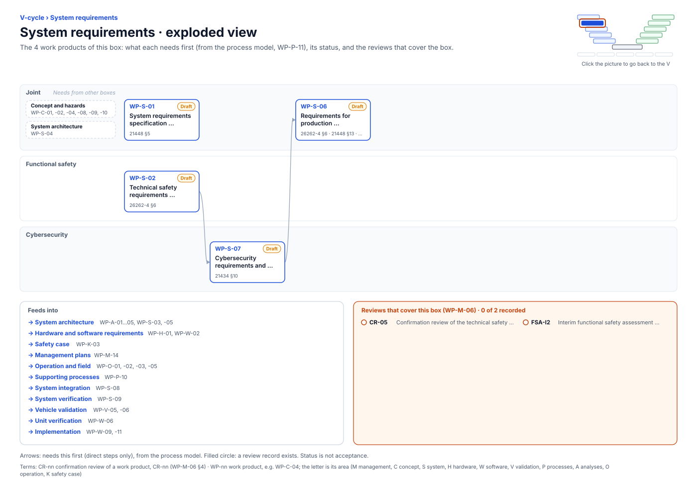

<!-- GENERATED by assurance/01-management/figures/fig_m00_vcycle.py from WP-M-00 and the process model. Do not edit. -->

# V-cycle: System requirements

[← Back to the V-cycle](../../README.md#the-v-cycle) · folder: [`03-system/`](../../03-system/README.md)

  

*Click the picture to go back to the V. Drawn from the [register](../WP-M-00-work-product-register.md) and the [process model](../../process/README.md) by [`fig_m00_vcycle.py`](../figures/fig_m00_vcycle.py); CI fails if it is stale.*

## Work products

| Work product | Status | Gate | Discipline | Needs first |
|---|---|---|---|---|
| [WP-S-01 System requirements specification (functional, non-safety)](../../03-system/WP-S-01-system-requirements.md) | Draft | G2 | Joint | — |
| [WP-S-02 Technical safety requirements specification](../../03-system/WP-S-02-technical-safety-requirements.md) | Draft | G2 | Functional safety | — |
| [WP-S-07 Cybersecurity requirements and architectural design](../../03-system/WP-S-07-cybersecurity-requirements-architecture.md) | Draft | G2 | Cybersecurity | WP-S-02 |
| [WP-S-06 Requirements for production, operation, service and decommissioning](../../03-system/WP-S-06-requirements-production-operation.md) | Draft | G2 | Joint | WP-S-07 |

## Needs from other boxes

- [Concept and hazards](concept-and-hazards.md): WP-C-01, WP-C-02, WP-C-08, WP-C-04, WP-C-09, WP-C-10
- [System architecture](system-architecture.md): WP-S-04

## Feeds into

- [System architecture](system-architecture.md): WP-A-01, WP-A-02, WP-A-03, WP-A-04, WP-A-05, WP-S-03, WP-S-05
- [Hardware and software requirements](hardware-and-software-requirements.md): WP-H-01, WP-W-02
- [Safety case](safety-case.md): WP-K-03
- [Management plans](management-plans.md): WP-M-14
- [Operation and field](operation-and-field.md): WP-O-01, WP-O-02, WP-O-03, WP-O-05
- [Supporting processes](supporting-processes.md): WP-P-10
- [System integration](system-integration.md): WP-S-08
- [System verification](system-verification.md): WP-S-09
- [Vehicle validation](vehicle-validation.md): WP-V-05, WP-V-06
- [Unit verification](unit-verification.md): WP-W-06
- [Implementation](implementation.md): WP-W-09, WP-W-11

## Reviews that cover this box

- No record yet: CR-05, Confirmation review of the technical safety concept
- No record yet: FSA-I2, Interim functional safety assessment (TSC, FFI/DFA, hardware route)
