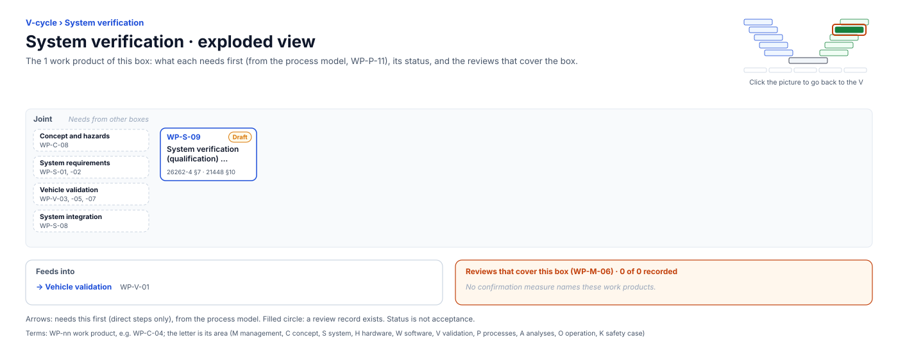

<!-- GENERATED by assurance/01-management/figures/fig_m00_vcycle.py from WP-M-00 and the process model. Do not edit. -->

# V-cycle: System verification

[← Back to the V-cycle](../../README.md#the-v-cycle) · folder: [`03-system/`](../../03-system/README.md)

  

*Click the picture to go back to the V. Drawn from the [register](../WP-M-00-work-product-register.md) and the [process model](../../process/README.md) by [`fig_m00_vcycle.py`](../figures/fig_m00_vcycle.py); CI fails if it is stale.*

## Work products

| Work product | Status | Gate | Discipline | Needs first |
|---|---|---|---|---|
| [WP-S-09 System verification (qualification) specification and report](../../03-system/WP-S-09-system-verification.md) | Draft | G4 | Joint | — |

## Needs from other boxes

- [Concept and hazards](concept-and-hazards.md): WP-C-08
- [System requirements](system-requirements.md): WP-S-01, WP-S-02
- [Vehicle validation](vehicle-validation.md): WP-V-07, WP-V-05, WP-V-03
- [System integration](system-integration.md): WP-S-08

## Feeds into

- [Vehicle validation](vehicle-validation.md): WP-V-01

## Reviews that cover this box

None.
