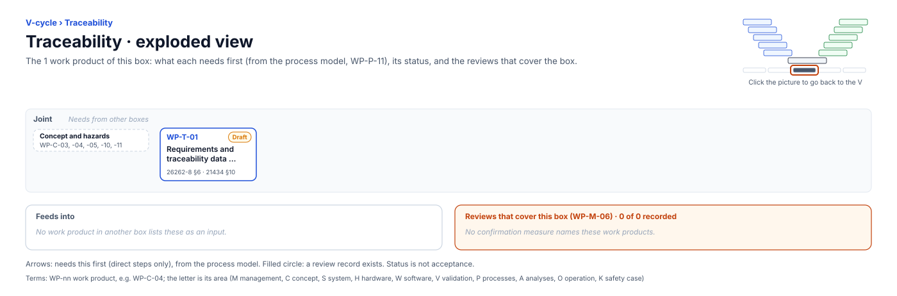

<!-- GENERATED by assurance/01-management/figures/fig_m00_vcycle.py from WP-M-00 and the process model. Do not edit. -->

# V-cycle: Traceability

[← Back to the V-cycle](../../README.md#the-v-cycle) · folder: [`trace/`](../../trace/README.md)

  

*Click the picture to go back to the V. Drawn from the [register](../WP-M-00-work-product-register.md) and the [process model](../../process/README.md) by [`fig_m00_vcycle.py`](../figures/fig_m00_vcycle.py); CI fails if it is stale.*

## Work products

| Work product | Status | Gate | Discipline | Needs first |
|---|---|---|---|---|
| [WP-T-01 Requirements and traceability data (machine-readable), consistency evidence](../../trace/README.md) | Draft | G1→G5 | Joint | — |

## Needs from other boxes

- [Concept and hazards](concept-and-hazards.md): WP-C-03, WP-C-04, WP-C-05, WP-C-10, WP-C-11

## Feeds into

None.

## Reviews that cover this box

None.
