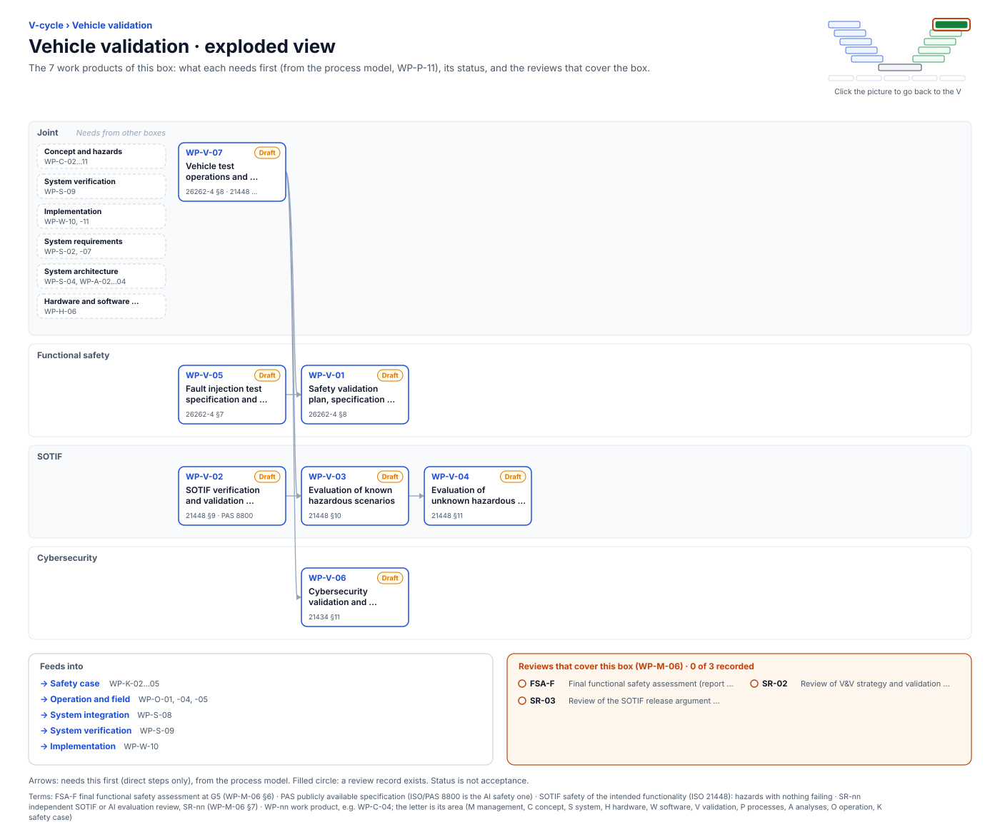

<!-- GENERATED by assurance/01-management/figures/fig_m00_vcycle.py from WP-M-00 and the process model. Do not edit. -->

# V-cycle: Vehicle validation

[← Back to the V-cycle](../../README.md#the-v-cycle) · folder: [`06-validation/`](../../06-validation/README.md)

  

*Click the picture to go back to the V. Drawn from the [register](../WP-M-00-work-product-register.md) and the [process model](../../process/README.md) by [`fig_m00_vcycle.py`](../figures/fig_m00_vcycle.py); CI fails if it is stale.*

## Work products

| Work product | Status | Gate | Discipline | Needs first |
|---|---|---|---|---|
| [WP-V-02 SOTIF verification and validation strategy, validation targets](../../06-validation/WP-V-02-sotif-vv-strategy.md) | Draft | G2 | SOTIF | — |
| [WP-V-05 Fault injection test specification and report](../../06-validation/WP-V-05-fault-injection.md) | Draft | G4 | Functional safety | — |
| [WP-V-07 Vehicle test operations and safety-driver procedures](../../06-validation/WP-V-07-vehicle-test-operations.md) | Draft | G1 | Joint | — |
| [WP-V-01 Safety validation plan, specification and report](../../06-validation/WP-V-01-safety-validation.md) | Draft | G5 | Functional safety | WP-V-07, WP-V-05 |
| [WP-V-03 Evaluation of known hazardous scenarios](../../06-validation/WP-V-03-sotif-known-scenarios.md) | Draft | G4 | SOTIF | WP-V-02, WP-V-07 |
| [WP-V-06 Cybersecurity validation and penetration testing](../../06-validation/WP-V-06-cybersecurity-validation.md) | Draft | G5 | Cybersecurity | WP-V-07 |
| [WP-V-04 Evaluation of unknown hazardous scenarios](../../06-validation/WP-V-04-sotif-unknown-scenarios.md) | Draft | G5 | SOTIF | WP-V-03 |

## Needs from other boxes

- [Concept and hazards](concept-and-hazards.md): WP-C-03, WP-C-04, WP-C-08, WP-C-02, WP-C-05, WP-C-06, WP-C-07, WP-C-11, WP-C-09, WP-C-10
- [System verification](system-verification.md): WP-S-09
- [Implementation](implementation.md): WP-W-10, WP-W-11
- [System requirements](system-requirements.md): WP-S-02, WP-S-07
- [System architecture](system-architecture.md): WP-S-04, WP-A-02, WP-A-03, WP-A-04
- [Hardware and software integration](hardware-and-software-integration.md): WP-H-06

## Feeds into

- [Safety case](safety-case.md): WP-K-02, WP-K-03, WP-K-04, WP-K-05
- [Operation and field](operation-and-field.md): WP-O-01, WP-O-04, WP-O-05
- [System integration](system-integration.md): WP-S-08
- [System verification](system-verification.md): WP-S-09
- [Implementation](implementation.md): WP-W-10

## Reviews that cover this box

- No record yet: FSA-F, Final functional safety assessment (report WP-K-04)
- No record yet: SR-02, Review of V&V strategy and validation targets
- No record yet: SR-03, Review of the SOTIF release argument and residual risk
