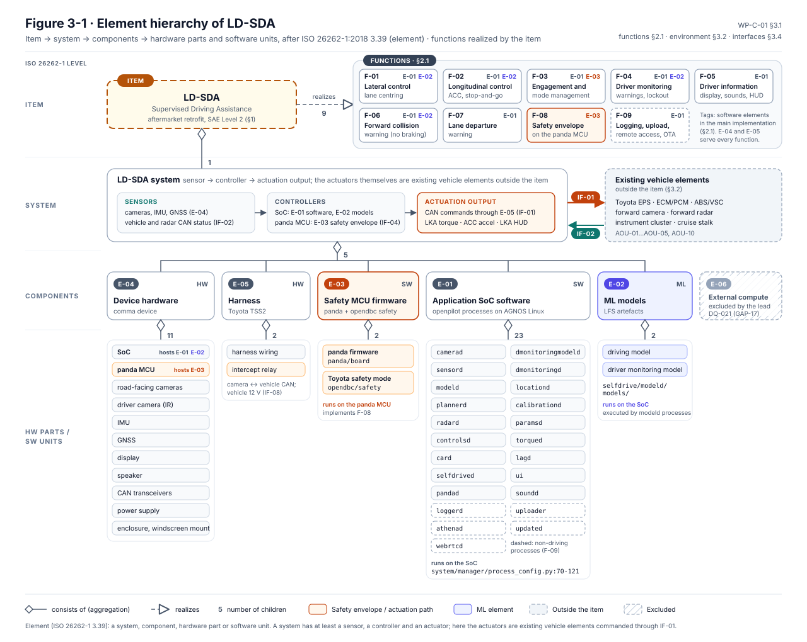
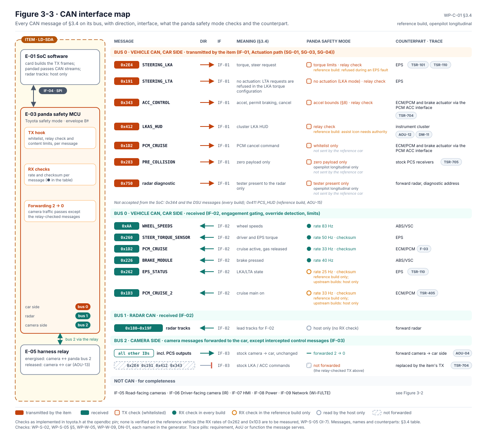
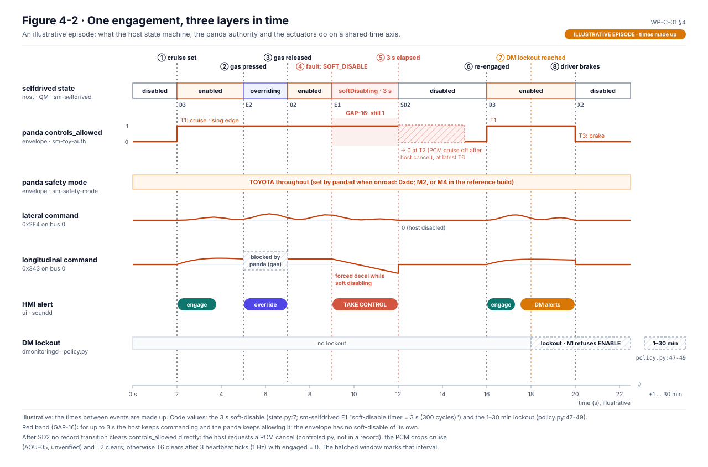

# WP-C-01 Item Definition

| Field | Value |
|---|---|
| Work product | WP-C-01 Item definition |
| Standard reference | ISO 26262-3:2018 §5; ISO 21448:2022 §5 (specification of the functionality and system); ISO/SAE 21434:2021 §9.3; ASPICE SYS.1 |
| Version | 0.24 (OI-5 closed: debug, maneuver and joystick modes left out of the reference build, DQ-131 A; 2026-10-25). 0.23 (§7: AOU-18 added, the network assumption of WP-S-05 OI-8 (actuation on unsigned classical CAN or ISO CAN FD at the harness point; J1939, signed, FlexRay and Ethernet actuation outside the platform), lead decision DQ-419 A; AOU-18 joins the vehicle-admission criteria; Figure 7-1 regenerated; I0, Claude; 2026-10-25). 0.22 (§3.5 and Figure 3-4 added: which elements realize, carry or are relied on for each function, generated by `figures/fig_c01_allocation.py`; no function, element or interface changed; 2026-10-24). 0.21 (§3.3 shows the boundary in the cybersecurity view, WP-C-09 Figure 1-1, after the safety view; 2026-10-24). 0.20 (§2.1 shows the functions in the hazard view, WP-C-03 Figure 4-9; 2026-10-24). 0.19 (§3.3 shows the boundary in the safety view, WP-C-04 Figure 10-1, after Figure 3-2; 2026-10-24). 0.18 (reference vehicle row links the item and environment models, WP-C-12; 2026-10-24). 0.17 (OI-2 notes the lead's answer of 2026-10-19: keep assuming Toyota A and box v3 (DQ-211 C); 2026-10-19). 0.16 (platform scope: this document defines the item on CFG-001, the reference configuration of platform PL-001; AOU-01…AOU-05 are entry criteria for admitting a vehicle, §1.1, DQ-369 A; G1 claims CFG-001 only, DQ-370 A; engagement speed floor, OI-7, DQ-280 A; AOU-17 added, the EPS and PCM signal every drop or non-execution, DQ-360 A, from WP-C-04 v0.12; 2026-10-18). 0.15 (vehicle testing on closed courses only until public-road legality is confirmed, DQ-104 B, OI-6; SGO applicability assessed by the project, DQ-087 B, §5; 2026-10-17). 0.14 (Figure 3-2: envelope badge and legend changed from B‡ to ASIL C after DQ-341 (envelope hardened to C), as in WP-S-03 v0.12; 2026-10-17). 0.13 (AOU-16 added: the PCM holds the car at standstill after the item's forced stop, DQ-365 A; 2026-10-16). 0.12 (reviewer: the volunteer, once recruited, DQ-027 A; 2026-10-16). 0.11 (device units per DQ-212 A; 2026-10-16). 0.10 (the lead's answers applied: Chestnut excluded, DQ-021; both comma 3X and comma four in scope, DQ-011; reference harness recorded as expected (Toyota A, box v3) and its confirmation asked, OI-2; ODD highways only, DQ-023; 2026-10-16). 0.9 (reference vehicle cited as CFG-001 · Corolla E210 · ZRE212 · US, model years 2020–2022, from the new vehicle register; OI-9 narrowed to the firmware set; 2026-10-14). 0.8 (Figures 2-1, 3-3 and 8-1 added, generated from §2.2, §3.4 and §8; §3.4 IF-01/IF-02 corrected to the reference build: `0x262` checked in the reference build only, `0x1D3`, `0x191`, `0x283`, `0x750` added; §3.2 cluster row credits AOU-12; Figures 4-1 and 4-2 added, generated from §4 and the state-machine records; Figure 7-1 added, generated from §7; 2026-10-14). 0.7 (§3.1 element hierarchy added as Figure 3-1; boundary diagram renumbered Figure 3-2; 2026-10-13). 0.6 (§3.3 boundary diagram redrawn as Figure 3-1 with interface IDs; text version kept; 2026-10-13). 0.5 (reference configuration named by generation, E210; OI-9 added; 2026-10-12). History: 0.4 (AOU-15 added: reference build used on camera-ACC configurations only, `0x411` refused (TSR-705 D-1); 2026-10-12). 0.3 (AOU-14 added for the reference build's fixed alternative experience; 2026-10-12) |
| Status | Draft |
| ASIL / scope | Item level (ASIL determined in [WP-C-03](WP-C-03-hara.md)) |
| Author | Assurance team (initial draft) |
| Reviewer(s) | A volunteer reviewer, once recruited (decision register DQ-027, A); until then nobody independent has reviewed it. Input to the HARA confirmation review (I3) |
| Approver | Safety manager |
| Baseline | `8b8c6ae` (opendbc `229dc70`, panda `92eb565`) |

## 1. Item identification

| Attribute | Value |
|---|---|
| Item name | LionDriver Supervised Driving Assistance (LD-SDA) |
| Item type | Aftermarket retrofit, supervised SAE Level 2 driving automation feature (lateral and longitudinal control at the same time, driver supervising) |
| Reference vehicle | **CFG-001 · Corolla E210 · ZRE212 · US**: Toyota Corolla, 12th generation (E210), sedan, US market, model years 2020–2022 (pre-facelift), 2ZR-FAE 1.8 L petrol with CVT, Toyota Safety Sense 2.0. Trims, physical data, the ECU firmware set and the exclusions (2023+ facelift, 2.0 L and manual trims, hybrid, hatchback) are in the [vehicle register](../../docs/liondriver/vehicles/README.md) (`docs/liondriver/vehicles/vehicles.yaml`), which this document cites instead of restating. The firmware set bounds the scope (OI-9). The models of this car and its environment that the simulation and the figures use are indexed in [WP-C-12](WP-C-12-item-and-environment-models.md) |
| LionDriver platform | Platform PL-001 with vehicle families VF-nnn and configurations CFG-nnn (decision register DQ-037, option B). This document defines the item on the reference configuration CFG-001 (family VF-001), the only configuration G1 claims (DQ-370, option A). How other vehicles are admitted is in §1.1 |
| openpilot platform | `TOYOTA_COROLLA_TSS2` (`opendbc_repo/opendbc/car/toyota/values.py:201`), flags `TSS2 \| NO_DSU` |
| Reference vehicle record | VIN, build date, ECU firmware versions (engine `0x700`/`0x7e0`, EPS `0x7a1`, ABS `0x7b0`, radar `0x750/0xf`, camera `0x750/0x6d`), options and tyre size: **to be recorded** (OI-1) |
| Device | comma device with integrated "panda" safety MCU (STM32H7) and Toyota TSS2 harness. **Both comma 3X (tres board) and comma four (cuatro board) stay in scope**: the lead asked for both to be reviewed (decision register DQ-011, answer "other", 2026-10-14), so the analyses keep the rows of both boards. Units: two of the device fitted to the reference car and one of the other board (DQ-212, A, 2026-10-16); which board is on the car is confirmed with DQ-211. Exact hardware revision and panda serial of each unit **to be recorded** (OI-2) |
| Harness | comma car harness for this vehicle: **Toyota A connector** per comma's car documentation for the Corolla 2020-22 (`docs/CARS.md`, vehicle register `harness`), with the harness box ("car harness v3" drawing, two DG419LE analog switches, no relay; [RR-2026-010](../04-hardware/reviews/RR-2026-010.md)). Not yet confirmed on the reference unit: the harness letter printed on it and the box revision (RR-2026-010 F-13, OI-2) |
| Software | LionDriver release baseline: openpilot tree + submodules pinned by commit + model weights (LFS), per [WP-P-01](../07-supporting/WP-P-01-configuration-management-plan.md) |

### 1.1 Platform and admission of vehicles

The functions (§2.1), the boundary (§3) and the operating modes (§4) are the same for every vehicle of the platform. The vehicle interfaces, limits and assumptions are not. They are recorded per family in the [vehicle register](../../docs/liondriver/vehicles/README.md), with the variant-sensitive parameters of [LD-ITEM-001 §A.10](../08-analyses/fmea/item-definition.md).

A vehicle is admitted to the platform only when all of the following hold (decision register DQ-369, option A, 2026-10-18):

1. **Entry criteria.** Its family meets the vehicle assumptions AOU-01…AOU-05 (§7), shown by that family's own vehicle tests. These are the EPS torque authority and overpowerability, brake override, stock PCS retained, and PCM acceleration bounds. A vehicle whose EPS or PCM does not meet them is not admitted. The ratings of the reference Corolla rest on these assumptions, so they are never carried to a vehicle that has not shown them.
2. **HARA delta.** The family has a HARA delta against [WP-C-03](WP-C-03-hara.md) (§1.1 there). The delta re-rates whatever differs, for example angle-based steering, another longitudinal interface, another minimum engagement speed, or a hybrid powertrain.
3. **Variant impact analysis** against LD-ITEM-001 §A.10 (IOI-002 for the other VF-001 members).

The reference Corolla keeps ASIL C for SG-01 and SG-03. Until another family has passed these steps, CFG-001 is the only admitted configuration.

## 2. Purpose and functional description

LD-SDA helps the driver by controlling steering (lane centring) and speed (adaptive cruise with stop-and-go) on limited-access highways, its ODD ([WP-C-02](WP-C-02-odd-and-intended-functionality.md); highways only since the lead's decision DQ-023). The driver stays responsible for the driving task at all times. The driver must supervise continuously and be ready to take over immediately. A driver monitoring function enforces attention.

### 2.1 Functions

| ID | Function | Description | Main implementation |
|---|---|---|---|
| F-01 | Lateral control (lane centring) | Computes a desired path or curvature from the camera-based ML driving model and commands steering torque to the Toyota EPS over its LKA interface (`STEERING_LKA`, `0x2E4`). Lane changes are driver-initiated with the turn signal and assisted (desire input) | `selfdrive/modeld`, `selfdrive/controls/controlsd.py`, `selfdrive/controls/lib/latcontrol_torque.py`, `opendbc/car/toyota/carcontroller.py` |
| F-02 | Longitudinal control (ACC with stop-and-go) | Holds the set speed or follows a lead vehicle. Commands acceleration and deceleration to the powertrain/brake ECUs through `ACC_CONTROL` (`0x343`), including permit-braking, standstill and cancel. Lead detection fuses the stock radar track and vision. In Experimental Mode the end-to-end model also proposes acceleration (stops for traffic lights and signs; see WP-C-02 for whether it is in scope) | `selfdrive/controls/plannerd.py`, `lib/longitudinal_planner.py`, `radard.py`, `carcontroller.py:174-254` |
| F-03 | Engagement and mode management | Engagement through the stock cruise controls. The safety MCU grants control authority only on the rising edge of the PCM cruise-active signal. Disengages on brake, cancel or faults. Supports override (driver gas, driver steering) | `selfdrive/selfdrived/state.py`, `selfdrived.py`; `opendbc/safety/safety.h:518-527` |
| F-04 | Driver monitoring | A driver-facing camera and ML model estimate attention. Escalating warnings (5/8/13 s on the vision policy), forced deceleration on no response, and lockout after repeated non-compliance | `selfdrive/modeld/dmonitoringmodeld.py`, `selfdrive/monitoring/policy.py` |
| F-05 | Driver information and warnings | Device display and sounds (`soundd`), plus the instrument cluster LKA HUD (`LKAS_HUD`, `0x412`). Alerts follow the event classes (warning, soft disable, immediate disable, no-entry) | `selfdrive/selfdrived/events.py`, `alertmanager.py`, `selfdrive/ui` |
| F-06 | Forward collision warning | Warning based on the model's hard-brake prediction or a planner crash estimate. Does not brake. The stock Toyota PCS stays in charge of AEB | `selfdrived.py:489-493`, `modeld/fill_model_msg.py:142-147` |
| F-07 | Lane departure warning | Warning when the vehicle is not engaged laterally, above 31 mph, with no recent turn signal | `selfdrive/controls/lib/ldw.py` |
| F-08 | Safety envelope | On the panda MCU: TX whitelist, actuation limits (torque magnitude/rate/measured tracking, accel bounds), engagement gating, RX plausibility checks, relay malfunction detection, heartbeat supervision | `opendbc_repo/opendbc/safety/*`, `panda/board/*` |
| F-09 | Data logging, upload, remote access, software update (non-driving) | Drive logging, upload to a server, remote RPC (athena), SSH, OTA update (`updated`). Relevant for cybersecurity and field monitoring | `system/loggerd`, `system/athena`, `system/updated` |

**The same functions in the hazard view.** The [HARA (WP-C-03)](WP-C-03-hara.md) applies 14 guide words (no function, unrequested, excessive, late, …) to every function above and asks which malfunctions are hazardous. Its Figure 4-9 shows the answer per function: which guide words are safety-critical, how high they are rated, and which hazards and safety goals they lead to.


*WP-C-03 Figure 4-9*, generated by [`hara/hara_views.py`](hara/hara_views.py) from the HARA model; a function added to or removed from this table is added to or removed from the model, and the figure follows.

### 2.2 Vehicle functions replaced, preserved and affected

| Stock TSS 2.0 function | With LD-SDA installed | Basis |
|---|---|---|
| Lane Departure Alert / Lane Tracing Assist (camera-based steering assist) | **Replaced.** The harness relay intercepts the camera's LKA messages; `0x2E4`, `0x191` and `0x412` from the camera are blocked from the car side | `opendbc/safety/safety.h:274-281`; `toyota.h:6-32` |
| Dynamic Radar Cruise Control | **Replaced** by openpilot longitudinal control (`0x343` from the camera blocked, relay-checked when openpilot longitudinal is active) | `toyota/interface.py:105`; `toyota.h:32-36` |
| Pre-Collision System (AEB, pedestrian detection) | **Intended to be preserved** (camera PCS messages forwarded). **Not verified** — AOU-04, and hazard H-08 in [WP-C-03](WP-C-03-hara.md) | `docs/INTEGRATION.md` |
| Road sign assist, automatic high beams | Assumed unaffected. Not verified (OI-3) | — |
| EPS, brakes, ABS/VSC, powertrain | Not modified. Commanded only through existing ADAS interfaces | — |


*Figure 2-1.* The §2.2 table as one row per stock function: what happens to it with the item installed, the blocked or forwarded camera messages, and the assumptions, open items and basis it rests on. Status words are the table's own; “intended to be preserved” and “assumed unaffected” are drawn as not verified, and the AoU status comes from §7. Drawn from the §2.2 table. Generated by [`figures/fig_c01_interfaces.py`](figures/fig_c01_interfaces.py); CI fails if it is stale.

## 3. Item boundary

### 3.1 Elements inside the item

| Element | Description |
|---|---|
| E-01 Application SoC software | openpilot processes on the comma device (AGNOS Linux): camerad, modeld, dmonitoringmodeld, dmonitoringd, plannerd, radard, controlsd, selfdrived, card, pandad, locationd, calibrationd, paramsd, torqued, lagd, sensord, ui, soundd, plus non-driving processes (loggerd, uploader, athenad, updated, webrtcd) (`system/manager/process_config.py:70-121`) |
| E-02 ML models | Driving model(s) and driver monitoring model (LFS artefacts under `selfdrive/modeld/models/`) |
| E-03 Safety MCU firmware | panda firmware (`panda/board`) with the opendbc safety Toyota mode |
| E-04 Device hardware | comma device: SoC, panda MCU, road and driver cameras, IMU, GNSS, display, speaker, power supply, CAN transceivers, enclosure, windscreen mount |
| E-05 Harness | Toyota TSS2 harness with intercept switch between the forward camera and the vehicle CAN (two analog switches in the harness box, not an electromechanical relay: [RR-2026-010](../04-hardware/reviews/RR-2026-010.md)) |
| E-06 Optional external compute ("Chestnut" big-model eGPU over USB) | **Excluded** from the reference configuration (decision register DQ-021, option A, 2026-10-14). Not part of the item. GAP-17 (unanalysed fallback path) does not apply to the reference configuration while the exclusion is enforced; KS-24 ([WP-V-03](../06-validation/WP-V-03-sotif-known-scenarios.md)) checks it |



*Figure 3-1.* The elements of this section arranged on the ISO 26262-1 hierarchy (3.39 element: system, component, hardware part, software unit), with the functions of §2.1 the item realizes. The item is one system. Its actuators (EPS, ECM/PCM, ABS/VSC) are existing vehicle elements outside the item (§3.2), commanded through IF-01 (§3.4). Function tags name the software elements in the main implementation of §2.1; the parts and units are those this table and `system/manager/process_config.py:70-121` list. Source: [`figures/fig-3-1-element-hierarchy.svg`](figures/fig-3-1-element-hierarchy.svg); change it together with §2.1, §3.1 and §3.2.

### 3.2 Elements outside the item (environment and existing vehicle elements)

| Element | Relationship | Assumptions |
|---|---|---|
| Toyota EPS | Receives LKA torque requests; reports driver torque, EPS torque and LKA state | AOU-01, AOU-02 |
| Engine/powertrain ECU and brake actuator (ABS/VSC) | Receive ACC acceleration and permit-braking commands through the PCM ACC interface; report pedal states, wheel speeds, cruise state | AOU-03, AOU-05, AOU-10 |
| Toyota forward camera | Its LKA/ACC outputs are intercepted. Its PCS outputs are forwarded | AOU-04 |
| Toyota forward radar | Provides lead tracks to openpilot. Supports the stock PCS | AOU-04 |
| Instrument cluster and cruise stalk | Driver controls (cruise main, set, resume, cancel) and LKA HUD display | AOU-05, AOU-12 |
| Driver | Supervises, overrides, responds to warnings | AOU-06, AOU-07 |
| comma.ai back end (connect, athena server) and update origin | External network entities. Not trusted for safety | Cybersecurity assumptions in [WP-C-10](WP-C-10-cybersecurity-goals-and-concept.md) |
| Road environment, other road users | Operating environment | [WP-C-02](WP-C-02-odd-and-intended-functionality.md) |

### 3.3 Boundary diagram


*Figure 3-2.* The item boundary (dashed) contains E-01…E-05. E-06 is drawn outside because it is excluded (DQ-021). Each line carries the interface ID of §3.4. The source is [`figures/fig-3-2-item-boundary.svg`](figures/fig-3-2-item-boundary.svg); change the figure and §3.1, §3.2 and §3.4 together.

<details><summary>Text version of Figure 3-2</summary>

```
                ┌──────────────────────── ITEM: LD-SDA ─────────────────────────┐
 Driver ◀──HMI──┤ E-04 device display/sound   E-01 SoC software + E-02 models  │
 (eyes,  ─face─▶│ driver camera ─▶ DM          road camera ─▶ driving model    │
  hands,        │                         │ SPI                                │
  pedals)       │                 E-03 panda safety MCU (envelope)             │
                │                    bus 0 (car side) ║  bus 2 (camera side)  │
                │                 E-05 harness relay ═╬══════════════════════  │
                └─────────────────────────────────────╫────────────────────────┘
                     vehicle CAN ◀════════════════════╝════▶ Toyota forward camera
   ┌──────────┬─────────────┬───────────┬─────────────┬───────────┐
   │ EPS      │ ECM / PCM   │ ABS / VSC │ Radar       │ Cluster   │   (existing elements, outside item)
   └──────────┴─────────────┴───────────┴─────────────┴───────────┘
```

</details>

**The same boundary in the safety view.** The [functional safety concept (WP-C-04)](WP-C-04-functional-safety-concept.md) puts its requirements on these elements. Its Figure 10-1 redraws Figure 3-2 with them: each element with the number of FSRs allocated to it, their highest ASIL and the safety goals they serve. The envelope E-03 carries most of them at ASIL C; the QM elements of the SoC that carry ASIL FSRs are outlined red.


*WP-C-04 Figure 10-1*, generated by [`fsc/fsc_safety_view.py`](fsc/fsc_safety_view.py) from WP-C-04 §2, §5, §9 and §10. It follows the layout of Figure 3-2; when an element is added to or removed from §3.1, the safety view changes with it.

**The same boundary in the cybersecurity view.** The [TARA (WP-C-09)](WP-C-09-tara.md) puts its assets and threats on the same elements. Its Figure 1-1 shows which assets each element holds, the threat scenarios against them by risk value, and where the attack paths enter.


*WP-C-09 Figure 1-1*, generated by [`figures/fig_c09_boundary.py`](figures/fig_c09_boundary.py) from WP-C-09 §2, §4, §5 and §8, in the layout of Figure 3-2.

### 3.4 Interfaces

| ID | Interface | Counterpart | Direction | Content (examples) | Safety relevance |
|---|---|---|---|---|---|
| IF-01 | Vehicle CAN, car side (panda bus 0) | EPS (`0x2E4`, `0x191`); ECM/PCM and brake actuator via the PCM ACC interface (`0x343`, `0x1D2`); instrument cluster (`0x412`); stock PCS receivers (`0x283`); forward radar, diagnostic address (`0x750`) | TX | `0x2E4` STEERING_LKA (torque, steer request), `0x191` STEERING_LTA (no actuation: LTA requests are refused in the LKA torque configuration), `0x343` ACC_CONTROL (accel, permit braking, cancel), `0x412` LKAS_HUD (cluster LKA HUD), `0x1D2` PCM_CRUISE (PCM cancel command; not sent by the reference car) (TX whitelist `toyota.h:6-32`). With openpilot longitudinal, as in the reference configuration (§2.2), the whitelist also admits `0x283` PRE_COLLISION (zero payload only) and `0x750` radar diagnostic (tester present to the radar only); the reference car sends neither (`toyota.h:28-39, 376-383, 487-493` at opendbc `a57b667`; [DN-01](../05-software/design-notes/DN-01-tx-rate-supervision.md) §2.1) | Actuation path (SG-01, SG-03, SG-04) |
| IF-02 | Vehicle CAN, car side (panda bus 0); radar CAN (panda bus 1) | ABS/VSC (`0xAA`, `0x226`); EPS (`0x260`, `0x262`); ECM/PCM (`0x1D2`, `0x1D3`); forward radar (`0x180`–`0x19F`) | RX | `0xAA` WHEEL_SPEEDS (wheel speeds), `0x260` STEER_TORQUE_SENSOR (driver and EPS torque), `0x1D2` PCM_CRUISE (cruise active, gas released), `0x226` BRAKE_MODULE (brake pressed), `0x262` EPS_STATUS (LKA/LTA state; read by `carstate.py:122-126`; checked for presence, checksum and rate in the reference build only (TSR-110); not in upstream builds), `0x1D3` PCM_CRUISE_2 (cruise main on; checked for presence, checksum and rate in the reference build only, where MAIN_ON is cross-checked against CRUISE_ACTIVE (TSR-405); not in upstream builds), `0x180`–`0x19F` radar tracks on bus 1 (`radar_interface.py:10-12`, `:23`). Reference-build RX checks: `toyota.h:50-63, 261-275` at opendbc `a57b667` | Engagement gating, override detection, limits |
| IF-03 | Camera side CAN (panda bus 2) | Toyota forward camera (and through it the car-side receivers of its forwarded messages) | RX/forward | Camera messages forwarded to the car, except intercepted control messages | PCS preservation (H-08) |
| IF-04 | SoC ↔ panda | Internal (E-01 ↔ E-03) | SPI | CAN TX/RX streams, heartbeat (`0xf3`), safety-mode set (`0xdc`), health | Freedom from interference ([WP-A-02](../08-analyses/WP-A-02-coexistence-freedom-from-interference.md)) |
| IF-05 | Road-facing cameras | Road environment | In | Images for the driving model and calibration | SOTIF |
| IF-06 | Driver-facing camera (IR) | Driver | In | Images for the DM model | Controllability basis |
| IF-07 | HMI | Driver | Out/In | Display, sounds, device touchscreen settings (toggles, e.g. Experimental Mode), cluster HUD | Mode awareness, warnings |
| IF-08 | Power | Vehicle 12 V supply and ignition (through E-05 harness) | In | Vehicle 12 V via the harness; ignition detection | Availability, safe shutdown |
| IF-09 | Network (Wi-Fi/LTE) | comma.ai back end (athena, connect), update origin, SSH clients | Bidirectional | Athena RPC, uploads, OTA updates, SSH | Cybersecurity ([WP-C-09](WP-C-09-tara.md)) |



*Figure 3-3.* Every CAN message of the §3.4 table on its bus, with direction, interface, counterpart and what the panda Toyota safety mode does with it: TX whitelist, relay check and content limit; RX rate and checksum, with `0x262` and `0x1D3` checked only in the reference build; camera-side forwarding except the relay-checked messages. Messages, names and counterparts are drawn from the §3.4 table; the safety-mode facts are listed in the generator with the WP-S-02, WP-S-05, WP-W-05, WP-W-09 and DN-01 text they come from, and compared with `toyota.h` where the opendbc submodule is checked out. Nothing is shown as verified. Generated by [`figures/fig_c01_interfaces.py`](figures/fig_c01_interfaces.py); CI fails if it is stale.

### 3.5 Which elements realize each function


*Figure 3-4.* The functions of §2.1 on the elements of §3.1 and §3.2. *Realizes*: the element's code, model or hardware performs the function (the Main implementation of §2.1). *Carries*: it hosts the function or passes it on, as the device hardware and the harness do, and as the envelope (E-03) does for a command it checks but did not make. *Relies on*: an element outside the item, credited only through an assumption of use (§7). The cells are an analyst reading of §2.1–§3.2, because §2.1 names code paths rather than elements. Generated by [`figures/fig_c01_allocation.py`](figures/fig_c01_allocation.py), which fails if a function or element is not mapped.

## 4. Operating modes and states

| Mode | Description | Actuation |
|---|---|---|
| Off / offroad | Ignition off or device offroad. pandad puts the panda in `NO_OUTPUT` (`pandad.cc:204-207`). A panda found in `SILENT` is also switched to `NO_OUTPUT` (`pandad.cc:195-196`) | None |
| Onroad, disengaged | Car safety mode active, `controls_allowed = false` | None (non-zero torque or accel rejected, `lateral.h:98-101`) |
| Pre-enabled / enabled | Engaged after the PCM cruise rising edge and no NO_ENTRY condition (`state.py:79-90`) | Lateral and longitudinal |
| Overriding | Driver gas or steering input while engaged. Longitudinal blocked while gas pressed (`longitudinal.h:3-5`) | Lateral; no longitudinal |
| Soft disabling | Fault detected; warning; actuation continues up to 3 s (`state.py:7`) — see GAP-16 | Lateral and longitudinal (forced decel) |
| Immediate disable | Critical fault; control released at once | None |
| Driver lockout | DM non-compliance; engagement prevented for 1–30 min (`policy.py:47-49`) | None |
| Chill vs Experimental Mode | Longitudinal policy selection (MPC vs end-to-end model). Upstream default is Experimental (`params_keys.h:43`, GAP-18) | — |
| Debug / maneuver / joystick modes | Developer modes that replace control processes (`process_config.py:34-47`) | **Excluded from the reference configuration** (OI-5) |


*Figure 4-1.* The §4 modes as one state diagram, drawn from the table above. Each mode shows the selfdrived state, the panda safety mode and `controls_allowed`, and what may actuate; each arrow names the transitions of the state-machine records ([WP-W-05](../05-software/WP-W-05-software-unit-design.md) §5: `sm-selfdrived` D/E/O/SD/X/N/P, `sm-toy-auth` T, `sm-safety-mode` M) and is coloured by who enforces it: the panda envelope, the host only, or the host only while the envelope still allows actuation (soft disabling, GAP-16). The configuration rows (Chill/Experimental, GAP-18; debug modes, OI-5) are shown as a strip. Generated by [`figures/fig_c01_modes.py`](figures/fig_c01_modes.py); CI fails if it is stale.



*Figure 4-2.* One illustrative episode through the §4 modes, with the host, the envelope and the actuators on one time axis. The times between events are made up; only the 3 s soft disable (`state.py:7`) and the 1–30 min lockout (`policy.py:47-49`) are code values. Transition labels are record IDs (T1, T2/T3, T6, D3, E1, E2, O2, SD2, X2, N1). The red band is the GAP-16 window: the host is soft disabling while `controls_allowed` stays 1; after SD2 the panda clears only at T2, once the PCM drops cruise on the host's cancel request (AOU-05), or at latest at T6. Generated by [`figures/fig_c01_modes.py`](figures/fig_c01_modes.py); CI fails if it is stale.

## 5. Legal requirements, national and international standards

| Source | Applicability |
|---|---|
| FMVSS (US) | The vehicle's FMVSS compliance must not be degraded (e.g. FMVSS 126 ESC, 135 brakes are unaffected by design — verify). No FMVSS covers L2 ADAS function |
| NHTSA Standing General Order 2021-01 (as amended) | Crash reporting for L2 ADAS applies to the manufacturers and operators NHTSA served with the order. Assessed by the project, without legal review (DQ-087 B): no reporting duty on LionDriver unless it is served; recheck before release to other users ([item-definition.md](../08-analyses/fmea/item-definition.md) IOI-005). Used as the model for [WP-O-04](../09-production-operation/WP-O-04-field-monitoring.md) |
| State vehicle codes | Driver remains legally responsible. Some states regulate testing of automated driving; L2 is generally outside those rules (to be confirmed per test state, OI-6). Until confirmed, vehicle testing is on closed courses only (DQ-104 B) |
| ISO 11270 (LKAS), ISO 15622 (ACC), ISO 22179 (FSRA) | Performance and actuation limit references. ISO 11270 and ISO 15622 are the references upstream cites (`docs/SAFETY.md:32`). ISO 22179 is added by LionDriver because the reference configuration uses full-speed range ACC with stop-and-go |
| UNECE R79 (ACSF), R171 (DCAS), EU 2025/1899 DM reference | Not legally binding in the US. Used as benchmarks for HMI, DM and actuation limits |
| ISO 26262, ISO 21448, ISO/SAE 21434, ISO/PAS 8800 | Applied voluntarily per [WP-M-01](../01-management/WP-M-01-assurance-strategy.md) |

## 6. Known hazards and experience from similar items

- Unintended or excessive steering torque, unexpected loss of steering assistance in curves, phantom braking, insufficient braking for stationary vehicles, failure to release on driver override, mode confusion (driver believes the system is engaged when it is not).
- Over-reliance and inattention on hands-free capable L2 systems (NHTSA investigations of L2 systems). openpilot uses vision-based DM and **does not require hands on the wheel**. This is an important factor for controllability and misuse.
- Limitations listed upstream in `docs/LIMITATIONS.md`: poor weather, glare, sharp curves, construction zones, stationary vehicles, cut-ins, pedestrians, traffic lights not detected.

## 7. Assumptions of use (AoU) and external measures

Each assumption needs verification evidence before it is credited in the HARA or safety concept. Status `Unverified` means it is only an assumption. AOU-01…AOU-05 and AOU-18 are also the entry criteria for admitting a vehicle to the platform (§1.1, DQ-369 A; AOU-18 added by DQ-419 A): each family verifies them on its own vehicles.

| ID | Assumption | Credited in | Verification approach | Status |
|---|---|---|---|---|
| AOU-01 | The Toyota EPS limits the torque applied for LKA requests to a level a normal driver can overpower. It rejects or fades out implausible requests, and it ends LKA torque within a bounded time if LKA messages stop (a code comment suggests ≈1.5–2 s, `carstate.py:15-16`) | HARA controllability of H-01/H-05 | Bench and vehicle characterization: max LKA torque at the wheel, timeout behaviour, fault states | Unverified |
| AOU-02 | A normal driver can override full LKA torque with steering force within the controllability criterion set by CA-01 in WP-C-08 §7 (ISO 11270-type limits; ≤ 50 N at the rim indicative) | HARA C-rating H-01, H-05 | Vehicle measurement with a steering force gauge | Unverified |
| AOU-03 | Driver brake pedal application always produces braking regardless of ACC commands, and the PCM cancels ACC on brake application | HARA H-05 | Vehicle test | Unverified |
| AOU-04 | The stock PCS/AEB keeps full function with the harness installed and openpilot longitudinal active | HARA H-08 | Review of forwarded and blocked messages; PCS target test (e.g. soft target) | Unverified |
| AOU-05 | The PCM bounds ACC acceleration and deceleration requests to its own ACC envelope and honours the cancel bit | HARA H-03/H-04 | Vehicle test with injected out-of-range requests (on a closed course) | Unverified |
| AOU-06 | The driver is licensed, attentive, briefed according to [WP-O-03](../09-production-operation/WP-O-03-user-information-safety-warnings.md), and keeps their eyes on the road | Controllability (all) | Enforced by F-04; misuse analysis [WP-C-08](WP-C-08-driver-hmi-misuse-analysis.md) | Assumption (SOTIF-managed) |
| AOU-07 | During development, only trained safety drivers operate the item on public roads, under [WP-V-07](../06-validation/WP-V-07-vehicle-test-operations.md) | All | Training records | Not started |
| AOU-08 | The device is mounted and calibrated according to installation instructions | SOTIF | Calibration check (`calibrationd`) and installation checklist [WP-O-01](../09-production-operation/WP-O-01-installation-and-provisioning-control.md) | Partially (calibration check exists) |
| AOU-09 | The vehicle is maintained, unmodified (suspension, tyres, steering), and has no active DTCs in the EPS, brake or powertrain systems | All | Pre-drive checklist | Not started |
| AOU-10 | VSC/ABS are enabled and functional | H-01, H-04 | Pre-drive checklist; CAN status signal | Not started |
| AOU-11 | The comma.ai back end and network are untrusted; no safety function depends on them | CS / FuSa | Architecture review | Design constraint |
| AOU-12 | The cluster cruise indicator is driven by PCM state and is not influenced by item TX messages other than `0x412` LKAS_HUD | FSC FSR-05.05; independent cue for SG-02/SG-06 (WP-S-02 TSR-303, TSR-309) | Vehicle test (WP-S-09 VS-SQ-07) | Unverified |
| AOU-13 | The de-energised harness relay connects the forward camera to the vehicle CAN (stock path) without any active component in the path | FSC FSR-07.03; SG-07 safe state | Harness inspection and test (WP-H-02 UK-03; WP-S-08 VS-SI-18) | Unverified |
| AOU-14 | The reference build (`LIONDRIVER_REFERENCE=1`) is used with openpilot's default alternative experience; no setting that sets alternative-experience bits is enabled. The firmware fixes the value at 0; a different host value leads to a controls mismatch | WP-S-02 TSR-512 (SWSR-512a) | Installation checklist; host-side guard to be decided (IA mode lock OI-3) | Unverified |
| AOU-15 | The reference build (`LIONDRIVER_REFERENCE=1`) is used only on camera-ACC configurations. It refuses PCS_HUD `0x411` from the SoC, so on radar-ACC cars with openpilot longitudinal (`DISABLE_RADAR`) the FCW HUD indication is lost | WP-S-02 TSR-705 (decision D-1) | Installation checklist (reference vehicle is camera-ACC); release record of the supported configurations | Unverified |
| AOU-16 | When the item brings the vehicle to a standstill under ACC (the no-response reaction of FSR-02.09), the PCM keeps it stopped and held, without the driver pressing the brake, for as long as ACC stays engaged, and does not let it roll or move off. How long the PCM holds, and whether it releases after a time-out, is not known for the reference car | WP-C-03 SG-08 safe state (DQ-365 A); WP-C-04 FSR-02.09; WP-A-04 §13 UE-8.11 | Vehicle test on the reference Corolla (DQ-365 option A): forced stop under ACC on level ground and on a grade at the ODD bound (6 %), with the hold duration and any time-out measured | Not started |
| AOU-17 | The EPS signals every drop of LKA assistance (LKA_STATE or an EPS fault state in `0x262`) and the PCM signals every non-execution of ACC requests (ACC or cruise fault state), so that neither stops acting on the item's requests without a fault the item can see | WP-C-04 §11 (DQ-360 A); FSR-02.01, FSR-06.03; WP-S-02 TSR-626 | Vehicle tests with forced faults (WP-V-07). If a test finds a silent drop, a response-versus-command check is added (TSR-626 (b), (c) extended to that case; DQ-360 option B) | Unverified |
| AOU-18 | The commands the item replaces (the steering command and, with openpilot longitudinal, the ACC request) travel on classical CAN or ISO CAN FD at the connector the harness splits, without message authentication (such as SecOC) that the item cannot produce. Vehicles on SAE J1939, and vehicles whose actuation commands are signed or travel on FlexRay or Ethernet, are outside the platform (decision register DQ-419 A) | Architecture: interception at the harness ([WP-S-03](../03-system/WP-S-03-technical-safety-concept-architecture.md)); [WP-S-05](../03-system/WP-S-05-hsi-specification.md) §12.1; vehicle admission (§1.1) | Configuration review of each vehicle: bus type and bit rates from the DBC and the opendbc platform flags (no SecOC on the replaced messages), confirmed by a bus capture at the harness point | Unverified |


*Figure 7-1.* The §7 table grouped by what each assumption is about. Each card gives the first clause of the assumption, its status (red: Unverified or Not started; amber: Partially; grey: SOTIF-managed or design constraint, which are not verification states), where it is credited and the verification approach; none is verified. What in the trace data credits each assumption is shown in [WP-T-01 Figure 6](../trace/README.md) (assumption exposure). Generated by [`figures/fig_c01_modes.py`](figures/fig_c01_modes.py); CI fails if it is stale.

## 8. Functional and non-functional performance (summary)

Performance targets are specified in [WP-S-01](../03-system/WP-S-01-system-requirements.md). Inherited limits that define the actuation envelope today (see [gap assessment §3.1](../00-assessment/gap-assessment.md#31-reference-configuration-as-traced-in-code)):

| Parameter | Value | Source |
|---|---|---|
| Max steering torque request | 1500 raw (physical value to be determined, GAP-04) | `toyota.h:173` |
| Torque rate | +15 / −25 raw per 10 ms frame; ≤ 450 raw per 250 ms | `toyota.h:174-177` |
| Lateral acceleration (controller) | ≤ 3.0 m/s² (roll-compensated); jerk ≤ 5 m/s³ | `controls/lib/drive_helpers.py:13-14` |
| Acceleration command | −3.5 … +2.0 m/s² | `toyota.h:207-210` |
| Minimum engagement speed | Toyota TSS2 with stop-and-go: from standstill (verify across the trims in scope, OI-7) | `car_events.py:59-72` |
| Max control speed | ≈ 149 km/h warning (`MAX_CTRL_SPEED`), no disengage | `selfdrive/car/car_events.py:126`; `selfdrived/events.py:989-996` |


*Figure 8-1.* The limits of the §8 table as small multiples, each number parsed from its Value cell and each marked inherited and not verified. The physical steering torque is a placeholder (GAP-04) and is drawn hatched, not as a number. Drawn from the §8 table. Generated by [`figures/fig_c01_interfaces.py`](figures/fig_c01_interfaces.py); CI fails if it is stale.

## 9. Open items

| ID | Item | Owner | Needed by |
|---|---|---|---|
| OI-1 | Record the reference vehicle VIN, ECU firmware versions (fingerprint query output), options, tyre size | Maintainer | G1 |
| OI-2 | Record the device hardware revision, panda hardware type and serial of each unit (comma 3X and comma four, DQ-011), and the harness letter and box revision printed on the reference harness (RR-2026-010 F-13). Expected from comma's documentation: Toyota A, box v3; not confirmed on the unit. Asked of the lead in the decision register (DQ-211); the lead decided on 2026-10-19 (DQ-211 C) to keep assuming Toyota A and box v3 for now, so G1 cannot close this item, and if the part differs the harness analysis is redone | Maintainer | G1 |
| OI-3 | Confirm which other TSS 2.0 functions (RSA, AHB, BSM if fitted) are affected by the harness | Safety engineer | G1 |
| OI-4 | Closed 2026-10-14: Chestnut/eGPU excluded from the reference configuration (decision register DQ-021, A). Its enforcement in reference builds is verified by KS-24 (WP-V-03) | Maintainer | — |
| OI-5 | Closed 2026-10-25: the reference build leaves the debug, maneuver and joystick modes out (decision register DQ-131, A). The build setting that builds the reference panda firmware (`LIONDRIVER_REFERENCE`, root `SConstruct`) also decides the process set: the manager does not register `joystick`, `maneuversd` or `lateral_maneuversd`, runs `joystickd` for notCar only, and no debug param changes which control processes run; the reference release does not ship the three modules. `system/manager/test/test_reference_build.py` and the release checks verify it ([change record](../07-supporting/impact/change-2026-10-25-reference-debug-procs.md)). The engagement refusal while one of the params is set (DQ-221) stays as a second barrier. Not verified on the device. DM demo mode is WP-C-07 FM-06, still open | SW lead | — |
| OI-6 | Confirm the legal status of L2 development testing in the state(s) where vehicle testing will take place. Decided 2026-10-14 (decision register DQ-104, B): until it is confirmed, the vehicle is tested on a test course only and not on public roads, passive or engaged ([WP-V-07](../06-validation/WP-V-07-vehicle-test-operations.md) rule 2). Open: the confirmation itself | Maintainer | Before any public-road use |
| OI-7 | Confirm the minimum engagement speed and stop-and-go behaviour across the trims in scope. Since 2026-10-18 the item shall refuse to engage below a highway speed floor, proposed 60 km/h, until road-type data exist (decision register DQ-280, A; [WP-C-02](WP-C-02-odd-and-intended-functionality.md) §3.1). The trims' own engagement floors (P6) sit below it | SW lead | G1 |
| OI-8 | Decide whether Experimental Mode (end-to-end longitudinal, traffic light stopping) is in the reference ODD | Maintainer | G1 |
| OI-9 | Scope is configuration CFG-001 of the vehicle register (generation decided 2026-10-12; codename, model years 2020–2022 and exclusions 2026-10-14). Record the ECU firmware versions (engine, EPS, ABS, radar, camera) per model year in the register's firmware set, confirm the 1.8 L trims, and confirm that firmware and equipment differences within the set (e.g. blind-spot monitoring) do not change the envelope assumptions ([WP-W-09](../05-software/WP-W-09-configuration-calibration-data.md)) | SM | G1 |
