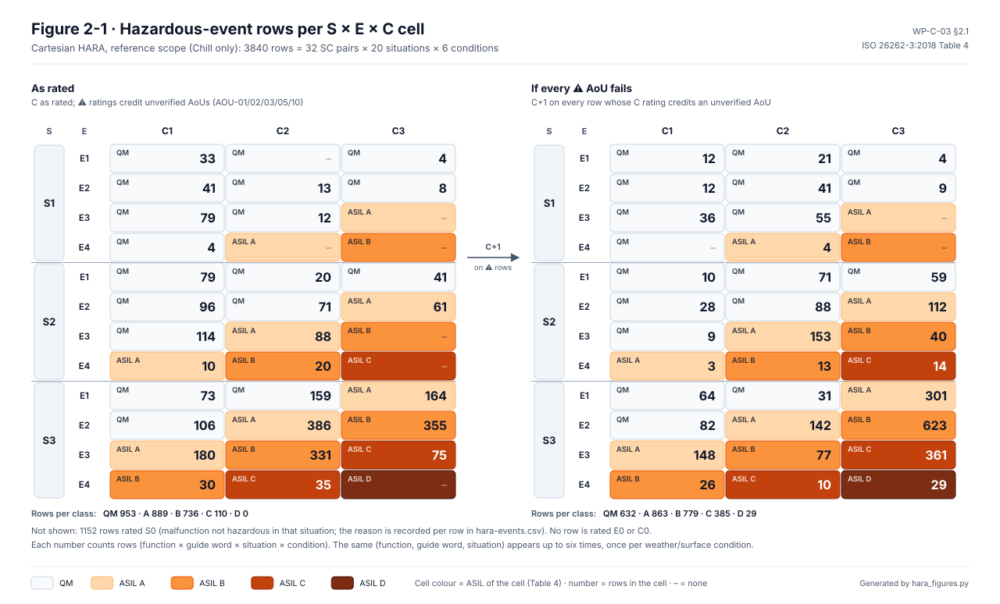

# WP-C-03 Hazard Analysis and Risk Assessment (HARA)

| Field | Value |
|---|---|
| Work product | WP-C-03 Hazard analysis and risk assessment, safety goals |
| Standard reference | ISO 26262-3:2018 §6 (and Annex B for E/C classification guidance); shared hazard log with ISO 21448 §6 |
| Version | 0.12.1 (§7: SH-14 of WP-C-05 v0.11, no response to emergency vehicles, added to the SOTIF-only row; whether it needs a fault-induced counterpart is open, OI-12; no rating changed; 2026-10-30). 0.12 (§2: exposure assumes a random fault; an attacker-triggered event takes the worst situation and the TARA's safety impact governs, interaction IX-12, DQ-420 A; no rating changes; 2026-10-26). 0.11 (Figure 3-1, the operational situations by speed and exposure, and Figure 4-9, the functions in the hazard view, generated by `hara/hara_views.py`; no rating changed; 2026-10-24). 0.10 (§7: H-04 and H-06 now name the threats that reach them; WP-C-09 links DS-04 and DS-06 to them, the log said none; 2026-10-22). 0.9 (HE-01.6 C3 → ASIL C, no AoU credit, so it leaves §5.12 (DQ-418 A); SG-01 stays ASIL C; the OS-12 rules and the workbooks follow under OI-11; 2026-10-22). 0.8 (§5.1: new hazardous event HE-01.6, an assisted lane change that does not stop in the target lane and crosses into the lane beyond, from the edge-case search finding EC-N1 (DQ-406 A); S3 E3 C2 ⚠ → ASIL B proposed with the existing H-01 × OS-12 rule, C if AOU-01/02 fail (§5.12); C2 or C3 is queued for the lead as DQ-418; SG-01 stays ASIL C; HE-02.5 keeps the stop between the lanes; Cartesian rows unchanged, OI-11; 2026-10-22). 0.7 (§7: Figure 7-1, the hazard log as one card per hazard, drawn by `hara/hazlog_cards.py`; no rating, hazard or goal changed; 2026-10-19). 0.6 (every environment of the upstream-use audit analysed at realistic exposure while the ODD claim stays highway-only (RR-2026-011, DQ-213 A): OS-03, OS-04, OS-14, OS-15, OS-16 E2 → E3, assumption A-ODD restated; new situations OS-19 roundabout, OS-20 road works, OS-21 no lane markings; HE-01.1 and HE-01.3 A → B, HE-02.2 B → C; no goal ASIL changes; workbooks regenerated; 2026-10-19). 0.5 (acceleration while not engaged or just after a brake press rated as HE-03.7 under H-03 and SG-03, DQ-364 A; ratings per vehicle family with AOU-01…AOU-05 as entry criteria, §1.1, DQ-369 A; engagement speed floor noted, no exposure credit taken, §3, DQ-280 A; workbooks regenerated; 2026-10-18). 0.4.4 (fallback ASILs of §5.12 confirmed by the lead as proposed, DQ-031; OI-9 closed; 2026-10-17). 0.4.3 (SG-08 safe state from DQ-365 A, the hold credited to AOU-16; OI-10 narrowed to the FTTI; 2026-10-16). 0.4.2 (engaged situations end at 110 km/h, the ODD bound, DQ-260 A; workbooks regenerated; 2026-10-16). 0.4.1 (SG-06 ASIL C confirmed by the lead, DQ-210 A; 2026-10-16). 0.4 (the lead's answers applied: highway-only ODD (DQ-023, DQ-091); OS-07 rated by frequency, SG-03 and SG-06 ASIL C (DQ-036); SG-02 ASIL C after re-rating the curve case (DQ-059); SG-01 kept at C2 with the measurement a G1 entry condition (DQ-008); the driver who stops supervising rated as foreseeable misuse (OS-17, DQ-003) and the unresponsive driver as hazard H-09 with SG-08, ASIL A (OS-18, DQ-205); fallback ASILs stated for every ⚠ event (§5.12, DQ-031); fault-induced SH-09…SH-11 argued as covered (§7.1, DQ-033); Experimental Mode hazard renumbered H-10; 2026-10-16). 0.3 (Figures 2-1 and 6-1 added, generated from the model and this document; 2026-10-13). 0.2 (Cartesian method, 2026-10-12) |
| Status | Draft — **ratings are proposals for review. They are not approved and must not be used to argue safety until the confirmation review (I3) passes** |
| ASIL / scope | Item LD-SDA, reference configuration CFG-001 of platform PL-001 (ratings per vehicle family, §1.1) |
| Author | Assurance team (initial draft) |
| Reviewer(s) | TBD (I1); confirmation review by an independent assessor (I3) per [WP-M-06](../01-management/WP-M-06-confirmation-measures-plan.md) |
| Approver | Safety manager |
| Baseline | `3ed97c8` (code unchanged since `8b8c6ae` apart from `process_replay/ref_commit`) |

## 1. Scope and inputs

- Item: [WP-C-01 item definition](WP-C-01-item-definition.md) (functions F-01…F-09, boundary, AOU-01…AOU-16).
- ODD: [WP-C-02](WP-C-02-odd-and-intended-functionality.md). Since version 0.4 the ODD is **limited-access highways only** (decision register DQ-023, option B). Situations off the highway (OS-03, OS-04, OS-15, OS-16) stay in the catalogue as reasonably foreseeable misuse, because the item does not yet prevent engagement there (§3).
- The HARA rates **malfunctioning behaviour of the item** (E/E faults). Hazards caused by functional insufficiencies of the intended functionality (perception and ML performance limits) use the same hazard list, but they are evaluated in [WP-C-05](WP-C-05-sotif-hazard-identification.md) under ISO 21448.
- **Reasonably foreseeable misuse** (ISO 26262-3 §6.4.2) is rated here as well as in SOTIF. Engagement outside the ODD (OS-03, OS-04, OS-14…OS-16, OS-19…OS-21) and the driver who stops supervising (STPA hazard H-STPA-1, situations OS-17 and OS-18) are operational situations of the catalogue, so every malfunction is crossed with them. The lead decided that H-STPA-1 is foreseeable misuse in both analyses (decision register DQ-003); its SOTIF side is [WP-C-08](WP-C-08-driver-hmi-misuse-analysis.md) MC-01…MC-03.
- As ISO 26262-3 §6 requires, the item's own safety mechanisms (the panda envelope, selfdrived checks, DM) are **not** credited in the ratings. External measures and existing vehicle elements (the EPS's own LKA torque authority, the brake system, the PCM) are credited in controllability **only where an AoU states it**. If that AoU fails verification, the alternative rating shown applies.

### 1.1 Platform: ratings per vehicle family

LionDriver is moving from the single Corolla to a platform (decision register DQ-037, option B): platform PL-001, vehicle families VF-nnn and configurations CFG-nnn ([vehicle register](../../docs/liondriver/vehicles/README.md)). The lead chose how this HARA extends to it (DQ-369, option A, 2026-10-18):

- **Hazards, functions, guide words and situations are platform-wide.** S, E and C are rated **per vehicle family**, because the controllability ratings credit the family's own EPS, brake and PCM behaviour.
- **The vehicle assumptions AOU-01…AOU-05 are entry criteria.** A vehicle whose EPS or PCM does not meet them is not admitted to the platform:
  - AOU-01 and AOU-02: the EPS limits LKA torque to an overpowerable level;
  - AOU-03: the brake overrides ACC;
  - AOU-04: the stock PCS keeps working;
  - AOU-05: the PCM bounds ACC acceleration.

  So the ⚠ credit is never extended to a vehicle that has not shown it.
- **The reference Corolla (VF-001, CFG-001) keeps the ratings of this document**: SG-01 and SG-03 stay ASIL C. Without the AoU credit both would be ASIL D (§5.12). The lead did not choose the alternative, one worst case for every vehicle (option B), which would have made both goals ASIL D for all vehicles, the Corolla included.
- **Each new family needs its own HARA delta and vehicle tests before it is admitted.**
  - The delta re-rates the situations and rules that differ for that family (LD-ITEM-001 §A.10 parameters P2, P3, P5, P7 and P8). Examples: angle-based steering instead of torque, a different longitudinal interface or minimum engagement speed, a hybrid powertrain.
  - The tests verify AOU-01…AOU-05 on that family.
  - The delta is recorded against this document's model. A family is not admitted on the Corolla's ratings.
- G1 claims only CFG-001, with this method in place (DQ-370, option A; [WP-M-01](../01-management/WP-M-01-assurance-strategy.md)).

This answers the platform question of the item definition (LD-ITEM-001 IOI-004).

## 2. Method

The HARA uses a **Cartesian (matrix) method**, generated with the hara-builder tool. The full matrix is in [`hara/WP-C-03-hara-cartesian.xlsx`](hara/WP-C-03-hara-cartesian.xlsx). Every analyst input is held as readable data in [`hara/hara_model.py`](hara/hara_model.py), and the step counts are in [`hara/hara-cartesian-summary.md`](hara/hara-cartesian-summary.md). For review, every hazardous-event row is also in [`hara/hara-events.csv`](hara/hara-events.csv) (one line per row, with rationale), and the function × guide-word classification is in [`hara/hara-function-guideword.csv`](hara/hara-function-guideword.csv).

1. **Functions** F-01…F-09 are taken from [WP-C-01 §2.1](WP-C-01-item-definition.md).
2. **Malfunction identification.** All 14 guide words (M01 No function, M02 Stops functioning, M03 Unrequested, M04 Stuck, M05 Excessive, M06 Partial, M07 Early, M08 Late, M09 Too short, M10 Too long, M11 Delayed, M12 Inverse, M13 Erratic, M14 Uneven) are applied to every function: 9 × 14 = 126 pairs.
   - Each pair is classified SC (safety-critical), NSC or NA, with a rationale. All 126 rows stay in the workbook (tab 11), so nothing is dropped without a reason.
   - An SC pair whose vehicle-level response is identical to another SC pair is marked *subsumed by* that pair and is not expanded twice.
3. **Situation analysis.** Each SC pair that is not subsumed is crossed with 20 operational situations (§3) and 6 weather/surface conditions (§3.1), giving 120 combinations per pair. Situations OS-03, OS-04, OS-14…OS-16 and OS-19…OS-21 (outside the highway-only ODD), OS-17 and OS-18 (driver not supervising or not responding) and conditions W04–W06 are included as reasonably foreseeable misuse.
4. **Classification of every row.**
   - Severity S0–S3, using injury potential to occupants and other road users. S0 is used where the malfunction is **not hazardous in that situation**, and the row records why. This is how combinations are screened out without deleting them.
   - Exposure E0–E4 per ISO 26262-3:2018 Table B.2 (duration). The combination of a situation and a condition is rated no more frequent than the rarer of the two. One situation is rated by frequency instead (Table B.3): closing on slower traffic at highway speed (OS-07) happens on almost every highway drive, so it is E4 although each occurrence lasts seconds (decision register DQ-036, option B; the reconciliation's RD-2 had proposed the duration reading, E3):

     | Class | Share of operating time |
     |---|---|
     | E4 | > 10 % |
     | E3 | 1–10 % |
     | E2 | < 1 % |
     | E1 | very rare |

     The generator's own default exposure anchors differ from Table B.2, so the workbook's exposure tab is corrected after generation (`hara_model.py --postprocess`).

     **Exposure assumes a random fault.** E rates how often the situation occurs because a random fault strikes at a random moment. An attacker in control of the SoC can wait for the worst situation, so for an attacker-triggered event E does not apply: the TARA ([WP-C-09](WP-C-09-tara.md) §3) rates its safety impact without exposure, and that rating governs. No HARA rating changes; the joint HARA/TARA view records it as interaction IX-12 ([`hatara/hatara-interactions.md`](hatara/hatara-interactions.md); decision register DQ-420, option A).
   - Controllability C0–C3 for a typical attentive driver; for other road users, their ability to avoid harm. Ratings that credit an unverified AoU are flagged ⚠, and the summary also gives the result with C+1 (AoU fails).
   - S and C come from rating rules per hazard and situation (`RULES` in `hara_model.py`), adjusted for the condition (e.g. snow/ice C+1 for lateral hazards). Each rule carries its rationale into the workbook row.
5. **ASIL determination.** The ASIL is computed in the workbook with the ISO 26262-3 Table 4 lookup and checked against an independent computation in `hara_model.py`; all rows agree. An equivalent rule is to sum the numeric class levels:

   | S + E + C | ASIL |
   |---|---|
   | 10 | D |
   | 9 | C |
   | 8 | B |
   | 7 | A |
   | ≤ 6 | QM |

   Any class at 0 gives QM (S0: no ASIL).
6. **Hazardous events and safety goals.**
   - The generator groups ASIL-rated rows per (function, hazard) as candidate goals (workbook tab 13).
   - These are consolidated per vehicle-level hazard into SG-01…SG-07 (§6), each taking the highest ASIL of its rows. For each distinct worst case, §5 records a representative hazardous event (HE) with full rationale.
   - The HE rows in §5 are the governing cases. The workbook holds every combination behind them.
7. **Scope variant.** Experimental Mode (D-08) is not decided, so a second workbook ([`hara/WP-C-03-hara-cartesian_experimental.xlsx`](hara/WP-C-03-hara-cartesian_experimental.xlsx)) adds function F-02X and shows what option B would add (§5.11).

Rationale is given for every rating. Ratings that depend on unverified AoUs are flagged ⚠.

### 2.1 Counts

<!-- hara-counts:start (generated by hara/hara_model.py) -->
| Step | Reference scope (Chill only) | With Experimental Mode |
|---|---|---|
| Functions × guide words | 9 × 14 = 126 | 10 × 14 = 140 |
| Pairs classified SC / NSC / NA | 59 / 41 / 26 | 70 / 42 / 28 |
| SC pairs expanded (not subsumed) | 32 | 34 |
| Rows generated (pairs × 20 situations × 6 conditions) | 3840 | 4080 |
| Rows not hazardous in that situation (S0, reason recorded) | 1152 | 1266 |
| Rows rated QM | 953 | 1038 |
| Rows rated ASIL A / B / C / D | 889 / 736 / 110 / 0 | 913 / 753 / 110 / 0 |
| Rows ASIL A / B / C / D if every ⚠ AoU fails | 863 / 779 / 385 / 29 | 897 / 809 / 394 / 29 |
| Distinct hazardous events (function × guide word × situation, S ≠ S0) | 448 | 469 |
| … with ASIL ≥ A in at least one condition | 392 | 408 |
<!-- hara-counts:end -->

Representative hazardous events recorded in §5: 39 (HE-01.1 … HE-09.2), plus 2 variant events for Experimental Mode (§5.11).

The table above is written by `hara_model.py`; CI runs `hara_model.py --check`, which fails if this table or [`hara-cartesian-summary.md`](hara/hara-cartesian-summary.md) no longer match the model.

*Figure 2-1.* Where the reference-scope rows fall in the ASIL matrix: left as rated, right with C+1 on every row whose controllability credits an unverified AoU (⚠). Rows rated S0 are not shown. Drawn from the rows of `hara_model.py` (the same data as [`hara-events.csv`](hara/hara-events.csv) and the table above); the per-class totals equal the §2.1 counts. Source: [`hara/figures/fig-c03-2-1-asil-heatmap.svg`](hara/figures/fig-c03-2-1-asil-heatmap.svg), generated by [`hara/hara_figures.py`](hara/hara_figures.py); change the rating rules in `hara_model.py` and regenerate, do not edit the SVG.

## 3. Operational situation catalogue

The situations come from the ODD ([WP-C-02 §3](WP-C-02-odd-and-intended-functionality.md)). OS-11 (wet road) of version 0.1 is now the weather/surface dimension (§3.1); its ID is not reused. OS-12…OS-16 are new in version 0.2, OS-17 and OS-18 in version 0.4. The list is held in `SITUATIONS` in [`hara_model.py`](hara/hara_model.py).

Version 0.4 changes, from the lead's answers:

- **Highway only (DQ-023, B).** OS-03, OS-04, OS-15 and OS-16 were part of the arterial and rural ODD (ODD-A), which is dropped. They stay in the catalogue as engagement outside the ODD, like OS-14: the item does not yet prevent engagement off the highway (WP-C-02 §5). Version 0.4 rated them E2 on an assumption (A-ODD: under 1 % of engaged time). OS-13 (manual driving, item powered) still covers every road type.
- **Upstream use (RR-2026-011, DQ-213 A, 2026-10-19).** A video of an owner on a CFG-001 Corolla shows openpilot engaged on back roads at 72 km/h, on narrow roads where it crosses the double yellow, through intersections, road works and roundabouts, and on roads without lane lines. The lead chose to analyse every one of these environments at realistic exposure, and to keep the ODD claim highway-only:
  - OS-03, OS-04, OS-14, OS-15 and OS-16 are **E3** (1–10 % of engaged time) instead of E2, and A-ODD now states that share.
  - New **OS-19** (roundabout, 15–40 km/h, E2), **OS-20** (road works, 30–90 km/h, E2) and **OS-21** (road without lane markings, 30–90 km/h, E3, rated as OS-03).
  - No goal ASIL changes. If off-highway use exceeds 10 % (E4), SG-02 becomes ASIL D (§6.1 observation 7, OI-2).
- **OS-07 by frequency (DQ-036, B):** E4 instead of E3 (§2).
- **Driver state (DQ-003, DQ-205).** OS-17 (not supervising, still responds) and OS-18 (unresponsive) are new. Driver monitoring is an item measure and is not credited in their exposure.
- **Engagement speed floor (DQ-280 A, 2026-10-18).** The item shall refuse to engage below a highway speed floor (proposed 60 km/h; WP-C-02 §3.1) until road-type data exist (FM-08). Once implemented and verified, it lowers the exposure of the off-highway misuse situations below the floor (OS-04, OS-14). **No credit is taken yet:** they stay E2 under A-ODD, and no rating changes. A floor checks only at engagement, so it does not remove a situation entered after engaging on the highway (OS-06 stop-and-go after a slowdown stays in the ODD).
- **Speed (DQ-091 A, DQ-260 A).** The engaged highway situations end at 110 km/h, the ODD bound since 2026-10-16 (DQ-260, option A): every claimed speed is the speed controllability is tested to (DQ-091). Manual driving (OS-13) and the stock PCS (OS-09) keep 0–120 km/h, because they do not depend on the item being engaged. Engaged driving above 110 km/h is foreseeable misuse until the speed bound is enforced (FM-07, [WP-C-07](WP-C-07-sotif-functional-modifications.md)): S3, E2 at most, and with no controllability credit (C3) at worst ASIL B, below SG-01 and SG-02 (C), so it adds no goal and changes none. The S and C ratings of the in-ODD rows do not change; at 110 km/h the C2 ratings rest on evidence that is to be measured (DQ-008, OI-1).

| ID | Situation | Speed (km/h) | Exposure (within ODD unless stated) |
|---|---|---|---|
| OS-01 | Limited-access highway, free flow, adjacent traffic | 90–110 | E4: Majority of engaged time (ODD-H) |
| OS-02 | Highway curve near R_ODD with barrier or adjacent traffic | 70–110 | E3: Curves of this radius at speed: 1–10 % of time |
| OS-03 | Engaged on an undivided rural or arterial road, oncoming traffic: outside the ODD, foreseeable misuse | 60–90 | E3: Outside the highway-only ODD (DQ-023); engagement is not prevented off-highway. RR-2026-011: upstream owners engage openpilot off the highway routinely, so the share is rated 1–10 % (DQ-213 A) (A-ODD) |
| OS-04 | Engaged on an urban arterial, pedestrians and cyclists near the lane edge: outside the ODD, foreseeable misuse | 30–60 | E3: Outside the highway-only ODD (DQ-023). RR-2026-011: upstream owners engage openpilot off the highway routinely, so the share is rated 1–10 % (DQ-213 A) (A-ODD) |
| OS-05 | Following a lead vehicle at a short gap, dense traffic | 30–110 | E4: Most engaged time has a lead vehicle |
| OS-06 | Stop-and-go queue or standstill behind a lead; pedestrians may cross | 0–30 | E3: Congestion share of driving |
| OS-07 | Approaching slower or stationary traffic from highway speed | 70–110 | E4: Rated by frequency: happens on almost every highway drive (DQ-036; ISO 26262-3 Table B.3) |
| OS-08 | Close following vehicle behind (gap < 1.5 s) | 50–110 | E4: Common in dense traffic |
| OS-09 | Imminent collision where the stock PCS/AEB would intervene | 0–120 | E2: PCS-relevant situations are rare |
| OS-10 | Driver override while engaged: braking, cancel or evasive steering | 0–110 | E3: Overrides are frequent but short; emergency cases rarer |
| OS-12 | Driver-initiated assisted lane change | 70–110 | E3: Lane changes: short duration, several per trip |
| OS-13 | Manual driving, item powered but not engaged | 0–120 | E4: Large share of onroad time with the device installed |
| OS-14 | Engaged outside the ODD (residential street, ramp, tight curve): foreseeable misuse | 15–60 | E3: Engagement is possible anywhere. RR-2026-011: upstream owners engage openpilot off the highway routinely, so the share is rated 1–10 % (DQ-213 A) (A-ODD) |
| OS-15 | Engaged approaching a signalised or stop-controlled intersection: outside the ODD, foreseeable misuse | 30–90 | E3: Outside the highway-only ODD (DQ-023). RR-2026-011: upstream owners engage openpilot off the highway routinely, so the share is rated 1–10 % (DQ-213 A) (A-ODD) |
| OS-16 | Engaged in a rural or arterial curve with oncoming traffic: outside the ODD, foreseeable misuse | 60–90 | E3: Outside the highway-only ODD (DQ-023). RR-2026-011: upstream owners engage openpilot off the highway routinely, so the share is rated 1–10 % (DQ-213 A) (A-ODD) |
| OS-17 | Engaged on the highway while the driver is not supervising (eyes off the road or hands off for long periods; responds when alerted): foreseeable misuse | 70–110 | E2: H-STPA-1 (DQ-003): sustained non-supervision assumed < 1 % of engaged time; DM is not credited |
| OS-18 | Engaged on the highway with an unresponsive driver (asleep, impaired or incapacitated): foreseeable misuse | 70–110 | E1: H-STPA-1, DQ-205: very rare; second-set HE-018 rates it E1 |
| OS-19 | Engaged in a roundabout (rotary), cyclists and pedestrians at the entries: outside the ODD, foreseeable misuse | 15–40 | E2: RR-2026-011 (DQ-213 A): shown in upstream use; a roundabout is a short part of any trip, so < 1 % of engaged time |
| OS-20 | Engaged through road works: lane shifts, cones, workers near the lane: outside the ODD, foreseeable misuse | 30–90 | E2: RR-2026-011 (DQ-213 A): shown in upstream use; work zones are a small share of engaged time |
| OS-21 | Engaged on a road without lane markings (rural back road or residential street): outside the ODD, foreseeable misuse | 30–90 | E3: RR-2026-011 (DQ-213 A): the end-to-end model steers without markings and nothing gates on them; rated as OS-03 |

### 3.1 Weather and surface conditions

| ID | Condition | Exposure | ODD |
|---|---|---|---|
| W01 | Dry, daylight | E4 | In ODD |
| W02 | Wet road or light rain | E3 | In ODD |
| W03 | Night, dry, headlights | E3 | In ODD |
| W04 | Moderate or heavy rain (outside ODD, foreseeable) | E2 | Outside ODD |
| W05 | Snow or ice (outside ODD, foreseeable) | E2 | Outside ODD |
| W06 | Fog, visibility below the ODD bound (outside ODD, foreseeable) | E1 | Outside ODD |

*Figure 3-1.* The two tables above: each situation over its speed range, coloured by exposure, with the foreseeable-misuse situations (outside the ODD or the intended driver state) hatched; below, the conditions every situation is crossed with. Generated by [`hara/hara_views.py`](hara/hara_views.py) through `hara/hara_figures.py` from `SITUATIONS` and `WEATHER` in `hara_model.py`.

## 4. Hazard identification (malfunctioning behaviour → vehicle-level hazard)

All 126 function × guide-word pairs, with classification and rationale, are in workbook tab 11 and in `FM` in [`hara_model.py`](hara/hara_model.py). This table lists the SC pairs per vehicle-level hazard; every other pair is NSC or NA with a written reason.

| Hazard | Expanded SC pairs (function guide word) | Subsumed SC pairs (→ pair that covers them) |
|---|---|---|
| **H-01** Unintended or excessive lateral motion | F-01 M03, F-01 M05, F-01 M07, F-01 M12, F-01 M13, F-03 M03 | F-01 M10→M03, F-01 M14→M05, F-03 M12→M03 |
| **H-02** Unannounced loss or degradation of lateral control | F-01 M01, F-01 M02, F-01 M04, F-01 M06, F-01 M11, F-03 M02, F-08 M04 | F-01 M08→M11, F-01 M09→M02, F-03 M13→M02, F-08 M05→M04, F-08 M13→M04 |
| **H-03** Unintended acceleration | F-02 M04, F-02 M05, F-02 M12 | — |
| **H-04** Unintended or excessive deceleration | F-02 M03, F-02 M10, F-02 M13, F-04 M03, F-06 M03 | F-02 M07→M03, F-04 M05→M03, F-04 M07→M03 |
| **H-05** Driver unable to override or disengage | F-03 M01, F-03 M06, F-03 M11 | F-03 M04→M01, F-03 M08→M11, F-03 M10→M01 |
| **H-06** Unannounced loss of longitudinal deceleration | F-02 M01, F-02 M02, F-02 M06, F-02 M11 | F-02 M08→M11, F-02 M09→M02 |
| **H-07** Displayed system state differs from actual state (mode confusion) | F-05 M01, F-05 M04 | F-05 M02→M01, F-05 M06→M01, F-05 M08→M01, F-05 M09→M01, F-05 M11→M01, F-05 M12→M04 |
| **H-08** Suppression of the vehicle's stock pre-collision braking | F-08 M03 | — |
| **H-09** Automated control continues with a driver who is not supervising or not responding | F-04 M01 | F-04 M02/M04/M06/M08/M11→M01 |

*Figure 4-9.* The same classification seen per function: all 126 pairs of the item's functions ([WP-C-01](WP-C-01-item-definition.md) §2.1), each coloured by its class and, for an expanded safety-critical pair, by the highest ASIL of its rows. On the right, the hazards of this table the function reaches and the goals of §6 they lead to. Reference scope; F-02X is in the variant (§5.11). Generated by [`hara/hara_views.py`](hara/hara_views.py) through `hara/hara_figures.py` from `FUNCTIONS`, `FM` and `SG_MAP` in `hara_model.py`. Figures 4-1 to 4-8, the guide-word scenes per function, are in the [HARA folder](hara/README.md#guide-word-scenes).

Pairs classified NSC that need a note:

| Pair | Why not a hazardous event of its own |
|---|---|
| F-08 M01/M02/M06/M08/M10/M11 (envelope limits or gating not enforced) | Latent fault of a safety mechanism; hazardous only together with an F-01/F-02/F-03 malfunction (dual-point). Handled through the FSC/TSC and the hardware metrics, not rated as a separate event (ISO 26262-3 §6: safety mechanisms of the item are not credited in the HARA) |
| F-06 M01 / F-07 all (missing FCW or LDW, false LDW) | No actuation; the driver is responsible and the stock PCS gives its own warning (subject to H-08) |
| F-09 all (logging, upload, remote access, update) | No kinetic authority. Cyber-induced effects are analysed in the TARA ([WP-C-09](WP-C-09-tara.md)) and map onto H-01…H-08 |

**H-09 (driver not supervising or not responding)** is new in version 0.4 (decision register DQ-205, option A). Version 0.3 classified F-04 M01 and its variants (DM fails to detect inattention, or escalates too late) as NSC: a latent fault of a measure that the controllability of H-02 and H-06 relies on. That reading still holds while the driver supervises, and the model rates those rows S0 with that reason. It does not hold when the driver has stopped supervising (OS-17) or cannot respond (OS-18). Then a silent DM failure lets the item keep driving with nobody in the loop, as the second-set HARA (HZ-013), the STPA (H-STPA-1, SC-8) and the System FMEA (SFM-025, SFM-ACT-005) all found. So F-04 M01 is SC under H-09, with M02, M04, M06, M08 and M11 subsumed.

**H-07 (mode confusion)** was reserved in version 0.1 and rated only through H-02, H-05 and H-06. The guide-word pass on F-05 (M01 missing take-over alert, M04 frozen or wrong engagement indication) makes it a hazard with its own events (§5.7). Its events are covered by SG-02 and SG-06, whose take-over-warning wording already includes a wrong state indication (§6).

## 5. Hazardous events and risk assessment

### 5.1 H-01 Unintended or excessive lateral motion

| HE | Situation | Effect | S | E | C | ASIL | Rationale |
|---|---|---|---|---|---|---|---|
| HE-01.1 | OS-03 undivided road, oncoming traffic, 60–90 km/h: engaged outside the highway-only ODD (foreseeable misuse) | Departure into the oncoming lane; head-on collision | S3 | E3 | C2 ⚠ | **B** | S3: head-on at combined speeds > 100 km/h, life-threatening. E3: since version 0.4 the ODD is highways only (DQ-023), so engagement on undivided roads is foreseeable misuse (E4 inside the old ODD-A). Version 0.6 rates it 1–10 % of engaged time from upstream use (RR-2026-011, DQ-213 A); the same holds on roads without markings (OS-21). C2 ⚠: credits AOU-01/AOU-02 (EPS limits LKA torque to an overpowerable level). If AOU-01/02 fail: C3 → ASIL C |
| HE-01.2 | OS-01/OS-02 highway, adjacent traffic or barrier, 90–110 km/h | Lateral departure into an adjacent vehicle or barrier | S3 | E4 | C2 ⚠ | **C** | S3: lateral deviation at speed with adjacent traffic can trigger loss of control or secondary collisions. E4: majority of engaged time. C2 ⚠: credits AOU-01/AOU-02. A supervising driver with hands near the wheel corrects a sustained limited-torque deviation within ~1 s in most cases (≥ 90 %). C2 is kept until the vehicle is measured; the measurement is a G1 entry condition, the panda path is designed to the ASIL D measures meanwhile, and the safety case claims no controllability credit (decision register DQ-008, option A; RD-1). **If AOU-01/02 are not verified: C3 → ASIL D**. Since version 0.4 this is the governing event of SG-01 (HE-01.1 left the ODD) |
| HE-01.3 | OS-04 urban, pedestrians and cyclists near the lane edge, 30–60 km/h: engaged outside the ODD (foreseeable misuse) | Vehicle drifts into a vulnerable road user | S3 | E3 | C2 ⚠ | **B** | S3: VRU impact above 30 km/h. E3: urban arterials are outside the highway-only ODD (DQ-023); rated 1–10 % of engaged time from upstream use since version 0.6 (RR-2026-011). The speed floor (DQ-280) will lower it once built and verified. C2: lower speed gives more time but less lateral margin. If AOU-01/02 fail: C3 → ASIL C |
| HE-01.4 | Torque while not engaged, OS-13 manual driving on any road, driver steering manually | Unexpected steering disturbance during manual driving | S3 | E4 | C2 ⚠ | **C** | S3, E4: manual driving with the item powered is most onroad time, on every road type (the ODD restricts engaged use only). Driver hands on the wheel (manual driving), so C2 rather than C3. If AOU-01/02 fail: C3 → ASIL D |
| HE-01.5 | OS-17 highway, engaged, the driver not supervising (eyes off the road or hands off): foreseeable misuse | Lateral departure at highway speed that nobody corrects in time | S3 | E2 | C3 | **B** | New in 0.4 (H-STPA-1, DQ-003). S3 as HE-01.2. E2: sustained non-supervision assumed < 1 % of engaged time; DM is not credited. C3: the correction that HE-01.2 credits does not come in time. Below SG-01's ASIL C; it does not change the goal |
| HE-01.6 | OS-12 driver-initiated assisted lane change, highway, 80–110 km/h; a fault late in the change: a frozen command (F-01 M04) keeps steering, or a loss of assist (F-01 M01/M02, EPS fault) leaves the car's lateral speed | The car does not stop in the target lane: it crosses the target lane's far line into the lane beyond, which the driver did not check before the change | S3 | E3 | C3 | **C** | New in 0.8 (decision register DQ-406, option A), from the edge-case search finding EC-N1 ([`sim/results/edge-cases.md`](../sim/results/edge-cases.md) rows EC-11, EC-13; synthetic plant runs with the real panda code, no evidence credit). **S, E and C are proposals:** S3: side or rear impact with a vehicle in the lane beyond at highway speed. E3: as OS-12, lane changes are short but several per trip; no credit is taken for how often the lane beyond is occupied. C3 (version 0.9, decision register DQ-418, option A): the car keeps moving the way the driver asked, so the first cue is the car not stopping, later than in HE-02.5; in the plant search every assumption probe of EC-11 and EC-13 still crosses the far line, a driver reacting after 0.75 s included (by 4.9 m at 80 km/h, 0.4 m at 108 km/h). No AoU is credited. Version 0.8 had C2 ⚠ (ASIL B) from the H-01 × OS-12 rule; that rule and the workbook rows are re-rated under OI-11. Revisit if a driver test shows drivers catch it. Equal to SG-01's ASIL C; it does not change the goal |

### 5.2 H-02 Unannounced loss or degradation of lateral control

| HE | Situation | Effect | S | E | C | ASIL | Rationale |
|---|---|---|---|---|---|---|---|
| HE-02.1 | OS-02 highway curve near R_ODD, driver supervising, possibly hands off (foreseeable: openpilot does not require hands on the wheel) | Vehicle goes straight in the curve and departs the lane | S3 | E3 | C3 | **C** | S3: departure at highway speed into a barrier or adjacent traffic. E3: curves of this radius at speed. C3 (C2 until version 0.3): at the curve bound a silent loss drifts about 0.6 m in 0.7 s ([WP-S-04](../03-system/WP-S-04-timing-ftti-budget.md) OI-2), faster than a supervising driver reacts. The lead chose to re-rate rather than tighten R_ODD (decision register DQ-059, option B; OI-7). This makes SG-02 ASIL C |
| HE-02.2 | OS-16 rural curve with oncoming traffic: engaged outside the ODD (foreseeable misuse) | Departure into the oncoming lane | S3 | E3 | C3 | **C** | As HE-02.1, C3 for the same drift time. E3: rural roads are outside the highway-only ODD (DQ-023); rated 1–10 % of engaged time from upstream use since version 0.6 (RR-2026-011, DQ-213 A). Equal to SG-02's ASIL C; it does not raise the goal |
| HE-02.3 | Frozen (stuck) torque command at its last value | Steering bias continues while the road changes | S3 | E3 | C2 ⚠ | **B** | A stuck request is bounded by EPS authority (AOU-01). It behaves like HE-01 at reduced magnitude. If AOU-01 fails: C3 → ASIL C |
| HE-02.4 | OS-01 highway, straight or gentle curve, 90–110 km/h; lateral control silently lost (F-01 M01/M02/M04/M06/M11, F-03 M02 unannounced disengagement, F-08 M04 envelope stuck blocking) | Slow drift out of the lane at highway speed | S3 | E4 | C1 | **B** | S3: lane departure at highway speed. E4: majority of engaged time. C1: on a straight road the drift is slow and a supervising driver notices and corrects it (≥ 99 %). New in 0.2: the Cartesian shows this governs SG-02 by frequency, not only the curve case |
| HE-02.5 | OS-12 driver-initiated assisted lane change | Lateral control lost mid-manoeuvre; vehicle straddles lanes next to traffic | S3 | E3 | C2 | **B** | S3: contact with traffic in the target or original lane. E3: lane changes are short but frequent. C2: the driver initiated the manoeuvre and is attentive, but loss without warning delays the reaction. A fault that leaves the car moving sideways past the target lane, into the lane beyond, is rated as HE-01.6 (DQ-406) |
| HE-02.6 | OS-17 highway, engaged, the driver not supervising: foreseeable misuse | Silent loss of lateral control; drift out of the lane that nobody notices | S3 | E2 | C3 | **B** | New in 0.4 (H-STPA-1, DQ-003). E2 as HE-01.5. C3: without supervision even the slow drift of HE-02.4 is not caught |

### 5.3 H-03 Unintended acceleration

| HE | Situation | Effect | S | E | C | ASIL | Rationale |
|---|---|---|---|---|---|---|---|
| HE-03.1 | OS-05 following a lead at a short gap | Rear-end collision with the lead vehicle | S2 | E4 | C2 ⚠ | **B** | S2: moderate speed difference in following. C2 credits AOU-03 (driver braking overrides) and AOU-05 (PCM bounds the ACC acceleration request). Without AOU-05, high-magnitude acceleration is possible → C3 → ASIL C |
| HE-03.2 | OS-06 standstill in a queue, pedestrian crossing in front | Vehicle moves off and hits a pedestrian | S3 | E3 | C2 | **B** | S3: VRU. E3: stop-and-go with crossing pedestrians. C2: the driver must brake immediately; a low-speed launch is limited |
| HE-03.3 | OS-07 approaching a slower lead | Acceleration toward the lead instead of deceleration | S3 | E4 | C2 ⚠ | **C** | S3: high closing speed. E4 (E3 until version 0.3): closing on a slower car happens on almost every highway drive; the lead chose the frequency reading (decision register DQ-036, option B; RD-2). C2: the driver supervises and can brake; credits AOU-03/AOU-05. Without them → C3 → ASIL D. This makes SG-03 ASIL C |
| HE-03.4 | OS-02 highway curve (F-02 M04 stuck positive, M05 excessive, M12 inverse) | Speed rises in the curve beyond the lateral limit; run-off | S3 | E3 | C2 ⚠ | **B** | S3: run-off at curve speed. E3: curves near R_ODD. C2 credits AOU-03/AOU-05 (driver braking overrides; PCM bounds acceleration). Without them → C3 → ASIL C. The same malfunction in a rural curve (OS-16) is outside the ODD: E2, ASIL A |
| HE-03.5 | OS-01 highway free flow (F-02 M04/M05/M12) | Speed rises above the set speed; moderate impacts if traffic slows | S2 | E4 | C1 ⚠ | **A** | S2: moderate speed difference. E4. C1: the driver brakes; acceleration bounded to +2.0 m/s² by the envelope. Credits AOU-03; without it → C2 → ASIL B |
| HE-03.6 | OS-17 highway, engaged, the driver not supervising: foreseeable misuse (F-02 M04/M05/M12) | Speed rises above the set speed and nobody brakes | S2 | E2 | C3 | **A** | New in 0.4 (H-STPA-1, DQ-003). S2 as HE-03.5. E2 as HE-01.5. C3: the driver is not watching |
| HE-03.7 | OS-13 manual driving, item not engaged: acceleration commanded while not engaged, after a false engagement (F-03 M03) or just after a brake press has cancelled engagement (F-02 M05) | Unexpected acceleration while the driver is driving or has just braked; rear-end on a lead | S2 | E4 | C2 ⚠ | **B** | New in 0.5 (decision register DQ-364, option A; FTA G3.3, WP-A-04). Until 0.4 the false engagement was rated only as steering (HE-01.4). S2: the driver is already driving and usually braking, so the speed difference stays moderate. E4: manual driving with the device installed. C2: the driver's foot is on or near the brake; credits AOU-03 (brake overrides) and AOU-05 (PCM bounds the request). Without them → C3 → ASIL C. Below SG-03's C (HE-03.3), so the goal ASIL is unchanged |

### 5.4 H-04 Unintended or excessive deceleration

| HE | Situation | Effect | S | E | C | ASIL | Rationale |
|---|---|---|---|---|---|---|---|
| HE-04.1 | OS-08 close following vehicle, 50–110 km/h | Rear-end impact by the following vehicle | S2 | E4 | C2 ⚠ | **B** | S2: rear impacts on a modern car are mostly S1–S2. Severe at large speed differences, but deceleration is limited by the PCM's ACC envelope (AOU-05). C2: the following driver and the ego driver (pressing gas overrides) can usually react. If the deceleration is unbounded (AOU-05 fails) → C3 → ASIL C |
| HE-04.2 | OS-02 highway curve on a wet road (W02); the same applies in a rural curve outside the ODD (OS-16, E3) | Instability under unexpected braking | S3 | E3 | C1 ⚠ | **A** | VSC available (AOU-10; if it fails: C2 → ASIL B). Moderate ACC deceleration on wet roads is controllable for most drivers |
| HE-04.3 | OS-08 close follower; driver monitoring escalates to forced deceleration although the driver is attentive (F-04 M03) | Rear impact by the following vehicle | S2 | E4 | C2 ⚠ | **B** | New in 0.2: DM is a source of H-04, not only a controllability measure. Same S/E/C as HE-04.1 (deceleration bounded by the PCM, AOU-05). Without AOU-05 → C3 → ASIL C |
| HE-04.4 | OS-13 manual driving, item not engaged; the item commands braking (F-02 M03) | Rear impact by the following vehicle during manual driving | S2 | E4 | C2 ⚠ | **B** | E4: most onroad time with the device installed is not engaged. C2 credits AOU-05. The envelope's engagement gating is not credited (ISO 26262-3 §6). Without AOU-05 → C3 → ASIL C |
| HE-04.5 | OS-08 close follower; false FCW provokes driver reflex braking (F-06 M03) | Rear impact by the following vehicle | S2 | E4 | C1 | **A** | New in 0.2 (version 0.1 rated false FCW QM). The warning does not actuate; most drivers glance at the scene and brake moderately or not at all (C1). The model FCW also fires when not engaged (`selfdrived.py:490`) |

### 5.5 H-05 Driver unable to override or disengage

| HE | Situation | Effect | S | E | C | ASIL | Rationale |
|---|---|---|---|---|---|---|---|
| HE-05.1 | OS-10 driver emergency braking while the system keeps commanding acceleration | Longer stopping distance; collision | S3 | E3 | C2 ⚠ | **B** | Credits AOU-03 (the brake system works mechanically and the PCM cancels ACC on brake). Without AOU-03 → C3 → ASIL C |
| HE-05.2 | OS-10 driver evasive steering while the system keeps commanding counter-torque | Evasive manoeuvre impaired; collision | S3 | E3 | C2 ⚠ | **B** | Credits AOU-01/AOU-02 (driver can overpower the EPS LKA torque). Without them → C3 → ASIL C |
| HE-05.3 | Cancel or brake does not disengage; the system stays engaged when the driver believes it is off | Mode confusion, then unexpected actuation (leads to H-01 or H-03) | S3 | E3 | C2 | **B** | Rated with the effect hazards |
| HE-05.4 | OS-10 brake or cancel releases one axis only (F-03 M06 partial disengagement) | Continued lateral or longitudinal actuation during the driver's emergency action | S3 | E3 | C2 ⚠ | **B** | As HE-05.1/05.2; credits AOU-01/02/03. Without them → C3 → ASIL C |

### 5.6 H-06 Unannounced loss of longitudinal deceleration

| HE | Situation | Effect | S | E | C | ASIL | Rationale |
|---|---|---|---|---|---|---|---|
| HE-06.1 | OS-07 approaching stationary or slow traffic at highway speed; the system silently stops decelerating (for example, a stale plan holds zero acceleration) | High-speed rear-end collision | S3 | E4 | C2 | **C** | S3: high closing speed. E4 (E3 until version 0.3): OS-07 is rated by frequency (DQ-036); the exposure belongs to the situation, so it applies here as to HE-03.3. C2: supervising driver, but reliance on ACC delays the reaction. The stock PCS may mitigate this but is not credited (it is a separate system, and AOU-04 is unverified). This makes SG-06 ASIL C |
| HE-06.2 | OS-06 slow queue | Low-speed rear-end collision | S1 | E3 | C2 | **QM** | S1: low-speed impact, light injuries |
| HE-06.3 | OS-05 following a lead at a short gap; the lead brakes and the deceleration is silently lost (F-02 M01/M02/M06/M11) | Rear-end collision at moderate speed difference | S2 | E4 | C2 | **B** | S2: following speeds, moderate speed difference. E4: most engaged time has a lead. C2: supervising driver, but reliance on ACC delays the reaction |
| HE-06.4 | OS-17 highway, engaged, the driver not supervising: foreseeable misuse; deceleration silently lost while closing on slower traffic | High-speed rear-end collision that nobody prevents | S3 | E2 | C3 | **B** | New in 0.4 (H-STPA-1, DQ-003). S3 as HE-06.1. E2 as HE-01.5. C3: the driver is not watching |

### 5.7 H-07 Displayed system state differs from actual state (mode confusion)

| HE | Situation | Effect | S | E | C | ASIL | Rationale |
|---|---|---|---|---|---|---|---|
| HE-07.1 | OS-02 highway curve near R_ODD; the system has disengaged but still shows engaged, or the take-over alert is missing (F-05 M01/M04) | The driver believes the system steers; departure in the curve | S3 | E3 | C3 | **C** | S3: departure into barrier or traffic. E3: curves near R_ODD. C3 (C2 until version 0.3): the vehicle response is the silent loss of HE-02.1, so it is re-rated with it (DQ-059). In a rural curve outside the ODD (OS-16): E2, ASIL B |
| HE-07.2 | OS-01 highway, straight or gentle curve | The driver believes the system steers; slow lane departure | S3 | E4 | C1 | **B** | S3: departure at highway speed. E4. C1: slow drift on a straight road; an attentive driver notices it |
| HE-07.3 | OS-07 approaching slower or stationary traffic; the driver believes ACC is active | The driver expects the vehicle to slow; high closing speed | S3 | E4 | C2 | **C** | S3: high closing speed. E4: OS-07 by frequency (DQ-036). C2: reliance on a function that is not active |
| HE-07.4 | OS-17 highway, engaged, the driver not supervising: foreseeable misuse; the take-over alert is missing or the display shows engaged (F-05 M01/M04) | The driver, looking away, is not called back when the system drops out | S3 | E2 | C3 | **B** | New in 0.4 (H-STPA-1, DQ-003). With eyes off the road the sound is the only channel left; if it is missing the driver is not called back. E2 as HE-01.5 |

### 5.8 H-08 Suppression of the vehicle's stock pre-collision braking

| HE | Situation | Effect | S | E | C | ASIL | Rationale |
|---|---|---|---|---|---|---|---|
| HE-08.1 | OS-09 imminent collision where the stock PCS would have braked (engaged or not engaged) | Collision not mitigated | S3 | E2 | C3 | **B** | S3: PCS-relevant impacts. E2: PCS-relevant situations are rare. C3: by definition the driver did not avoid the situation. The item must not degrade a stock safety function, whether or not LD-SDA is engaged |

### 5.9 H-09 Automated control continues with a driver who is not supervising or not responding

New in version 0.4 (decision register DQ-205, option A; reconciliation RD-3). The malfunction is driver monitoring failing silently (F-04 M01: no detection, under-sensitive, stuck at "attentive", late or missing escalation, no no-response reaction). It is hazardous only in the misuse situations OS-17 and OS-18; while the driver supervises it is latent (S0 rows in the model, reason recorded).

| HE | Situation | Effect | S | E | C | ASIL | Rationale |
|---|---|---|---|---|---|---|---|
| HE-09.1 | OS-17 highway, engaged, the driver not supervising but able to respond; DM does not detect it or does not escalate | The item keeps driving unsupervised; the next situation it does not handle (stationary vehicle, cut-in, faded lines) ends in a highway-speed collision | S3 | E2 | C2 | **A** | S3: highway-speed collision. E2: sustained non-supervision assumed < 1 % of engaged time (DM not credited). C2: a distracted driver who can still respond returns attention to the road on their own in most cases (≥ 90 %) before a situation demands it; to be confirmed with the DM clinic ([WP-C-08](WP-C-08-driver-hmi-misuse-analysis.md) §8 V-5). If OS-17 proves E3, this event is ASIL B (§6.1) |
| HE-09.2 | OS-18 highway, engaged, the driver asleep, impaired or incapacitated; DM does not detect it, or detects it and no no-response reaction follows | The vehicle drives on with nobody able to take over until a collision or departure | S3 | E1 | C3 | **A** | S3. E1: very rare (the second-set HARA HE-018 rates the same case S3 E1 C3). C3: nobody can control the vehicle; only the item's no-response reaction brings it to a minimal-risk state: stop in lane and stay held (DQ-365 A, SG-08 safe state) |

### 5.10 Malfunctions rated QM

| Malfunction | Rating | Rationale |
|---|---|---|
| Missing FCW (F-06) | QM | The warning supplements driver supervision. The stock PCS gives its own warning (subject to H-08) |
| False FCW (F-06) without a close follower | QM | Startle without actuation, or a moderate driver brake (S1). With a close follower it is HE-04.5 (ASIL A). Recurrent false alerts are a SOTIF and HMI concern ([WP-C-08](WP-C-08-driver-hmi-misuse-analysis.md)) |
| Missing LDW (F-07) | QM | Manual driving with the driver in full control |
| Loss of logging or upload | QM | No effect on vehicle motion. Relevant to field monitoring and cybersecurity only |

### 5.11 Scope variant: Experimental Mode (only if D-08 option B is chosen)

Rated in [`hara/WP-C-03-hara-cartesian_experimental.xlsx`](hara/WP-C-03-hara-cartesian_experimental.xlsx). These events are **not** part of the reference HARA and have no `HE-` IDs, so they do not enter the hazard log unless the scope changes.

| Variant event | Situation | Effect | S | E | C | ASIL | Rationale |
|---|---|---|---|---|---|---|---|
| EX-10.1 | OS-15 approaching a signalised or stop-controlled intersection (F-02X M01 does not stop; hazard H-10 in the variant model) | Vehicle enters the intersection against a red light or stop sign | S3 | E2 | C2 ⚠ | A | C2 needs evidence: Experimental Mode invites over-trust that it stops (SH-09, WP-C-05). Without it → C3 → ASIL B. E2 since version 0.4: intersections are outside the highway-only ODD (DQ-023), so with option B the ODD would have to include them again and E would return to E3 (ASIL B). Would need a new safety goal ("SG-09"). Renumbered from EX-09.1 / H-09 in version 0.4, when H-09 became the unresponsive-driver hazard |
| EX-04.1 | OS-05/OS-08 dense traffic, false stop for a misread signal or shadow (F-02X M03) | Rear impact by the following vehicle | S2 | E4 | C2 ⚠ | B | Same as HE-04.1; covered by SG-04 |

### 5.12 Ratings if the vehicle assumptions fail

Every event whose controllability credits an unverified AoU (⚠), with the ASIL that applies if the AoU fails verification (C+1). Version 0.3 left the fallback unstated for some events; the lead asked for all of them to be stated (decision register DQ-031, option A). The values follow the model's C+1 rule. **The lead confirmed them as proposed on 2026-10-17** (DQ-031); the I1 review (OI-8) still checks them.

| HE | Credited AoU | ASIL as rated | ASIL if the AoU fails |
|---|---|---|---|
| HE-01.1 | AOU-01, AOU-02 | B | C |
| HE-01.2 | AOU-01, AOU-02 | C | D |
| HE-01.3 | AOU-01, AOU-02 | B | C |
| HE-01.4 | AOU-01, AOU-02 | C | D |
| HE-02.3 | AOU-01 | B | C |
| HE-03.1 | AOU-03, AOU-05 | B | C |
| HE-03.3 | AOU-03, AOU-05 | C | D |
| HE-03.4 | AOU-03, AOU-05 | B | C |
| HE-03.5 | AOU-03 | A | B |
| HE-03.7 | AOU-03, AOU-05 | B | C |
| HE-04.1 | AOU-05 | B | C |
| HE-04.2 | AOU-10 | A | B |
| HE-04.3 | AOU-05 | B | C |
| HE-04.4 | AOU-05 | B | C |
| HE-05.1 | AOU-03 | B | C |
| HE-05.2 | AOU-01, AOU-02 | B | C |
| HE-05.4 | AOU-01, AOU-02, AOU-03 | B | C |

HE-03.7 was added in version 0.5 (DQ-364), after the lead confirmed the table on 2026-10-17. HE-01.6 (version 0.8, DQ-406) is C3 since version 0.9 (DQ-418) and credits no AoU, so it has no row here. HE-01.1 and HE-01.3 rose by one class in version 0.6 (E3, DQ-213), with their fallbacks. Its fallback follows the same C+1 rule and is for the I1 review (OI-8) to check.

The two events DQ-031 named: HE-01.4 (steering while not engaged) goes from C to D if AOU-01/02 fail, and HE-04.2 (braking in a wet curve) from A to B if AOU-10 fails. HE-01.3, the third event the trace README listed, is now foreseeable misuse (A, B if the AoUs fail).

## 6. Safety goals

| ID | Safety goal | ASIL | Source HEs | Safe state | Preliminary FTTI | Notes |
|---|---|---|---|---|---|---|
| **SG-01** | The item shall not cause lateral motion of the vehicle that exceeds what the driver can control, including any steering actuation while the item is not engaged | **C** ⚠ (D if AOU-01/02 fail) | HE-01.1–01.6, HE-02.3 | LKA torque request zero, steer request bit cleared; driver informed | **≤ 0.5 s** (preliminary: `docs/SAFETY.md` cites 0.9 s to reach 1 m lateral deviation at maximum actuation; FTTI to be derived in [WP-S-04](../03-system/WP-S-04-timing-ftti-budget.md)) | The current envelope detection times (RX ≤ 2 s, heartbeat 3–5 s) are not consistent with this FTTI (GAP-06). The envelope's continuous limiting (magnitude, rate, measured tracking) does act within one frame. C2 kept until measured; the measurement is a G1 entry condition and the panda path is designed to the ASIL D measures meanwhile (DQ-008, A) |
| **SG-02** | The item shall not lose or degrade lateral control while engaged without giving the driver an adequate take-over warning | **C** | HE-02.1–02.2, HE-02.4–02.6, HE-07.1–07.2, HE-07.4 | Driver warned (visual + acoustic) and lateral control handed back with a smooth torque ramp-down | ≤ 1 s from fault to warning (preliminary) | Mode awareness (HMI) and DM integrity contribute. Covers H-07: a wrong or frozen engagement indication is a missing take-over warning. ASIL C since version 0.4: the curve case at the bound is C3 (HE-02.1, HE-07.1; DQ-059, B). At the bound, a 1 s warning time is longer than the 0.7 s drift, so the FTTI needs review in WP-S-04 |
| **SG-03** | The item shall not cause unintended vehicle acceleration | **C** ⚠ (D if AOU-03/05 fail) | HE-03.1–03.7 | Acceleration request ≤ 0 (no positive acceleration); ACC cancelled to the PCM | ≤ 1 s (preliminary) | ASIL C since version 0.4: OS-07 is rated by frequency, E4 (HE-03.3; DQ-036, B) |
| **SG-04** | The item shall not cause deceleration that exceeds what following traffic and the driver can control | **B** ⚠ (C if AOU-05 fails) | HE-04.1–04.5 | Deceleration limited; transition to "inactive" (no ACC command; coast) with a bounded jerk | ≤ 1 s (preliminary) | The envelope has no longitudinal jerk limit (GAP-04) |
| **SG-05** | The item shall release control immediately when the driver brakes, cancels, or overrides steering | **B** ⚠ (C if AOU-01/02/03 fail) | HE-05.1–05.4 | Disengaged: no lateral or longitudinal actuation | ≤ 0.2 s from driver input to release (preliminary) | The envelope does not monitor driver steering torque on the LKA path (GAP-02) |
| **SG-06** | The item shall not lose longitudinal deceleration capability while engaged without giving the driver an adequate take-over warning | **C** | HE-06.1, HE-06.3–06.4, HE-07.3 | Driver warned; ACC cancelled so that the driver brakes | ≤ 1 s (preliminary) | Covers the longitudinal part of H-07. ASIL C since version 0.4: the OS-07 exposure (E4, DQ-036) applies to every hazard in that situation (HE-06.1, HE-07.3) |
| **SG-07** | The item shall not suppress, delay or alter the vehicle's stock pre-collision (PCS/AEB) function | **B** | HE-08.1 | Camera PCS messages forwarded unchanged; if forwarding cannot be guaranteed (e.g. harness fault), relay released to restore the stock camera link | ≤ 0.2 s for loss or delay of forwarding (preliminary, [WP-S-04](../03-system/WP-S-04-timing-ftti-budget.md) §3.6); content: per frame | Verification through AOU-04 and harness fault analysis |
| **SG-08** | The item shall not continue automated control while the driver is not supervising or not responding without escalating to a minimal-risk reaction | **A** | HE-09.1–09.2 | Escalating take-over alerts; on no response, the no-response reaction (DQ-365 A, WP-C-04 FSR-02.09): steering stays on while the vehicle decelerates in lane to a standstill, stays stopped and held, and cannot drive off or be re-engaged until the driver responds. The hold rests on the PCM (AOU-16, not yet tested) | ≤ 6 s from loss of attention to the first alert (preliminary: the DM end-to-end alert time of [WP-C-08](WP-C-08-driver-hmi-misuse-analysis.md) OI-2); time to the no-response reaction to be set in [WP-S-04](../03-system/WP-S-04-timing-ftti-budget.md) | New in version 0.4 (DQ-205, A; RD-3; second-set SG-010, ASIL A). Gives driver monitoring an ASIL A attribute ([WP-C-04](WP-C-04-functional-safety-concept.md) §7 proposed QM). Assumes OS-17 is E2 (§6.1 observation 7) |

*Figure 6-1.* From hazard to safety goal. Each hazard (§4) shows how many Cartesian rows reach ASIL A or higher and its worst case. Its representative events (§5) are connected to the goals whose "Source HEs" column above lists them. HE-02.3 goes to SG-01, the H-07 events go to SG-02 and SG-06, and HE-06.2 (QM) has no goal. Drawn from §4–§6 and `hara_model.py`. The generator fails if a goal's ASIL is not the highest ASIL of its source events, or if a rated event has no goal. Source: [`hara/figures/fig-c03-6-1-hazard-sg-overview.svg`](hara/figures/fig-c03-6-1-hazard-sg-overview.svg), generated by [`hara/hara_figures.py`](hara/hara_figures.py); change §4–§6 and regenerate.

### 6.1 Observations for the functional safety concept

1. **SG-01 sets the ASIL for the envelope.** At ASIL C (or D if the EPS assumptions fail), a single-channel STM32H7 without a working watchdog, with report-only faults and no E2E counters (GAP-01, -07, -08, -11) cannot be argued as it stands. The FSC ([WP-C-04](WP-C-04-functional-safety-concept.md)) has to choose between:
   - (a) hardening the envelope to ASIL C;
   - (b) ASIL decomposition, e.g. C(C) = B(C) on the envelope + A(C) credited to the EPS-internal limitation, which is only valid if independence and AoU evidence exist;
   - (c) reducing the actuation authority (torque limit, rate) until controllability C1 can be shown, which lowers the ASIL.

   Option (c) combined with vehicle controllability testing is the most realistic route for an aftermarket item. It also matches the ISO 11270 reasoning already present in `docs/SAFETY.md`.
2. **The ratings depend heavily on the vehicle AoUs** (AOU-01/02/03/05). Characterizing the vehicle (EPS torque authority and timeout, PCM ACC envelope, brake override) is therefore a G1 activity, not a later validation activity.
3. **Driver monitoring underpins controllability** in H-02 and H-06 (and the C2 ratings generally), and since version 0.4 it carries a goal of its own: SG-08, ASIL A (H-09). The FSC proposal that the DM chain stays QM (WP-C-04 §7) no longer holds as written; DM needs at least ASIL A measures, and the FSC must still say whether SG-02/SG-06 (now ASIL C) put any further attribute on it. Today DM runs entirely on the QM SoC, with the validity flag hard-coded `True` at the source (GAP-21).
4. **SG-07 has to hold even when LD-SDA is disengaged.** It covers the harness and relay hardware and the forwarding logic.
5. **New sources found by the Cartesian method (version 0.2).** None changes a safety goal ASIL, but each needs coverage in the FSC:
   - Driver monitoring commanding forced deceleration while the driver is attentive (HE-04.3). DM is a source of H-04 as well as a controllability measure. SG-04 therefore applies to the DM-initiated deceleration; WP-C-04 covers it with FSR-04.05 and the envelope bounds FSR-04.01/04.02, so the DM chain itself can stay QM (WP-C-04 §7).
   - The envelope stuck in a blocking state while the SoC shows "engaged" (F-08 M04, HE-02.4). SG-02 then requires that a block by the envelope is detected and announced to the driver within the SG-02 time.
   - Braking commanded while not engaged (HE-04.4). This adds to HE-01.4 (torque while not engaged): the engagement gating carries SG-01 and SG-04.
   - Acceleration while not engaged or just after a brake press (HE-03.7, version 0.5, DQ-364): the engagement gating and the inactive-value check carry SG-03 as well (FTA G3.3). The FMEA's engagement modes (SFM-013, SWF-030, SWF-007) now reach SG-03 through it.
   - Mode confusion (H-07), now rated, is covered by SG-02 and SG-06. The HMI path that shows the engagement state and gives take-over alerts carries ASIL B.
   - False FCW with a close follower is ASIL A (HE-04.5), not QM as in version 0.1.
6. **AoU sensitivity.** If every ⚠ AoU fails, 29 rows reach ASIL D: H-01 at E4 (OS-01, OS-05, OS-07, OS-08, OS-13) and H-03 at OS-07 (HE-03.3); 385 rows reach ASIL C. AOU-01/02 (EPS torque authority) carry the SG-01 rating and, since OS-07 is E4, AOU-03/05 (brake override, PCM acceleration bound) carry SG-03.
7. **What changed in version 0.4, and what it rests on.**
   - Three goals rise from B to C: SG-02 (the curve case re-rated C3, DQ-059), SG-03 (OS-07 by frequency, DQ-036) and SG-06. **SG-06 rises as a consequence of DQ-036, not by a decision of its own:** an exposure class belongs to the situation, so OS-07 at E4 applies to the lost-deceleration events HE-06.1 and HE-07.3 as much as to the acceleration event HE-03.3. The lead's question named only SG-03, so the SG-06 consequence was put to the lead, who accepted it on 2026-10-16 (decision register DQ-210, option A): SG-06 is ASIL C.
   - The highway-only ODD (DQ-023) moves HE-01.1, HE-01.3 and HE-02.2 to foreseeable misuse. No goal falls, because the highway events HE-01.2 and HE-02.1 govern SG-01 and SG-02.
   - **Version 0.6 (RR-2026-011, DQ-213 A):** upstream use contradicted the E2 of assumption A-ODD, so the off-highway situations are E3, plus the new OS-19…OS-21. Every goal ASIL stays the same: HE-02.2 reaches C, equal to SG-02.
   - **The limit of that statement:** if a user's engaged driving is more than 10 % off the highway (E4, e.g. daily rural roads), a silent steering loss in a rural or tight curve (H-02 at OS-16 and OS-14, H-07 at OS-16) is S3 E4 C3, and **SG-02 becomes ASIL D**. Keeping E3 rests on the ODD being stated to the owner (WP-O-03) and on the speed floor (DQ-280) and road-type data (FM-08) once verified. OI-2 confirms it.
   - The misuse situations OS-17 and OS-18 add events at ASIL A and B. None raises an existing goal. SG-08 is ASIL A only while OS-17 is E2: if naturalistic data show sustained non-supervision in more than 1 % of engaged time (E3), HE-09.1 becomes ASIL B, and so does SG-08. The exposure of OS-17 is part of OI-2.
   - SG-02's preliminary FTTI (≤ 1 s to warning) is longer than the 0.7 s drift at the curve bound that drove the re-rating. WP-S-04 OI-2 must reconcile the two.

## 7. Hazard log cross-references

| Hazard | SOTIF evaluation | TARA damage scenarios | FSC |
|---|---|---|---|
| H-01 | [WP-C-05](WP-C-05-sotif-hazard-identification.md) SH-01 (model-induced lateral error) | [WP-C-09](WP-C-09-tara.md) (CAN injection, compromised SoC, malicious firmware) | FSR-01.x |
| H-02 | SH-02 (lane-detection loss, sharp curves) | DoS on SoC processes | FSR-02.x |
| H-03 | SH-03 (false lead release, e2e mode errors) | Malicious OTA / param changes | FSR-03.x |
| H-04 | SH-04 (phantom braking) | DS-04: CAN injection, compromised SoC or panda firmware (TS-01…TS-03, TS-05, TS-06); PCS/DSU frame injection (TS-14) | FSR-04.x |
| H-05 | SH-05 (override detection limits) | Mode changes over `0xdc` | FSR-05.x |
| H-06 | SH-06 (missed stationary lead) | DS-06: DoS on SoC processes (TS-12); CAN injection, compromised SoC or panda firmware (TS-01…TS-03, TS-05, TS-06) | FSR-06.x |
| H-07 | — (mode confusion without a malfunction is analysed in [WP-C-08](WP-C-08-driver-hmi-misuse-analysis.md) MC-08, MC-09, MC-12) | Spoofed HMI state via compromised SoC | FSR-02.x, FSR-06.x |
| H-08 | SH-08 | Harness / firmware tamper; SoC transmitting `0x344`/`0x411` (GAP-42) | FSR-07.x |
| H-09 | SH-12 (prolonged unsupervised operation: DM does not detect inattention); [WP-C-08](WP-C-08-driver-hmi-misuse-analysis.md) MC-01…MC-03; STPA H-STPA-1 | DM camera covered or spoofed; DM model or policy altered | FSR for SG-08 (to be derived, WP-C-04) |
| — | SOTIF-only hazards SH-09…SH-11, SH-13 and SH-14 ([WP-C-05](WP-C-05-sotif-hazard-identification.md)); no fault-induced counterpart beyond H-01…H-07 for SH-09…SH-11 (§7.1); SH-14 not yet analysed (OI-12) | — | — |

*Figure 7-1. The hazard log, one card per hazard.* Read from this document (§4 SC pairs, §5 events and misuse situations, §6 goals, the table above), [WP-C-06](WP-C-06-sotif-insufficiencies-triggering-conditions.md) §5, [WP-C-07](WP-C-07-sotif-functional-modifications.md), [WP-C-09](WP-C-09-tara.md) §3, §4, §8 and [WP-C-04](WP-C-04-functional-safety-concept.md) §5, §9. A dashed lane means the document has no entry for that hazard and shows what the table above says instead. The scenes are schematic. Generated by [`hara/hazlog_cards.py`](hara/hazlog_cards.py); do not edit by hand.

### 7.1 Can a fault cause what SH-09…SH-11 describe?

No new hazardous event is needed (decision register DQ-033, option A). SH-09…SH-11 are hazards of the intended functionality: the item has no function that stops for traffic control, checks the blind spot or responds to vulnerable road users ([WP-C-02](WP-C-02-odd-and-intended-functionality.md) §4.1, "not intended"). A fault cannot take away a function the item does not have. What a fault can do is make the vehicle behave in one of the ways already rated:

| SOTIF hazard | Fault-induced behaviour with the same effect | Rated in |
|---|---|---|
| SH-09 Traffic-control non-compliance with over-trust | Unintended acceleration or lost deceleration near an intersection (F-02 M04/M05/M12, M01/M02); a wrong mode or state shown to the driver (F-05 M01/M04). Intersections are outside the highway-only ODD (OS-15, E2). In Experimental Mode the not-stopping malfunction is variant hazard H-10 (§5.11) | H-03, H-06, H-07 (OS-15 rows); EX-10.1 |
| SH-10 Assisted lane change into an occupied lane | Lane change started before the driver confirms or the target lane is clear (F-01 M07); lateral control lost mid-change (F-01 M01/M02), or a fault late in the change that carries the car past the target lane into the lane beyond (HE-01.6, DQ-406) | H-01 (F-01 M07 rows, OS-12), HE-01.6, HE-02.5 |
| SH-11 No reaction to a VRU | Lateral drift towards a VRU (F-01), acceleration from standstill into a pedestrian (F-02 M05), lost deceleration (F-02 M01/M02) | HE-01.3, HE-03.2, H-06 |

The argument holds only while the item has none of these functions. If a function that stops for signals, checks the blind spot or brakes for VRUs is added (for example Experimental Mode under D-08 option B), its malfunctions need their own rows.

## 8. Open items

| ID | Item | Needed by |
|---|---|---|
| OI-1 | Verify AOU-01/02/03/05 by vehicle characterization, then confirm or revise the ⚠ ratings. For SG-01 the measurement of AOU-01/02 is a G1 entry condition (DQ-008, A) | G1 |
| OI-2 | Confirm the exposure classes against real usage data (fork-owned drive logs, or published L2 usage statistics). For OS-01, -02, -03, -05, -07 and -08, the measurements of [WP-V-02 §3.4](../06-validation/WP-V-02-sotif-vv-strategy.md#34-evidence-for-pe-situation) provide the fork-owned data. Version 0.4 adds two exposures that rest on assumptions: engaged driving off the highway (A-ODD, OS-03/04/14/15/16 and OS-21, E3 since version 0.6, RR-2026-011; E4 would make SG-02 ASIL D) and sustained non-supervision (OS-17, E2; E3 would make SG-08 ASIL B) | G1 |
| OI-3 | Derive FTTIs from vehicle dynamics (lateral deviation vs time at envelope limits, per speed) in [WP-S-04](../03-system/WP-S-04-timing-ftti-budget.md) | G2 |
| OI-4 | Decide the envelope strategy (harden / decompose / reduce authority) in [WP-C-04](WP-C-04-functional-safety-concept.md) | G1 |
| OI-5 | Experimental Mode is rated as a scope variant (§5.11). If D-08 chooses option B, move EX-10.1/EX-04.1 into §5 with HE IDs and add SG-09 | G1 |
| OI-6 | Independent confirmation review (I3) | G1 |
| OI-7 | Closed 2026-10-16: the lead chose to re-rate (decision register DQ-059, option B). HE-02.1 and HE-07.1 are C3 and SG-02 is ASIL C; R_ODD is unchanged. Left open in WP-S-04 OI-2: the SG-02 FTTI against the 0.7 s drift (§6.1 observation 7) | G2 |
| OI-8 | I1 review of the 126-pair SC/NSC/NA classification and of the rating rules in `hara_model.py`. The skill notes the SC filter is the most consequential analyst judgement; the rules encode the same judgements as the version 0.1 rationales, but they have not been reviewed. Version 0.4 adds the OS-17/OS-18 rules and the C2 of HE-09.1 (a distracted driver returns attention on their own), which is a judgement to confirm with the DM clinic (WP-C-08 V-5) An automated pre-check of the workbook ([wp-c03-v0.4-precheck.md](../08-analyses/fmea/reviews/wp-c03-v0.4-precheck.md), 2026-10-17) lists the items pending for the reviewer; it is input to the review, not the review | G1 |
| OI-9 | Closed 2026-10-17: the lead confirmed the fallback ASILs of §5.12 as proposed (DQ-031). The SG-06 consequence of DQ-036 was accepted on 2026-10-16 (DQ-210, A) | — |
| OI-10 | SG-08 safe state defined 2026-10-16 (DQ-365 A; WP-C-04 FSR-02.09). Left: the FTTI to the no-response reaction (preliminary ≤ 18 s / ≤ 30 s from loss of attention, WP-S-04 §3.8.4, OI-11), and the vehicle test of the standstill hold (AOU-16) | G1 |
| OI-11 | HE-01.6 (version 0.8, DQ-406 A) is C3, ASIL C since version 0.9 (DQ-418 A), as a representative event. The Cartesian rows of OS-12 are not re-rated yet: the H-01 × OS-12 rule still gives S3 C2 ⚠ and names only the target and original lanes, and the frozen-command and loss-of-assist rows of OS-12 sit under H-02 (C2). Re-rate the OS-12 rules for the overshoot to C3 in `hara_model.py` and regenerate both workbooks with the hara-builder generator (`hara/README.md`, Regenerating) in the same change, so the model, the CSVs and the workbooks stay equal. The I1 review (OI-8) checks the ratings | G1 |
| OI-12 | SH-14 (WP-C-05 v0.11, no response to emergency vehicles) is not yet in §7.1: decide whether a fault can cause the same effect beyond H-01 and H-06 (for example lateral drift toward a responder on the shoulder), as DQ-033 did for SH-09…SH-11 (WP-C-05 OI-7) | G1 |
