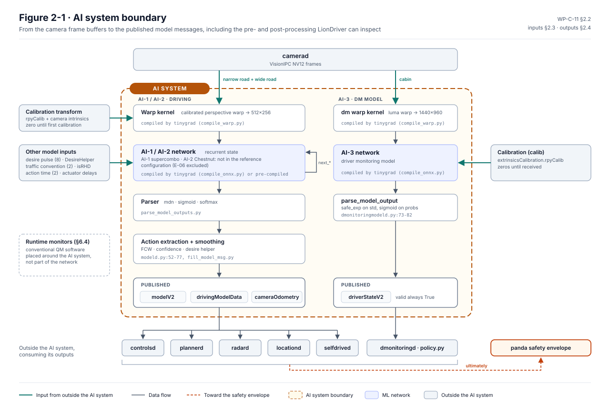
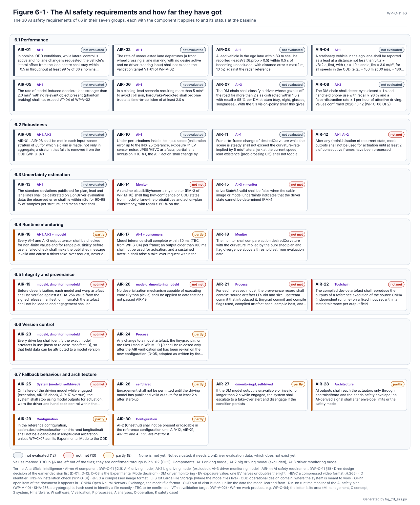

# AI system definition and AI safety requirements

LionDriver drives with neural networks it did not train. [WP-C-11](../WP-C-11-ai-system-definition-and-safety-requirements.md)
says which networks those are and what they see and decide. It sets out the space of inputs they must handle, how the
rest of the item bounds what they can do, and how they can be wrong. Its requirements are what a model has to show
before LionDriver relies on it, under ISO/PAS 8800.

<!-- terms:start (generated by assurance/trace/tools/terms.py; do not edit by hand) -->

Terms on this page (25)

| Term | Meaning |
|---|---|
| AE-nn | AI error type (WP-C-11 §5) |
| AI | artificial intelligence |
| AI-nn | AI component (WP-C-11 §2.1): AI-1 driving model, AI-2 big driving model (excluded), AI-3 driver monitoring model |
| AIR-nn | AI safety requirement (WP-C-11 §6) |
| ASIL | Automotive Safety Integrity Level, A (lowest) to D (highest), from ISO 26262 |
| DM | driver monitoring |
| DQ-nn | decision of the project lead (decision register) |
| E-nn | element of the item (WP-C-01 §3.1), E-01…E-06 |
| EPS | electric power steering |
| FSC | functional safety concept |
| GPS | global positioning system |
| GPU | graphics processor (runs the models) |
| ISO | International Organization for Standardization |
| ODD | operational design domain: where the system is meant to work |
| OI-nn | open item of the document it appears in |
| PAS | publicly available specification (ISO/PAS 8800 is the AI safety one) |
| PCM | powertrain control module (engine and drive) |
| QM | quality managed: no ASIL; ordinary quality processes suffice |
| RTK | real-time kinematic GPS, accurate to centimetres |
| SG-nn | safety goal (HARA §6) |
| SOTIF | safety of the intended functionality (ISO 21448): hazards with nothing failing |
| SVG | scalable vector graphics (the figure format) |
| TBC | to be confirmed |
| TSR-nn | technical safety requirement (WP-S-02) |
| WP-nn | work product, e.g. WP-C-04; the letter is its area (M management, C concept, S system, H hardware, W software, V validation, P processes, A analyses, O operation, K safety case) |

All terms: [abbreviations and record codes](../../terms.md).

<!-- terms:end -->

This page walks through it with its figures. The document is the source of record, and every figure here is generated
from it or drawn from its tables.

**The AI system in five lines.**

1. **Three models.** AI-1 is the driving model, which steers and finds the lead car. AI-2 is a big driving model on
   external hardware, excluded from the reference configuration (DQ-021). AI-3 is the driver monitoring model.
2. **Acquired, not trained.** comma.ai trained them on data LionDriver cannot see. So the requirements are acceptance
   criteria for an existing model, plus requirements on the software around it. No argument may rest on the training
   data.
3. **Bounded in size, not in direction.** Every model output reaches the car only through the safety envelope. The
   envelope caps how far and how fast the car can be steered or accelerated. It cannot tell a right curvature from a
   wrong one inside those limits, or notice a lead the model saw late.
4. **30 AI safety requirements and 13 dataset requirements.** None is met yet. Twelve wait for LionDriver's own
   evaluation data, which does not exist yet. Ten are not met, and eight are partly met.
5. **The driver monitoring chain** is QM for the steering and braking goals, but carries ASIL A from SG-08, the driver
   who is not supervising (DQ-205). How a QM model meets ASIL A is open (WP-C-04 OI-11).

| Where it comes from | The definition | Where it goes |
|---|---|---|
| [Item definition (WP-C-01)](../item/README.md): the models (E-02) and functions | Components, boundary, input space, allocation, error types | [SOTIF validation (WP-V-02)](../../06-validation/WP-V-02-sotif-vv-strategy.md): the targets the AIRs are measured against |
| [ODD (WP-C-02)](../odd/README.md): the input space · [AI safety plan (WP-M-10)](../../01-management/WP-M-10-ai-safety-plan.md) | AI safety and dataset requirements | [TSRs (WP-S-02)](../../03-system/WP-S-02-technical-safety-requirements.md) that refine them; the [FSC](../fsc/README.md) and [SOTIF](../sotif/README.md) that they serve |

## 1. The AI system and its boundary

*The AI system (§2.2, Figure 2-1).* The system runs from the camera frames to the messages the models publish,
including the warping before the networks and the parsing after them. Everything that consumes those messages sits
outside it: control, planning, radar fusion, the driver-monitoring policy and, last, the safety envelope.

| Component | What it does | In the reference configuration |
|---|---|---|
| AI-1 driving model | From two road images it produces the path, lane lines, lead cars, the desired curvature and acceleration, and a hard-brake prediction. 20 times a second, on the device GPU | Yes |
| AI-2 big driving model | The same, larger, on an external GPU, with a fallback to AI-1 while driving | No (DQ-021) |
| AI-3 driver monitoring model | From the cabin camera it gives face pose, eyes, phone and sleep probabilities | Yes |

## 2. What bounds the models

| Model output | Bounded by | Not bounded |
|---|---|---|
| AI-1 curvature → steering | The controller (3.0 m/s², jerk 5 m/s³), then the envelope's torque and rate limits and the EPS | A wrong curvature inside the limits: following an exit lane, a tar seam |
| AI-1 leads → speed | The planner and the envelope's acceleration limits (−3.5 to +2.0 m/s²), then the PCM | A stopped car seen late, or a phantom lead: both stay inside the limits |
| AI-1 action acceleration (Experimental Mode only) | As above | Phantom stops and missed red lights; excluded from the claim |
| AI-1 forward collision warning | Nothing; it only warns | A missing or late warning |
| AI-3 driver state | The driver-monitoring policy's timers | Not bounded by the envelope at all |

*From WP-C-11 §4.* So the requirements aim at two things: keeping in-limit errors rare enough to meet the validation
targets, and detecting the rest at runtime so the driver gets a take-over request.

## 3. How the models can be wrong

| Type | What goes wrong | Example |
|---|---|---|
| AE-P perception | The scene is read wrong | A lane line on a tar seam; a lead missed under a bridge |
| AE-L planning | The right scene, the wrong action | Cutting a curve; accelerating toward a slowing lead |
| AE-T temporal | Each frame is plausible, frames disagree | A lead that flickers; a cold restart after a fallback |
| AE-O out of distribution | An input the model never learned | Snow, low sun, construction zones |
| AE-N numerical | The execution fails, not the learning | Non-finite outputs; an inference overrun |
| AE-D driver monitoring | Inattention missed, or false alarms | Sunglasses at night; a phone low in the lap |

Each type links to the insufficiencies of the [SOTIF analysis](../sotif/README.md) (WP-C-06) and its hazards. The
inputs the models must handle are the [ODD](../odd/README.md), written as an input space with a tag for every
dimension (§3). That way each requirement can be reported per road type, light, weather and so on.

## 4. The requirements and how far they have got

*The AI safety requirements (§6, Figure 6-1).* They fall into seven groups:

- **Performance:** lane keeping, lead detection, phantom braking, how quickly driver monitoring flags distraction.
- **Robustness:** per stratum, under perturbation, stable from frame to frame.
- **Uncertainty:** the model's own confidence, calibrated and watched by a runtime monitor.
- **Runtime monitoring:** non-finite outputs, overruns, curvature against plan.
- **Integrity and provenance:** verify each model file before loading it; no `pickle` (code execution on load).
- **Version control:** every log names its model.
- **Fallback:** never switch models while steering; no model output can change the envelope.

The performance group waits on evaluation data. The integrity group is not met: today the model files are loaded
without any check.

## 5. The data

Thirteen dataset requirements (§7) govern the evaluation data LionDriver has to collect itself:

- **Where and how:** recorded on the reference car by safety drivers, tagged per input-space dimension, and large
  enough per stratum for the confidence the targets need.
- **Independent of training:** collected after the model's release and not uploaded to comma.ai (DQ-084).
- **Labelled and versioned:** a label specification with double annotation, and immutable, content-hashed versions.
- **Kept apart:** real data never pooled with simulated data, and personal data handled under the data-protection
  rules.

None of this data exists yet.

## 6. Open items

The ones that can change the requirements are below; the full list is in WP-C-11.

- **OI-2:** confirm or replace every value marked TBC (to be confirmed) through the target derivation of WP-V-02.
- **OI-3:** the DM chain is QM for SG-02/SG-06; the ASIL A from SG-08 is WP-C-04 OI-11.
- **OI-4:** decide what replaces `pickle` loading, with the cybersecurity lead.
- **OI-5:** record the hashes of the compiled model files.
- **OI-6:** define how lane-centre offset is measured without lidar or RTK GPS.

## Where the figures come from

This folder has no files of its own besides this page. The figures live in [`../figures/`](../figures/), next to the
document:

| Figure | Generator |
|---|---|
| WP-C-11 Figure 6-1, the AI safety requirements | [`fig_c11_airs.py`](../figures/fig_c11_airs.py), from §6. It fails if a status cannot be classified |
| WP-C-11 Figure 2-1, the AI system boundary | Hand-drawn SVG in [`../figures/`](../figures/); change it together with §2.1–§2.4 |
