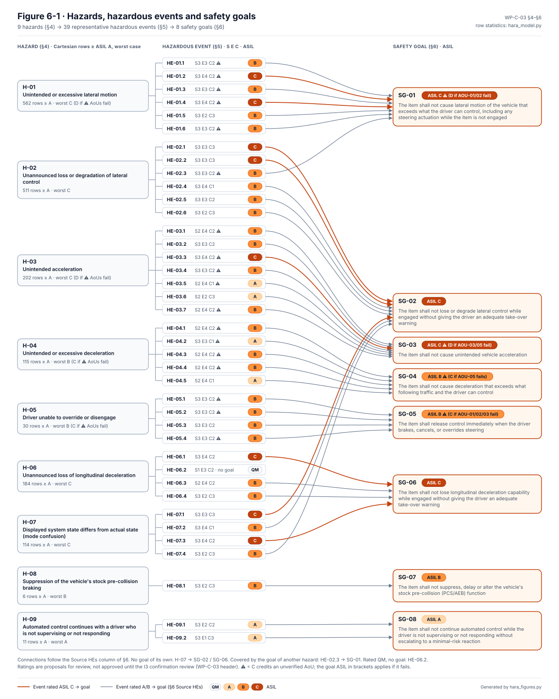
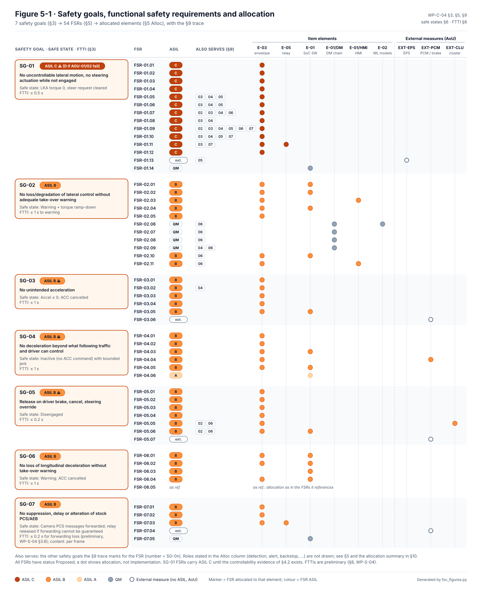
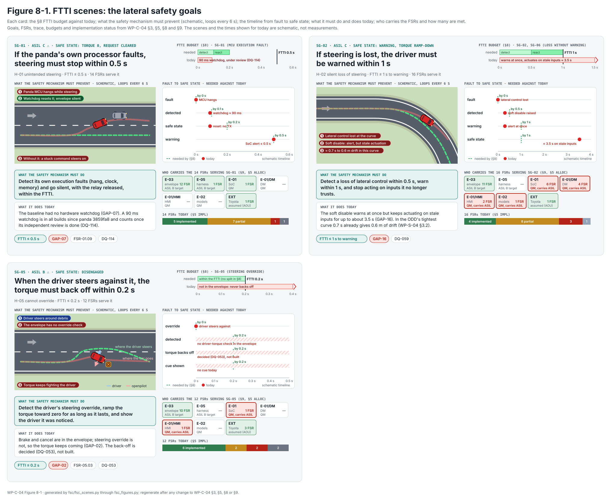
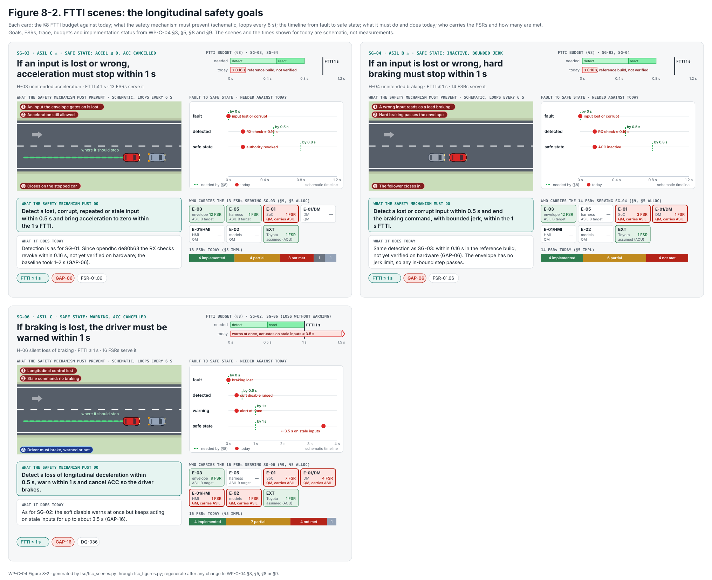
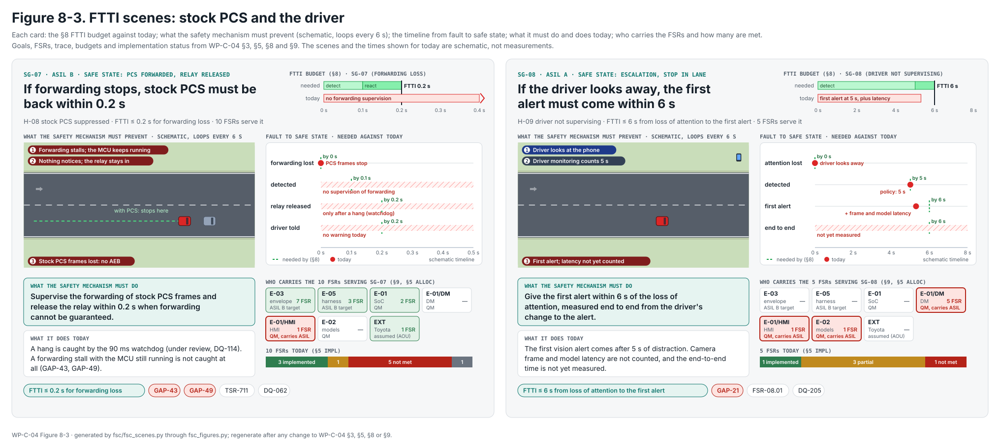
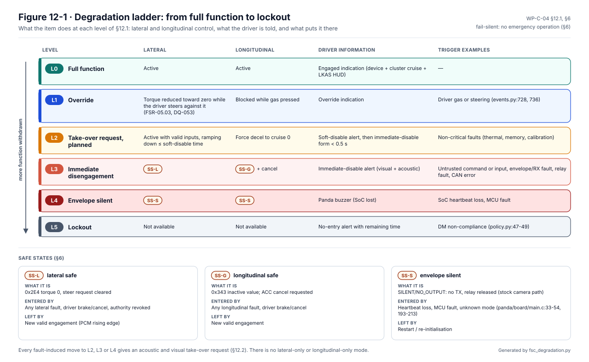
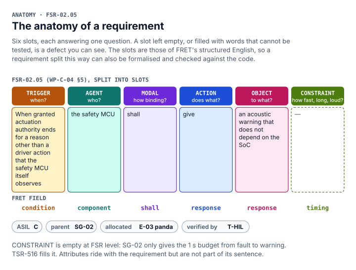
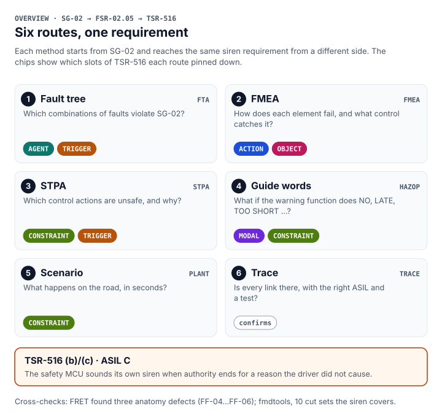

# Functional safety concept

The functional safety concept, [WP-C-04](../WP-C-04-functional-safety-concept.md), turns each safety goal of the HARA
into functional safety requirements (FSRs) and puts each requirement on an element of the item. This page walks
through it with the figures. The document is the source of record, and every figure here is generated from it.

<!-- terms:start (generated by assurance/trace/tools/terms.py; do not edit by hand) -->
<details><summary>Terms on this page (42)</summary>

| Term | Meaning |
|---|---|
| ACC | adaptive cruise control |
| AEB | automatic emergency braking |
| AoU | assumption of use: what the analysis assumes about the car, the driver or the environment |
| AOU-nn | assumption of use (WP-C-01 §7); an R suffix marks the FSC's refined version |
| ASIL | Automotive Safety Integrity Level, A (lowest) to D (highest), from ISO 26262 |
| C0–C3 | controllability class C0 (controllable in general) to C3 (difficult or uncontrollable) |
| CI | continuous integration: the checks that run on every pull request |
| DC | diagnostic coverage: the share of faults a safety mechanism detects |
| DQ-nn | decision of the project lead (decision register) |
| E-nn | element of the item (WP-C-01 §3.1), E-01…E-06 |
| ECU | electronic control unit |
| EPS | electric power steering |
| FMEA | failure mode and effects analysis |
| FRET | NASA's Formal Requirements Elicitation Tool |
| FSC | functional safety concept |
| FSR-nn | functional safety requirement (FSC) |
| FTTI | fault-tolerant time interval: fault to hazard, the time a safety mechanism has |
| GAP-nn | gap found by the gap assessment |
| H-nn | hazard (HARA) |
| HARA | hazard analysis and risk assessment (ISO 26262-3) |
| I0–I3 | independence level of a review, I0 (none, e.g. the author or an AI) to I3 (independent organisation) |
| IF-nn | interface of the item (WP-C-01 §3.4) |
| L0–L5 | degradation level L0 (full function) to L5 (lockout), FSC §12.1 |
| LD-SDA | LionDriver Supervised Driving Assistance, the item |
| LKA | lane keeping assist |
| MCU | microcontroller: the panda safety processor (STM32H7) |
| ODD | operational design domain: where the system is meant to work |
| OI-nn | open item of the document it appears in |
| PCM | powertrain control module (engine and drive) |
| PCS | pre-collision system: Toyota's stock collision warning and braking |
| QM | quality managed: no ASIL; ordinary quality processes suffice |
| SG-nn | safety goal (HARA §6) |
| SoC | system on chip: the comma device's main processor, running openpilot (QM) |
| SOTIF | safety of the intended functionality (ISO 21448): hazards with nothing failing |
| SS-nn | safe state (FSC §6): SS-L lateral, SS-G longitudinal, SS-S envelope silent |
| STPA | system-theoretic process analysis |
| SVG | scalable vector graphics (the figure format) |
| SysML | Systems Modeling Language: the system model in models/sysml |
| TSC | technical safety concept |
| TSR-nn | technical safety requirement (WP-S-02) |
| V-nn | view of the SysML model (V-01…V-27) |
| WP-nn | work product, e.g. WP-C-04; the letter is its area (M management, C concept, S system, H hardware, W software, V validation, P processes, A analyses, O operation, K safety case) |

All terms: [abbreviations and record codes](../../terms.md).

</details>
<!-- terms:end -->

**The concept in five lines.**

1. All actuation passes through one element, the panda safety MCU (E-03). It enforces the safety goals whatever the
   QM openpilot software on the SoC commands. That makes it the **safety envelope**, hardened to ASIL C (§4, decided
   DQ-341).
2. The envelope's limits are set so that the worst it lets through stays controllable. Reduced steering authority is
   the chosen strategy for SG-01 (§4, decided DQ-007). There is no ASIL decomposition.
3. The item is **fail-silent**. On a fault it stops actuating and hands back to the driver with a warning. Its only
   minimal-risk manoeuvre is the stop when the driver does not respond (§6, SG-08).
4. The vehicle's own EPS, PCM and cluster, and the driver, are credited only through assumptions of use (§11). None
   of them is verified yet.
5. Every FSR is *Proposed*. The figures show what is allocated where, and the Impl column of §5 says how much of it
   the code does today.

| Where it comes from | The concept | Where it goes |
|---|---|---|
| [Item definition (WP-C-01)](../WP-C-01-item-definition.md): functions, elements, boundary | Safety goals → FSRs → elements, safe states, FTTI, AoUs | [TSC (WP-S-03)](../../03-system/tsc/README.md) and [TSRs (WP-S-02)](../../03-system/WP-S-02-technical-safety-requirements.md) |
| [HARA (WP-C-03)](../WP-C-03-hara.md): hazards, safety goals, ASILs | | [Requirement trees](../../03-system/requirements/README.md), one per goal |

## 1. From the item to the safety view

The item definition draws the item's boundary: what is inside, what is outside, and how they connect. The FSC puts
its requirements on those same elements. Below, the boundary is shown twice, first as the item definition draws it
and then in the safety view.


*The item, as [WP-C-01](../WP-C-01-item-definition.md#33-boundary-diagram) §3.3 draws it (Figure 3-2).*


*The same item in the safety view (WP-C-04 §10, Figure 10-1).* The envelope carries most of the concept. The red
outlines are the open question: QM elements on the SoC that carry ASIL requirements. §10 backs most of them with the
envelope. The driver-monitoring ones (OI-11) and the false forward-collision warning (OI-9) are still open.

## 2. From hazards to safety goals

The HARA rates every hazardous event and gathers the events into eight safety goals. The FSC starts from those goals.



*Hazards → hazardous events → safety goals ([WP-C-03](../WP-C-03-hara.md) §4–§6, Figure 6-1).* Four goals are ASIL C:
SG-01 lateral motion, SG-02 lateral loss without warning, SG-03 unintended acceleration and SG-06 longitudinal loss
without warning. SG-04, SG-05 and SG-07 are ASIL B, and SG-08, the driver who is not supervising, is ASIL A. The ⚠
marks a rating that rests on vehicle assumptions; it rises a level if those fail. The ratings are proposals until the
I3 confirmation review.

## 3. Safety goals → requirements → elements



*Figure 5-1 (§3, §5, §9).* One band per goal and one row per FSR. A dot marks each element the requirement is
allocated to, coloured by the requirement's ASIL. The "also serves" chips show where one requirement protects several
goals, for example FSR-01.09, the envelope's own execution faults, which serves seven.

[](../../models/sysml/generated/fig-sysml-v27-mechanism-coverage-per-goal.svg)

*Safety mechanisms per goal (SysML view V-27).* The same goals followed one step further: from each FSR through its
TSRs to the mechanisms of WP-S-03 §6 that implement them, with their status today. A red box is an FSR with no
mechanism behind it yet; a grey box is met outside the item, through an
assumption of use, or by reference to other FSRs. Generated from the SysML model by
[`render_arch.py`](../../models/sysml/tools/render_arch.py).

## 4. The strategy: why the envelope, and why ASIL C

The HARA left one choice open: how to get SG-01, ASIL C (D if the EPS assumptions fail), onto a single-channel
off-the-shelf device. §4 weighs three options.

| Option | What it needs | Verdict |
|---|---|---|
| (a) Harden the envelope to ASIL C | ASIL C hardware metrics and process on the panda MCU | **Done since DQ-341**: SG-02, SG-03 and SG-06 became ASIL C, so the envelope needed C anyway |
| (b) Decompose onto envelope + Toyota EPS | Evidence on the EPS that Toyota does not publish | Fallback only, and not on the EPS (§4.3) |
| (c) Reduce steering authority until the driver controls the worst case | Vehicle tests and a physically derived torque limit | **Chosen for SG-01 (DQ-007)**: it bounds the lateral worst case and should lower the SG-01 requirements to B once tested |

## 5. Time: the fault-tolerant time intervals

Each goal has a time budget, from fault to safe state or warning. The scene cards show what the mechanism must
prevent, the budget against what the code does today, and who carries the requirements. The times and scenes are
schematic, not measurements.



<details><summary>Longitudinal goals (Figure 8-2) and stock PCS and driver (Figure 8-3)</summary>





</details>

The budgets are preliminary (§8; the timing analysis is [WP-S-04](../../03-system/WP-S-04-timing-ftti-budget.md)). Two
of them are known to be short today. Steering loss in the ODD's tightest curve gives about 0.6 m of drift in 0.7 s
(SG-02). Steering override is not yet in the envelope (SG-05, GAP-02).

## 6. Safe states and degradation



*Figure 12-1 (§6, §12).* The item has no lateral-only or longitudinal-only mode. It either works, hands back
(planned or at once), goes silent with the stock camera path restored, or locks the driver out after repeated
inattention. Every move caused by a fault comes with an acoustic and visual take-over request, and there is a siren
on the panda for when the SoC is gone.

## 7. Driver monitoring

Driver monitoring takes no ASIL from SG-02 or SG-06: those ratings assume a supervising driver, and inattention is
misuse, handled under SOTIF (§7). Since HARA v0.4 the unresponsive driver has its own goal, SG-08 (ASIL A). The
driver-monitoring requirements FSR-02.06…02.09 and FSR-08.01 now carry ASIL A, on a QM SoC. How that ASIL A is met
is OI-11. The I3 reviewer must agree that the ratings do not depend on driver monitoring (OI-3).

## 8. What the concept assumes

The concept credits the vehicle and the driver only through these assumptions of use (§11). None of them is verified.

| AoU | What is assumed | Carries |
|---|---|---|
| AOU-01R | The EPS limits LKA torque and drops it in a bounded time | FSR-01.13 |
| AOU-02R | A typical driver overpowers the envelope's worst-case torque | FSR-01.01, 05.03 |
| AOU-03R | The brake pedal always brakes, and the PCM drops ACC on brake | FSR-05.07 |
| AOU-04R | Stock PCS/AEB wins over ACC requests and works with the harness fitted | FSR-07.04 |
| AOU-05R | The PCM clamps ACC requests and honours cancel | FSR-03.06, 04.03 |
| AOU-06R | The driver supervises and can respond in time | every C2 rating |
| AOU-12, AOU-13, AOU-17 | Cluster cruise indication from the PCM; relay de-energised = stock path; the EPS and PCM signal every drop | FSR-05.05, 07.03, 02.01, 06.03 |

## 9. Open items

The ones that can change the concept are below; the full list is in §13.

- **OI-2:** derive the speed-dependent torque limit, confirm controllability by test, then have SG-01 re-rated.
- **OI-3:** the I3 reviewer confirms that driver monitoring carries no ASIL from SG-02/SG-06.
- **OI-4:** confirm the FTTIs (WP-S-04).
- **OI-9, OI-11:** the ASIL A requirements on the QM SoC: the false forward-collision warning, and driver monitoring.

## 10. How we know it is complete

The FSRs were written by hand from the goals. The fsc-builder method checks that none is missing (§14). It expands
each goal into a fault tree over a block diagram of the item, giving 20 ASIL-relevant nodes and 140 (goal × node)
basic events. Each event must name the FSRs that address it, or say why that node cannot violate that goal. CI fails
on an event with neither, on an FSR that no event cites, and on a stale table. The check found the SoC's reset and
boot control of the MCU missing at FSR level (now in FSR-01.10), four FSRs for new HARA sources, and three trace
extensions.

### One requirement, six routes

How do we know a safety requirement is the right one? [One requirement, six routes](requirement-routes.md) takes
TSR-516, the panda's own siren when it ends actuation authority for a reason the driver did not cause. It reaches
that requirement six times: by the fault tree, the FMEA, STPA, the HARA guide words, the plant scenarios and the
trace. Each route ends on the same anatomy strip, so you can see which part of the requirement it pinned down.





## Files in this folder

| File | What it is |
|---|---|
| [`fsc_figures.py`](fsc_figures.py) | Figure generator. It parses WP-C-04 §2, §3, §5, §6, §8, §9, §10 and §12 and writes every `fig-c04-<n>` figure: 5-1 itself, the FTTI scenes through [`fsc_scenes.py`](fsc_scenes.py), the safety view through [`fsc_safety_view.py`](fsc_safety_view.py) and the ladder through [`fsc_degradation.py`](fsc_degradation.py). It fails if an FSR is missing from the §9 trace, names an element without a column or box, or if a level names a safe state §6 does not define |
| [`figures/`](figures/) | Generated SVGs, embedded in WP-C-04 (and Figure 10-1 also in WP-C-01 §3.3). Do not edit by hand |
| `test_fsc_*.py` | Unit tests: every figure is current, every FSR is drawn once, and malformed tables are rejected |
| [`fsc_model.py`](fsc_model.py) | Completeness check, source of truth. It holds the block diagram (20 ASIL-relevant nodes, 5 external) and, for every (goal × node) basic event, the FSRs that address it or why the node cannot violate the goal |
| [`fsc-coverage.md`](fsc-coverage.md) | Generated coverage table: 140 basic events |
| [`WP-C-04-fsc-completeness.xlsx`](WP-C-04-fsc-completeness.xlsx) | Workbook generated by fsc-builder. Tabs 04–08 are its fault trees, template FSRs, ASIL allocation and verification matrix; tab 09 maps them onto WP-C-04. Its template FSRs (tab 05) are not LionDriver's requirements; those are in WP-C-04 §5 |
| [Workbook viewer](https://claude.ai/artifact/WHMhKBZQywWzDetcTKaDe3) | The workbook above (and every other assurance workbook) as a page that opens in the browser or on a phone. Rebuilt by [`tools/xlsx_viewer.py`](../../../tools/xlsx_viewer.py). It is a private claude.ai page: reviewers outside the project need it shared with them |
| [`fsc_routes.py`](fsc_routes.py), [`requirement-routes.md`](requirement-routes.md) | One requirement, six routes, with its figures `fig-c04-r*.svg`. CI fails if stale or if a quoted record is no longer in its file |

## Regenerating

Redraw the figures after any change to WP-C-04 §2, §3, §5, §6, §8, §9, §10 or §12:

```bash
python3 fsc_figures.py            # write figures/fig-c04-<n>-*.svg
python3 fsc_figures.py --check    # fail if a figure is stale (run in CI)
```

The completeness check:

```bash
python3 fsc_model.py        # build/block_diagram.json, build/hara_consolidated_sgs.xlsx, fsc-coverage.md
python3 <fsc-builder>/scripts/generate_fsc.py build/hara_consolidated_sgs.xlsx build/block_diagram.json WP-C-04-fsc-completeness.xlsx
python3 fsc_model.py --postprocess WP-C-04-fsc-completeness.xlsx
python3 <fsc-builder>/scripts/recalc.py WP-C-04-fsc-completeness.xlsx
```

`build/hara_consolidated_sgs.xlsx` is a copy of the HARA workbook in which tab 13 holds the consolidated safety goals
SG-01…SG-08 (from `trace/items/goals.yaml`) instead of the generator's per-function candidates. CI runs
`python3 fsc_model.py --check`.
