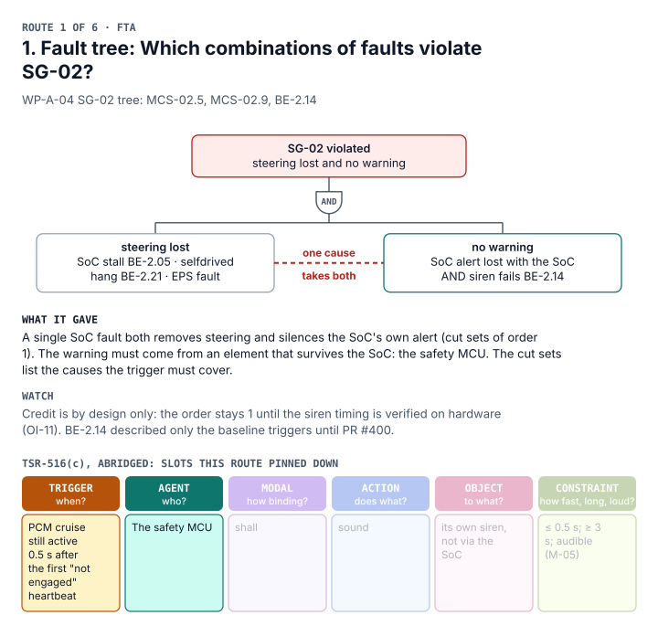
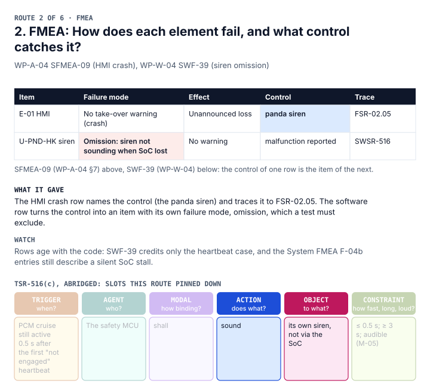
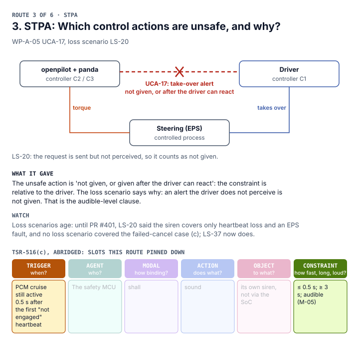
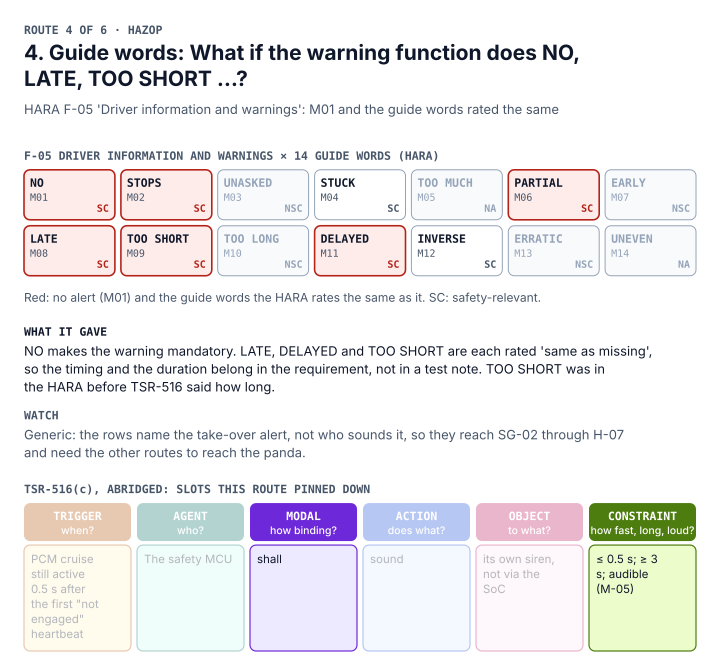
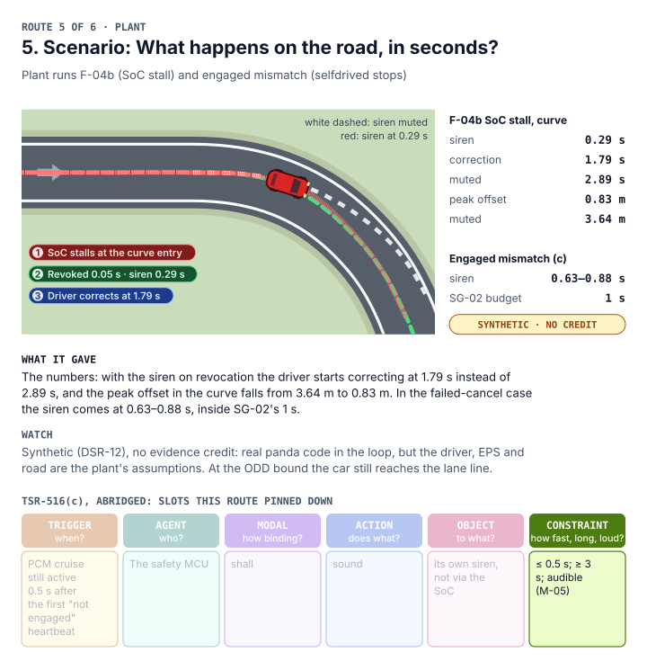
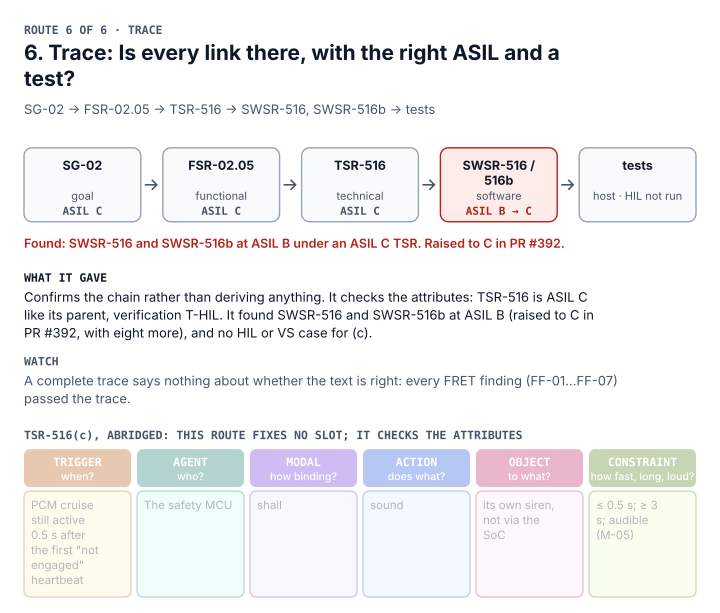
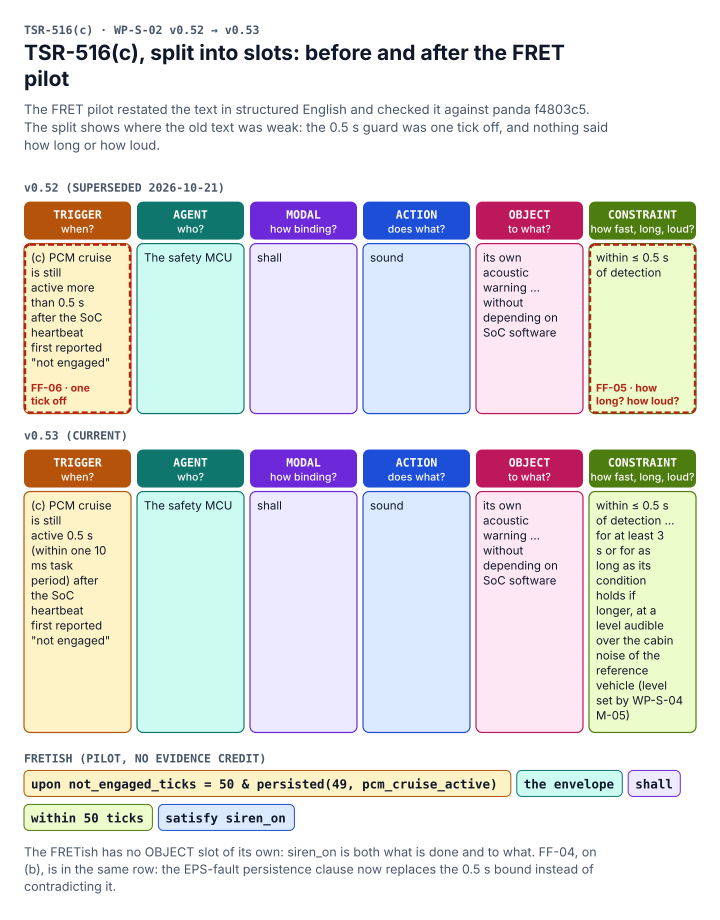

<!-- Generated by assurance/02-concept/fsc/fsc_routes.py; do not edit by hand. -->

# One requirement, six routes

How do we know a safety requirement is the right one? One way to check is to reach it more than once, by methods that look from different sides, and see whether they agree. This page takes one requirement and walks it through six methods that already run in this repository. Each page ends with the same anatomy strip, so you can see which part of the requirement each method actually pinned down.

**Specimen:** SG-02 (no loss of lateral control without an adequate take-over warning, ASIL C, ≤ 1 s to warning) → [FSR-02.05](../WP-C-04-functional-safety-concept.md) → [TSR-516](../../03-system/WP-S-02-technical-safety-requirements.md) (b) and (c): the panda's own siren when it ends actuation authority for a reason the driver did not cause.

Every record quoted below is checked against its file when this page is built, so a route whose record changes fails CI. The plant results are synthetic (DSR-12) and carry no evidence credit.

## The anatomy


| Slot | Question | FRET field | A defect looks like |
|---|---|---|---|
| TRIGGER | When does it apply? | condition (and scope) | a condition no element can observe, or one narrower than the parent's |
| AGENT | Who does it? | component | an element that fails with the fault it must catch |
| MODAL | How binding? | shall | *should*, *may*, or two *shalls* in one sentence that cannot be tested apart |
| ACTION | Does what? | response | a verb with no observable result |
| OBJECT | To what? | response | an output no test can see at the item's boundary |
| CONSTRAINT | How fast, how long, how much? | timing | a start without a reference point, a bound with no duration or level |

ASIL, parent, allocation and verification method are attributes: they travel with the requirement but are not part of its sentence.

## The six routes


### 1. Fault tree



Sources (quoted, checked at build): MCS-02.5 SoC stall in [`WP-A-04-system-fta-fmea.md`](../../08-analyses/WP-A-04-system-fta-fmea.md); MCS-02.9 selfdrived hang in [`WP-A-04-system-fta-fmea.md`](../../08-analyses/WP-A-04-system-fta-fmea.md); BE-2.14 siren not triggered in [`WP-A-04-system-fta-fmea.md`](../../08-analyses/WP-A-04-system-fta-fmea.md).

### 2. FMEA



Sources (quoted, checked at build): SFMEA-09 no take-over warning in [`WP-A-04-system-fta-fmea.md`](../../08-analyses/WP-A-04-system-fta-fmea.md); SWF-39 siren omission in [`WP-W-04-software-safety-analysis.md`](../../05-software/WP-W-04-software-safety-analysis.md).

### 3. STPA



Sources (quoted, checked at build): UCA-17 alert not given or late in [`WP-A-05-stpa.md`](../../08-analyses/WP-A-05-stpa.md); LS-20 not perceived in [`WP-A-05-stpa.md`](../../08-analyses/WP-A-05-stpa.md).

### 4. Guide words



Sources (quoted, checked at build): F-05 M01 no function in [`hara_model.py`](../../02-concept/hara/hara_model.py); F-05 M09 too short in [`hara_model.py`](../../02-concept/hara/hara_model.py); F-05 M08 late in [`hara_model.py`](../../02-concept/hara/hara_model.py).

### 5. Scenario



Sources (quoted, checked at build): F-04b curve, as built in [`silent-stall.md`](../../sim/results/silent-stall.md); F-04b curve, siren muted in [`silent-stall.md`](../../sim/results/silent-stall.md); engaged mismatch, siren in [`engaged-mismatch.md`](../../sim/results/engaged-mismatch.md); synthetic, no credit in [`silent-stall.md`](../../sim/results/silent-stall.md).

### 6. Trace



Sources (quoted, checked at build): TSR-516 parents in [`tsr.yaml`](../../trace/items/tsr.yaml); SWSR-516b in [`swsr.yaml`](../../trace/items/swsr.yaml); WP-W-02 SWSR-516b in [`WP-W-02-software-safety-requirements.md`](../../05-software/WP-W-02-software-safety-requirements.md); SWSR-516/516b at ASIL B in [`swsr.yaml`](../../trace/items/swsr.yaml).

## Two cross-checks

**FRET** (pilot on branch `claude/fret-tsr-pilot`, not yet on liondriver-dev) restated six TSRs in structured English and checked them against the code. It found seven places where the text and the code disagreed (FF-01…FF-07). Three of them, FF-04, FF-05 and FF-06, are in TSR-516 and are exactly anatomy defects: the CONSTRAINT slot had no duration and no level, and the TRIGGER was off by one task tick. All seven are fixed in WP-S-02 v0.53.



**fmdtools** (TE-02, [`TE-02-fmdtools-fault-propagation.md`](../../07-supporting/tool-evaluations/TE-02-fmdtools-fault-propagation.md)) propagated every joint fault through a model of the item. In 10 of the 31 effective SG-02 cut sets the model needs the siren to fail as well, so the siren is what keeps them from being single points. The tightest, a selfdrived hang ({BE-2.21}), is warned 0.78 s after the loss, a margin of 0.22 s to SG-02's 1 s. Synthetic, no evidence credit.

## How the methods compare

| Method | Shines at | Watch for | Fixed here |
|---|---|---|---|
| Fault tree | Showing that one cause removes both steering and the SoC's warning, so the warning needs an independent agent | Credit only as current as its event texts | AGENT, TRIGGER |
| FMEA | Naming the control, then giving the control its own failure mode | Rows age with the code | ACTION, OBJECT |
| STPA | Perception: an alert the driver does not notice is not given | Loss scenarios age; misses cases no one modelled, like (c) | CONSTRAINT, TRIGGER |
| Guide words | Systematic: LATE, DELAYED and TOO SHORT are each 'same as missing' | Generic: names the alert, not who sounds it | MODAL, CONSTRAINT |
| Scenario | Numbers in seconds and metres the driver lives with | Synthetic; the plant's driver and road are assumptions | CONSTRAINT values |
| Trace | Completeness: every parent, ASIL and test is there | Confirms, does not derive; a complete trace can carry wrong text | attributes |
| FRET | Ambiguity: off-by-one bounds, missing durations, contradictions | Only as good as the variables it is given | TRIGGER, CONSTRAINT |

No single route filled all six slots. The guide words had TOO SHORT long before the TSR said how long; it took FRET to notice that the TSR had not carried it over.

## Checklist

Applied to TSR-516(c) as it stands in WP-S-02 v0.53.

| # | Check | TSR-516(c) |
|---|---|---|
| 1 | TRIGGER is observable by the AGENT and names the requirement that detects it | Yes: the heartbeat flag (TSR-307(a)) and PCM_CRUISE |
| 2 | TRIGGER is no narrower than the parent's, and the parent covers it | **No**: FSR-02.05 names only SoC communication loss and an MCU reset; (b) and (c) go beyond it |
| 3 | AGENT does not fail with the fault it must catch | Yes: the safety MCU, not SoC software |
| 4 | One MODAL per testable clause | Yes: (a)–(d) share one *shall* but each has its own trigger and bound |
| 5 | ACTION and OBJECT are visible at the item's boundary | Yes: the siren output |
| 6 | CONSTRAINT has a reference point, a bound, a duration and a level | Yes since v0.53 (FF-05, FF-06) |
| 7 | The bound fits the parent's budget | Yes by design: 0.63–0.88 s in the plant against 1 s; not verified on hardware |
| 8 | ASIL matches the parent's, or a decomposition is stated | TSR yes (C); **no** for SWSR-516 and SWSR-516b (B) |
| 9 | A verification case exists for the method named | **No**: T-HIL is named, but no HIL or VS case targets (c) |
| 10 | Every route's record states the current behaviour | **No**: see below |

## What the walk found

These records are behind the requirement. Each is with its owner, through the coordinator.

| Record | What is out of date | Owner |
|---|---|---|
| FSR-02.05 (WP-C-04 §5) | Trigger names only SoC communication loss and an MCU reset; TSR-516(b)/(c) cover any non-driver revocation and a failed cancel | FSC |
| SWSR-516, SWSR-516b (WP-W-02) | ASIL B under ASIL C, no decomposition stated; SWSR-516(b) still lists the heartbeat "not engaged" case, which TSR-516 moved to (c) | software requirements |
| WP-A-05 LS-20, LS-05 | Say the siren covers only heartbeat loss and an EPS fault; no loss scenario for (c) | STPA |
| WP-A-04 BE-2.14; fta-fmea-map BE-2.14 note | Event text lists the baseline triggers; the map says (b)/(c) are not implemented | FTA |
| System FMEA F-04b entries; SW FMEA SWF-036, SWF-39 | Describe a silent SoC stall and a 3 s engaged mismatch; SWF-39 credits only the heartbeat case | FMEA |
| WP-V-05 VS-FI-31; no case for (c) | VS-FI-31 still says 1 s persistence; no HIL or VS case targets TSR-516(c) | verification |
| fmdtools README | Says 58 sets where p4-timing.md and TE-02 say 61 | fmdtools |

## Regenerating

```bash
python3 fsc_routes.py          # write this page and its figures
python3 fsc_routes.py --check  # CI: fail if stale or a quote is gone
```
