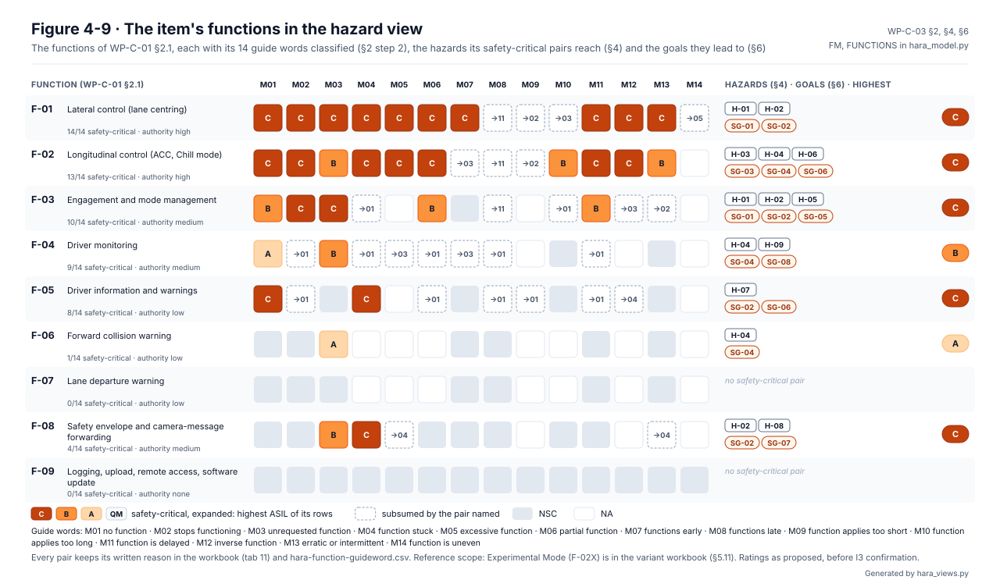
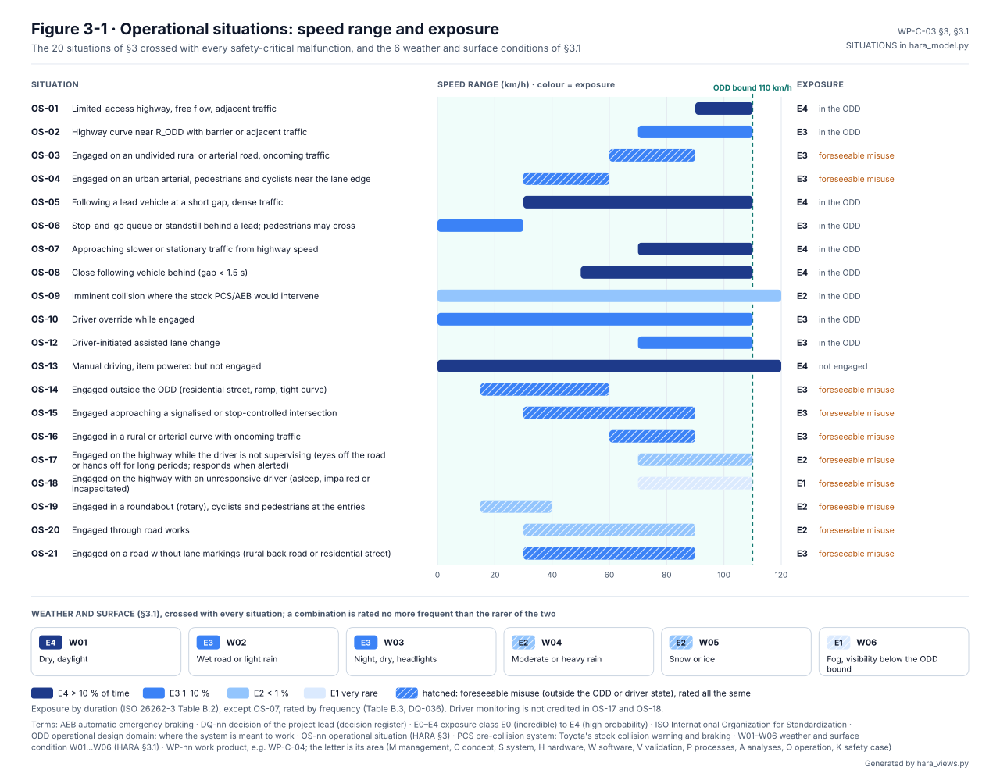
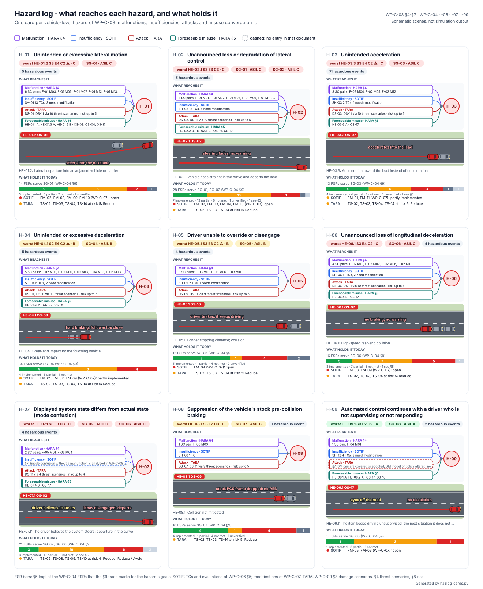
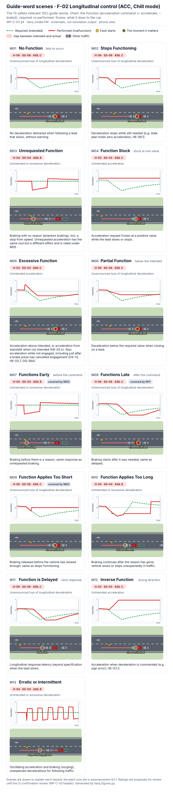
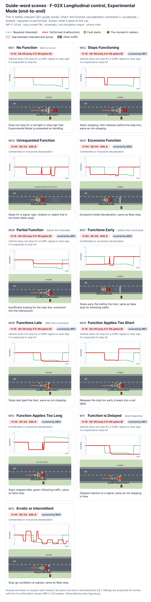
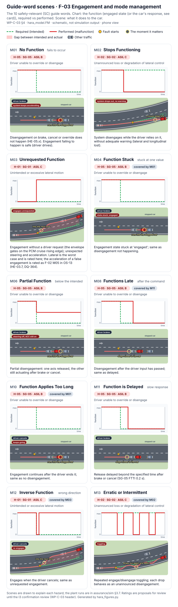
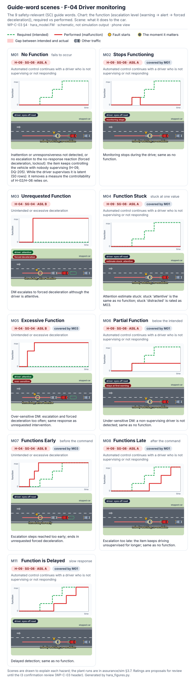
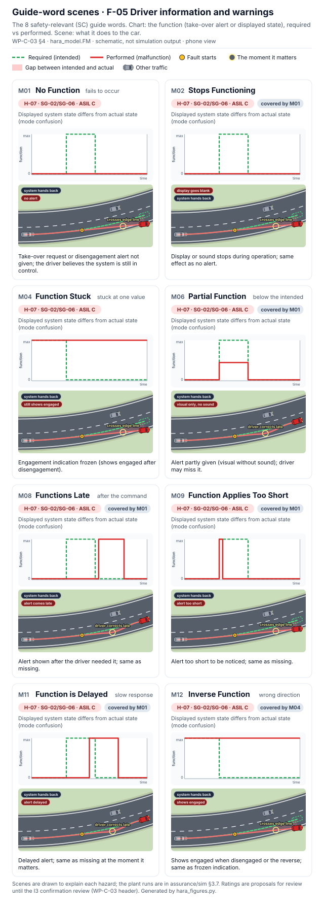
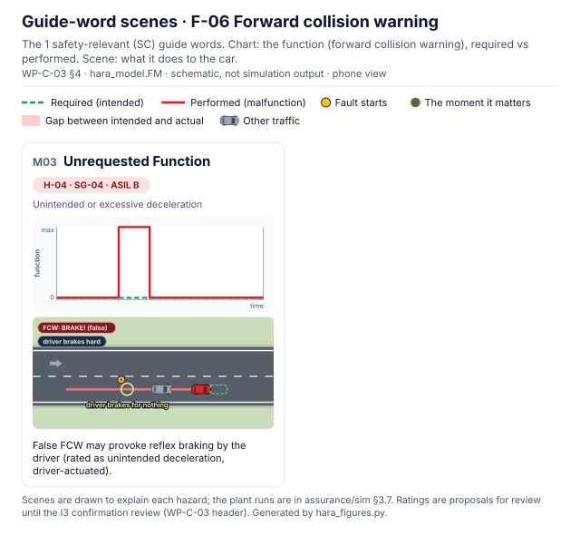
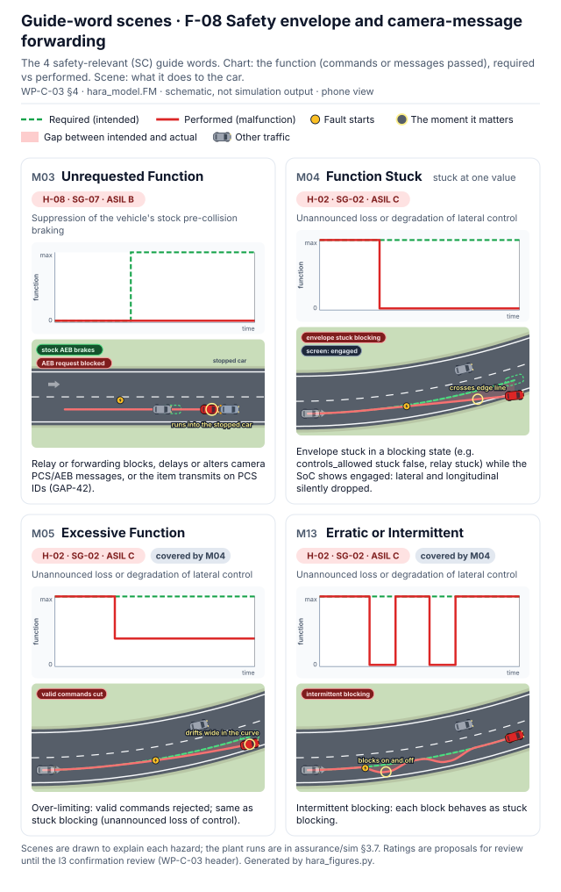

# Hazard analysis and risk assessment (HARA)

The HARA, [WP-C-03](../WP-C-03-hara.md), asks what happens when the item **malfunctions**: steering it did not ask for,
braking that does not come, a warning that never shows. It rates each hazardous event for severity, exposure and
controllability, and turns the worst cases into safety goals with an ASIL. Those goals are where the
[functional safety concept](../fsc/README.md) starts.

<!-- terms:start (generated by assurance/trace/tools/terms.py; do not edit by hand) -->
<details><summary>Terms on this page (40)</summary>

| Term | Meaning |
|---|---|
| ACC | adaptive cruise control |
| AEB | automatic emergency braking |
| AoU | assumption of use: what the analysis assumes about the car, the driver or the environment |
| ASIL | Automotive Safety Integrity Level, A (lowest) to D (highest), from ISO 26262 |
| CI | continuous integration: the checks that run on every pull request |
| CSV | comma-separated values file |
| D-nn | design decision of the earlier decision list (D-01…D-12; D-08 is the Experimental Mode decision) |
| DQ-nn | decision of the project lead (decision register) |
| E-nn | element of the item (WP-C-01 §3.1), E-01…E-06 |
| E0–E4 | exposure class E0 (incredible) to E4 (high probability) |
| EPS | electric power steering |
| F-nn | function of the item (WP-C-01 §2.1), F-01…F-09 |
| FSC | functional safety concept |
| FSR-nn | functional safety requirement (FSC) |
| G0–G6 | gate G0…G6 of the project lifecycle |
| H-nn | hazard (HARA) |
| HARA | hazard analysis and risk assessment (ISO 26262-3) |
| HATARA | the joint HARA and TARA view: where hazards and threats meet |
| I0–I3 | independence level of a review, I0 (none, e.g. the author or an AI) to I3 (independent organisation) |
| ID | identifier |
| ISO | International Organization for Standardization |
| LD-SDA | LionDriver Supervised Driving Assistance, the item |
| M01–M14, M1–M8 | guide word M01…M14 of the HARA (no function, unrequested, excessive, …); M1…M8 (one digit) a safety-mode transition (WP-W-05 §5.1) |
| MB | megabyte |
| NA | not applicable |
| NSC | not safety-critical |
| NUL | null byte |
| ODD | operational design domain: where the system is meant to work |
| OI-nn | open item of the document it appears in |
| OS-nn | operational situation (HARA §3) |
| PCM | powertrain control module (engine and drive) |
| PR | pull request |
| RR-nn | review record |
| SC | safety-critical (a guide-word pair that can cause a hazard) |
| SG-nn | safety goal (HARA §6) |
| SOTIF | safety of the intended functionality (ISO 21448): hazards with nothing failing |
| SVG | scalable vector graphics (the figure format) |
| TARA | threat analysis and risk assessment (ISO/SAE 21434) |
| URL | web address |
| WP-nn | work product, e.g. WP-C-04; the letter is its area (M management, C concept, S system, H hardware, W software, V validation, P processes, A analyses, O operation, K safety case) |

All terms: [abbreviations and record codes](../../terms.md).

</details>
<!-- terms:end -->

This page walks through the HARA with its figures. The document and its model, [`hara_model.py`](hara_model.py), are
the source of record, and every figure here is generated from them.

**The HARA in five lines.**

1. Every function of the item meets all 14 guide words (no function, unrequested, excessive, late, …), which gives 126
   pairs. 59 are safety-critical, and 32 of those are expanded; the rest are covered by a pair with the same effect.
2. Each expanded pair is crossed with 20 operational situations and 6 weather and surface conditions: 3 840 rows, each
   rated S, E and C with a written reason. The item's own safety mechanisms are not credited.
3. Nine vehicle-level hazards, H-01 to H-09, lead to **eight safety goals**. Four are ASIL C: SG-01 lateral motion,
   SG-02 lateral loss without warning, SG-03 unintended acceleration and SG-06 longitudinal loss without warning.
   SG-04, SG-05 and SG-07 are ASIL B, and SG-08, the driver who is not supervising, is ASIL A.
4. The ⚠ marks a rating that credits an unverified vehicle assumption (the EPS, brake or PCM). If those assumptions
   fail, SG-01 and SG-03 become ASIL D. For a new vehicle they are entry criteria (DQ-369).
5. The ratings are proposals until the independent confirmation review (I3).

| Where it comes from | The analysis | Where it goes |
|---|---|---|
| [Item definition (WP-C-01)](../WP-C-01-item-definition.md): functions F-01…F-09, boundary, assumptions | Guide words, situations, ratings, hazardous events, safety goals | [Functional safety concept (WP-C-04)](../fsc/README.md) |
| [ODD (WP-C-02)](../WP-C-02-odd-and-intended-functionality.md): the situations | Hazard log shared with SOTIF and the TARA | [SOTIF (WP-C-05…07)](../sotif/README.md), [HATARA](../hatara/README.md) |

## 1. From the item's functions to the hazard view

The item definition lists what the item does. The HARA asks how each of those functions can go wrong in a way that
hurts someone. Below, the functions are shown as WP-C-01 draws them, then in the hazard view.


*The item and its functions, as [WP-C-01](../WP-C-01-item-definition.md#31-elements-inside-the-item) §2.1 and §3.1 describe them
(Figure 3-1).*



*The same functions in the hazard view (WP-C-03 §4, Figure 4-9).* Lateral and longitudinal control carry almost every
guide word at ASIL C. Driver information (F-05) reaches ASIL C too: a missing take-over alert or a frozen engagement
display is mode confusion (H-07). The safety envelope (F-08) is rated only where it acts on its own: blocking the stock
pre-collision braking or getting stuck blocking. Elsewhere its failure is a latent fault of a safety mechanism,
handled in the FSC. Lane departure warning (F-07) and the non-driving functions (F-09) have no safety-critical pair.

## 2. The situations



*Figure 3-1 (§3, §3.1).* The situations come from the ODD. Those outside it are kept and hatched: off the highway,
or with a driver who stops supervising. The item cannot yet prevent engagement there, so they are rated as
reasonably foreseeable misuse. Off-highway use is rated E3, 1–10 % of engaged time, after a video showed owners
engaging upstream openpilot on back roads (DQ-213). If it were more than 10 %, SG-02 would become ASIL D (§6.1).

## 3. Where the ratings fall


*Figure 2-1 (§2.1).* Left, as rated: 110 rows reach ASIL C and none reaches D. Right, with C+1 on every row that credits
an unverified assumption: 385 rows at C and 29 at D. That is why verifying the EPS, brake and PCM assumptions is a G1
activity (OI-1), not a late validation task.

## 4. From hazards to safety goals


*Figure 6-1 (§4–§6).* Each hazard, its representative hazardous events (39 in §5, each with full rationale) and the goal
each feeds. A goal takes the highest ASIL of its events; the generator fails if it does not. Mode confusion (H-07)
feeds both warning goals, SG-02 and SG-06.

## 5. The hazard log



*Figure 7-1 (§7).* One card per hazard. Every route to it converges on the card: malfunctions (here), insufficiencies
(SOTIF), attacks (TARA) and misuse. Each card also shows what holds the hazard today: the safety requirements, SOTIF
modifications and threat treatments behind it.

## Guide-word scenes

Sheets: [F-01](#f-01-lateral-control) · [F-02](#f-02-longitudinal-control-acc-chill-mode) · [F-02X](#f-02x-longitudinal-control-experimental-mode) · [F-03](#f-03-engagement-and-mode-management) · [F-04](#f-04-driver-monitoring) · [F-05](#f-05-driver-information-and-warnings) · [F-06](#f-06-forward-collision-warning) · [F-08](#f-08-safety-envelope-and-forwarding)

One sheet per function with SC guide words (F-07 and F-09 have none). F-01 comes first, with how to read a card; the other sheets follow in the same layout.

### F-01 Lateral control

Sheets: **F-01** · [F-02](#f-02-longitudinal-control-acc-chill-mode) · [F-02X](#f-02x-longitudinal-control-experimental-mode) · [F-03](#f-03-engagement-and-mode-management) · [F-04](#f-04-driver-monitoring) · [F-05](#f-05-driver-information-and-warnings) · [F-06](#f-06-forward-collision-warning) · [F-08](#f-08-safety-envelope-and-forwarding)

[](figures/fig-c03-4-1-f01-guide-words.svg)

*What each guide word does to F-01 lateral control.* Top of each card: the torque the function must deliver against what the malfunction delivers. Below: the car on a two-lane left curve, seen from above, with the moment it matters ringed. Each card loops in a browser: the cars drive, the red track draws in, and the fault and the callout appear when they happen (a viewer that shows the SVG as a still shows the last frame). The scenes are schematic, to explain each hazard; the measured cases are the plant runs in [assurance/sim §3.7](../../sim/README.md#37-the-asil-c-hazardous-events-in-the-loop). Generated by [`guideword_scenes.py`](guideword_scenes.py).

#### All sheets

The other functions have a sheet each, in the same layout:

| Function | Sheet | Scene |
|---|---|---|
| F-02 Longitudinal control (ACC, Chill mode) | [13 cards](figures/fig-c03-4-2-f02-guide-words.svg) ([phone](figures/fig-c03-4-2-f02-guide-words-phone.svg)) | Following a lead that slows; chart = commanded acceleration |
| F-02X Longitudinal control, Experimental Mode | [11 cards](figures/fig-c03-4-3-f02x-guide-words.svg) ([phone](figures/fig-c03-4-3-f02x-guide-words-phone.svg)) | Approaching a red light; chart = commanded acceleration |
| F-03 Engagement and mode management | [10 cards](figures/fig-c03-4-4-f03-guide-words.svg) ([phone](figures/fig-c03-4-4-f03-guide-words-phone.svg)) | Driver brakes toward a stopped car, or engagement changes in the curve; chart = engaged state |
| F-04 Driver monitoring | [9 cards](figures/fig-c03-4-5-f04-guide-words.svg) ([phone](figures/fig-c03-4-5-f04-guide-words-phone.svg)) | Driver looks away, or is attentive; chart = escalation (warning → alert → forced deceleration) |
| F-05 Driver information and warnings | [8 cards](figures/fig-c03-4-6-f05-guide-words.svg) ([phone](figures/fig-c03-4-6-f05-guide-words-phone.svg)) | The system hands back in the curve; chart = take-over alert or displayed state |
| F-06 Forward collision warning | [1 card](figures/fig-c03-4-7-f06-guide-words.svg) ([phone](figures/fig-c03-4-7-f06-guide-words-phone.svg)) | A false warning and the driver's reflex braking |
| F-08 Safety envelope and forwarding | [4 cards](figures/fig-c03-4-8-f08-guide-words.svg) ([phone](figures/fig-c03-4-8-f08-guide-words-phone.svg)) | Stock AEB request blocked before a stopped car, or commands blocked in the curve |

In the longitudinal scenes a small simulation runs the intended controller twice, as specified and with the guide word applied to its output, so the chart plots the commanded acceleration of both runs and the callout marks the first moment the faulty run is clearly worse (closes on the lead, follower closes in, past the stop line on red). Pills in the scene's corner give the state the card depends on (driver brakes, no alert, AEB request blocked). The cards list the safety goal of each hazard from `SG_MAP`: H-07 cards show both SG-02 and SG-06; H-10 (F-02X) shows that SG-09 exists only under D-08 option B.

### F-02 Longitudinal control (ACC, Chill mode)

Sheets: [F-01](#f-01-lateral-control) · **F-02** · [F-02X](#f-02x-longitudinal-control-experimental-mode) · [F-03](#f-03-engagement-and-mode-management) · [F-04](#f-04-driver-monitoring) · [F-05](#f-05-driver-information-and-warnings) · [F-06](#f-06-forward-collision-warning) · [F-08](#f-08-safety-envelope-and-forwarding)

[](figures/fig-c03-4-2-f02-guide-words.svg)

### F-02X Longitudinal control, Experimental Mode

Sheets: [F-01](#f-01-lateral-control) · [F-02](#f-02-longitudinal-control-acc-chill-mode) · **F-02X** · [F-03](#f-03-engagement-and-mode-management) · [F-04](#f-04-driver-monitoring) · [F-05](#f-05-driver-information-and-warnings) · [F-06](#f-06-forward-collision-warning) · [F-08](#f-08-safety-envelope-and-forwarding)

[](figures/fig-c03-4-3-f02x-guide-words.svg)

### F-03 Engagement and mode management

Sheets: [F-01](#f-01-lateral-control) · [F-02](#f-02-longitudinal-control-acc-chill-mode) · [F-02X](#f-02x-longitudinal-control-experimental-mode) · **F-03** · [F-04](#f-04-driver-monitoring) · [F-05](#f-05-driver-information-and-warnings) · [F-06](#f-06-forward-collision-warning) · [F-08](#f-08-safety-envelope-and-forwarding)

[](figures/fig-c03-4-4-f03-guide-words.svg)

### F-04 Driver monitoring

Sheets: [F-01](#f-01-lateral-control) · [F-02](#f-02-longitudinal-control-acc-chill-mode) · [F-02X](#f-02x-longitudinal-control-experimental-mode) · [F-03](#f-03-engagement-and-mode-management) · **F-04** · [F-05](#f-05-driver-information-and-warnings) · [F-06](#f-06-forward-collision-warning) · [F-08](#f-08-safety-envelope-and-forwarding)

[](figures/fig-c03-4-5-f04-guide-words.svg)

### F-05 Driver information and warnings

Sheets: [F-01](#f-01-lateral-control) · [F-02](#f-02-longitudinal-control-acc-chill-mode) · [F-02X](#f-02x-longitudinal-control-experimental-mode) · [F-03](#f-03-engagement-and-mode-management) · [F-04](#f-04-driver-monitoring) · **F-05** · [F-06](#f-06-forward-collision-warning) · [F-08](#f-08-safety-envelope-and-forwarding)

[](figures/fig-c03-4-6-f05-guide-words.svg)

### F-06 Forward collision warning

Sheets: [F-01](#f-01-lateral-control) · [F-02](#f-02-longitudinal-control-acc-chill-mode) · [F-02X](#f-02x-longitudinal-control-experimental-mode) · [F-03](#f-03-engagement-and-mode-management) · [F-04](#f-04-driver-monitoring) · [F-05](#f-05-driver-information-and-warnings) · **F-06** · [F-08](#f-08-safety-envelope-and-forwarding)

[](figures/fig-c03-4-7-f06-guide-words.svg)

### F-08 Safety envelope and forwarding

Sheets: [F-01](#f-01-lateral-control) · [F-02](#f-02-longitudinal-control-acc-chill-mode) · [F-02X](#f-02x-longitudinal-control-experimental-mode) · [F-03](#f-03-engagement-and-mode-management) · [F-04](#f-04-driver-monitoring) · [F-05](#f-05-driver-information-and-warnings) · [F-06](#f-06-forward-collision-warning) · **F-08**

[](figures/fig-c03-4-8-f08-guide-words.svg)

## 6. Open items

The ones that can change a rating are below; the full list is in WP-C-03 §8.

- **OI-1:** verify the EPS, brake and PCM assumptions by vehicle tests, then confirm or revise every ⚠ rating. For
  SG-01 this is a G1 entry condition (DQ-008).
- **OI-2:** confirm the exposure classes against real usage data, including the share of off-highway use and of
  driving without supervision.
- **OI-6:** the independent confirmation review (I3).
- **OI-8:** I1 review of the 126-pair classification and the rating rules.

Where these hazards meet the TARA's threats, and where a safety measure changes a security risk or the reverse:
[HATARA](../hatara/README.md).

## Files in this folder

| File | What it is |
|---|---|
| [`hara_model.py`](hara_model.py) | Source of truth. It holds every analyst input: functions, the 14-guide-word classification with rationale, situations, conditions, and the S/C rating rules |
| [`hara-cartesian-summary.md`](hara-cartesian-summary.md) | Generated step counts and worst cases per hazard |
| [`WP-C-03-hara-cartesian.xlsx`](WP-C-03-hara-cartesian.xlsx) | Generated workbook, reference scope (Chill mode only) |
| [`WP-C-03-hara-cartesian_experimental.xlsx`](WP-C-03-hara-cartesian_experimental.xlsx) | Generated workbook, Experimental Mode variant (D-08 option B) |
| [Workbook viewer](https://claude.ai/artifact/WHMhKBZQywWzDetcTKaDe3) | Both workbooks (and every other assurance workbook) in a spreadsheet-style page that opens on a phone: one tab per sheet, frozen header and HARA ID, filters by function, guide word, ASIL, S/E/C, location and weather, search, and every field of a row, rationale included. Private claude.ai page, built by [`tools/xlsx_viewer.py`](../../../tools/xlsx_viewer.py) |
| [`hara-events.csv`](hara-events.csv) | Generated. All 3 840 hazardous-event rows of the reference workbook (tab 12), one per line, with S/E/C rationale, ASIL, ASIL if the ⚠ AoUs fail, and safety goal. A PR diff of it shows exactly which rows a rule change moves. At 2.4 MB it is too large for GitHub to show as a table; to read the rows, use the workbook viewer above |
| [`hara-events_experimental.csv`](hara-events_experimental.csv) | Generated. The same for the Experimental Mode variant (4 080 rows) |
| [`hara_figures.py`](hara_figures.py) | Figure generator. It draws WP-C-03 Figure 2-1 (rows per S × E × C cell, as rated and if every ⚠ AoU fails) from the model, and Figure 6-1 (hazards → hazardous events → safety goals) from WP-C-03 §4–§6 and the model. It fails if a goal's ASIL is not the highest ASIL of its source events, or if a rated event has no goal |
| [`guideword_scenes.py`](guideword_scenes.py) | Draws the guide-word scenes: one card per SC guide word of a function, the function over time (required against performed) over a top-down road scene of what the malfunction does to the car. Words, hazards, subsumption and rationale come from `FM` in `hara_model.py`; goal and ASIL from WP-C-03 §6. The behaviour models are schematic and live in this file; it fails if an SC guide word has no model. One sheet per function with SC guide words (F-07 and F-09 have none). Run through `hara_figures.py` |
| [`hazlog_cards.py`](hazlog_cards.py) | Draws WP-C-03 Figure 7-1, the hazard log: one card per hazard with the malfunctions (§4), SOTIF insufficiencies (§7, WP-C-06), attacks (WP-C-09) and misuse situations (§5) that reach it, a scene of its highest-rated event, and the status of what holds it (WP-C-04 FSR Impl through the §9 trace, WP-C-07 modifications, WP-C-09 treatment). It fails if §4, §5 and §7 list different hazards, a rated event has no goal, or a hazard has no scene. Run through `hara_figures.py`; tested by [`test_hazlog_cards.py`](test_hazlog_cards.py) |
| [`hara_views.py`](hara_views.py) | Draws WP-C-03 Figure 3-1 (the operational situations by speed range and exposure, from `SITUATIONS` and `WEATHER`) and Figure 4-9 (the item's functions in the hazard view, from `FUNCTIONS`, `FM` and `SG_MAP`; also shown in WP-C-01 §2.1). Run through `hara_figures.py`; tested by [`test_hara_views.py`](test_hara_views.py) |
| [`figures/`](figures/) | Generated SVGs `fig-c03-2-1-asil-heatmap.svg` and `fig-c03-6-1-hazard-sg-overview.svg` and `fig-c03-7-1-hazard-log.svg`, embedded in WP-C-03, and `fig-c03-4-1-…` to `fig-c03-4-8-…-guide-words.svg` (guide-word scenes, below). Do not edit by hand |
| [`test_hara_figures.py`](test_hara_figures.py), [`test_guideword_scenes.py`](test_guideword_scenes.py) | Unit tests: the figures are current, the heat-map totals equal the model's ASIL counts, inconsistent goal tables are rejected, every function with SC guide words has a sheet, and every SC guide word has one card that agrees with `FM` and §6 and names the moment it matters |
| [`hara-function-guideword.csv`](hara-function-guideword.csv) | Generated. The 140 function × guide-word pairs (tab 11, both variants) with class SC / NSC / NA, subsumption and the reason. This is the SC filter that decides which rows exist (RR-2026-003 F-01) |

## Regenerating

1. Write the generator inputs to `build/` (not committed), the summary, and the counts table in WP-C-03 §2.1:

   ```bash
   python3 hara_model.py
   ```

2. Generate each workbook with the hara-builder skill's generator, apply the LionDriver corrections, then recalculate the formulas (LibreOffice):

   ```bash
   python3 <hara-builder>/scripts/generate_hara.py build/hara_input.json WP-C-03-hara-cartesian.xlsx
   python3 hara_model.py --postprocess WP-C-03-hara-cartesian.xlsx
   python3 <hara-builder>/scripts/recalc.py WP-C-03-hara-cartesian.xlsx
   ```

   Repeat for `build/hara_input_experimental.json` → `WP-C-03-hara-cartesian_experimental.xlsx`.

   - Post-processing replaces the generator's exposure anchors with ISO 26262-3 Table B.2.
   - It adds the rationale column to tab 11 and the "Consolidated into" column to tab 13.
   - It has to run **before** the recalculation, because re-saving with openpyxl drops cached formula values.

3. Redraw the figures (`figures/`, including the guide-word scenes):

   ```bash
   python3 hara_figures.py
   ```

4. Rebuild the [workbook viewer](https://claude.ai/artifact/WHMhKBZQywWzDetcTKaDe3) from the repository root, then republish the page it writes to that URL:

   ```bash
   python3 tools/xlsx_viewer.py --out <scratch>/workbook-viewer.html
   ```

5. CI runs `python3 hara_model.py --check`. It fails if the summary, the CSV files or the WP-C-03 §2.1 table no longer match the model. `python3 hara_figures.py --check` and `python3 test_hara_figures.py` fail if a figure no longer matches the model or WP-C-03; they are run in CI (`assurance.yaml`) next to the model check. `python3 tools/xlsx_viewer.py --check` fails if a workbook changed and the viewer page was not rebuilt.

## Reviewing

- To read the workbooks without downloading them, a phone included, open the [workbook viewer](https://claude.ai/artifact/WHMhKBZQywWzDetcTKaDe3). On the HARA Worksheet tab, filter by function, guide word or ASIL and tap a row for its S, E and C rationale.
- Each CSV row has a stable key, `function/guide word/situation/condition` (e.g. `F-01/M04/OS-02/W02`), and the workbook row ID (`H-0001`…) for cross-reference. To comment on a row, open the CSV in a PR and comment on its line, quoting the key.
- Changing a rating means changing a rule in `hara_model.py`. Regenerate, and the CSV diff shows every row the rule affects.
- The CSVs and workbooks come from the same model; every ASIL in the CSVs equals the workbook's tab 12, row for row.

The workbooks were generated with hara-builder `generate_hara.py` (sha256 `188f7e51df06aceae7668bb6563f009b8e28189754d3eedc87f93c05f2a91a33`, after removing trailing NUL padding from the synced copy). Every ASIL in both workbooks was checked against the independent computation in `hara_model.py`, and they agree: 3 840 and 4 080 rows, 0 mismatches (regenerated 2026-10-19 for WP-C-03 v0.6, 20 situations; 3 264 and 3 468 at v0.4–v0.5, 2 790 and 2 970 at v0.3).
