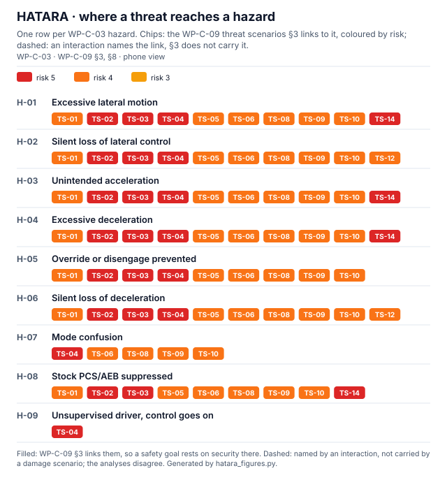
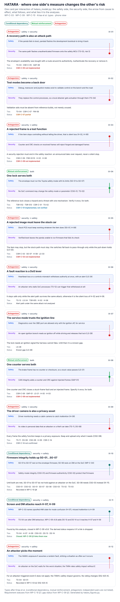

# HATARA: where the HARA and the TARA meet

This folder holds the safety–security interaction analysis for LionDriver. It applies the HATARA method (fusion of HARA and TARA) to the item's own [HARA (WP-C-03)](../WP-C-03-hara.md) and [TARA (WP-C-09)](../WP-C-09-tara.md). In the method's "integration of findings" step, hazards and threats are cross-referenced. Mitigations are then checked so that one domain's measure does not compromise the other.

The HARA and the TARA each record one direction already: WP-C-09 §3 links every damage scenario to the hazard it causes, and [WP-C-10 §8](../WP-C-10-cybersecurity-goals-and-concept.md) maps the cybersecurity goals to the safety goals they protect. This folder adds what neither records:

- where a **safety measure opens a security weakness**, for example a recovery path that is also an attack path;
- where a **security measure can cause a hazard**, for example a rejected frame that becomes a silent loss of control;
- where **one measure serves both**, so it can be specified and verified once;
- where the **two analyses disagree**, for example a threat the HARA names that the TARA has no damage scenario for.

Each interaction has a type after Kriaa et al.: conditional dependency, mutual reinforcement or antagonism. Independent pairs are not listed. Threats were brought into the hazard view in the way of SAHARA (Macher et al., DATE 2015).

| File | What it is |
|---|---|
| [`hatara_model.py`](hatara_model.py) | Source of truth: the interactions IX-01…IX-nn, and the checks below |
| [`hatara-interactions.md`](hatara-interactions.md) | Generated table of the interactions with their current status |
| [`hatara_figures.py`](hatara_figures.py) | Draws Figures 1 and 2 from the model, WP-C-03, WP-C-09 and WP-C-10 |
| [`figures/`](figures/) | Generated SVGs. Do not edit by hand |
| [`test_hatara.py`](test_hatara.py) | Unit tests: the checks fail on bad input, the outputs are current and deterministic |

## Figure 1: where a threat reaches a hazard

[](figures/fig-hatara-1-matrix.svg)

*Every hazard against every threat scenario (phone view; tap it for the [full matrix](figures/fig-hatara-1-matrix.svg)). Filled cells are links WP-C-09 §3 carries. Dashed cells are links an interaction names but the TARA does not carry. Interaction IX-11 found one: TS-04 can alter driver monitoring, yet until WP-C-09 v0.8 none of its damage scenarios reached H-07 (mode confusion) or H-09 (unsupervised driver). DS-13 and DS-14 now carry both links, so IX-11 reads Closed and no cell is dashed.*

## Figure 2: where one side's measure changes the other's risk

[](figures/fig-hatara-2-interactions.svg)

*One card per interaction (phone view; tap it for the [four-column sheet](figures/fig-hatara-2-interactions.svg)). The arrow runs from the side that causes the effect to the side that takes it; mutual reinforcement is drawn as a joint. Requirement statuses come from WP-C-10 §7. The gap status comes from WP-C-09 §3.*

## What the checks enforce

`python3 hatara_model.py --check` fails if:

- an interaction ties to an ID that is not in the assurance records outside this folder (hazards are checked against WP-C-03, threat scenarios against WP-C-09 §4, requirements against WP-C-10 §7);
- a conditional dependency names a hazard and a threat scenario that WP-C-09 §3 does not link, without being marked as a gap;
- an interaction ties to no requirement and has no status of its own;
- the generated table is stale.

A gap's status is derived. It reads "Open" while WP-C-09 §3 lacks the link and "Closed" once a damage scenario carries it. Closing a gap in the TARA therefore needs no edit here, only a regeneration.

## Regenerating

These outputs read the tables of WP-C-03, WP-C-09 and WP-C-10. A change there can make them stale, and the fix is to regenerate:

```bash
python3 hatara_model.py && python3 hatara_figures.py
```

CI runs `hatara_model.py --check`, `hatara_figures.py --check` and `test_hatara.py` (`assurance.yaml`).

## Adding an interaction

Add an entry to `INTERACTIONS` in `hatara_model.py`. Give it the next IX number, a type and a direction, one line each for the safety side, the security side and what follows, and the IDs it ties to. Run both generators. The build tells you if an ID does not exist or a card's text does not fit.

The analysis is a draft prepared for engineering review. It has had no verification review. The HARA owner reviews the safety side and the TARA owner the security side.
