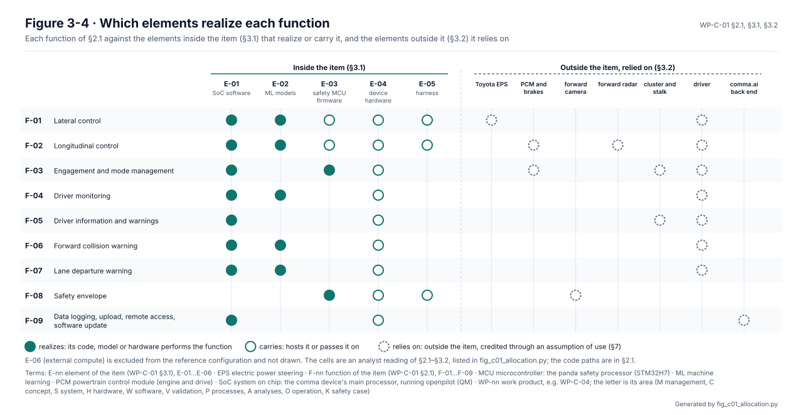
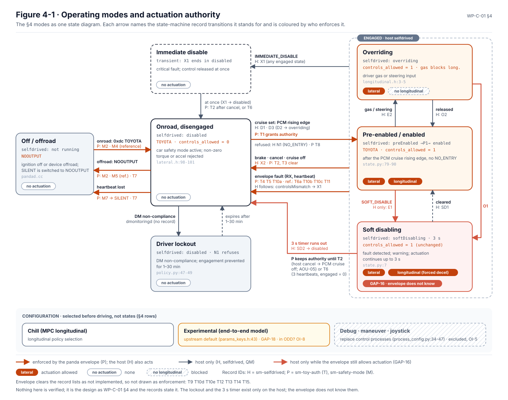

# Item definition

The item definition, [WP-C-01](../WP-C-01-item-definition.md), says what LionDriver is before any analysis starts:
what it does, what it is made of, where it ends, what it touches and what it assumes about everything outside it.
The HARA, the safety concepts, SOTIF and the TARA all start from it, and each redraws its boundary in its own view.

<!-- terms:start (generated by assurance/trace/tools/terms.py; do not edit by hand) -->

Terms on this page (31)

| Term | Meaning |
|---|---|
| ACC | adaptive cruise control |
| AOU-nn | assumption of use (WP-C-01 §7); an R suffix marks the FSC's refined version |
| ASIL | Automotive Safety Integrity Level, A (lowest) to D (highest), from ISO 26262 |
| CAN | controller area network: the vehicle's data bus |
| CFG-nn | vehicle configuration in the vehicle register (CFG-001 is the reference Corolla) |
| DQ-nn | decision of the project lead (decision register) |
| E-nn | element of the item (WP-C-01 §3.1), E-01…E-06 |
| ECU | electronic control unit |
| EPS | electric power steering |
| F-nn | function of the item (WP-C-01 §2.1), F-01…F-09 |
| FSC | functional safety concept |
| FSR-nn | functional safety requirement (FSC) |
| G0–G6 | gate G0…G6 of the project lifecycle |
| GAP-nn | gap found by the gap assessment |
| HARA | hazard analysis and risk assessment (ISO 26262-3) |
| IF-nn | interface of the item (WP-C-01 §3.4) |
| L0–L5 | degradation level L0 (full function) to L5 (lockout), FSC §12.1 |
| LD-SDA | LionDriver Supervised Driving Assistance, the item |
| MCU | microcontroller: the panda safety processor (STM32H7) |
| OI-nn | open item of the document it appears in |
| PCM | powertrain control module (engine and drive) |
| PCS | pre-collision system: Toyota's stock collision warning and braking |
| QM | quality managed: no ASIL; ordinary quality processes suffice |
| SoC | system on chip: the comma device's main processor, running openpilot (QM) |
| SOTIF | safety of the intended functionality (ISO 21448): hazards with nothing failing |
| SVG | scalable vector graphics (the figure format) |
| TARA | threat analysis and risk assessment (ISO/SAE 21434) |
| TSS | Toyota Safety Sense (TSS 2.0: the car's stock lane assist, radar cruise and pre-collision package) |
| US | United States |
| VIN | vehicle identification number |
| WP-nn | work product, e.g. WP-C-04; the letter is its area (M management, C concept, S system, H hardware, W software, V validation, P processes, A analyses, O operation, K safety case) |

All terms: [abbreviations and record codes](../../terms.md).

<!-- terms:end -->

This page walks through the item definition with its figures. The document is the source of record, and every figure
here is generated from it or drawn from its tables.

**The item in five lines.**

1. **LionDriver Supervised Driving Assistance (LD-SDA).** It is a supervised Level 2 retrofit: it steers and controls
   speed at the same time while the driver supervises.
2. **One reference car.** The item is defined on CFG-001, a US Toyota Corolla E210 of model years 2020–2022, with a
   comma device and the Toyota harness. G1 claims that configuration only (DQ-370).
3. **Nine functions and five elements inside the boundary.** The functions are steering, speed control, engagement,
   driver monitoring, warnings, forward collision warning, lane departure warning, the safety envelope and logging and
   updates. The elements are the openpilot software, the models, the panda safety firmware, the device hardware and
   the harness. External compute (E-06) is excluded (DQ-021).
4. **One path to the actuators.** Every steering and acceleration command leaves through the panda safety MCU (the
   envelope) and the harness, and nothing else in the item can move the car.
5. **17 assumptions of use.** They cover what the item takes for granted about the Toyota ECUs, the installation, the
   driver, the network and the build. Most are not yet verified.

| Where it comes from | The definition | Where it goes |
|---|---|---|
| The reference car, the comma device and upstream openpilot | Functions, elements, boundary, interfaces, modes, assumptions, limits | [HARA (WP-C-03)](../hara/README.md), [FSC (WP-C-04)](../fsc/README.md), [SOTIF (WP-C-05…07)](../sotif/README.md), [TARA (WP-C-09)](../tara/README.md) |
| The [vehicle register](../../../docs/liondriver/vehicles/README.md) (CFG-001, its trims and firmware) | | [Item and environment models (WP-C-12)](../WP-C-12-item-and-environment-models.md) |

## 1. What it does

| Function | What it does |
|---|---|
| F-01 Lateral control | Lane centring: steering torque to the EPS from the driving model's path |
| F-02 Longitudinal control | Adaptive cruise with stop-and-go through the PCM's ACC interface |
| F-03 Engagement and mode management | Engages on the stock cruise controls; disengages on brake, cancel or a fault |
| F-04 Driver monitoring | Driver camera and model; escalating warnings, then a controlled stop and lockout |
| F-05 Driver information and warnings | Device display and sounds, cluster lane-assist display |
| F-06 Forward collision warning | Warns only; the stock PCS keeps the braking |
| F-07 Lane departure warning | Warns when not steering, above 31 mph |
| F-08 Safety envelope | On the panda MCU: which messages may be sent, actuation limits, engagement gating, input checks |
| F-09 Logging, upload, remote access, update | Non-driving functions |

The item replaces two stock Toyota functions: lane tracing assist and radar cruise. It is meant to leave the stock
pre-collision braking untouched; that is not yet verified (AOU-04).

*What happens to the car's own functions ([WP-C-01](../WP-C-01-item-definition.md) §2.2, Figure 2-1).*

## 2. What it is made of, and where it ends

*The elements (§3.1, Figure 3-1),* from the item down to the parts and software units.

*Which elements realize each function (§3.5, Figure 3-4).* The openpilot software (E-01) and its models (E-02)
realize almost every driving function. The safety firmware (E-03) realizes only two: the envelope itself and the
engagement gating. For steering and speed it checks commands it did not make. Every function except the envelope
and logging relies on the driver.

*The boundary (§3.3, Figure 3-2).* Everything that crosses it is an interface, IF-01 to IF-09.

*The CAN interfaces (§3.4, Figure 3-3).* Each message the item sends, receives or forwards, and the check the envelope
applies to it.

## 3. One item, four views

The analyses that follow all redraw the same boundary. Shown together, they show where the weight of the item sits.

*The hazard view ([HARA](../hara/README.md), Figure 4-9).* Which functions can hurt someone when they go wrong, and
how badly. Steering and speed control carry almost every guide word at ASIL C.

*The safety view ([FSC](../fsc/README.md), Figure 10-1).* Which element carries which safety requirement. The envelope
carries most of them at ASIL C. The QM openpilot side still carries some, outlined red.

*The cybersecurity view ([TARA](../tara/README.md), Figure 1-1).* What is worth attacking on each element and how it
is reached. The highest risks sit on the same two elements: the openpilot side, which can reach the envelope without
authentication, and the envelope itself.

## 4. How it behaves

*The operating modes (§4, Figure 4-1),* each with what the openpilot side and the panda believe and what may actuate.

*One engagement on a time axis (Figure 4-2).* The times between events are made up. Only the 3 s soft disable and the
1–30 min lockout come from the code.

## 5. What it assumes

*The assumptions of use (§7, Figure 7-1).* The ratings of the HARA lean hardest on the first group. The EPS limits
and fades the steering torque (AOU-01/02). Braking always works and cancels cruise (AOU-03). The stock PCS keeps
working (AOU-04). The PCM bounds acceleration (AOU-05). For any other vehicle these five are entry criteria (§1.1):
a car that does not show them is not admitted to the platform (DQ-369).

## 6. Its limits today

*The inherited actuation envelope (§8, Figure 8-1).* These are the limits the code enforces today, not yet derived
from what a driver can control. The steering torque limit has no physical value yet (GAP-04); deriving one is the
FSC's chosen route to controllability.

## 7. Open items

The ones that can change the definition are below; the full list is in WP-C-01 §9.

- **OI-1, OI-2, OI-9:** record the reference car's VIN and ECU firmware, and each device's and harness's revision.
- **OI-3:** confirm which other stock functions (road sign assist, high beams, blind spot) the harness affects.
- **OI-5:** define how the debug, maneuver and joystick modes are disabled in reference builds.
- **OI-6:** confirm the legal status of L2 development testing. Until then, vehicle tests run on a closed course only
  (DQ-104).
- **OI-7:** the engagement speed floor (proposed 60 km/h, DQ-280).

## Where the figures come from

This folder has no files of its own besides this page. The item's figures live in [`../figures/`](../figures/), next
to the document:

| Figure | Generator |
|---|---|
| WP-C-01 Figures 2-1, 3-3 and 8-1 | [`fig_c01_interfaces.py`](../figures/fig_c01_interfaces.py), from §2.2, §3.4 and §8 |
| WP-C-01 Figures 4-1, 4-2 and 7-1 | [`fig_c01_modes.py`](../figures/fig_c01_modes.py), from §4, §7 and the state-machine records |
| WP-C-01 Figure 3-4 | [`fig_c01_allocation.py`](../figures/fig_c01_allocation.py). The cells are an analyst reading of §2.1–§3.2 (`ALLOCATION`); the build fails if a function or element is not mapped |
| WP-C-01 Figures 3-1 and 3-2 | Hand-drawn SVGs in [`../figures/`](../figures/); change them together with §3.1–§3.4 |
| The three views | [`hara_views.py`](../hara/hara_views.py), [`fsc_safety_view.py`](../fsc/fsc_safety_view.py), [`fig_c09_boundary.py`](../figures/fig_c09_boundary.py) |
