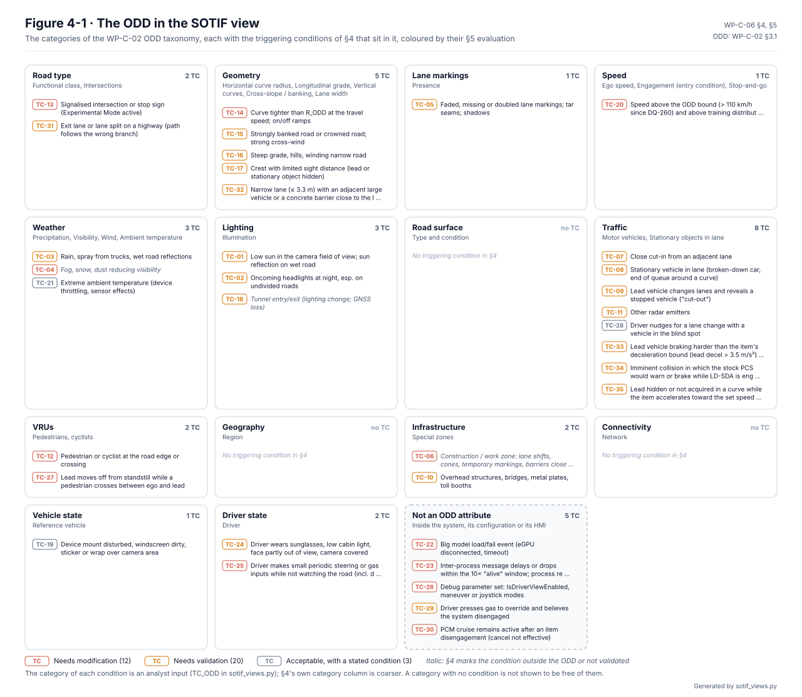
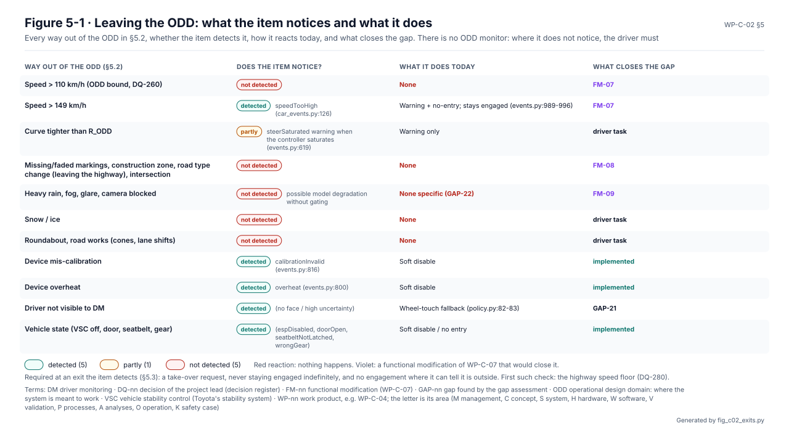

# Operational design domain (ODD) and intended functionality

The ODD, [WP-C-02](../WP-C-02-odd-and-intended-functionality.md), says where LionDriver is meant to drive. That means
which roads, speeds, curves, weather, light and traffic, and in what state the car and the driver must be. The same
document says what each function does there and what it does not do. Every SOTIF analysis and every validation target
is scoped to this domain, and the HARA's situations are drawn from it.

<!-- terms:start (generated by assurance/trace/tools/terms.py; do not edit by hand) -->

Terms on this page (16)

| Term | Meaning |
|---|---|
| AI | artificial intelligence |
| ASIL | Automotive Safety Integrity Level, A (lowest) to D (highest), from ISO 26262 |
| D-nn | design decision of the earlier decision list (D-01…D-12; D-08 is the Experimental Mode decision) |
| DQ-nn | decision of the project lead (decision register) |
| F-nn | function of the item (WP-C-01 §2.1), F-01…F-09 |
| FM-nn | functional modification (WP-C-07) |
| HARA | hazard analysis and risk assessment (ISO 26262-3) |
| ODD | operational design domain: where the system is meant to work |
| ODD-H | the claimed ODD: limited-access highways |
| OI-nn | open item of the document it appears in |
| PCS | pre-collision system: Toyota's stock collision warning and braking |
| SG-nn | safety goal (HARA §6) |
| SOTIF | safety of the intended functionality (ISO 21448): hazards with nothing failing |
| US | United States |
| VRU | vulnerable road user: pedestrian or cyclist |
| WP-nn | work product, e.g. WP-C-04; the letter is its area (M management, C concept, S system, H hardware, W software, V validation, P processes, A analyses, O operation, K safety case) |

All terms: [abbreviations and record codes](../../terms.md).

<!-- terms:end -->

This page walks through the ODD with its figures. The document is the source of record, and every figure here is
generated from it.

**The ODD in five lines.**

1. **Limited-access highways only** (ODD-H; DQ-023), in the continental US. Everything else is outside, including
   arterials, rural roads, intersections, roundabouts and road works.
2. **Up to 110 km/h** (DQ-260), in light rain at most (below 2.5 mm/h, DQ-414), in curves no tighter than v²/2.5 m/s²,
   with a maintained car on good tyres (DQ-416) and an attentive driver.
3. **The item does not enforce it.** There is no ODD monitor: the driver decides when the car is inside and
   disengages before it leaves. Of the eleven ways out, the item notices five and partly notices one.
4. **Off-highway use is analysed, not claimed.** Owners engage upstream openpilot well off the highway, so those
   situations are rated as foreseeable misuse (DQ-213). The first system-side check, a highway speed floor below which
   the item will not engage, is decided but not built (DQ-280).
5. **Chill mode only.** Experimental Mode is off by default (DQ-001). Whether it ever joins the ODD stays open (OI-1).

| Where it comes from | The specification | Where it goes |
|---|---|---|
| Upstream limitations (`docs/LIMITATIONS.md`) and the code's own limits | ODD bounds, intended functionality, driver role, behaviour at the boundary | [SOTIF (WP-C-05…07)](../sotif/README.md), [SOTIF validation (WP-V-02)](../../06-validation/WP-V-02-sotif-vv-strategy.md) |
| [Item definition (WP-C-01)](../item/README.md) | | [HARA situations (WP-C-03 §3)](../hara/README.md), [user information (WP-O-03)](../../09-production-operation/WP-O-03-user-information-safety-warnings.md) |

## 1. Where the item is meant to work

*The ODD as a taxonomy (§3.1, Figure 3-1).* Fourteen categories, each with what is included. Anything not listed as
included is excluded. Some examples of what is out:
- moderate rain and anything heavier, snow, fog;
- low sun straight into the camera, and tunnels;
- construction zones and toll booths;
- a driver the camera cannot see.

## 2. Speed and curves

*Speed against the tightest curve (§3.2, Figure 3-2).* The controller can command up to 3.0 m/s² of lateral
acceleration, and the ODD stops at 2.5 m/s² to keep a margin. That margin is not yet shown to cover the steering's
real torque authority (OI-2). The planner does not slow down for curves, so entering a tighter one is the driver's
task. At the bound, a silent loss of steering drifts about 0.6 m in 0.7 s. That is why the HARA rates SG-02 ASIL C
(DQ-059).

## 3. The ODD as the analyses see it

The SOTIF analysis and the HARA both start from this domain, and each redraws it.

*The SOTIF view ([SOTIF](../sotif/README.md), WP-C-06 Figure 4-1).* The situations in each category that expose a
weakness of the intended function. Traffic and geometry hold the most.

*The hazard view ([HARA](../hara/README.md), WP-C-03 Figure 3-1).* The situations the HARA crosses with every
malfunction. The hatched ones are outside the ODD but rated anyway, because the item cannot yet stop the driver
engaging there.

## 4. What the item does inside it

| Function | Inside the ODD it… | It does not… |
|---|---|---|
| F-01 Lateral control | keeps the car near the lane centre, at most 3.0 m/s²; assists a lane change the driver starts | check the blind spot |
| F-02 Longitudinal control (Chill) | holds the set speed, follows and stops behind a lead, resumes when it moves | stop for signals, signs, pedestrians or stationary objects |
| F-03 Engagement | engages only through the stock cruise controls; brake or cancel disengages | stay engaged against the driver |
| F-04 Driver monitoring | escalates alerts above 10 km/h, then stops the car and locks the driver out | measure alertness exactly |
| F-05 Driver information | shows the engagement state and alerts | explain every limitation as it happens |
| F-06 Forward collision warning | warns ("BRAKE!") | brake: the stock PCS keeps that |
| F-07 Lane departure warning | warns above 31 mph when not steering | correct the steering |

**The driver** is responsible for the driving at all times. They decide whether the car is inside the ODD and engage
only there, supervise with eyes on the road and hands near the wheel, and handle everything the table says the item
does not do.

## 5. Leaving the ODD

*What the item notices at the boundary (§5.2, Figure 5-1).* Above 110 km/h, on leaving the highway, in heavy rain,
snow or road works, the item notices nothing and does nothing; the driver must. Above 149 km/h it warns but stays
engaged. The required behaviour (§5.3) is a take-over request at every exit the item can detect, and no engagement
where it can tell it is outside. The modifications that would close these gaps are FM-07, FM-08 and FM-09 (WP-C-07).

## 6. Experimental Mode

Upstream made Experimental Mode the default. In that mode the model's own acceleration joins the plan, the car
accelerates harder, and the user interface promises stops at red lights that the upstream limitations say it does not
detect. WP-C-02 recommends keeping it outside the ODD until it has been analysed and validated (option A, §6.4). The
default has been off since DQ-001; locking the toggle is specified in FM-01, not built yet. Whether to bring it in later is open (OI-1, D-08).

## 7. The ODD and the driving model's training data

What the driving model was trained on is not published. So a part of the ODD is claimed only where LionDriver's own
evaluation data covers it and the AI safety requirements are met there (§3.3, [WP-C-11](../WP-C-11-ai-system-definition-and-safety-requirements.md)).
A runtime monitor raises a take-over alert on inputs the evaluation did not reveal. What stays unknown is recorded as
a residual risk in the safety case.

## 8. Open items

The ones that can change the ODD are below; the full list is in WP-C-02 §7.

- **OI-1:** decide whether Experimental Mode can ever join the ODD.
- **OI-2:** measure the steering's torque authority and confirm the curve bound.
- **OI-3:** set the ambient temperature bound from the device's operating range.
- **OI-5:** confirm the 6 % grade and banking bounds by vehicle test.
- **OI-9:** the highway speed floor (DQ-280): its value, implementation and verification, and later a road-type
  source (FM-08).
- **OI-10:** a windy-day log, to set the crosswind limit.

## Where the figures come from

This folder has no files of its own besides this page. The figures live next to the documents:

| Figure | Generator |
|---|---|
| WP-C-02 Figures 3-1 and 3-2 | [`fig_c02_odd.py`](../figures/fig_c02_odd.py), from §3.1 and §3.2 |
| WP-C-02 Figure 5-1, leaving the ODD | [`fig_c02_exits.py`](../figures/fig_c02_exits.py), from §5.2. It fails if the Detected column cannot be read |
| WP-C-06 Figure 4-1, the SOTIF view | [`sotif_views.py`](../sotif/sotif_views.py) |
| WP-C-03 Figure 3-1, the situations | [`hara_views.py`](../hara/hara_views.py) |
