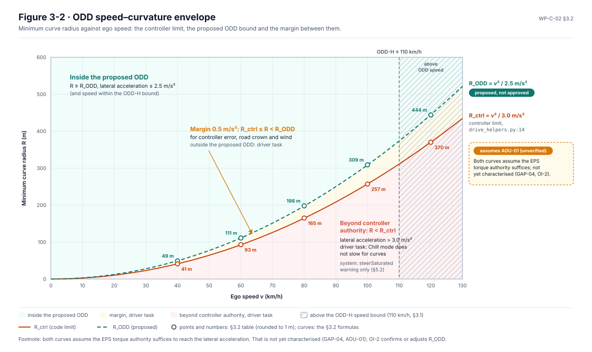
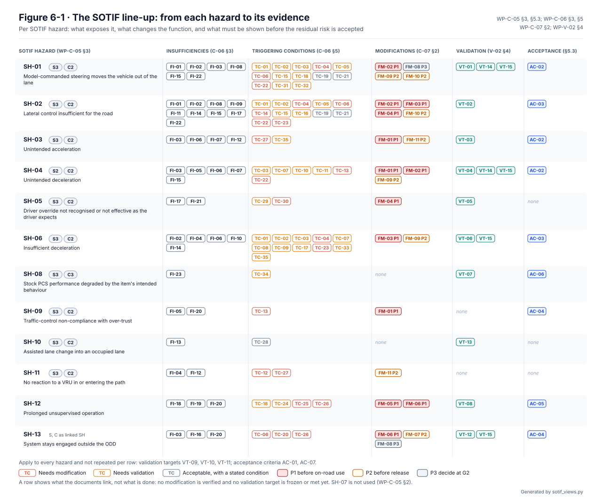
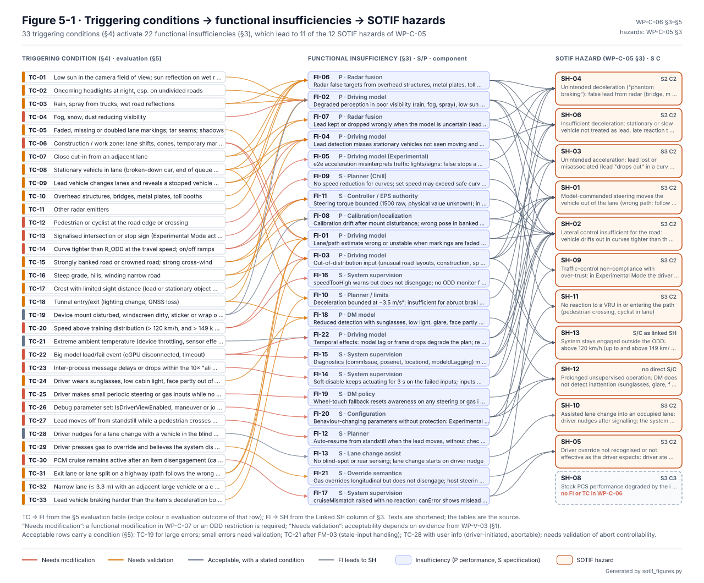
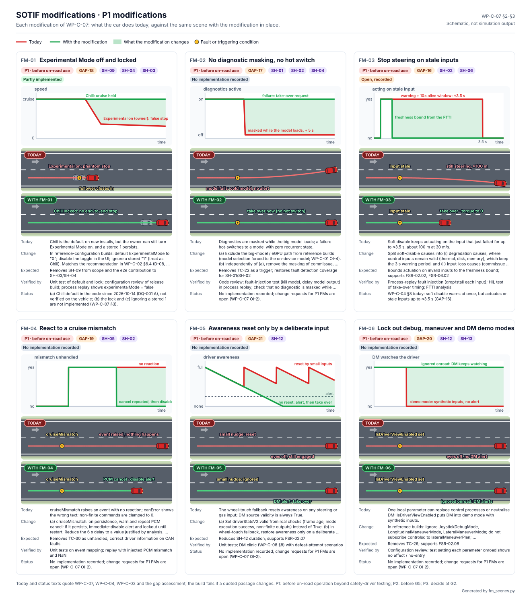
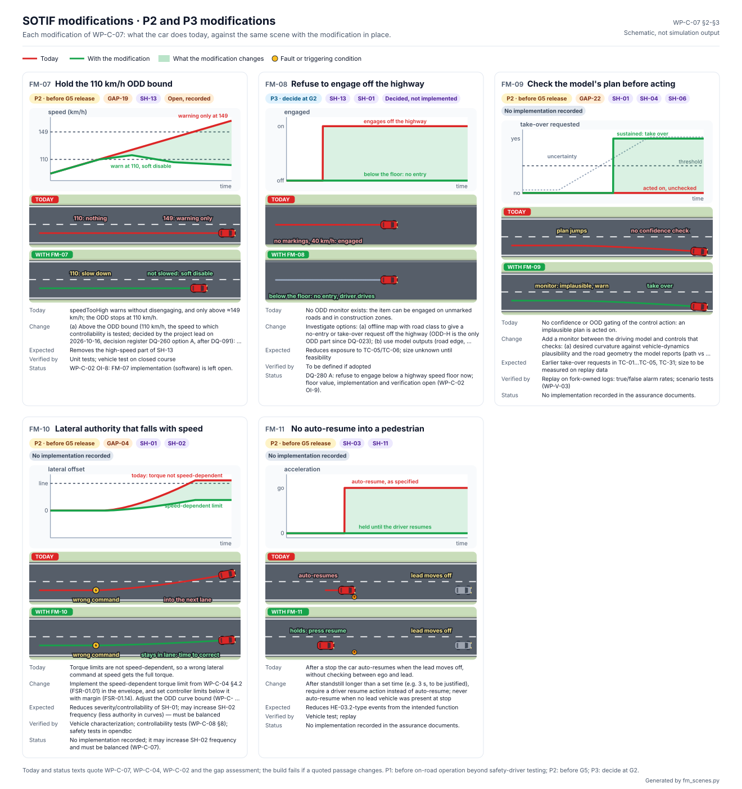
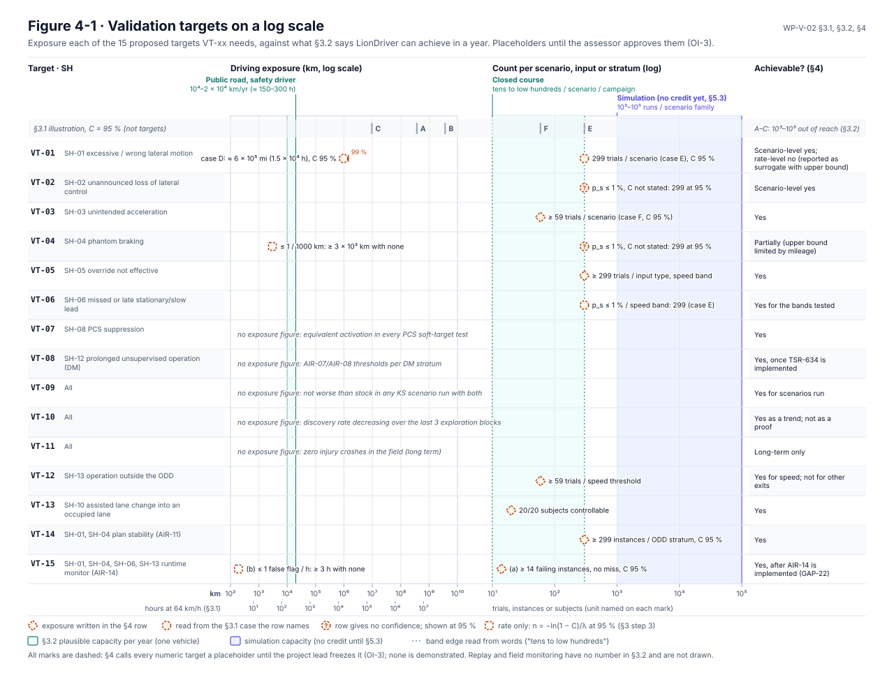

# Safety of the intended functionality (SOTIF)

The HARA and the functional safety concept ask what happens when something **fails**. SOTIF (ISO 21448) asks what
happens when nothing fails: the camera, the model and the planner all work as designed, and the car still does
something hazardous. The cause is a situation the design was never good enough for, such as low sun, a tar seam that
looks like a lane line, or a stopped car around a curve.

<!-- terms:start (generated by assurance/trace/tools/terms.py; do not edit by hand) -->
<details><summary>Terms on this page (26)</summary>

| Term | Meaning |
|---|---|
| AC-nn | acceptance criterion (WP-C-05 §5.3) |
| C0–C3 | controllability class C0 (controllable in general) to C3 (difficult or uncontrollable) |
| DQ-nn | decision of the project lead (decision register) |
| FI-nn | functional insufficiency (WP-C-06) |
| FM-nn | functional modification (WP-C-07) |
| G0–G6 | gate G0…G6 of the project lifecycle |
| GAP-nn | gap found by the gap assessment |
| HARA | hazard analysis and risk assessment (ISO 26262-3) |
| HMI | human-machine interface: display, sounds, cluster |
| ISO | International Organization for Standardization |
| KS-nn | known scenario (WP-V-03) |
| ODD | operational design domain: where the system is meant to work |
| ODD-H | the claimed ODD: limited-access highways |
| OI-nn | open item of the document it appears in |
| P1–P3 | priority of a functional modification: P1 before on-road use, P2 before release, P3 decide at G2 |
| PCS | pre-collision system: Toyota's stock collision warning and braking |
| S0–S3 | severity class S0 (no injuries) to S3 (life-threatening) |
| SG-nn | safety goal (HARA §6) |
| SH-nn | SOTIF hazard (WP-C-05) |
| SOTIF | safety of the intended functionality (ISO 21448): hazards with nothing failing |
| SVG | scalable vector graphics (the figure format) |
| TC-nn | triggering condition (WP-C-06) |
| TSR-nn | technical safety requirement (WP-S-02) |
| VRU | vulnerable road user: pedestrian or cyclist |
| VT-nn | validation target (WP-V-02) |
| WP-nn | work product, e.g. WP-C-04; the letter is its area (M management, C concept, S system, H hardware, W software, V validation, P processes, A analyses, O operation, K safety case) |

All terms: [abbreviations and record codes](../../terms.md).

</details>
<!-- terms:end -->

This page walks through LionDriver's SOTIF analysis with its figures. The documents are the source of record, and
every figure here is generated from them.

**The analysis in five lines.**

1. The intended functionality and its operating domain (ODD) are set in [WP-C-02](../WP-C-02-odd-and-intended-functionality.md).
   The ODD is limited-access highways only, up to 110 km/h, in no more than light rain (DQ-023, DQ-260, DQ-414).
2. Thirteen SOTIF hazards, SH-01 to SH-14, are identified and rated in [WP-C-05](../WP-C-05-sotif-hazard-identification.md).
   SH-07 is not used. Most share their vehicle-level effect, and their S and C ratings, with a HARA hazard.
3. [WP-C-06](../WP-C-06-sotif-insufficiencies-triggering-conditions.md) finds 24 functional insufficiencies and 36
   triggering conditions that expose them, and evaluates each. 12 need a modification, 21 need validation, and 3 are
   acceptable with a stated condition.
4. [WP-C-07](../WP-C-07-sotif-functional-modifications.md) specifies 11 functional modifications: 6 before any on-road
   use (P1), 4 before release (P2) and 1 to decide at G2 (P3).
5. [WP-V-02](../../06-validation/WP-V-02-sotif-vv-strategy.md) sets 15 validation targets. The residual risk is
   accepted when they are met. They are proposals until the lead freezes them (DQ-096), and none is met yet.

| Where it comes from | The analysis | Where it goes |
|---|---|---|
| [Item definition (WP-C-01)](../WP-C-01-item-definition.md) and [ODD and intended functionality (WP-C-02)](../WP-C-02-odd-and-intended-functionality.md) | Hazards, insufficiencies, triggering conditions, modifications, acceptance criteria | [SOTIF V&V strategy (WP-V-02)](../../06-validation/WP-V-02-sotif-vv-strategy.md), [known scenarios (WP-V-03)](../../06-validation/WP-V-03-sotif-known-scenarios.md) |
| [HARA (WP-C-03)](../WP-C-03-hara.md): hazards and ratings shared with SH-nn | Driver, HMI and misuse ([WP-C-08](../WP-C-08-driver-hmi-misuse-analysis.md)) | [System requirements (WP-S-01)](../../03-system/WP-S-01-system-requirements.md), [TSRs (WP-S-02)](../../03-system/WP-S-02-technical-safety-requirements.md) |

## 1. From the ODD to the SOTIF view

The ODD says where the function is meant to work. The SOTIF analysis asks which situations inside that domain, or at
its edge, catch the function out. Below, the ODD is shown twice: first as WP-C-02 draws it, then with the triggering
conditions placed in it.


*The ODD, as [WP-C-02](../WP-C-02-odd-and-intended-functionality.md) §3.1 draws it (Figure 3-1).*


*The same ODD in the SOTIF view (WP-C-06 §4, Figure 4-1).* Traffic and geometry hold the most conditions: cut-ins,
stopped cars, a lead hidden in a curve, curves tighter than the ODD bound, narrow lanes. Five conditions are not in
the domain at all. They are inside the system (a model switch, stale messages), its configuration (debug modes) or
its HMI (the driver believes the system is off). A category with no condition here has not been shown to be free of
them.

The ODD's speed and curve envelope is where the lateral insufficiencies sit:



*Figure 3-2 of WP-C-02.* Above the dashed bound is inside the ODD. A tighter curve at speed is triggering condition
TC-14. The planner does not slow down for curves in Chill mode, so entering one is the driver's task.

## 2. Where the analysis stands: the four areas


*WP-C-05 Figure 2-1.* ISO 21448 aims to move scenarios out of the hazardous areas, either known (area 2) or
unknown (area 3), into area 1, known not hazardous. Area 1 is still empty: nothing has yet been shown safe by
evidence. The driving model is a black box (its training data is not published, GAP-22), so area 3 is reduced only
by exploration (WP-V-04, AC-07) and the runtime monitor (FM-09).

## 3. From each hazard to its evidence



*WP-C-05 Figure 6-1.* Read a row left to right: what exposes the hazard, what changes the function, what must be
shown. It shows links, not progress. Gaps to note:

- **SH-08** (stock PCS degraded) and **SH-10** (lane change into an occupied lane) have no modification. SH-08 rests
  on the PCS tests of AC-06. SH-10 rests on user information and an abort test (VT-13).
- **SH-11** (no reaction to a VRU) has no validation target. Highways only (DQ-023) makes a VRU in the lane rare;
  it stays the driver's responsibility.
- **SH-09** (traffic-control non-compliance) leaves scope with Experimental Mode locked off (FM-01). KS-24 verifies
  the lock.
- **SH-14** (no response to emergency vehicles) has no modification and no validation target yet. Its S3 and C2
  were accepted by the lead (DQ-429 A); KS-28 is specified, but the driver's response is not analysed yet.

## 4. Triggering conditions → insufficiencies → hazards



*WP-C-06 Figure 5-1.* Every condition is evaluated once (§5). The generator fails if a condition is not evaluated,
or if an insufficiency is activated by no condition.

### What each hazard looks like on the road


*What each SOTIF hazard looks like on the road (WP-C-06 Figure 5-2).* Nothing fails in these scenes. The system
works as specified, and a triggering condition exposes an insufficiency. Each card draws one row of WP-C-06 §5. Two
styles follow the class WP-C-06 §3 gives the insufficiency:

- **P, performance insufficiency** ("it sees it wrong"): the blue dashed layer is what the camera or radar believes,
  drawn over the true road.
- **S, specification insufficiency** ("not enough as specified"): the chart sets what the situation needs against
  what the specification delivers, with the specified limit as a grey dashed line.

The scenes are schematic, to explain each hazard. The measured cases are the plant runs in
[assurance/sim §3.7](../../sim/README.md#37-the-asil-c-hazardous-events-in-the-loop). Each card loops in a browser.

## 5. What changes the function



*The P1 modifications, needed before any on-road use beyond safety-driver testing (WP-C-07 §2).* Each card sets what
the car does today against the same scene with the modification. Of the eleven, WP-C-07 records one as done: FM-01(a),
the Chill-mode default (DQ-001). The others are specified, each with its verification.

<details><summary>The P2 and P3 modifications (FM-07 to FM-11)</summary>



</details>

## 6. The driver and misuse

SOTIF counts reasonably foreseeable misuse as well as insufficiencies ([WP-C-08](../WP-C-08-driver-hmi-misuse-analysis.md)).
The driver who stops supervising is treated on both sides (DQ-003). Here, as SH-12, it removes the basis of the C2
ratings of SH-01 to SH-11. In the HARA it is the unresponsive-driver goal SG-08. Driver monitoring is the counter
(FM-05, FM-06, AC-05). Off-highway use is analysed as misuse, not claimed (DQ-213).

## 7. When is the residual risk accepted

The top-level claim is that residual risk is no worse than manual driving of the same car with its stock assistance
(WP-C-05 §5.1). Two layers carry it:

- **Qualitative criteria AC-01 to AC-07** (WP-C-05 §5.3), checked by review and test. Examples: every triggering
  condition evaluated; actuation inside the envelope; stock PCS unchanged; exploration finding nothing new.
- **Validation targets VT-01 to VT-15** (WP-V-02 §4), from rate and scenario-level targets to driver-monitoring
  performance.



*WP-V-02 Figure 4-1.* What each target needs in driving or trials, set against what public road, closed course
and simulation can supply (WP-V-02 §3.2).

## 8. Open items

The ones that can change the analysis are below; each document lists all of its own.

- **WP-C-05 OI-3:** choose the human-driver baseline data for the acceptance targets.
- **WP-C-05 OI-4:** whether the reference car has a blind-spot input (SH-10).
- **WP-V-02 OI-2, OI-3:** replace the illustrative crash rates with real data, then freeze the targets.
- **WP-C-07 OI-5:** re-run the WP-C-06 evaluation once the modifications are implemented.

## Files in this folder

| File | What it is |
|---|---|
| [`sotif_figures.py`](sotif_figures.py) | Generator. It reads the WP-C-05 and WP-C-06 tables and writes WP-C-06 Figure 5-1, then the scene sheet, the modification sheets and the two overview figures through the modules below |
| [`sotif_views.py`](sotif_views.py) | Draws WP-C-06 Figure 4-1 (the ODD in the SOTIF view, from WP-C-02 §3.1 and WP-C-06 §4–§5) and WP-C-05 Figure 6-1 (the line-up, from WP-C-05 §3 and §5.3, WP-C-06, WP-C-07 §2 and WP-V-02 §4). The ODD category of each triggering condition is an analyst input, `TC_ODD` |
| [`sotif_scenes.py`](sotif_scenes.py) | Draws the SOTIF scene sheet, one card per hazard. Texts, S/C and evaluations come from the documents; the behaviour curves are schematic and live in this file |
| [`fm_scenes.py`](fm_scenes.py) | Draws the WP-C-07 modification sheets. Every "today" and "status" text quotes the documents, and the build fails if a quoted passage changes |
| `test_*.py` | Unit tests: every figure is current, every TC and FI appears, every condition has one ODD category, the line-up follows the documents, and malformed tables are rejected |
| [`../figures/`](../figures/) | The generated SVGs `fig-c05-6-1-*`, `fig-c06-4-1-*`, `fig-c06-5-1-*`, `fig-c06-5-2-*` and `fig-c07-3-*`. Do not edit by hand. The four-area chart is drawn by [`../figures/fig_c05_four_areas.py`](../figures/fig_c05_four_areas.py), the ODD figures by [`../figures/fig_c02_odd.py`](../figures/fig_c02_odd.py) |

## Regenerating

```bash
python3 sotif_figures.py            # write every figure listed above
python3 sotif_figures.py --check    # fail if a figure is stale (run in CI)
python3 -m unittest discover -p 'test_*.py'
```

The generator fails if:

- a §5 row names a TC or FI that §3/§4 do not define;
- a TC is not evaluated in §5, or is evaluated in more than one row;
- an FI is not activated by any §5 row;
- an evaluation outcome is not one of the three defined in WP-C-06 §1;
- an FI links to a hazard that WP-C-05 §3 does not define;
- a TC has no ODD category, or `TC_ODD` names a category WP-C-02 §3.1 does not have;
- WP-C-07 §2, WP-V-02 §4 or WP-C-05 §5.3 names a hazard WP-C-05 §3 does not define.

A §5 row that names a hazard which none of its FIs links to in §3 is printed as a warning. The drawing helpers and
the colour scale are shared with [`../hara/hara_figures.py`](../hara/hara_figures.py).
