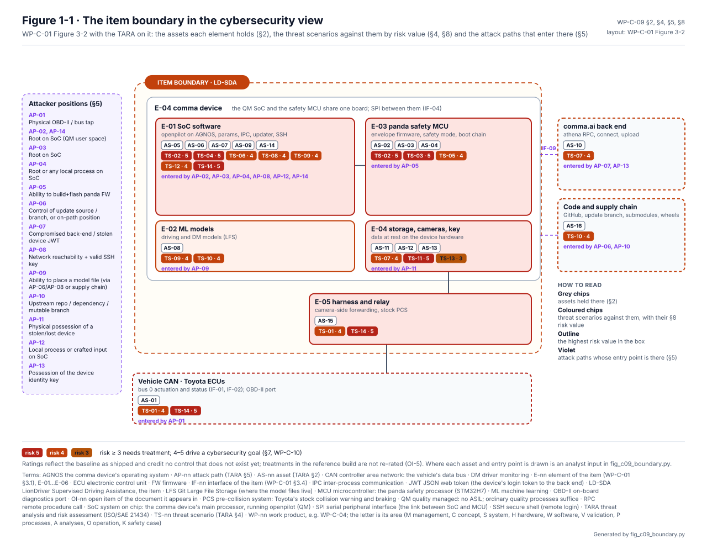
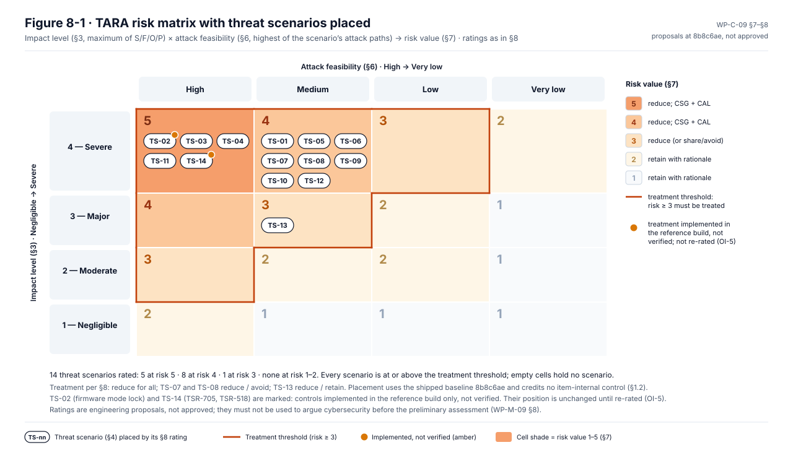
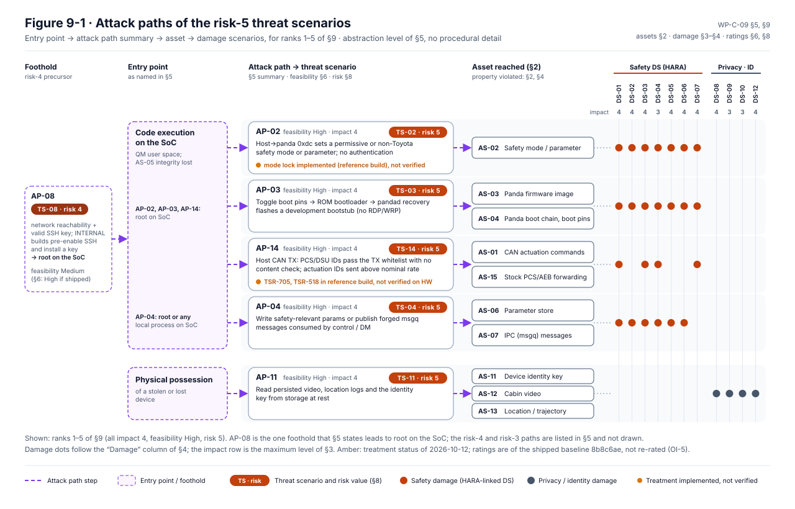
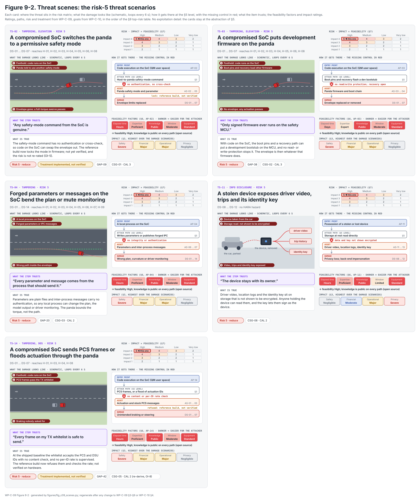
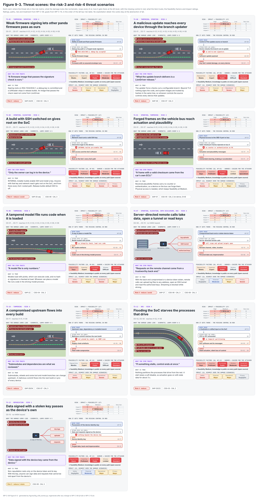
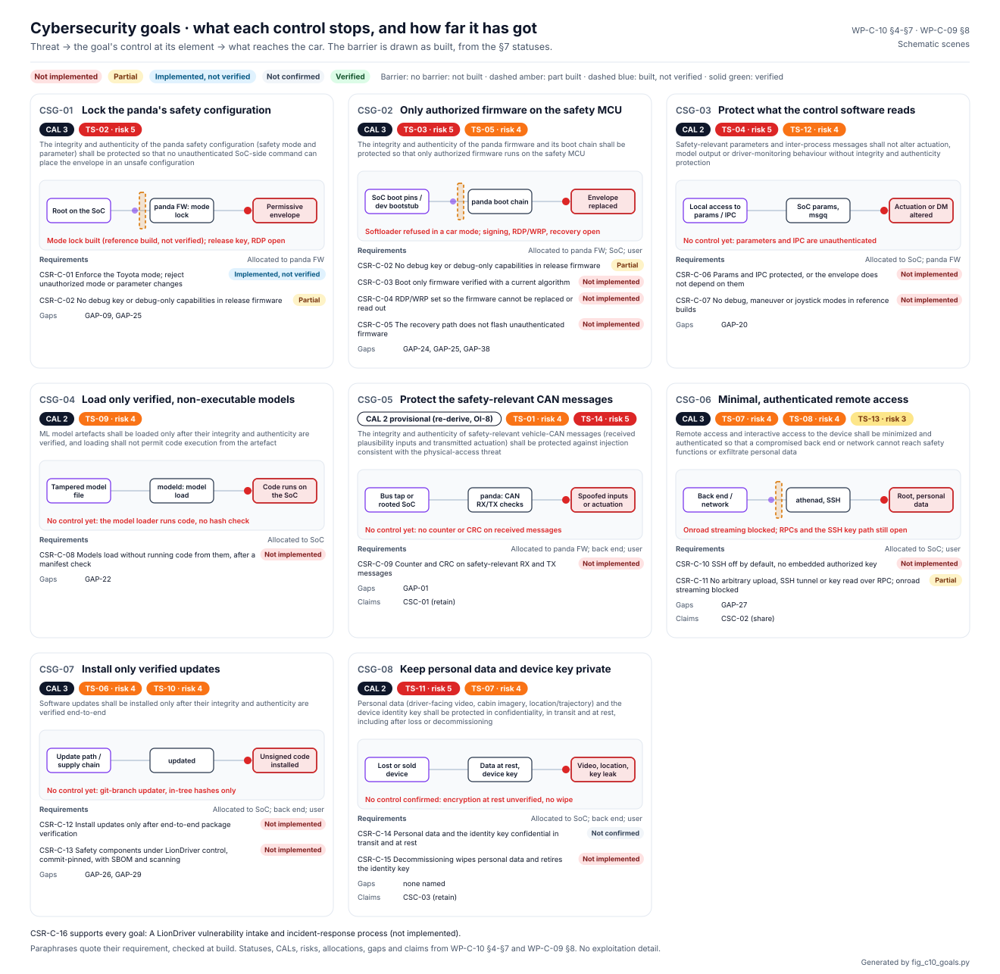

# Threat analysis and risk assessment (TARA)

The HARA asks what happens when the item fails by itself. The TARA,
[WP-C-09](../WP-C-09-tara.md), asks what happens when someone makes it fail, under ISO/SAE 21434. It names what is
worth attacking, how it could be reached, how hard that would be and how bad the result. Each threat gets a risk
value, and the high ones become cybersecurity goals in [WP-C-10](../WP-C-10-cybersecurity-goals-and-concept.md).

<!-- terms:start (generated by assurance/trace/tools/terms.py; do not edit by hand) -->
<details><summary>Terms on this page (26)</summary>

| Term | Meaning |
|---|---|
| ASIL | Automotive Safety Integrity Level, A (lowest) to D (highest), from ISO 26262 |
| CAL | cybersecurity assurance level, 1 to 4 (ISO/SAE 21434) |
| CSG-nn | cybersecurity goal (WP-C-10) |
| DQ-nn | decision of the project lead (decision register) |
| DS-nn | damage scenario (TARA §3) |
| E-nn | element of the item (WP-C-01 §3.1), E-01…E-06 |
| ECU | electronic control unit |
| FSC | functional safety concept |
| GAP-nn | gap found by the gap assessment |
| HARA | hazard analysis and risk assessment (ISO 26262-3) |
| HATARA | the joint HARA and TARA view: where hazards and threats meet |
| ID | identifier |
| IF-nn | interface of the item (WP-C-01 §3.4) |
| IPC | inter-process communication |
| ISO | International Organization for Standardization |
| LD-SDA | LionDriver Supervised Driving Assistance, the item |
| MCU | microcontroller: the panda safety processor (STM32H7) |
| ML | machine learning |
| OI-nn | open item of the document it appears in |
| QM | quality managed: no ASIL; ordinary quality processes suffice |
| SAE | SAE International (formerly the Society of Automotive Engineers) |
| SoC | system on chip: the comma device's main processor, running openpilot (QM) |
| SVG | scalable vector graphics (the figure format) |
| TARA | threat analysis and risk assessment (ISO/SAE 21434) |
| TS-nn | threat scenario (TARA §4) |
| WP-nn | work product, e.g. WP-C-04; the letter is its area (M management, C concept, S system, H hardware, W software, V validation, P processes, A analyses, O operation, K safety case) |

All terms: [abbreviations and record codes](../../terms.md).

</details>
<!-- terms:end -->

This page walks through the TARA with its figures. The documents are the source of record, and every figure here is
generated from them. It is a defensive analysis, written at the level a TARA needs (entry point → asset → violated
property → feasibility). There are no exploitation procedures in it.

**The TARA in five lines.**

1. **16 assets**, from the actuation commands on the vehicle bus to the device identity key and the driver-facing video.
2. **14 threat scenarios.** Five are at risk 5, eight at risk 4 and one at risk 3. Every one is to be reduced; none is
   retained yet.
3. **The dimensioning cause.** The QM SoC can configure, reflash and command the safety envelope without
   authentication (GAP-09, GAP-20, GAP-38), and the firmware signing is weak (GAP-24/25). So every threat that reaches
   the envelope is safety-severe and easy once the SoC is taken.
4. **Eight cybersecurity goals**, CSG-01 to CSG-08, each with a proposed assurance level (CAL 2 or 3), cover every
   scenario at risk 3 or above.
5. **The ratings are proposals.** They reflect the code as shipped, credit no control that does not exist, and may not
   be used to argue cybersecurity until the preliminary assessment passes ([WP-M-09 §8](../../01-management/WP-M-09-cybersecurity-plan.md)).

| Where it comes from | The analysis | Where it goes |
|---|---|---|
| [Item definition (WP-C-01)](../WP-C-01-item-definition.md): boundary, elements, interfaces | Assets, damage, threats, attack paths, feasibility, risk | [Cybersecurity goals and concept (WP-C-10)](../WP-C-10-cybersecurity-goals-and-concept.md) |
| [HARA (WP-C-03)](../hara/README.md): the hazards that set the safety impact | Treatment decision per threat | [Cybersecurity requirements (WP-S-07)](../../03-system/WP-S-07-cybersecurity-requirements-architecture.md), [HATARA](../hatara/README.md) |

## 1. From the item to the cybersecurity view

The item definition draws the boundary. The TARA puts its assets and threats on the same elements. Below, the boundary
is shown twice: first as WP-C-01 draws it, then in the cybersecurity view.


*The item, as [WP-C-01](../WP-C-01-item-definition.md#33-boundary-diagram) §3.3 draws it (Figure 3-2).*



*The same item in the cybersecurity view (WP-C-09 §1.1, Figure 1-1).* Most attack paths enter at the SoC, and the
risk-5 scenarios sit on the SoC and the panda safety MCU. This is the picture the
[FSC](../fsc/README.md) safety view shows from the other side: the envelope carries the safety goals, and the QM SoC
can reach it without authentication. The [HATARA](../hatara/README.md) records where the two views meet.

## 2. Where the risk sits



*WP-C-09 Figure 8-1 (§7, §8).* Every scenario has impact level 4 or 3, because the safety ones reach a hazard
rated ASIL B to C in the HARA. Feasibility separates them. The ones that start from code execution on the SoC are High,
because the item is open source and the paths have no authentication. An amber mark is a treatment implemented in
the reference build but not verified, and not re-rated (OI-5).

## 3. The five top risks



*WP-C-09 Figure 9-1 (§9).* All five risk-5 scenarios:

- **TS-02:** an unauthenticated host command sets any panda safety mode, disabling the envelope.
- **TS-03:** the SoC uses its control of the panda boot path to replace the firmware.
- **TS-04:** unauthenticated parameters or IPC override control, the model or driver monitoring.
- **TS-11:** a stolen device exposes video, location history and the identity key at rest.
- **TS-14:** a compromised SoC injects pre-collision frames or floods actuation IDs.

TS-02 and TS-14 have treatments in the reference build, not yet verified.

### Threat scenes



*The risk-5 scenarios as scene cards (WP-C-09 Figure 9-2).* Each card shows the damage on the road or in the data, the
path at the level of §5 with the missing control in red, what the item trusts against what is true, and the
feasibility factors.

<details><summary>The risk-3 and risk-4 scenarios (Figure 9-3)</summary>



</details>

## 4. From threats to cybersecurity goals



*[WP-C-10](../WP-C-10-cybersecurity-goals-and-concept.md) Figure 7-1.* Each goal states the property to protect, not the
mechanism.

| Goal | Protects | Threats (risk) | CAL |
|---|---|---|---|
| CSG-01 | The panda safety configuration | TS-02 (5) | 3 |
| CSG-02 | The panda firmware and its boot chain | TS-03 (5), TS-05 (4) | 3 |
| CSG-03 | Safety-relevant parameters and IPC | TS-04 (5), TS-12 (4) | 2 |
| CSG-04 | ML model artefacts at load | TS-09 (4) | 2 |
| CSG-05 | Safety-relevant vehicle-CAN messages | TS-01 (4), TS-14 (5) | 2 (to be re-derived, WP-C-10 OI-8) |
| CSG-06 | Remote and interactive access | TS-07 (4), TS-08 (4), TS-13 (3) | 3 |
| CSG-07 | Software updates, end to end | TS-06 (4), TS-10 (4) | 3 |
| CSG-08 | Personal data and the identity key | TS-11 (5), TS-07 (4) | 2 |

## 5. Where safety and security meet

Every safety damage scenario (DS-01 to DS-07, DS-13, DS-14) names the HARA hazard it causes. Its safety impact is set
by that hazard's ASIL. [WP-C-10 §8](../WP-C-10-cybersecurity-goals-and-concept.md#8-relation-to-safety-goals) maps each
cybersecurity goal to the safety goals it protects. Where a safety measure opens a security weakness, or a security
measure could cause a hazard, the [HATARA](../hatara/README.md) records the interaction.

## 6. Open items

The ones that can change a rating are below; the full list is in WP-C-09.

- **OI-1:** the reference-configuration decisions that set the TS-07 and TS-08 feasibilities. The lead has since
  decided that remote features are off by default and opt-in only (DQ-020, recorded in WP-C-10). The feasibilities
  are not re-rated yet.
- **OI-3:** check whether video, location and the identity key are encrypted at rest (TS-11).
- **OI-4:** decide the panda boot-chain and signing approach (TS-03, TS-05).
- **OI-5:** re-rate the feasibilities once the first controls are specified (the residual-risk iteration).
- **OI-6:** the independent preliminary cybersecurity assessment at G1.

## Where the figures come from

This folder has no files of its own besides this page. The figures live in [`../figures/`](../figures/), next to
the documents:

| Figure | Generator |
|---|---|
| WP-C-09 Figure 1-1, the cybersecurity view | [`fig_c09_boundary.py`](../figures/fig_c09_boundary.py). Assets, threats, risk and attack paths come from WP-C-09 §2, §4, §5 and §8. Where each asset and entry point is drawn is an analyst input (`ASSET_PLACE`, `AP_ENTRY`), and the build fails if one is missing |
| WP-C-09 Figures 9-2 and 9-3, the threat scenes | [`fig_c09_scenes.py`](../figures/fig_c09_scenes.py). It fails if the §8 risk table no longer follows from §3, §6 and the §7 matrix |
| WP-C-09 Figures 8-1 and 9-1 | Hand-drawn SVGs in [`../figures/`](../figures/); change them together with §7–§9 |
| WP-C-10 Figure 7-1, the goal cards | [`fig_c10_goals.py`](../figures/fig_c10_goals.py) |

```bash
python3 ../figures/fig_c09_boundary.py --check   # run in CI with the other figure checks
python3 ../figures/fig_c09_scenes.py --check
```
