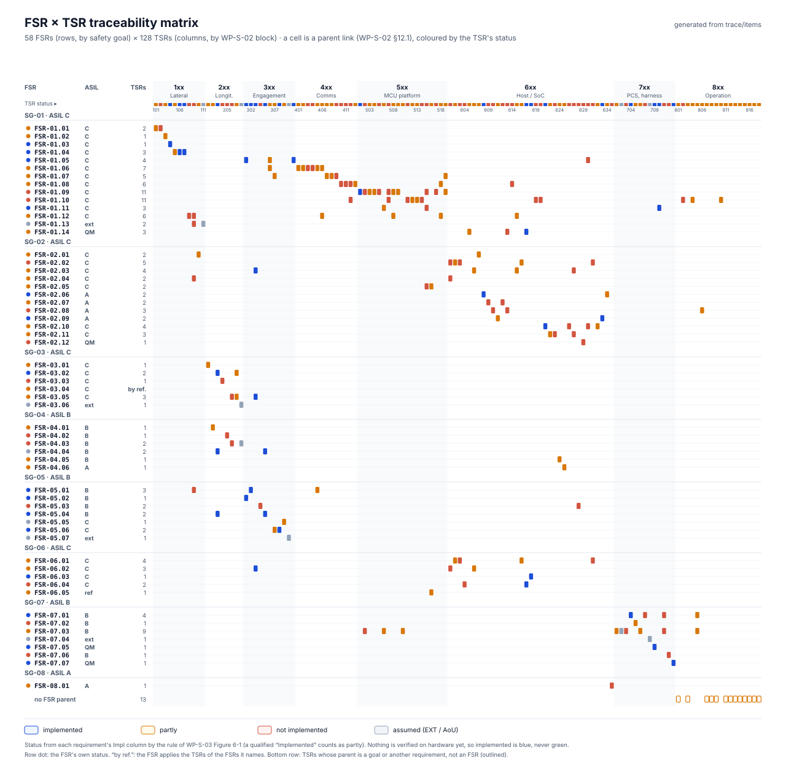

# WP-S-02 Technical Safety Requirements Specification

| Field | Value |
|---|---|
| Work product | WP-S-02 Technical safety requirements specification |
| Standard reference | ISO 26262-4:2018 §6 (specification of technical safety requirements, safety mechanisms, requirements for production/operation by reference); ISO 26262-8:2018 §6 (requirement attributes); ISO 26262-9:2018 §5–§7 (by reference); ASPICE 4.0 SYS.2 |
| Version | 0.61 (RX timeout bound ≤ 0.162 s, was ≤ 0.16 s, as WP-S-04 v0.21 T-01 (161.5 ms: 5 periods of 30.3 ms plus one 10 ms task period); no requirement, budget or verdict changed; 2026-10-27). 0.60 (§2.2: Figure 2-1, the TSRs by block and allocated element with ASIL and status, generated from the trace copy; OI-6 closed, the TSR records and their links are in `trace/items`; 2026-10-26). 0.59 (OI-7: SPI CRC chosen from a residual-error target set from the ASIL C budget, DQ-143 A; analysis and implementation open; 2026-10-26). 0.58 (TSR-517, TSR-711: the status cites the System FMEA IDs SFM-029.C7 and SFM-033.C6, since WP-A-04 retired its SFMEA table (DQ-127 A); requirements and status unchanged; 2026-10-25). 0.57 (TSR-629 refined after DQ-132 A: the read runs only before the car safety mode is requested and with the vehicle stationary, any active code blocks (status bits 0, 1, 3, 7; exemptions only by impact analysis), an incomplete read blocks until the next start-up, entry only; implemented in host software, not verified on the vehicle; 2026-10-25). 0.56 (TSR-613 status partial: the reference build neither registers nor ships the joystick and maneuver processes, the `lateralManeuverPlan` path in `controlsd` stays open; TSR-806: the debug, maneuver and joystick modes are absent by construction in the reference build; DQ-131 A; requirements unchanged; 2026-10-25). 0.55 (TSR-624: the 1 s lead time applies to the driver-monitoring stop; a fault soft-disable deceleration may start on the first frame of its alert, with the rationale in the requirement (DQ-407 A); no behaviour change; 2026-10-22). 0.54 (TSR-103, TSR-104 wording aligned with `dist_to_meas_check` after FRET realizability finding FF-08, no behaviour change: the rate checks accept any change toward zero, but a frame still beyond measured + Δ_meas must have fallen by at least Δ_down; TSR-104 rejects a frame beyond the bound unless it falls by at least Δ_down; 2026-10-21). 0.53 (wording aligned with the code after the FRET pilot findings FF-01…FF-07, no behaviour change: TSR-103 states the rate checks as implemented (both checks as the sign-aware band [min(r, 0) − Δ, max(r, 0) + Δ], so a fall toward zero is not limited and a zero crossing by more than Δ is rejected; the 250 ms window restarts; Δ_down is the descent above the measured torque); TSR-307(a) "continuously for 0.3 s"; TSR-516: the EPS clause replaces the 0.5 s bound, a minimum of 3 s and an audible level (M-05), (c) at 0.5 s within one task period; 2026-10-21). 0.52 (TSR-307(a) implemented in the reference build, panda `f4803c5` (#382): revoke 0.3 s after the first "not engaged" heartbeat; TSR-516: the heartbeat trigger moved from (b) to (c) with the lead's cancel-lag guard (2026-10-21), (c) implemented; 2026-10-21). 0.51 (TSR-307(a) and TSR-516 Impl: the engaged-mismatch case (selfdrived stops, heartbeat goes on) is silent for 2–3 s in the plant, a second silent stall; no requirement change; 2026-10-20). 0.50 (TSR-624 Impl: the no-response deceleration is announced by a 5 s countdown and the maneuver alert; the host ramp is within a_min and j_down; the fault soft disable still has no lead time, register DQ-407; 2026-10-20). 0.49 (TSR-633 Impl: the minimum-risk manoeuvre is latched in `selfdrived` until the driver takes over, so the stop and hold no longer end if the DM request drops, and the lockout runs from the takeover; TSR-611 note; not verified on the vehicle; 2026-10-20). 0.48 (TSR-635 Impl: the uncertain-DM-output gap (15.0 s to the first alert) fixed with SWSR-635a/b in `policy.py` (first alert 5.05 s), latency still not measured; 2026-10-20). 0.47 (TSR-511: signature scheme named, ECDSA P-256 with SHA-256 in the bootstub (DQ-191 A); 2026-10-20). 0.46 (TSR-635 Impl: the uncertain-DM-output gap (15.0 s to the first alert) and the refinement into SWSR-635, 635a, 635b (WP-W-02 v0.38); 2026-10-20). 0.45 (§12: requirements view linked and FSR × TSR matrix embedded; TSR-635 added: end-to-end time to the first DM alert ≤ 6 s, the refinement FSR-08.01 lacked; §12.2 coverage statement corrected; 2026-10-20). 0.44 (TSR-516 Impl: stale "firmware change open" for the 0.7 s EPS-fault persistence removed, done at panda `bf8102a`; 2026-10-20). 0.43 (TSR-307 (b) status follows TSR-621 (#51): 2 samples, ≤ 0.5 s; 2026-10-20). 0.42 (TSR-516 Impl: (b) for TSR-408 implemented, panda `8a69ccf` / opendbc `4d1a056`; 2026-10-20). 0.41 (TSR-516(b): a revocation for missing SoC command frames (TSR-408) sounds the siren, so a SoC stall is never silent; a driver disengagement stays silent (DQ-404 A); 2026-10-19). 0.40 (§2.1 B‡: a failed C1 no longer implies decomposition, since the envelope is hardened to ASIL C (DQ-341, A); 2026-10-19). 0.39 (TSR-713 implemented and unit-tested: `0x343` ≤ 0 from the first stockAeb frame since opendbc `e233362` (#311); vehicle test open (AOU-04R); 2026-10-19). 0.38 (TSR-713 status: host side implemented in `c045874` (#292), unit-tested; the `0x343` command lags by the opendbc rate limit; 2026-10-19). 0.37 (OI-3, OI-5: provisional values for the symbolic limits are in WP-W-02 §2.5, register DQ-081 A; 2026-10-19). 0.36 (TSR-513: a refused request is ignored and does not end actuation authority (DQ-082 B); CSR-012's intent stays open in the cybersecurity case; 2026-10-19). 0.35 (lead answers of 2026-10-18: TSR-713 stock-AEB stand-down (DQ-300 A); TSR-626 not relied on for a silent EPS or PCM drop, which AOU-17 covers (DQ-360 A); 2026-10-18). 0.34 (TSR-634 status: implemented in `policy.py`, SWSR-634 in WP-W-02 v0.32; not verified in the vehicle; 2026-10-17). 0.33 (TSR-634 timing points to WP-C-08 v0.5 §5.4: alert k at 5/15/25 s or 150/240/395 m since the last driver input, whichever comes first (DMP-05); 2026-10-17). 0.32 (TSR-516 status: EPS-fault siren persistence 0.7 s, panda `bf8102a`, DQ-048; siren ≤ 0.96 s from onset; 2026-10-17). 0.31 (new TSR-634: in the wheel-touch fallback the DM escalation times shorten with vehicle speed, DQ-077 A; WP-A-05 LS-09, OI-6; 2026-10-17). 0.30 (TSR-516 status: the EPS-fault siren also sounds when authority is revoked during the fault, panda `3ee2796`, DQ-367; 2026-10-17). 0.29 (DQ-061 applied: TSR-516(a) reworded, so heartbeat loss within 5 s after authority ended needs only the 1 Hz siren within 5 s; DQ-052 recorded at TSR-625; 2026-10-17). 0.28 (TSR-607 (c) decided, DQ-366 A, and implemented in `487d4ef` (#179), unit-tested; 2026-10-17). 0.27 (TSR-607 Impl: (a)/(b) implemented in `7158a9a`, unit-tested; proposed (c) for a fault that starts while the driver steers, pending the lead (impact record OI-2); DQ-342 applied: TSR-607 escalates an EPS fault after a recent override to the take-over request after 1.5 s; System FMEA SFM-ACT-023; 2026-10-16). 0.26 (DQ-365 applied (DQ-340 merged into it): TSR-633 states the decided reaction; 2026-10-16). 0.25 (DQ-341 applied: envelope ASIL C decided, decomposition only if the ASIL C hardware metrics fail; §2.1; 2026-10-16). 0.24 (HARA v0.4 ratings applied (WP-C-04 v0.8): SG-02, SG-03 and SG-06 ASIL C, so every TSR serving them is ASIL C whatever SG-01 becomes; B‡ kept only for TSRs whose C comes from SG-01 alone; new notation QM (C-sup); TSR-608…612 and TSR-633 ASIL A for SG-08, open as WP-C-04 OI-11; envelope target queued for the lead as DQ-341; 2026-10-16). 0.23 (TSR-516 Impl: a TSR-408 revocation in a full SoC stall gets no siren, WP-S-04 T-34; 2026-10-16). 0.22 (System FMEA monitoring actions turned into requirements: new TSR-630 (host check of panda authority while disengaged, SFM-ACT-013), TSR-631 (frozen or stale driving-model content, SFM-ACT-015), TSR-632 (panda reports transmitted and refused actuation frames, SFM-ACT-018), TSR-633 (reaction at zero driver awareness, SFM-ACT-005; reaction queued as DQ-340); TSR-304 timing tied to SG-05 0.2 s (SFM-ACT-016); TSR-626(d) EPS and PCM acceptance status (SFM-ACT-018); TSR-611 Impl corrected; §12.4 action map; 2026-10-16). 0.21 (lead decisions of 2026-10-14 applied, register DQ-007, DQ-048, DQ-053, DQ-054, DQ-056, DQ-060, DQ-063, DQ-064, DQ-114: §2.1 strategy decided; TSR-108 latching confirmed; TSR-304(b) backs off on override; TSR-516(b) EPS-fault warning measured from the first fault frame with ≤ 0.7 s persistence, new (d) watchdog reset while engaged; TSR-501 acceptance condition; new TSR-628, TSR-629, TSR-712; OI-4 closed; 2026-10-16). 0.20 (TSR-301: authority granted on a PCM edge only with the heartbeat's engaged flag, reference build, opendbc `9a13f60`; TSR-621 Impl: 0.3 s engagement grace, 0.5 s bound kept; WP-A-05 LS-06 / OI-9; 2026-10-14). 0.19 (heartbeat-loss siren, panda `c33343b`; EPS-siren worst case 1.26 s; 2026-10-13). 0.18 (Impl column of TSR-308, TSR-602 (partly), TSR-615 (partly) and TSR-621: host supervision change; 2026-10-13). 0.17 (Impl column of TSR-408: actuation-frame arrival supervised in the reference build, opendbc `273f44e`; 2026-10-12). 0.16 (Impl column of TSR-514: reference build reported by the panda and required by `pandad`, panda `6dee6fa`; 2026-10-12). 0.15 (reference configuration named by generation, E210; 2026-10-12). 0.14 (Impl column of TSR-516: siren on a persistent EPS fault, panda `b790fca`; 2026-10-12). 0.13 (TSR-518: reaction time measured from the first rejected frame (DN-01 D-6); Impl column, opendbc `7993399`, panda `8aa8671`; 2026-10-12). 0.12 (Impl column of TSR-405: (c) implemented in the reference build, opendbc `875e325`; 2026-10-12). 0.11 (Impl column of TSR-110: EPS fault reported to the host, panda `877730e`, opendbc `adcb7c2`; 2026-10-12). 0.10 (Impl column of TSR-110: LKA actuation refused on EPS fault codes in the reference build, opendbc `242d63d`; 2026-10-12). 0.9 (Impl column of TSR-110, 401: `0x262` and `0x1D3` supervised in the reference build, opendbc `98404a4`; 2026-10-12). 0.8 (Impl column of TSR-519: explicit priority for every enabled interrupt, panda `52cad44`; 2026-10-12). 0.7 (Impl column of TSR-407: 0.3 s heartbeat revocation, panda `c2e5d93`; 2026-10-12). 0.6 (Impl column of TSR-501, 512, 705: watchdog reset and refused requests reported to the host, `0x411` refused in the reference build; panda `3859fa8`, opendbc `5b5a4ba`; 2026-10-12). 0.5: Impl column updated for the integrated firmware changes |
| Status | Draft |
| ASIL / scope | Up to ASIL C (SG-02, SG-03, SG-06; SG-01 until re-rated); ASIL B for SG-04, SG-05, SG-07; ASIL A for SG-08 (WP-C-03 v0.4) |
| Author | Assurance team (initial draft) |
| Reviewer(s) | TBD (I1); safety-envelope requirements additionally reviewed by an independent reviewer (I2) per [WP-M-06](../01-management/WP-M-06-confirmation-measures-plan.md) |
| Approver | Safety manager |
| Baseline | `8b8c6ae` (opendbc `229dc70`, panda `92eb565`) |

## 1. Purpose and scope

This document refines the functional safety requirements (FSR-01.01…FSR-07.05) of the [functional safety concept (WP-C-04)](../02-concept/WP-C-04-functional-safety-concept.md) into technical safety requirements (TSRs) for the LD-SDA reference configuration (Toyota Corolla, 12th generation (E210), TSS 2.0, `TOYOTA_COROLLA_TSS2`, openpilot longitudinal, comma device with STM32H7 panda, Toyota TSS2 harness).

Each TSR states one verifiable property, its ASIL, its parent FSR(s), the element it is allocated to, the type of safety mechanism, its timing (detection and reaction inside the FTTI), the verification method, and what the baseline code does today. Where the code does not meet the TSR, the GAP from the [gap assessment](../00-assessment/gap-assessment.md) or a new finding (NF-nn, §11) is named.

Related work products:

- System architecture, mechanism catalogue and allocation views: [WP-S-03](WP-S-03-technical-safety-concept-architecture.md).
- FTTI derivation and timing budgets: [WP-S-04](WP-S-04-timing-ftti-budget.md).
- Hardware-software interface: [WP-S-05](WP-S-05-hsi-specification.md).
- Production, operation, service and decommissioning requirements (TSR-8xx detail): [WP-S-06](WP-S-06-requirements-production-operation.md).
- Non-safety system requirements: [WP-S-01](WP-S-01-system-requirements.md).
- Refinement: hardware safety requirements [WP-H-01](../04-hardware/WP-H-01-hardware-safety-requirements.md) (HWSR-5nn/7nn refine TSR-5nn/7nn with the same number and meaning as provisionally used there; HWSR-401, whose provisional parent was "TSR-4xx", refines TSR-410 and TSR-412); software safety requirements [WP-W-02](../05-software/WP-W-02-software-safety-requirements.md) (SWSR-nnn mirror TSR numbers).
- Cybersecurity requirements that overlap TSR-511…514: [WP-S-07](WP-S-07-cybersecurity-requirements-architecture.md).

## 2. Conventions

### 2.1 ASIL attribute

The FSC ([WP-C-04 §4.2](../02-concept/WP-C-04-functional-safety-concept.md)) recommends **option (c)**, and the project lead chose it on 2026-10-14 (register DQ-007): reduce actuation authority until controllability C1 is shown for HE-01.1/01.2/01.4, which lowers SG-01 to ASIL B, and harden the whole envelope to ASIL B. Until that evidence exists, SG-01 stays ASIL C. Hardware for the B‡ requirements is designed to ASIL C until the HARA is re-rated, with the ASIL B figures shown alongside (DQ-063, [WP-H-04](../04-hardware/WP-H-04-hardware-metrics.md)).

**HARA v0.4 (2026-10-16):** SG-02, SG-03 and SG-06 are now ASIL C (WP-C-03 v0.4; WP-C-04 v0.8 §3). Most envelope TSRs also serve one of them (the shared mechanisms FSR-01.05…01.11 serve SG-03), so they are ASIL C whatever SG-01 becomes, and the target of a whole ASIL B envelope no longer holds (WP-C-04 §4). B‡ stays only on TSRs whose ASIL C comes from SG-01 alone (TSR-101…108, TSR-304 for SG-01). The lead decided on 2026-10-16 (DQ-341, option A) that the envelope is hardened to ASIL C; DEC-01 is started only if the ASIL C hardware metrics fail. B‡ TSRs are therefore implemented on an ASIL C element whatever SG-01 becomes; B‡ records only that their own target may drop after the SG-01 re-rating. A TSR carries the highest ASIL of the goals its parent FSRs serve, except the DM TSRs, which carry ASIL A from SG-08 only (WP-C-04 §7).

| Notation | Meaning |
|---|---|
| **B‡** | Target ASIL B under FSC option (c). **ASIL C applies until the HARA re-rates SG-01 on controllability evidence** (FSC OI-2). If C1 cannot be shown, ASIL C remains. No decomposition follows from that alone: the envelope is hardened to ASIL C (DQ-341, A), and the fallback of FSC §4.3 (DEC-01, a second independent limiter able to open the relay) is started only if the ASIL C hardware metrics fail ([WP-A-01 §2](../08-analyses/WP-A-01-asil-decomposition.md)) |
| **C** | ASIL C from SG-02, SG-03 or SG-06 (HARA v0.4), independent of the SG-01 decision. Final for the envelope (DQ-341, A); it would become B(C) only if DEC-01 is started after failed ASIL C hardware metrics |
| **B** | ASIL B, independent of the SG-01 decision (parents SG-04, SG-05 or SG-07 only) |
| **A** | ASIL A from SG-08 (driver monitoring, HARA v0.4). Allocated to the QM SoC; how the SoC can carry it is open (WP-C-04 OI-11) |
| **QM (C-sup)**, **QM (B-sup)** | Allocated to the QM SoC. It supports an ASIL C (or B) FSR, but the ASIL argument rests on the named envelope TSR (backstop). No ASIL claim is made for the SoC |
| **QM** | Quality-managed; no safety claim |
| **ext** | External measure or existing vehicle element, credited only through an AoU ([WP-C-04 §11](../02-concept/WP-C-04-functional-safety-concept.md)) |

### 2.2 Other attributes

| Attribute | Values |
|---|---|
| Alloc (allocation) | **P-SW** panda firmware / opendbc safety on the STM32H7 (E-03); **P-HW** panda hardware (E-04, safety MCU part); **SoC** application SoC software (E-01, QM); **HAR** harness and relay (E-05); **EXT** external element (EPS, PCM, brake); **OPS** production/operation process |
| SM type | **LIM** limiter; **GATE** authority gating; **PLB** plausibility / cross-check; **TMO** timeout / alive supervision; **E2E** integrity code / sequence; **WDG** watchdog; **FR** fault reaction; **ST** start-up or periodic self-test; **CFG** configuration lock; **ISO** spatial/temporal isolation; **WRN** driver warning; **DES** design constraint; **EXTM** external measure |
| Timing | `detect / react`: worst-case detection time and reaction time to the safe state. Budgets from [WP-C-04 §8](../02-concept/WP-C-04-functional-safety-concept.md) and [WP-S-04](WP-S-04-timing-ftti-budget.md). "frame" = one 10 ms control frame |
| Verif | **A** analysis, **R** review/inspection, **T-SIL** host-built safety test (opendbc `safety/tests`), **T-HIL** bench test with panda + CAN simulation, **T-VEH** vehicle test (closed course, [WP-V-07](../06-validation/WP-V-07-vehicle-test-operations.md)), **FI** fault injection ([WP-V-05](../06-validation/WP-V-05-fault-injection.md)), **LOG** analysis of recorded drive logs |
| Status | All TSRs are `Proposed`. The "Impl" column records what the baseline does; it is not verification evidence |

*Figure 2-1.* Where the TSRs sit: one pill per TSR in each column of its Alloc cell, with its ASIL and its status read from the Impl column by the rule of WP-S-03 Figure 6-1 (implemented, partly, not implemented, assumed for EXT and AoU-based TSRs). Implemented means in the code at the baseline or in the reference build, not verified. Generated by [`figures/fig_s02_allocation.py`](figures/fig_s02_allocation.py) from `trace/items/tsr.yaml`, the copy of §3–§10 and WP-S-06 that CI holds to this document; nothing is hand-listed.

Paths: `safety.h`, `lateral.h`, `longitudinal.h`, `helpers.h`, `declarations.h`, `modes/toyota.h` are under `opendbc_repo/opendbc/safety/`. `main.c`, `main_comms.h`, `can_comms.h`, `drivers/*`, `sys/*`, `boards/*`, `stm32h7/*` are under `panda/board/`. `carcontroller.py`, `carstate.py`, `values.py`, `interface.py` are under `opendbc_repo/opendbc/car/toyota/`. Other paths are under `openpilot/`.

### 2.3 Safe states (from FSC §6)

| ID | Definition |
|---|---|
| SS-L | `0x2E4` STEERING_LKA torque 0 and STEER_REQUEST 0 reach the EPS; lateral authority revoked until a new engagement |
| SS-G | `0x343` ACC_CONTROL carries the inactive acceleration value; ACC cancel requested; longitudinal authority revoked until a new engagement |
| SS-S | Envelope silent: no actuation TX, relay released (stock camera path), siren if authority was recently granted |

## 3. TSR-1xx Lateral actuation envelope (SG-01, SG-02)

| ID | Requirement | ASIL | Parent | Alloc | SM | Timing | Verif | Impl (baseline) / GAP |
|---|---|---|---|---|---|---|---|---|
| TSR-101 | The envelope shall reject every STEERING_LKA (`0x2E4`) frame whose STEER_TORQUE_CMD magnitude exceeds the torque bound τ_max(v) of TSR-102. Until TSR-102 is implemented, τ_max is the baseline 1500 raw. | B‡ | FSR-01.01 | P-SW | LIM | per frame / frame rejected (then TSR-108, TSR-109) | A, T-SIL, T-VEH | Partial: fixed 1500 raw (`modes/toyota.h:173`, check at `lateral.h:73-74`). No physical rationale (GAP-04) |
| TSR-102 | τ_max(v) shall be a speed-dependent lookup derived on the reference vehicle by (1) characterising the steady-state lateral acceleration and wheel torque produced by raw requests 0…1500 at speeds 10…120 km/h (AOU-01R), (2) choosing per speed the largest request whose worst-case lateral deviation over the driver intervention time stays inside the bound of [WP-S-04 §3](WP-S-04-timing-ftti-budget.md), and (3) confirming controllability C1 for that bound with the tests of [WP-C-08](../02-concept/WP-C-08-driver-hmi-misuse-analysis.md) §8. The speed value used shall be the one that yields the smaller torque bound when the speed estimate is uncertain. | B‡ | FSR-01.01 | P-SW (+ calibration data, [WP-W-09](../05-software/WP-W-09-configuration-calibration-data.md)) | LIM | per frame | A, T-SIL, T-VEH | Not implemented for Toyota: `dynamic_max_torque` not set (`modes/toyota.h:172-186`). The mechanism exists (`lateral.h:66-71`) but uses `vehicle_speed.min − 1 m/s`, which is conservative only if τ_max increases with speed; the direction must be checked against the derived table (OI-3). Speed input integrity: TSR-405(a). GAP-04 |
| TSR-103 | The envelope shall reject a `0x2E4` frame whose torque lies outside [min(r, 0) − Δ, max(r, 0) + Δ], where r is the previous frame's torque and Δ = Δ_up for the frame rate check, or r is the torque at the start of the current real-time window and Δ = Δ_rt for the window check; the window restarts with the first frame more than 250 ms after its start. So a rise in magnitude, or a crossing of zero, by more than Δ (from r or from 0) is rejected, and these two checks accept any change toward zero: a fall toward zero is the safe direction for SG-01, and a bounded ramp of torque withdrawn on a fault is FSR-02.04's. While the command exceeds the measured EPS torque by more than Δ_meas, it shall fall by at least Δ_down per frame (TSR-104). A frame still beyond that bound after a smaller fall toward zero is rejected. After a rejected frame, or while authority is not granted, the reference for these checks is 0. The values shall be derived from the onset rate accepted in the controllability tests; the baseline values are Δ_up 15 and Δ_down 25 raw per frame and Δ_rt 450 raw per 250 ms. | B‡ | FSR-01.02 | P-SW | LIM | per frame | A, T-SIL | Implemented without rationale: `modes/toyota.h:174-177`; `lateral.h:49-57, 82-95`; `MAX_RT_INTERVAL` `declarations.h:71`. Host uses the same values (`values.py:45-47`), zero margin (GAP-04) |
| TSR-104 | The envelope shall reject `0x2E4` frames whose torque exceeds the measured EPS motor torque (`0x260` STEER_TORQUE_EPS scaled by the EPS factor of the safety parameter) by more than Δ_meas (measured from 0 when the measured torque is of the opposite sign), using the minimum/maximum of the last 6 samples widened by 1 raw, unless the frame falls toward zero by at least Δ_down from the previous frame (TSR-103). Baseline Δ_meas = 350 raw. | B‡ | FSR-01.03 | P-SW | LIM, PLB | per frame | T-SIL | Implemented: `modes/toyota.h:98-111, 176`; `lateral.h:10-23, 82-83`; sample window `declarations.h:68`. Depends on `0x260` integrity (TSR-402…405) and on the EPS factor being locked (TSR-512) |
| TSR-105 | While lateral authority is not granted, the envelope shall reject every `0x2E4` frame with non-zero torque **or** with STEER_REQUEST set. | B‡ | FSR-01.04 | P-SW | GATE | per frame | T-SIL, T-HIL | Partial: non-zero torque rejected (`lateral.h:98-101`). STEER_REQUEST = 1 with zero torque is accepted while not engaged (`lateral.h:105` checks only the opposite mismatch). NF-01 |
| TSR-106 | While authority is granted, the envelope shall accept STEER_REQUEST = 0 with non-zero torque for at most 1 consecutive frame, only after ≥ 17 consecutive valid frames and ≥ 162 ms after the previous cut. | B‡ | FSR-01.04 | P-SW | GATE | per frame | T-SIL | Implemented: `modes/toyota.h:182-185`; `lateral.h:103-138`. Purpose: EPS fault avoidance at high steering rate (`carcontroller.py:27-30`) |
| TSR-107 | In the reference configuration (LKA torque path) the envelope shall reject any STEERING_LTA (`0x191`) frame that carries a steering request, a non-zero angle command or a non-zero torque wind-down, and shall accept `0x2E4` only with its specified length (5 bytes). | B‡ | FSR-01.04 | P-SW | GATE | per frame | T-SIL | Implemented: `modes/toyota.h:269-273` (LTA blocked), `modes/toyota.h:11` (length 5), length match `helpers.h:60-64` |
| TSR-108 | If the envelope rejects a lateral command frame while lateral authority is granted, it shall revoke lateral authority (SS-L) and keep it revoked until a new valid engagement (TSR-301), and it shall report the event and its cause to the SoC. | B‡ | FSR-01.12 | P-SW | FR | detect: same frame / react: same frame | T-SIL, FI | Not implemented: the violating frame is dropped and the rate state reset (`lateral.h:140-148`), `safety_tx_blocked` is counted and reported (`drivers/can_common.h:168-171`, `main_comms.h:27`), but `controls_allowed` is not cleared. Upstream design lets the host recover; the FSC requires latching. Decided 2026-10-14 (DQ-060): latching as written, switch off until the driver re-engages; firmware change open |
| TSR-109 | Whenever the envelope rejects a `0x2E4` frame or revokes lateral authority, the EPS shall receive torque 0 with STEER_REQUEST 0 within ≤ 0.1 s. This shall be achieved by (a) the envelope transmitting, in place of each rejected frame, a `0x2E4` frame with zero torque, STEER_REQUEST 0, a counter continuing the host sequence and a valid checksum; or (b) only if vehicle characterisation shows that the EPS ramps LKA torque to zero within ≤ 0.1 s of a missing `0x2E4` frame, by withholding the frame. Option (a) is the recommended design. | C | FSR-01.12, FSR-01.13, FSR-05.01, FSR-02.04 | P-SW (a); EXT (b) | FR | react ≤ 0.1 s | T-HIL, T-VEH, FI | **Not implemented / unverified.** Rejecting a frame drops it (`drivers/can_common.h:161-176`); the EPS then sees a message drop-out. The only available description of drop-out handling is a code comment (LKA_STATE 9 → 11 over ≈2 s, then 3; `carstate.py:15-16`), so torque may persist after rejection. NF-02, GAP-05 |
| TSR-110 | The envelope shall receive EPS_STATUS (`0x262`) and, while lateral authority is granted, shall revoke lateral authority and report the cause when LKA_STATE indicates an EPS fault or LKA unavailability, or when EPS_STATUS is missing beyond its timeout (TSR-401). The LKA_STATE fault code set shall be confirmed for the reference EPS firmware. | C | FSR-02.01 | P-SW (detect); SoC (warn, TSR-606) | PLB, TMO | detect ≤ 0.3 s / react ≤ 0.1 s | T-SIL, T-VEH | **Partial** (reference build; not yet verified on the vehicle): `0x262` is an envelope RX check (checksum, 5-period timeout at a nominal 25 Hz, gates engagement via TSR-306; opendbc `98404a4`), and while LKA_STATE is in the host's fault set {0, 3, 9, 11, 17, 21, 25} STEERING_LKA frames with torque or a steer request are refused (opendbc `242d63d`, [IA EPS fault](../07-supporting/impact/change-2026-10-12-opendbc-toyota-eps-fault.md)). The cause is reported to the host: health flag `HEALTH_FLAG_EPS_FAULT` → `pandaState.epsFault`, logged by `pandad` on each change (panda `877730e`, opendbc `adcb7c2`). **Open:** confirmation of the fault code set for the reference EPS firmware. GAP-03 |
| TSR-111 | The EPS shall limit the LKA torque at the steering wheel to ≤ T_EPS for any `0x2E4` request and remove LKA torque within t_EPS after `0x2E4` stops or STEER_REQUEST clears. (External measure; T_EPS and t_EPS to be measured.) | ext | FSR-01.13 | EXT | EXTM | t_EPS TBD | T-VEH | Unverified (AOU-01R, GAP-05) |

## 4. TSR-2xx Longitudinal envelope (SG-03, SG-04)

| ID | Requirement | ASIL | Parent | Alloc | SM | Timing | Verif | Impl (baseline) / GAP |
|---|---|---|---|---|---|---|---|---|
| TSR-201 | The envelope shall reject every ACC_CONTROL (`0x343`) frame whose ACCEL_CMD exceeds a_max, where a_max is derived from the controllability of HE-03.1…03.3 on the reference vehicle. Baseline a_max = +2.0 m/s² (raw 2000). | C | FSR-03.01 | P-SW | LIM | per frame | A, T-SIL, T-VEH | Implemented without rationale: `modes/toyota.h:207-210, 225`; `longitudinal.h:8-12`. Host uses 2.0 m/s² under `RAISED_ACCEL_LIMIT` (`values.py:39-43`, `interface.py:117-118`), zero margin; flag not validated for the Corolla (GAP-04) |
| TSR-202 | The envelope shall reject every `0x343` frame whose ACCEL_CMD is below a_min, derived from the controllability of HE-04.1 (following traffic). Baseline a_min = −3.5 m/s² (raw −3500). | B | FSR-04.01 | P-SW | LIM | per frame | A, T-SIL, T-VEH | Implemented without rationale: `modes/toyota.h:209` (GAP-04) |
| TSR-203 | While longitudinal authority is not granted (not engaged, or accelerator pressed per TSR-305), the envelope shall accept `0x343` only with the inactive acceleration value. | C | FSR-03.02, FSR-04.04, FSR-05.04 | P-SW | GATE | per frame | T-SIL | Implemented: `longitudinal.h:3-12` |
| TSR-204 | The envelope shall reject `0x343` frames whose ACCEL_CMD increases, relative to the last accepted value (the inactive value counting as 0 m/s² at engagement), faster than j_up, derived from controllability. | C | FSR-03.03 | P-SW | LIM | per frame | T-SIL, T-VEH | Not implemented in the envelope (GAP-04). Host-only wind-up limit 0.12 m/s² per 3-frame step ≈ 4 m/s³ (`carcontroller.py:21`) |
| TSR-205 | The envelope shall reject `0x343` frames whose ACCEL_CMD decreases (deceleration onset) faster than j_down, derived from following-traffic controllability. | B | FSR-04.02 | P-SW | LIM | per frame | T-SIL, T-VEH | Not implemented in the envelope (GAP-04). Host-only wind-down ≈ −4 m/s³ (`carcontroller.py:22`) |
| TSR-206 | On revocation of longitudinal authority the transition to SS-G shall not cause a vehicle deceleration or acceleration step beyond the jerk bounds of TSR-204/205. If the PCM response to a step from the last commanded value to the inactive value is not shown to be bounded (AOU-05R), the envelope shall accept a commanded value that winds down to the inactive value at no more than j_down/j_up for at most 1 s after revocation. | C | FSR-03.05, FSR-04.03 | P-SW, EXT | FR | react ≤ 0.3 s to SS-G start | A, T-VEH | Not specified. Today any non-inactive value is rejected at once after revocation (`longitudinal.h:8-12`); vehicle response unknown (GAP-05) |
| TSR-207 | For `0x343`, the envelope shall also check the actuation-relevant fields PERMIT_BRAKING, CANCEL_REQ, RELEASE_STANDSTILL and ACCEL_CMD_ALT against the values allowed in the current authority state, and while authority is not granted shall accept only frames that do not request acceleration, braking or standstill release. | C | FSR-03.02, FSR-03.05 | P-SW | GATE | per frame | T-SIL | Partial: in openpilot-longitudinal mode only bytes 0–1 (ACCEL_CMD) are checked (`modes/toyota.h:216-241`); field layout `opendbc_repo/opendbc/dbc/generator/toyota/_toyota_2017.dbc:178-193`. NF-03 |
| TSR-208 | The PCM shall bound ACC acceleration requests to its own ACC envelope, honour CANCEL_REQ, and produce coasting without a deceleration step on the inactive value. (External measure.) | ext | FSR-03.06, FSR-04.03 | EXT | EXTM | — | T-VEH | Unverified (AOU-05R, GAP-05) |

## 5. TSR-3xx Engagement, disengagement and driver override (SG-01, SG-03…SG-05)

| ID | Requirement | ASIL | Parent | Alloc | SM | Timing | Verif | Impl (baseline) / GAP |
|---|---|---|---|---|---|---|---|---|
| TSR-301 | The envelope shall grant actuation authority only on the rising edge of PCM_CRUISE (`0x1D2`) CRUISE_ACTIVE, and only once the SoC heartbeat reports the item engaged within 1 s of that edge (otherwise not until the next rising edge), and shall revoke it in the same frame in which CRUISE_ACTIVE is received false (cancel, main switch off, PCM-internal drop). | C | FSR-01.05, FSR-05.02 | P-SW | GATE | detect ≤ 1 period (30 ms at 33 Hz) / same frame | T-SIL, T-VEH | Implemented: `safety.h:518-527`; `modes/toyota.h:143-146`. `0x1D2` has a checksum but no counter (GAP-01) → TSR-402…405. 2026-10-14, reference build: the heartbeat condition (WP-A-05 LS-06): the edge opens a 1 s window, the grant is made in the safety task once `heartbeat_engaged` is set; cancelled by cruise off, brake, an RX fault or a mode change (opendbc `9a13f60`, [jherrodthomas/opendbc#14](https://github.com/jherrodthomas/opendbc/pull/14)); unit-tested, not verified on the vehicle |
| TSR-302 | The envelope shall revoke all actuation authority when a driver brake press is received (rising edge, or pressed while the vehicle is moving). | B | FSR-05.01 | P-SW | GATE | detect ≤ 1 period (25 ms at 40 Hz) / same frame; SS-L via TSR-109 | T-SIL, T-VEH | Implemented: `safety.h:350-356`; BRAKE_MODULE (`0x226`) bit 37 `modes/toyota.h:148-150`; `vehicle_moving` from wheel speeds `modes/toyota.h:157-168`. `0x226` has no checksum and no counter (`modes/toyota.h:46`, GAP-01) → TSR-405(b) |
| TSR-303 | On every fault-induced disengagement, with or without openpilot longitudinal, the SoC shall set CANCEL_REQ so that the PCM drops ACC. The PCM cruise state then changes, which changes the cluster cruise indication (TSR-309, AOU-12) and makes the envelope revoke (TSR-301); a cancel without effect is caught by TSR-516(c). | QM (C-sup: TSR-203, TSR-301, TSR-516) | FSR-03.05, FSR-02.03, FSR-06.02 | SoC | FR | ≤ 0.1 s after disengagement | T-SIL, T-VEH | Implemented on host: cancel whenever PCM cruise is on and the item is not enabled (`openpilot/selfdrive/controls/controlsd.py:163`), sent in ACC_CONTROL in both longitudinal modes (`opendbc_repo/opendbc/car/toyota/carcontroller.py:253-254, 269-273`). The host replaces the PCM's own fault sound on a forced cancel with its own UI sound (`carcontroller.py:283-287`); whether the PCM sound is an independent cue is part of AOU-12 |
| TSR-304 | The envelope shall monitor STEER_TORQUE_DRIVER (`0x260`) on the LKA path and (a) reject `0x2E4` frames that increase torque opposing the driver beyond a driver allowance (driver-limited check in addition to the measured-torque check of TSR-104), and (b) when the driver torque exceeds T_ovr for longer than t_ovr, back off: accept only frames whose torque does not oppose the driver more than the previous frame, so that the commanded torque falls toward zero at no less than the Δ_down rate and stays there while the override lasts, and report the override state to the SoC (TSR-628). Lateral authority is kept, so assistance resumes when the driver releases (decided 2026-10-14, DQ-053: back off on override and show a cue; WP-A-05 LS-01, LS-02). T_ovr, t_ovr and the allowance shall be derived from the override behaviour accepted in [WP-C-08](../02-concept/WP-C-08-driver-hmi-misuse-analysis.md) and from the EPS override threshold (AOU-02R). | B (SG-05); B‡ (SG-01, HE-05.2) | FSR-05.03 | P-SW | PLB, GATE | detect ≤ 2 frames of `0x260` (40 ms) + t_ovr, with t_ovr ≤ 0.1 s / torque decreasing the next frame, so the back-off starts ≤ 0.2 s after the driver's input (SG-05, WP-S-04 §3.7; SFM-ACT-016) | T-SIL, T-VEH | **Not implemented on the LKA path** (GAP-02). Driver torque is sampled (`modes/toyota.h:113-116`) but used only for LTA (`modes/toyota.h:294-298`). A driver-limited check exists (`lateral.h:26-46`, `TorqueDriverLimited`) but the Toyota mode is motor-limited (`modes/toyota.h:178`). Host-only: `MAX_USER_TORQUE` 500 (`carcontroller.py:33, 83`) |
| TSR-305 | While the accelerator is pressed (PCM_CRUISE GAS_RELEASED = 0), the envelope shall withdraw longitudinal authority (inactive value only, TSR-203). The accelerator shall not revoke lateral authority in the reference configuration unless the HMI decision in WP-C-08 changes `DisengageOnAccelerator`. | B | FSR-04.04, FSR-05.04 | P-SW | GATE | detect ≤ 1 period / same frame | T-SIL | Implemented: `modes/toyota.h:146`; `longitudinal.h:3-5`. `DisengageOnAccelerator` default `0` (`common/params_keys.h:35`) |
| TSR-306 | The envelope shall not grant actuation authority while any RX check of TSR-401…405 is failed, including timeouts not yet evaluated by the periodic check. | C | FSR-01.05, FSR-01.06 | P-SW | GATE | per frame | T-SIL | **Met for the existing checks** (opendbc `aff4033`): for Toyota, a PCM rising edge grants authority only if every RX check is seen, valid and not lagging at that moment (`rx_checks_allow_engagement()` in `safety.h`). Frozen-value and cross-checks do not exist yet ([IA RX timeout](../07-supporting/impact/change-2026-10-12-opendbc-toyota-rx-timeout.md) §7) |
| TSR-307 | (a) The envelope shall revoke authority when the SoC heartbeat has reported "not engaged" continuously for 0.3 s while authority is granted; an "engaged" heartbeat restarts the count. (b) The SoC shall immediately disable when the envelope's reported authority differs from its own engaged state for > 0.3 s. | (a) C; (b) QM (C-sup) | FSR-05.06, FSR-01.07 | P-SW (a); SoC (b) | PLB | (a) ≤ 0.3 s / same tick; (b) ≤ 0.3 s | T-HIL, FI | (a) **Implemented in the reference build, not verified on hardware** (panda `f4803c5`, #382): the 100 Hz safety task revokes authority 0.3 s after the first heartbeat that reports "not engaged" while authority is granted (`board/drivers/engaged_mismatch.h`, SWSR-307); other builds keep the 1 Hz check, 3 consecutive ticks ≈ 2–3 s (`main.c:262-268`). Plant run (selfdrived stops, pandad keeps the heartbeat, MCS-02.9): revoked 0.39–0.48 s after the stop (2.25–3.16 s before); the item stops steering at ≈ 0.1 s, so the siren of TSR-516(c) is what shortens the drift ([engaged-mismatch.md](../sim/results/engaged-mismatch.md), synthetic, no evidence credit). (b) Partial, not verified on the vehicle: `controlsMismatch` after 2 consecutive mismatched `pandaStates` samples (10 Hz, about 0.1–0.2 s) and at most 0.5 s after the first mismatched frame (`selfdrive/selfdrived/selfdrived.py:361-366, 566-574`, `supervision.py`; TSR-621, LionDriver #51); above the 0.3 s of (b) in the worst case, and samples in the first 0.3 s after engaging are not counted (TSR-301). Before #51: 200 cumulative cycles, about 2 s (GAP-06) |
| TSR-308 | If PCM cruise is active while the item is not engaged, or the item is engaged while PCM cruise is inactive, for longer than 1 s, the SoC shall warn the driver and request ACC cancel. | QM (C-sup: TSR-301) | FSR-05.06 | SoC | PLB, WRN | ≤ 1 s | T-SIL | Implemented, not verified on the vehicle: `cruiseMismatch` after 1 s with a repeating prompt (`selfdrive/selfdrived/selfdrived.py`, `events.py`); `controlsd` keeps requesting the cancel. The other direction (engaged while PCM cruise is off) disengages through `pcmDisable` on PCM-cruise cars (GAP-19 closed in code) |
| TSR-309 | The engagement state enforced by the envelope shall be the PCM cruise state, so that the vehicle's cluster cruise indicator is an indication of engagement independent of the item's HMI. | C | FSR-05.05 | P-SW, EXT | DES | — | A, T-VEH | Implemented by TSR-301 design. Independence of the cluster indication unverified (AOU-12) |
| TSR-310 | Driver brake application shall produce braking regardless of `0x343` content, and the PCM shall drop ACC on brake. (External measure.) | ext | FSR-05.07 | EXT | EXTM | — | T-VEH | Unverified (AOU-03R) |
| TSR-311 | Actuation authority shall be false at MCU start-up and after every safety-mode change, and all limiter state (last torque, rate windows, samples) shall be reset. | C | FSR-01.05 | P-SW | GATE | — | T-SIL | Implemented: `safety.h:57, 423-460` |

## 6. TSR-4xx Communication integrity (vehicle CAN RX, SoC ↔ panda)

### 6.1 Vehicle CAN RX: E2E strategy for messages without counters (GAP-01)

The Toyota messages the envelope uses carry no alive counter. `0x226` (brake) and `0xAA` (wheel speeds) carry no checksum; `0x260` and `0x1D2` carry an 8-bit additive checksum (`modes/toyota.h:39-46, 65-72`). The vehicle cannot be changed, so classic E2E protection (CRC + counter + timeout) is not achievable. The strategy is a combination of measures, each of which covers a subset of the communication failure modes. The diagnostic coverage of the combination is estimated in [WP-S-03 §6](WP-S-03-technical-safety-concept-architecture.md) and must be confirmed by fault injection.

| Failure mode | `0x1D2` cruise/gas | `0x226` brake | `0x260` torques | `0xAA` speed | Measure |
|---|---|---|---|---|---|
| Loss / delay | timeout | timeout | timeout | timeout | TSR-401 |
| Corruption | checksum | — (none) | checksum | wheel fault bits only | TSR-402; cross-checks TSR-405 |
| Repetition / stuck frame | — | — | frozen-content | frozen-content (when moving) | TSR-404 |
| Insertion / extra sender | rate | rate | rate | rate | TSR-403 |
| Masquerade / wrong value with valid checksum | cross-check with PCM_CRUISE_2 MAIN_ON | cross-check with PCM_CRUISE_2 BRAKE_PRESSED and cruise drop | cross-check torque response to command | cross-check with `0xB4` SPEED | TSR-405 |

| ID | Requirement | ASIL | Parent | Alloc | SM | Timing | Verif | Impl (baseline) / GAP |
|---|---|---|---|---|---|---|---|---|
| TSR-401 | For each RX message used for gating or limiting (`0xAA`, `0x260`, `0x1D2`, `0x226`, and `0x262`, `0x1D3`, `0xB4` once added), the envelope shall detect absence longer than 5 nominal periods and shall evaluate this at ≥ 50 Hz, so that worst-case detection is ≤ 0.2 s. | C | FSR-01.06 | P-SW | TMO | detect ≤ 0.2 s / react ≤ 0.1 s | T-SIL, T-HIL, FI | **Met for the four Toyota RX checks, not yet verified on hardware** (opendbc `aff4033`, panda `9f60e17`): lag after 5 nominal periods (`safety_config.rx_timeout_periods`, `modes/toyota.h`), evaluated at 100 Hz in the panda safety task, so detection ≤ 0.162 s. In the reference build `0x262` (25 Hz) and `0x1D3` (33 Hz) are also RX checks (opendbc `98404a4`; nominal rates from openpilot's former CAN parser minimums, to be measured, WP-S-05 OI-7). `0xB4` is not in the RX set: no nominal rate known ([IA RX timeout](../07-supporting/impact/change-2026-10-12-opendbc-toyota-rx-timeout.md) §8) |
| TSR-402 | The envelope shall verify the Toyota checksum and the message length of every RX message that carries a checksum (`0x260`, `0x1D2`, and `0x262`, `0x1D3`, `0xB4` once added) and treat one failed frame as an RX fault. | C | FSR-01.06 | P-SW | E2E | per frame | T-SIL | Implemented for `0x260`, `0x1D2`: `safety.h:164-197`; `modes/toyota.h:40-46, 65-77`. Residual weakness: 8-bit additive sum (GAP-01) |
| TSR-403 | The envelope shall detect when an RX message arrives at more than 1.5× its nominal rate over a 100 ms window (indicating duplicated or inserted frames) and treat it as an RX fault. | C | FSR-01.06 | P-SW | PLB | detect ≤ 0.1 s | T-SIL, FI | Not implemented (GAP-01). `frequency` is only used for the timeout (`safety.h:330-336`) |
| TSR-404 | For RX signals that vary in normal operation, the envelope shall detect a frozen payload: an identical data field (excluding checksum) for longer than t_frz while the vehicle is moving (`0x260` torque/angle bytes; `0xAA` wheel speeds above a minimum speed; `0xB4` ENCODER). t_frz shall be set from fork-owned drive logs so that no false detection occurs in the reference log set. | C | FSR-01.06 | P-SW | PLB | detect ≤ t_frz (target ≤ 0.2 s) | LOG, T-SIL, FI | Not implemented (GAP-01) |
| TSR-405 | The envelope shall apply these cross-checks and treat a disagreement lasting longer than its tolerance time as an RX fault: (a) wheel-speed mean (`0xAA`) vs SPEED (`0xB4`) within 2 m/s; (b) BRAKE_PRESSED in `0x226` vs PCM_CRUISE_2 (`0x1D3`) BRAKE_PRESSED — on disagreement the envelope shall assume "brake pressed" (revoke); (c) CRUISE_ACTIVE = 1 shall imply PCM_CRUISE_2 MAIN_ON = 1; (d) while authority is granted, measured EPS torque shall follow the accepted command within an EPS-response tolerance (detects frozen or replaced `0x260`). Signal availability and tolerances shall be confirmed on reference-vehicle logs. | C | FSR-01.06, FSR-05.01 | P-SW | PLB (cross-channel) | detect ≤ 0.2 s | LOG, T-SIL, FI | **Partial** (reference build, opendbc `875e325`, [IA cruise/main](../07-supporting/impact/change-2026-10-12-opendbc-toyota-cruise-main.md)): (c) CRUISE_ACTIVE with `0x1D3` MAIN_ON = 0 refuses engagement at once and revokes authority after a 150 ms disagreement. **Not implemented:** (a) speed cross-check (`0xB4` not in the RX set, no nominal rate); (b) BRAKE_PRESSED cross-check, pending the meaning of the `0x1D3` bit (driver pedal or any braking, ACC included) from reference logs; (d) EPS-response check (GAP-01). A speed cross-check helper exists but is unused by the Toyota mode (`safety.h:529-537`). Candidate signals: `0xB4` SPEED/ENCODER (`opendbc_repo/opendbc/dbc/generator/toyota/_toyota_2017.dbc:77-80`), `0x1D3` BRAKE_PRESSED (`_toyota_2017.dbc:110-111`) |
| TSR-406 | On any RX fault of TSR-401…405, the envelope shall revoke all actuation authority within ≤ 0.1 s (SS-L via TSR-109, SS-G), report a fault-specific reason code to the SoC, and not grant authority again until all checks pass and a new PCM rising edge occurs. | C | FSR-01.06, FSR-01.12 | P-SW | FR | react ≤ 0.1 s | T-SIL, FI | Partial: revocation on checksum/quality (`safety.h:112-121`) and timeout (`safety.h:337-340`); only a single flag is reported (`main_comms.h:23`) |

### 6.2 SoC ↔ panda link and command liveness

| ID | Requirement | ASIL | Parent | Alloc | SM | Timing | Verif | Impl (baseline) / GAP |
|---|---|---|---|---|---|---|---|---|
| TSR-407 | In a car safety mode, the envelope shall detect absence of the SoC heartbeat (`0xf3`) for > 0.3 s and then revoke all actuation authority at once (SS-L, SS-G). It shall enter SS-S (SILENT, relay released) after the longer timeout of TSR-510. | C | FSR-01.07 | P-SW | TMO | detect ≤ 0.3 s / react ≤ 0.1 s | T-HIL, FI | **Partial, not yet verified on hardware** (panda `c2e5d93`): in a car mode the 100 Hz safety task revokes all authority once no heartbeat has arrived for 0.3 s (`drivers/heartbeat_monitor.h`); the host sends it at 10 Hz. SILENT still follows after 5 s (TSR-510). Open: safety-task latency under load (WP-W-03 §5.4), HIL ([IA heartbeat](../07-supporting/impact/change-2026-10-12-panda-fast-heartbeat.md)) |
| TSR-408 | While lateral authority is granted, the envelope shall monitor the arrival of `0x2E4` frames from the SoC and, if no frame arrives for > 50 ms (5 frames), revoke authority and command SS-L (TSR-109). While longitudinal authority is granted, the same shall apply to `0x343` with a gap > 100 ms. | C | FSR-01.07 | P-SW | TMO | detect ≤ 50 / 100 ms / react ≤ 0.1 s | T-HIL, FI | **Implemented in the reference build, not yet verified on hardware** (opendbc `273f44e`, opendbc#11): while authority is granted, the 100 Hz safety task revokes it when `0x2E4` has not reached the TX hook for > 50 ms or, with openpilot longitudinal, `0x343` for > 100 ms (`safety.h` `tx_arrival_ok`, `modes/toyota.h`). SS-L follows from the revocation (TSR-109). Open: thresholds on reference logs, HIL ([IA TX arrival](../07-supporting/impact/change-2026-10-12-opendbc-toyota-tx-arrival.md)) |
| TSR-409 | The heartbeat shall carry evidence that the control loop is alive (e.g. the latest `carControl` frame counter), and the envelope shall treat a heartbeat whose evidence has not advanced for > 0.3 s as a missing heartbeat. | C (panda check); QM (SoC content) | FSR-01.07 | P-SW, SoC | TMO | ≤ 0.3 s | T-HIL, FI | Not implemented: heartbeat carries only `engaged` = `selfdriveState` alive && valid && enabled (`selfdrive/pandad/pandad.cc:389-390`) (GAP-10) |
| TSR-410 | Every SPI transfer (header and data) shall be protected by a CRC whose residual error probability over the maximum transfer length meets the target set in [WP-S-05 §4](WP-S-05-hsi-specification.md), and every CAN-TX transfer shall carry a sequence counter; the envelope shall discard transfers with a failed CRC or a repeated or out-of-order counter. The per-packet XOR may remain as an additional check. | C | FSR-01.08 | P-SW, SoC | E2E | per transfer | A, T-HIL, FI | Not met: 8-bit XOR seeded 0xAB on header and data (`drivers/spi.h:97-104, 122, 137`); per-CAN-packet 8-bit XOR (`drivers/can_common.h:144-159`, checked at FDCAN TX `drivers/fdcan.h:100`); no sequence counter (`can_comms.h:8-37`) (GAP-10) |
| TSR-411 | The envelope shall reject actuation frames whose transfer counter shows they are older than 2 control periods relative to the newest accepted transfer (freshness). | C | FSR-01.08 | P-SW | E2E | per transfer | T-HIL, FI | Not implemented (GAP-10). Host-side age check is 1 s (`selfdrive/pandad/pandad.cc:78-79`), see TSR-614 |
| TSR-412 | The envelope shall validate every length field received over SPI against its buffer size before starting a DMA transfer or copy, and every control-request parameter used as an array index against the array bounds; a violation shall be NACKed and counted as an SPI error. | C | FSR-01.08, FSR-01.10 | P-SW | ISO, PLB | per transfer | R, T-HIL, FI | **Not met (NF-04):** MOSI/MISO lengths are taken from the header (`drivers/spi.h:115-116`) and the data DMA is started with `spi_data_len_mosi + 1` into a 4096-byte buffer (`drivers/spi.h:233`, `drivers/drivers.h:216`) without a bound check; `comms_can_read` fills `spi_buf_tx` up to the requested MISO length (`drivers/spi.h:150`); request `0xe8` indexes `bus_config[param1]` without a bound check (`main_comms.h:262-264`). The nominal host keeps lengths below the buffer size (`selfdrive/pandad/spi.cc:319-320`), but freedom from interference cannot rely on the QM host |
| TSR-413 | If SPI errors (header/data checksum failures, NACKs) exceed a rate threshold while authority is granted, the envelope shall revoke authority and report. | C | FSR-01.08 | P-SW | FR | ≤ 0.3 s | T-HIL, FI | Partial: counted and reported only (`drivers/spi.h:220-222`, `main_comms.h:36`) |

## 7. TSR-5xx Safety-MCU platform integrity

Numbering is aligned with the provisional TSR parents in [WP-H-01](../04-hardware/WP-H-01-hardware-safety-requirements.md); HWSR-5nn refines TSR-5nn.

| ID | Requirement | ASIL | Parent | Alloc | SM | Timing | Verif | Impl (baseline) / GAP |
|---|---|---|---|---|---|---|---|---|
| TSR-501 | The safety MCU shall be supervised by an independent hardware watchdog (IWDG1, LSI-clocked) that is started no later than the first time the harness relay is energised after a reset, by any path (safety-mode change or configuration/debug command), and then stays active until the next reset; that cannot be stopped by the SoC; that is serviced only after the periodic safety processing has completed; and that resets the MCU within ≤ 0.1 s of a stall (SG-07 FDTI, [WP-S-04](WP-S-04-timing-ftti-budget.md) §3.6; ≤ 0.2 s would meet SG-01 only). Rationale for the start condition (amended in v0.4): until the relay is first energised after a reset, the stock camera-to-vehicle path is intact and no actuation frame reaches the vehicle, so a stall cannot violate SG-01 or SG-07; an idle device keeps its power-save and stop modes. | C | FSR-01.09 | P-HW (cfg), P-SW | WDG | detect ≤ 0.1 s / reset → SS-S | R, T-HIL, FI | **Implemented, not yet verified on hardware** (panda `3859fa8`): IWDG1 started the first time the relay is energised, on any path (`drivers/harness.h`); fed from the 100 Hz safety task only after main-loop progress (`drivers/hw_watchdog.h`, `main.c`); 90 ms nominal; window mode, about 5 ms minimum feed interval (HWSR-501b). a watchdog reset is reported to the host (`pandaState.watchdogReset`). Decided 2026-10-14 (DQ-114): accepted as closing the SG-07 interim residuals once the independent reviewer has checked it and the LSI tolerance keeps it ≤ 0.1 s. Open: LSI range at both ends, HIL evidence ([IA watchdog](../07-supporting/impact/change-2026-10-12-panda-hw-watchdog.md)) |
| TSR-502 | Every detected MCU fault (watchdog, interrupt-rate, register divergence, memory ECC, clock, supply, temperature, SPI/DMA, siren, relay) shall lead to SS-S within ≤ 0.1 s of detection. Faults shall be classified as latching until power cycle or as recoverable, by documented rationale. During and after any reset the outputs shall be in SS-S until a valid safety mode is set. | C | FSR-01.09, FSR-07.03 | P-SW, P-HW | FR | react ≤ 0.1 s | R, FI | **Not implemented.** Faults are report-only (`sys/faults.h:8-27`); `PERMANENT_FAULTS 0U` (`sys/sys.h:50`); only relay malfunction blocks TX (GAP-08). Start state SILENT (`main.c:295`). A hang (default handlers, `assert_fatal`, no IWDG) leaves the relay in its last state (GAP-43). HWSR-502…502c |
| TSR-503 | Memory faults that can corrupt actuation decisions shall be detected: RAM ECC with double-error reaction, flash image CRC at start-up and periodically, and periodic check of safety-critical configuration registers, each leading to TSR-502. | C | FSR-01.09 | P-HW (cfg), P-SW | ST, PLB | ≤ 0.2 s for RAM/register faults; flash: start-up + background | R, FI | Partial: register divergence check at 1 Hz, report-only (`drivers/registers.h:56-70`, `main.c:228-229`); no ECC handling, no runtime CRC (GAP-08). HWSR-503…503d |
| TSR-504 | Loss or drift of the MCU clock that would invalidate timing checks or CAN bit timing shall be detected and lead to TSR-502. | C | FSR-01.09 | P-HW (cfg), P-SW | PLB | ≤ 0.2 s | FI | Partial: HSE clock security system per WP-H-01 HWSR-504; no frequency cross-check |
| TSR-505 | Supply voltage of the MCU outside its operating range shall lead to reset or SS-S (brown-out reset, programmable voltage detector), and vehicle input voltage out of range while the relay is driven shall lead to SS-S. | C | FSR-01.09 | P-HW, P-SW | PLB | ≤ 0.2 s | T-HIL | Unknown / not implemented (BOR, PVD not configured; input voltage reported only, `main_comms.h:14`). HWSR-505…505b |
| TSR-506 | The intercept relay shall be de-energise-to-safe, its actual state shall be read back and compared with the commanded state in both directions within ≤ 0.3 s, and a detected relay malfunction shall inhibit all actuation TX and be latched until power cycle (not cleared by a safety-mode change). | C (blocking), B (PCS restore) | FSR-01.11, FSR-07.03 | P-HW, HAR, P-SW | PLB, FR | detect ≤ 0.3 s | A, T-HIL, FI | Partial: open-drain active-low drive, released at init (`drivers/harness.h:8-33, 96-107`); indirect detection only (camera control messages on the car side) after a 1 s transition window counted at 1 Hz (`safety.h:211-220, 372-380`); cleared on every mode change (`safety.h:427, 459`), so a host can clear it with `0xdc`. No readback (GAP-12); relay stuck in intercept not detected at all (GAP-43). HWSR-506…506d |
| TSR-507 | Safety-critical data (safety mode and parameter, limits, authority state, relay state) and the stacks shall be protected against writes from communication handlers by the MPU, with a stack guard, and a MemManage fault shall lead to TSR-502. | C | FSR-01.09, FSR-01.10 | P-HW (cfg), P-SW | ISO | — | R, FI | Not implemented: no MPU configuration (GAP-08, GAP-11). HWSR-507 |
| TSR-508 | The car-side CAN transceiver shall be non-transmitting from reset until enabled by firmware; bus-off or persistent TX failure on the car-side bus while authority is granted shall revoke authority and be reported. | C | FSR-01.09, FSR-01.12 | P-HW, P-SW | FR | ≤ 0.3 s | T-HIL, FI | Partial: transceivers enabled after SILENT (`main.c:295-298`); bus-off counted (`drivers/fdcan.h`), host raises `canError` only. HWSR-508…508c |
| TSR-509 | MCU die temperature outside its specified range shall lead to SS-S. | C | FSR-01.09 | P-HW, P-SW | PLB | ≤ 1 s | T-HIL | Partial: DTS read and reported only (`main_comms.h:51-52`). HWSR-509 |
| TSR-510 | Ignition state shall be sensed from the harness ignition line; loss of the SoC heartbeat shall lead to SS-S after ≤ 2 s regardless of the ignition reading, and a failed ignition input shall not keep the relay driven without a heartbeat. | B | FSR-07.03 | P-HW, HAR, P-SW | TMO | SS-S ≤ 2 s | A, T-HIL | Partial: line-only ignition for Toyota (`drivers/harness.h:35-52`; `opendbc_repo/opendbc/safety/ignition.h:12-63` has no Toyota case); SILENT after 5 s (ignition on) / 2 s (off) (`main.c:101-103, 193`). HWSR-510…510a |
| TSR-511 | Only release-signed LionDriver firmware shall execute on the safety MCU: the bootstub shall verify an ECDSA signature over P-256 with SHA-256 (decided 2026-10-19, DQ-191 A; replaces RSA-1024/SHA-1), flash read-out and write protection shall be set, the SoC's control of `STM_BOOT0`/`STM_RST_N` shall not allow non-release code to drive the relay, release builds of `pandad` shall not flash a development bootstub, and softloader entry (`0xd1` param 1) shall be refused in a car safety mode and while the ignition is on (CSR-024). | C (+ CS) | FSR-01.10 | P-SW, P-HW (option bytes), SoC | CFG | — | R, T-HIL | **Not met.** RSA-1024/SHA-1 (`crypto/rsa.h:37`, `crypto/sha.h:45`; `bootstub.c:47-72`); only sector 0 protected from erase (`stm32h7/llflash.h:12-20`); SoC drives BOOT0/NRST (`openpilot/common/hardware/comma/hardware.py:400-419`); recovery flashes a development bootstub (`selfdrive/pandad/pandad.py:34-39`); softloader entry allowed in release at any time (`main_comms.h:176-180`) (GAP-24, GAP-38). See [WP-S-07](WP-S-07-cybersecurity-requirements-architecture.md) |
| TSR-512 | In release builds for the reference configuration the safety MCU shall accept only the modes SILENT, NOOUTPUT, ELM327 (fingerprinting, relay released) and TOYOTA with the reference safety parameter compiled into the firmware (EPS factor 73, no flags). Once TOYOTA mode is active, it shall accept only a change to NOOUTPUT or SILENT; any other request shall be rejected and reported. The alternative-experience word shall likewise be fixed to the reference value in release builds, so that it cannot be changed in a non-car mode and carried into a later TOYOTA session. | C | FSR-01.10 | P-SW | CFG | per request | R, T-HIL | **Met in the reference build, not yet verified on hardware** (`LIONDRIVER_REFERENCE=1`, panda `3859fa8`): `0xdc` accepts only SILENT, NOOUTPUT, ELM327 and TOYOTA with parameter 73; in TOYOTA only NOOUTPUT or SILENT; `0xdf` refused, alternative experience stays 0 (`board/reference_lock.h`). Refused requests are counted in the health packet and published as `pandaState.requestsRejected`, and `pandad` logs them; no driver-facing alert yet. AOU-14 ([IA mode lock](../07-supporting/impact/change-2026-10-12-panda-safety-mode-lock.md)) |
| TSR-513 | In release builds, control requests that can change actuation, relay, CAN configuration or comms state shall be rejected while a car safety mode is active: at least `0xc5` (relay drive), `0xe5` (CAN loopback), `0xde`/`0xf9`/`0xfc`/`0xe8` (bit rate and CAN-FD configuration), `0xdb` (OBD multiplexing), `0xe6` (clock source), `0xe7` (power save; in car mode it stops camera-side forwarding with the relay energised, SG-07, WP-A-04 SPF-08), `0xf1` (queue clear), `0xd1` param 1 (softloader entry, see also TSR-511), `0xd8` (MCU reset without fault reporting), `0xdf` (alternative experience, see TSR-512). Also `0xc0` (comms reset), `0xb0`/`0xb1` and `0xf6` (to be confirmed per WP-W-02 OI-5). A refused request is ignored: it shall not change the actuation state, and it does not by itself end actuation authority (decided 2026-10-19, DQ-082 B; the alternative, withdrawing authority and reporting it as RR-2026-009 F-36 and CSR-012 propose, was not chosen, so CSR-012's intent stays an open item of the cybersecurity case, [WP-S-07](WP-S-07-cybersecurity-requirements-architecture.md)). | C | FSR-01.10 | P-SW | CFG | per request | R, T-HIL | **Partial, reference build only** (panda `9f60e17`): `0xc5`, `0xd8`, `0xdb`, `0xde`, `0xe5`, `0xe6`, `0xe7`, `0xe8`, `0xf1`, `0xf9`, `0xfc` and `0xd1` param 1 refused in a car mode (`board/reference_lock.h`). `0xc0`, `0xb0`, `0xb1`, `0xf6` still to be confirmed (WP-W-02 OI-5) ([IA mode lock](../07-supporting/impact/change-2026-10-12-panda-safety-mode-lock.md)) |
| TSR-514 | Release firmware shall be built without `ALLOW_DEBUG`, with the LionDriver release key, and shall not contain the ALLOUTPUT mode, debug-only safety modes or debug-key acceptance; the build type shall be readable through the version request and recorded in the release record. | C (+ CS) | FSR-01.10 | P-SW (build) | CFG | — | R | Not met by default: DEBUG + `ALLOW_DEBUG` unless `RELEASE` and `CERT` are set (`panda/SConscript:12-20`); debug modes `safety.h:413-422`; debug key `bootstub.c:66-71` (GAP-25). The reference build is reported in the health packet (`HEALTH_FLAG_REFERENCE_BUILD`, panda `6dee6fa`) and `pandad` configures a car safety mode only on a panda that reports it (`selfdrive/pandad/panda_safety.cc`, SWSR-514h); the debug/release build type is not yet reported |
| TSR-515 | At every power-up, before the relay is first driven, the safety MCU shall run start-up tests of its safety mechanisms (flash CRC, RAM test of safety data regions, watchdog reset path at a defined interval, relay drive and readback, siren path) and stay in SS-S and report if any test fails. | C | FSR-01.09, FSR-01.11, FSR-02.05 | P-SW, P-HW | ST | once per drive cycle | T-HIL, FI | Not implemented (latent-fault handling absent) |
| TSR-516 | The safety MCU shall sound its own acoustic warning within ≤ 0.5 s of detection (except as stated below for (b) on an EPS fault), without depending on SoC software, for at least 3 s or for as long as its condition holds if longer, at a level audible over the cabin noise of the reference vehicle (level set by WP-S-04 M-05), when (a) the SoC heartbeat is lost (TSR-407) while authority is granted; if authority ended within the 5 s before the loss, a warning within ≤ 5 s of the loss is sufficient, because the driver has already been told of the disengagement (decided 2026-10-14, DQ-061 A); (b) the envelope revokes authority while it is granted for any reason other than a driver action that the envelope itself observes (brake press, TSR-302; PCM cruise inactive, TSR-301), that is on missing SoC command frames (TSR-408), an RX fault (TSR-406), an EPS fault state (TSR-110), a rejected command (TSR-108), a car-side TX failure or bus-off (TSR-508) or a platform fault (TSR-502); or (c) PCM cruise is still active 0.5 s (within one 10 ms task period) after the SoC heartbeat first reported "not engaged" (a fault-induced disengagement whose ACC cancel, TSR-303, had no effect); or (d) the safety MCU restarts after a watchdog or fault reset (TSR-501, TSR-502) that interrupted granted authority. For (b) on an EPS fault, this clause replaces the ≤ 0.5 s bound: detection is the first fault frame, any persistence filter before the warning shall be ≤ 0.7 s, and the siren shall sound within the SG-02 1 s warning budget from fault onset (decided 2026-10-14, DQ-048). For (d), the item's engaged state shall be kept across the reset in memory that the reset does not clear, and the siren shall sound ≤ 0.5 s after the restart (decided 2026-10-14, DQ-054). A stalled SoC stops both the command frames and the heartbeat; whichever of TSR-408 and TSR-407 revokes first shall sound the siren under (b) or (a), so that a SoC stall is never silent, while a disengagement by the driver stays silent (decided 2026-10-19, DQ-404 A). A revocation on a heartbeat "not engaged" (TSR-307(a)) sounds the siren under (c), not (b): only if PCM cruise is still active 0.5 s after the first such heartbeat, so that a disengagement openpilot ends with an ACC cancel stays silent (cancel-lag guard, decided by the lead 2026-10-21; the PCM cancel lag is to be measured, WP-W-02 OI-18). | C | FSR-02.05, FSR-06.05 | P-SW, P-HW | WRN | ≤ 0.5 s after detection | T-HIL | Partial: (a) heartbeat loss: siren for 3 s at once when the 0.3 s heartbeat monitor (TSR-407) revokes authority that was granted, ≤ 0.3 s + 10 ms + 250 ms ≈ 0.56 s after the last heartbeat, in all builds (panda `c33343b`, `drivers/heartbeat_siren.h`, [IA fast heartbeat](../07-supporting/impact/change-2026-10-12-panda-fast-heartbeat.md) §5; not verified on hardware); the 1 Hz path (siren for 3 s after 4–5 s heartbeat loss if authority within the last 5 s, `main.c:169-171, 198-201`) unchanged, and alone covers authority that ended within the 5 s before the loss, which meets the ≤ 5 s of the reworded (a) (DQ-061 A); (b) for the EPS fault (TSR-110): siren once the fault has persisted 0.7 s (DQ-048, panda `bf8102a`; 1 s before) while authority is granted (since panda `3ee2796`, register DQ-367: counted from when the fault is first seen with authority granted, also after the TSR-408 arrival check revokes authority during the fault), ≥ 3 s, ≤ 0.26 s after that detection (worst case: the speaker sounds only on every other 8 Hz tick) (panda `b790fca`, `drivers/eps_fault_siren.h`, [IA EPS fault](../07-supporting/impact/change-2026-10-12-opendbc-toyota-eps-fault.md) §7; detection defined as 1 s persistence by maintainer decision 2026-10-12, to be confirmed against fault durations in reference logs); persistence shortened from 1 s to the ≤ 0.7 s required by DQ-048 at panda `bf8102a` (WP-S-04 T-28, siren ≤ 0.96 s from onset); (b) for missing SoC command frames (TSR-408, DQ-404 A): since panda `8a69ccf` with opendbc `4d1a056` (reference build), the same 3 s siren starts in the safety task in which the command-arrival check revokes granted authority (opendbc `safety_tx_arrival_revoked`, `drivers/heartbeat_siren.h`), so a full SoC stall, where TSR-408 revokes before the heartbeat check (WP-S-04 T-34), sounds it ≤ 0.06 s + 2 × 125 ms ≈ 0.31 s after the last `0x2E4`; a driver brake press or PCM cruise drop and an RX fault do not set the flag; because the arrival check counts only accepted frames, a host that keeps sending refused frames (TSR-108 content, an EPS fault, a switch fallen to pass-through) also gets the siren once its frames have been refused for 50 ms ([IA siren on TX-arrival revocation](../07-supporting/impact/change-2026-10-20-panda-tx-arrival-siren.md); host tests and plant runs F-04b: siren 0.25–0.29 s after the stall, the driver corrects at 1.79 s instead of 2.68 s at the ODD curve bound, [silent-stall.md](../sim/results/silent-stall.md), synthetic, no evidence credit; not verified on hardware); (c) **implemented in the reference build, not verified on hardware** (panda `f4803c5`, #382): the same 3 s siren starts if PCM cruise is still active 0.5 s after the first heartbeat reporting "not engaged" (`board/drivers/engaged_mismatch.h`, SWSR-516b); plant run with selfdrived stopped and the heartbeat going on: siren 0.63–0.88 s after the stop (none before), the driver corrects at 2.13–2.38 s instead of 2.32–3.37 s ([engaged-mismatch.md](../sim/results/engaged-mismatch.md), synthetic); the guard keeps an openpilot disengagement silent only if the PCM drops cruise within 0.5 s of the cancel, which is not measured (WP-W-02 OI-18); other (b) triggers (RX fault TSR-406, TX failure TSR-508, platform fault TSR-502) and (d) not implemented ((d): a bench test of the reset behaviour comes first, WP-S-04 M-06; retained memory is a hardware choice, WP-H-01); siren path via codec over I2C on some boards, malfunction reported only (`drivers/fake_siren.h:38-52`); shared speaker with SoC audio to be analysed in DFA ([WP-A-03](../08-analyses/WP-A-03-dependent-failure-analysis.md)) |
| TSR-517 | Corruption of an approved actuation frame after the TX hook (copy into FDCAN message RAM, message RAM, FDCAN core, transceiver) shall be detected, e.g. by reading back the safety MCU's own transmitted frames on the car-side bus and comparing them with the approved frame, and a mismatch shall lead to TSR-502. | C | FSR-01.09 | P-SW, P-HW | PLB | ≤ 2 frames / react per TSR-502 | A, FI | **Not implemented.** Packet XOR checked before the FDCAN load only (`drivers/fdcan.h:100`); no read-back after load (WP-A-04 SPF-02, System FMEA SFM-029.C7) |
| TSR-518 | The envelope shall supervise the transmit rate of each actuation message ID (`0x2E4`, `0x343`, `0x412`, and any other TX-whitelisted ID) against its nominal period and reject frames sent faster than the nominal rate plus a defined tolerance; persistent excess while authority is granted shall revoke authority and be reported. | C | FSR-01.08, FSR-01.12 | P-SW | TMO | per frame; revoke ≤ 0.1 s after the first rejected frame ([DN-01](../05-software/design-notes/DN-01-tx-rate-supervision.md) D-6; ≤ 0.2 s from the onset of a flood at 2× the nominal rate) | T-SIL, T-HIL | **Met in the reference build, not yet verified on hardware** (opendbc `7993399`, panda `8aa8671`, [IA TX rate](../07-supporting/impact/change-2026-10-12-tx-rate-supervision.md)): per-ID count over a sliding 250 ms window with budgets for every TX-whitelisted ID; frames beyond the budget rejected before the content checks; 3 rejections in a half-window while authority is granted revoke it, reported as `pandaState.txRateExceeded`. Budgets to be confirmed on reference logs (DN-01 §9). RX rate is TSR-403 |
| TSR-519 | The safety MCU shall have a documented interrupt-priority and execution-timing scheme: priorities assigned explicitly for every enabled interrupt; safety hooks, CAN TX and SoC command dispatch either moved out of interrupt context or bounded by measured WCET; and the worst-case latency of the periodic safety processing (timeouts, heartbeat, watchdog service) shown to meet the TSR-401/407/501 budgets under worst-case interrupt load. | C | FSR-01.09, FSR-01.07 | P-SW, P-HW (cfg) | ISO | analysis; WCET measured on target | A, T-HIL | **Partial** (panda `52cad44`): every enabled interrupt has an explicit priority, all at one level until the WP-W-03 §5.4.2 scheme is adopted; R-1 and R-8 races closed, R-2 bounded at 10 ms. **Not implemented:** WCET and latency measurement (WP-W-03 §5.4.5); RX hook in the FDCAN interrupt (`drivers/fdcan.h:221, 245-252`); TX hook and control-request dispatch in the SPI DMA interrupt (`stm32h7/llspi.h:56-60`, `drivers/spi.h:143, 162`, `can_comms.h:97, 118`) (GAP-50) |

## 8. TSR-6xx Host-side (SoC) monitoring, DM and HMI

All TSR-6xx are allocated to the QM SoC. Those marked QM (C-sup) or QM (B-sup) support an ASIL C or B FSR whose ASIL argument rests on the named envelope TSR. Those marked A serve SG-08 and are open (WP-C-04 OI-11).

| ID | Requirement | ASIL | Parent | Alloc | SM | Timing | Verif | Impl (baseline) / GAP |
|---|---|---|---|---|---|---|---|---|
| TSR-601 | `selfdrived` shall classify faults as (i) untrusted command or input (loss or staleness of an input to the control law, model failure, CAN error, controls mismatch) → immediate disable, and (ii) trustworthy but degrading (thermal, storage, memory) → soft disable. Actuation on an input that has failed its alive or validity check shall end within ≤ 0.2 s. | QM (C-sup: TSR-407, TSR-408) | FSR-02.02, FSR-02.04, FSR-06.02 | SoC | FR | ≤ 0.2 s | T-SIL, FI | Not met: `commIssue` is SOFT_DISABLE (`selfdrive/selfdrived/events.py:853-856`), soft disable keeps actuating 3 s (`selfdrive/selfdrived/state.py:7-8`); alive allows 10 periods (`cereal/messaging/__init__.py:265`) (GAP-16). FM-03 in [WP-C-07](../02-concept/WP-C-07-sotif-functional-modifications.md) |
| TSR-602 | `controlsd` shall check the age of `modelV2`, `longitudinalPlan` and `carState` before use (≤ 2 nominal periods) and shall set `latActive`/`longActive` false and raise an event when an input is stale. | QM (C-sup: TSR-408) | FSR-02.02, FSR-06.01 | SoC | TMO | ≤ 0.1 s | T-SIL | Partly met: `latActive` / `longActive` are false while an input is stale (`selfdrive/controls/lib/input_freshness.py`), but after 10 nominal periods, not 2, to avoid nuisance disengagements from model frame drops until logs show the jitter; the event is `selfdrived`'s `commIssue` from the same 10-period check (GAP-16 narrowed; impact record OI-1) |
| TSR-603 | No diagnostic (`commIssue`, posenet, locationd, `modeldLagging`) shall be masked while the item is engaged, and the driving model shall not be switched while engaged. In the reference configuration the external big model (E-06) shall be absent and not loadable. | QM (C-sup) | FSR-02.02, FSR-06.01 | SoC | DES | — | R, T-SIL | Not met: masking during big-model load + 5 s (`selfdrive/selfdrived/selfdrived.py:428-430, 449, 505`); hot switch `selfdrive/modeld/modeld.py:411-419` (GAP-17). AIR-25, AIR-30 ([WP-C-11](../02-concept/WP-C-11-ai-system-definition-and-safety-requirements.md)) |
| TSR-604 | Non-finite actuator commands shall be treated as a fault with immediate disable, not replaced silently. | QM (C-sup) | FSR-06.04 | SoC | FR | ≤ 1 frame | T-SIL | Not met: replaced by 0 and logged (`selfdrive/controls/controlsd.py:140-147`) (GAP-19) |
| TSR-605 | The SoC controller shall command with margin below every envelope limit: steering torque ≤ 90 % of τ_max(v), acceleration within [a_min + 0.2, a_max − 0.2] m/s² (proposed), lateral acceleration ≤ 3.0 m/s², lateral jerk ≤ 5 m/s³. | QM | FSR-01.14 | SoC | LIM | per frame | T-SIL | Partial: 3.0 m/s² and 5 m/s³ (`selfdrive/controls/lib/drive_helpers.py:9-14`); torque and accel limits equal to the envelope (`values.py:20, 39-47`) |
| TSR-606 | On every fault-induced transition to L2/L3 (FSC §12) the SoC shall give a visual and acoustic take-over request within ≤ 1 s of detection, with text that names the actual fault class. | QM (C-sup: TSR-516) | FSR-02.03, FSR-06.02 | SoC (HMI) | WRN | ≤ 1 s | T-HIL, T-VEH | Partial: alerts exist (`selfdrive/selfdrived/events.py:224-234`); `canError` shows "Unknown Vehicle Variant" (`events.py:928-936`) (GAP-19); timing not verified |
| TSR-607 | The SoC shall warn the driver when the EPS reports LKA unavailable or faulted (complements TSR-110). (a) Outside the cases of (b) the warning is the take-over request (soft disable, visual and acoustic). (b) When the fault starts within 1.5 s of a driver steering override, or at standstill, the SoC may first give the lighter prompt (small alert with chime); if the fault is still present 1.5 s after it started, the SoC shall escalate to the take-over request of (a). The lighter prompt shall not be held for the duration of the fault. (Decided 2026-10-16, register DQ-342, A; System FMEA SFM-ACT-023.) (c) When the fault starts while the driver is steering and lasts more than 1.5 s while they keep steering, the SoC shall give at least the lighter prompt, so that the driver learns of the lost assistance before releasing the wheel; on release the take-over request of (a) follows at once. (Decided by the lead in chat on 2026-10-17, register DQ-366, A; impact record OI-2.) | QM (C-sup: TSR-110) | FSR-02.01 | SoC | WRN | (a) ≤ 1 s; (b) prompt ≤ 1 s, take-over request ≤ 1.5 s after fault onset (the driver has hands on the wheel within the window) | T-SIL, T-VEH | (a), (b) implemented in `7158a9a` (#174): the lighter `steerTempUnavailableSilent` is allowed only for the first 1.5 s of the fault (`STEER_FAULT_SILENT_FRAMES`, `openpilot/selfdrive/car/car_events.py:17, 169-183`), then `steerTempUnavailable` (soft disable); unit-tested (`openpilot/selfdrive/car/tests/test_steer_fault_warning.py`, 6 tests); not verified on the vehicle ([impact record](../07-supporting/impact/change-2026-10-17-eps-fault-escalation.md)). (c) implemented in `487d4ef` (#179): the lighter prompt once the fault has lasted 1.5 s while the driver keeps steering, the take-over request on release; unit-tested (`test_released_after_holding`, `test_short_fault_while_holding`); not verified on the vehicle |
| TSR-608 | Driver monitoring shall escalate warnings for an inattentive driver with the timing set in WP-C-08 §5 (baseline vision 5/8/13 s, wheel-touch 5/15/25 s). | A (SG-08; allocated to the QM SoC, open: WP-C-04 OI-11) | FSR-02.06 | SoC | WRN | per policy | T-SIL, T-VEH | Implemented: `selfdrive/monitoring/policy.py:31-36` |
| TSR-609 | The DM chain shall mark its output invalid when the cabin image or model output is missing or not credible, and an invalid DM output for > 2 s while engaged shall escalate to a take-over request. | A (SG-08; allocated to the QM SoC, open: WP-C-04 OI-11) | FSR-02.07 | SoC | PLB | ≤ 2 s | T-SIL, FI | Not met: `driverStateV2` always `valid=True` at source (`selfdrive/modeld/dmonitoringmodeld.py:99`) (GAP-21). AIR-15, AIR-27 |
| TSR-610 | DM demo mode (`IsDriverViewEnabled`) shall not be active while the item can engage. | A (SG-08; allocated to the QM SoC, open: WP-C-04 OI-11) | FSR-02.08 | SoC | CFG | — | R, T-SIL | Implemented in host software, not verified on the vehicle (SWSR-610, DQ-427, change-2026-10-29-driver-view-interlock): dmonitoringd uses demo mode only while card is not running (offroad); selfdrived raises `driverViewActive` while `IsDriverViewEnabled` is set, NO_ENTRY and SOFT_DISABLE. Earlier: `selfdrive/monitoring/dmonitoringd.py:26-38` (GAP-20) |
| TSR-611 | If the driver does not respond to the highest DM warning, the SoC shall decelerate, disengage and lock out re-engagement for 1/5/15/30 min. | A (SG-08; allocated to the QM SoC, open: WP-C-04 OI-11) | FSR-02.09 | SoC | FR | per policy | T-SIL, T-VEH | Partial: after 5 s at the terminal alert the policy requests a forced deceleration (`noResponseForceDecel`, `selfdrive/monitoring/policy.py:44-49, 454`; `selfdrive/controls/controlsd.py:236`), but nothing disengages the item, so the lockout (`policy.py:359-372`) acts only after a later disengagement (System FMEA SFM-025.C1, corrected 2026-10-16). The terminal reaction is refined in TSR-633: the item stays engaged, stopped and held until the driver takes over, and since v0.49 the lockout timer runs from that takeover (`policy.py:368-369`) |
| TSR-612 | The wheel-touch fallback shall reset awareness only on a deliberate driver input above a defined threshold, not on any steering or gas input. | A (SG-08; allocated to the QM SoC, open: WP-C-04 OI-11) | FSR-02.07 | SoC | PLB | — | T-SIL | Not met: any steer/gas input resets (`selfdrive/monitoring/policy.py:375-376`) (GAP-21) |
| TSR-613 | Debug, joystick and maneuver modes, and the `lateralManeuverPlan` path to the actuator, shall be absent from reference-configuration builds. | QM (C-sup); A where it keeps DM active (FSR-02.08, WP-C-04 OI-11) | FSR-02.08, FSR-01.14 | SoC | CFG | — | R | Partial (DQ-131 A, [change record](../07-supporting/impact/change-2026-10-25-reference-debug-procs.md)): the reference build does not register `joystick`, `maneuversd` or `lateral_maneuversd`, runs `joystickd` for notCar only, and does not ship the three modules (`system/manager/process_config.py` `REFERENCE_BUILD`, `tools/release/release_files.py`; unit test `system/manager/test/test_reference_build.py`); not verified on the device. Open: `controlsd` still subscribes to and uses `lateralManeuverPlan` (`selfdrive/controls/controlsd.py:123-124`), which nothing publishes in the reference build (GAP-20) |
| TSR-614 | `pandad` shall not forward `sendcan` messages older than 2 control periods (20 ms). | QM (C-sup: TSR-411) | FSR-01.08 | SoC | TMO | 20 ms | T-SIL | Not met: 1 s (`selfdrive/pandad/pandad.cc:78-79`) |
| TSR-615 | The SoC shall immediately disable on any panda fault flag, heartbeat-lost flag, rising `safetyTxBlocked` count while engaged, or SPI error burst reported in `pandaStates`. | QM (C-sup: TSR-502, TSR-108) | FSR-01.12, FSR-02.03 | SoC | FR | ≤ 0.2 s | T-SIL, FI | Partly met: heartbeat lost, LionDriver TX-rate revocation and a rising `safetyTxBlocked` while engaged disable at once (`pandaHeartbeatLost`, `pandaTxRateExceeded`, `pandaTxBlocked`; `selfdrive/selfdrived/supervision.py`), as do `relayMalfunction` and `safetyRxChecksInvalid`. Other fault flags and SPI error bursts: no reaction yet (impact record OI-2) |
| TSR-616 | Driving-model outputs shall be checked for non-finite values, range plausibility and age before use, per AIR-16, AIR-17 and AIR-25 of [WP-C-11](../02-concept/WP-C-11-ai-system-definition-and-safety-requirements.md). | QM | FSR-02.02, FSR-06.01 | SoC | PLB | per frame | T-SIL | Partial: non-finite check on the big model only (onboard review, `selfdrive/modeld/modeld.py:210-211`) (GAP-22) |
| TSR-617 | Excessive-actuation detection (longitudinal outside 2× ACCEL_MIN/MAX, lateral > 2× ISO lateral acceleration for > 0.25 s) shall be kept and shall latch until cleared offroad. | QM | FSR-01.14, FSR-06.04 | SoC | PLB | 0.25 s | T-SIL | Implemented: `selfdrive/selfdrived/helpers.py:12, 30, 41`; latch `selfdrive/selfdrived/selfdrived.py:326-333` |
| TSR-618 | A PCM-reported ACC fault shall cause immediate disable with a take-over request. | QM (C-sup) | FSR-06.03 | SoC | FR | ≤ 0.2 s | T-SIL | Implemented: `accFaulted` IMMEDIATE_DISABLE (`selfdrive/selfdrived/events.py:908`) |
| TSR-619 | `pandad` shall compare the panda-reported safety model, safety parameter and alternative experience with the release-record values and shall prevent engagement and raise an alert on mismatch (refines CSR-016 of [WP-S-07](WP-S-07-cybersecurity-requirements-architecture.md)). | QM (C-sup: TSR-512) | FSR-01.10 | SoC | PLB | before engagement; ≤ 1 s | T-SIL, T-HIL | Not implemented: `pandad` sets the values from `CarParams` and does not compare them with a reference (`selfdrive/pandad/panda_safety.cc:56-69`) |
| TSR-620 | The item shall not request the TOYOTA safety mode or allow engagement unless the ECU firmware versions read at start-up (EPS, engine, ABS, radar, camera) match the release record of the reference configuration; an unverified or mismatching firmware set shall keep the safety MCU in NOOUTPUT and inform the driver. The envelope cannot read ECU firmware itself, so the refusal rests on the SoC query plus the mode lock of TSR-512. | QM (C-sup: TSR-512, TSR-803) | FSR-01.10 | SoC | CFG | at start-up | T-SIL, T-VEH | Not implemented: fingerprinting accepts a fuzzy match and can be forced or skipped by environment (`opendbc_repo/opendbc/car/car_helpers.py:86-87, 144, 164`); no comparison with a release record (WP-A-03 ECU-FW row; TSR-803 is the procedural counterpart) |
| TSR-621 | While engaged, `selfdrived` shall raise an immediate disable with a take-over request when any panda in a car safety mode reports `controlsAllowed` false, after at most 2 consecutive mismatched samples to absorb transport skew between the CAN and `pandaStates` sockets, and in any case within ≤ 0.5 s of the first mismatched sample. | QM (C-sup: TSR-108, TSR-516) | FSR-02.10 | SoC | PLB | ≤ 0.5 s / ≤ 0.5 s to warning | T-SIL, FI | Implemented, not verified on the vehicle: `controlsMismatch` after 2 consecutive mismatched `pandaStates` samples and at most 0.5 s after the first mismatched frame (`selfdrive/selfdrived/supervision.py`, unit tests). 2026-10-14: samples in the first 0.3 s after engaging are not counted, because the panda grants authority only on the heartbeat (TSR-301); the 0.5 s bound from the first mismatched frame is unchanged |
| TSR-622 | While the item can engage, the SoC shall supervise the liveness of the HMI path (UI render loop and sound output stream, each with a heartbeat) and treat a missing heartbeat for > 1 s as a fault: immediate disable, with the take-over request carried by the panda siren (TSR-516) and the cluster cruise state (TSR-309, FSR-05.05). | QM (C-sup: TSR-516) | FSR-02.11 | SoC (HMI) | TMO | ≤ 1 s / ≤ 0.2 s | T-SIL, FI | Partial: a crashed `ui`/`soundd` raises `processNotRunning` (`selfdrive/selfdrived/selfdrived.py:398-404`); a hung render loop or stalled audio stream is not detected |
| TSR-623 | Alert sound output shall not be muted or set below a defined audible minimum while the item can engage; if the minimum cannot be guaranteed, engagement shall be prevented with a no-entry alert. | QM (C-sup: TSR-516) | FSR-02.11 | SoC (HMI) | CFG | — | R, T-SIL | Not assessed at the baseline (WP-C-08 MC-12) |
| TSR-624 | The SoC shall command deceleration that is not caused by traffic (driver-monitoring no-response, fault-induced force deceleration) only after a visual and acoustic alert announcing it has been given, and shall ramp the request within the envelope bounds a_min (TSR-202) and j_down (TSR-205). The 1 s lead time applies to the driver-monitoring no-response deceleration; a fault soft-disable deceleration may start on the first frame of its alert (DQ-407 A). Rationale: that slow-down is gentle (at most −1.2 m/s² over the 3 s before control is handed back, about 13 km/h at most), its alert sounds from the first frame, and holding it back 1 s means driving on at speed with the fault still active; the plant search found no contact in any order of alert and slow-down (synthetic, no credit). | QM (B-sup: TSR-202, TSR-205) | FSR-04.05 | SoC | WRN | Driver-monitoring stop: alert ≥ 1 s before decel onset (proposed); fault soft disable: alert from the first frame of the decel (DQ-407 A) | T-SIL, T-VEH | Partial: the driver-monitoring no-response deceleration is announced 5 s ahead: the terminal alert counts down "Car Stops in N s" (`policy.py:459`, `events.py:239`), and the maneuver alert "TAKE CONTROL: CAR STOPPING", then "CAR STOPPED", sounds through the stop and the hold (`events.py:256`, `selfdrived.py:257`); the ramp stays within a_min and j_down on the host: the final command is rate-limited to 4.5 m/s³ (`ACCEL_FINAL_RATE_LIMIT`, opendbc `carcontroller.py:27, 256`, below j_down = 5 m/s³ of WP-W-02 §2.5) and clipped at ACCEL_MIN; the envelope's own jerk check is still missing (GAP-04, TSR-205); the fault soft-disable deceleration starts with its alert, as the exception allows (DQ-407 A). Not verified on the vehicle |
| TSR-625 | Forward collision warnings shall be raised only from fresh and valid inputs (`modelV2` and `longitudinalPlan` within 2 nominal periods, validity flags set), and the false-FCW rate per driving hour in the ODD shall meet a target set in [WP-V-02](../06-validation/WP-V-02-sotif-vv-strategy.md). | A (until re-rated: DQ-052 A, WP-C-04 OI-9; allocated to the QM SoC) | FSR-04.06 | SoC | PLB | ≤ 2 periods | T-SIL, LOG | Partial: model FCW from `hardBrakePredicted` and planner FCW (`selfdrive/selfdrived/selfdrived.py:488-493`); no explicit freshness gate on FCW inputs; no false-rate target |
| TSR-626 | While engaged, the SoC shall detect that the envelope does not actuate from evidence other than the envelope's own status report: (a) `pandaStates` older than 2 nominal periods (0.2 s) is treated as a controls mismatch (TSR-621); (b) with lateral control active, the EPS-applied torque (STEER_TORQUE_EPS in `0x260`) not following a commanded torque above a threshold for longer than t_blk; (c) with longitudinal control active, the measured acceleration not following the requested acceleration beyond a tolerance for longer than t_blk. (d) with lateral control active, EPS_STATUS (`0x262`) LKA_STATE not reporting LKA active, or with longitudinal control active, the PCM not reporting ACC in control, for longer than t_blk; (e) the transmitted-frame count of TSR-632 not advancing for a commanded actuation ID. Each leads to immediate disable with a take-over request, so that the warning falls within the SG-02/SG-06 1 s budget (SFM-ACT-018). Threshold, tolerance and t_blk (≤ 0.5 s) shall be set from fork-owned drive logs so that no false detection occurs in the reference log set. (b) and (c) target envelope blocking; an EPS or PCM that silently stops acting on the item's requests is covered by AOU-17 instead, verified with forced faults (decided 2026-10-18, DQ-360 A); if that test finds a silent drop, (b) and (c) are extended to it. | QM (C-sup: TSR-516) | FSR-02.10 | SoC | PLB | (a) 0.2 s; (b), (c) ≤ t_blk ≤ 0.5 s | LOG, T-SIL, FI | Not implemented. (a): `pandaStates` alive limit is 1 s (WP-S-03 §9). The vehicle-side signals come through the panda RX stream, which is separate from the health report but not independent of the MCU ([WP-A-03](../08-analyses/WP-A-03-dependent-failure-analysis.md) DFI-24) |
| TSR-627 | The alert sound path (`soundd`) shall run with a real-time scheduling priority not lower than that of `ui`, or a worst-case load test (maximum logging, encoding and upload) shall show that alert sound output starts within the TSR-606 budget. | QM (C-sup: TSR-516) | FSR-02.11, FSR-02.03 | SoC (HMI) | TMO | within TSR-606 | T-SIL (load), T-HIL | Not met: `soundd` sets no real-time priority (`openpilot/selfdrive/ui/soundd.py`); `ui` runs at `Priority.CTRL_HIGH` (`openpilot/selfdrive/ui/ui.py:19`). [WP-A-02](../08-analyses/WP-A-02-coexistence-freedom-from-interference.md) FFI-CM-17 |
| TSR-628 | While the envelope reports a driver override on the LKA path (TSR-304(b)), the SoC shall show an override cue on the device display within ≤ 0.2 s, so the driver sees that the steering backed off and why. | QM | FSR-05.03 | SoC | WRN | ≤ 0.2 s | T-SIL, T-VEH | Not implemented: the host's own override state (`steerOverride`, `MAX_USER_TORQUE` 500, `carcontroller.py:33, 83`) drives the existing override display; no envelope override report exists. Added v0.21 (DQ-053) |
| TSR-629 | At start-up, before the first engagement of each ignition cycle, the SoC shall read the stored diagnostic trouble codes (DTCs) of the EPS and of the brake / stability control (ABS/VSC) ECU, and shall prevent engagement with a no-entry alert naming the system while either ECU reports an active code. (a) The read shall run only while the item cannot be engaged (before the car safety mode is requested) and only after the vehicle has been seen stationary; it shall never run while the vehicle moves or the item is engaged. (b) A code is active when its status shows test failed, test failed this operation cycle, confirmed, or warning indicator requested (ISO 14229-1 status bits 0, 1, 3, 7), counting only the bits the ECU reports as supported. Pending or history bits alone do not count. A code the release record exempts as not affecting lateral or longitudinal control does not count; none is exempt in the first release, and an exemption needs an impact analysis. (c) A read that was not made (vehicle not seen stationary), not answered completely within the read time, answered with a negative response or malformed, or that reports none of the active bits as supported, shall also prevent engagement, with its own no-entry alert, until the next start-up. (d) The result is an entry condition only: it does not disengage an engaged item. The driver's lamp check (WP-O-02 OPS-01) stays as a second barrier. | QM (supports TSR-110, TSR-618) | FSR-02.12 | SoC | PLB, ST | before engagement | T-SIL, T-VEH | Implemented in host software, not verified on the vehicle (DQ-132 A, 2026-10-25; SWSR-629…629d): UDS ReadDTCInformation 0x19 / 0x02 to the firmware-query addresses (EPS `0x7a1`, ABS/VSC `0x7b0`) in card before `FirmwareQueryDone`; no-entry events `epsFaultCode`, `brakeFaultCode`, `faultCodeReadFailed` on the reference platform. Whether the reference car's ECUs answer this service is not known from the repository; WP-S-09 VS-SQ-20 checks it per ECU. Added v0.21 (DQ-056); refined v0.57 (DQ-132) |
| TSR-630 | While a car safety mode is active and the item is not engaged, the SoC shall check that every panda reports `controlsAllowed` false. A report of true for more than 2 consecutive `pandaStates` samples, and in any case within ≤ 0.3 s, shall prevent engagement with a no-entry alert, be logged as an envelope fault, and request ACC cancel. (The reverse of TSR-621: it makes a latent panda authority fault visible before the host also commands torque.) | QM (C-sup: TSR-105, TSR-301) | FSR-01.05, FSR-02.10 | SoC | PLB | ≤ 0.3 s (within the SG-01 0.5 s FTTI) | T-SIL, FI | Not implemented: `controlsMismatch` checks only the engaged direction (`selfdrive/selfdrived/selfdrived.py`, TSR-621). System FMEA SFM-001.C2, SFM-ACT-013. Added v0.22 |
| TSR-631 | `controlsd` shall treat the driving-model output as stale, with the TSR-602 reaction, when (a) its frame ID does not advance for more than 2 nominal periods while messages keep arriving (frozen output), or (b) its age measured from the source camera frame timestamp, not the publish time, exceeds 2 nominal periods (stale content with fresh timestamps). | QM (C-sup: TSR-101, TSR-103 bound the effect; TSR-408 covers a stopped command stream) | FSR-02.02, FSR-06.01 | SoC | TMO, PLB | ≤ 0.1 s | T-SIL, FI | Not implemented: `input_freshness.py` (TSR-602) checks message age at arrival, not frame ID or source timestamp. System FMEA SFM-006.C2, SFM-006.C3, SFM-ACT-015. Added v0.22 |
| TSR-632 | The safety MCU shall report to the SoC, for each supervised actuation ID (`0x2E4`, `0x343`), the count of frames accepted by the envelope and transmitted on the car-side bus (transmit complete) and the count refused, in every health report. | C (report content); QM for its use (TSR-626(e)) | FSR-02.10 | P-SW | PLB | per health report (≤ 0.1 s) | T-SIL, T-HIL | Partial: a total `safety_tx_blocked` count is reported (`drivers/can_common.h:168-171`, `main_comms.h:27`); no per-ID transmitted count. System FMEA SFM-005.C2, SFM-011.C2, SFM-ACT-018. Added v0.22 |
| TSR-633 | When driver awareness has reached zero (terminal DM alert) and the driver has not responded for 5 s, the item shall keep the lane and decelerate in lane to a standstill within a_min and j_down (TSR-202, TSR-205) with the terminal alert sounding, then keep the vehicle stopped and held, and lock out re-engagement and resumption until the driver responds, so that the item cannot drive off again (register DQ-365, A, decided 2026-10-16). It shall not leave lateral and longitudinal control active at the set speed. | A (SG-08; allocated to the QM SoC, open: WP-C-04 OI-11) | FSR-02.09 | SoC | FR, WRN | reaction starts ≤ 5 s after the terminal alert (WP-S-04 §3.8) | T-SIL, T-VEH | Implemented in software and unit-tested, not verified on the vehicle: `selfdrived` latches the manoeuvre from the first no-response request until the item disengages (`selfdrive/selfdrived/minimum_risk.py`, published as `selfdriveState.minimumRiskManeuver`), and `controlsd` keeps `forceDecel` on while it is set (`controlsd.py:237-239`), so a dropped DM request (restart, awareness reset) no longer sends the planner back to the set speed; the planner keeps the stop request on and the Toyota controller keeps requesting standstill hold and never resumes (`carcontroller.py:184-189`); the terminal alert is re-raised while latched; the lockout of re-engagement runs from the driver's takeover (`policy.py:368-369`). Open: the PCM standstill hold over time (AOU-16, T-VEH), the deceleration against a_min and j_down and the reaction time (T-33) not measured. System FMEA SFM-025.C1, SFM-ACT-005. Added v0.22 |
| TSR-634 | When driver monitoring has fallen back to the wheel-touch policy (camera confidence too low), the escalation times of TSR-608 shall shorten as vehicle speed rises, so that the distance driven without driver supervision up to each alert stays within a bound set in WP-C-08 §5.4; at highway speed the time to the strongest alert shall be shorter than the fixed 25 s (register DQ-077, A, decided 2026-10-14). The speed table and the bound are set in WP-C-08 §5.4 (DMP-05) and validated under WP-V-02. | A (SG-08; allocated to the QM SoC, open: WP-C-04 OI-11) | FSR-02.06 | SoC | WRN | alert k at T_k = 5/15/25 s or D_k = 150/240/395 m since the last driver input, whichever comes first (WP-C-08 §5.4) | T-SIL, T-VEH | Impl (SIL): alert k at T_k or D_k, whichever comes first, `selfdrive/monitoring/policy.py:37-41, 419-425` (SWSR-634); unit tests only, vehicle validation open (WP-V-02 §4.4). WP-A-05 LS-09, OI-6. Added v0.31 |
| TSR-635 | The time from the driver's change of state (eyes off the road, or hands off under the wheel-touch policy) to the first driver alert shall be ≤ 6 s end to end, including camera frame time, DM model latency and policy evaluation, so the first-alert timer of TSR-608 and TSR-634 shall leave a stated budget for that latency; the no-response reaction of TSR-611 shall start within the time set in [WP-S-04](WP-S-04-timing-ftti-budget.md). | A (SG-08; allocated to the QM SoC, open: WP-C-04 OI-11) | FSR-08.01 | SoC | WRN | first alert ≤ 6 s end to end | T-SIL, T-VEH | Not met, not measured: the policy part is implemented (SWSR-635a: the countdown follows elapsed time at any DM frame rate; SWSR-635b: an uncertain DM output no longer stops it, first alert 5.05 s instead of 15.0 s; `selfdrive/monitoring/policy.py`, unit tests, [IA](../07-supporting/impact/change-2026-10-20-dm-first-alert-time.md)), but the camera, model and alert-output latency on top of the 5 s timer is not measured (SWSR-635, WP-C-08 OI-2, WP-S-04 OI-11). Refined in WP-W-02 v0.38 (SWSR-635, 635a, 635b). Added v0.45: FSR-08.01 had no TSR |

## 9. TSR-7xx Stock PCS preservation and harness (SG-07, SG-01)

| ID | Requirement | ASIL | Parent | Alloc | SM | Timing | Verif | Impl (baseline) / GAP |
|---|---|---|---|---|---|---|---|---|
| TSR-701 | The harness orientation (normal, flipped, not connected) shall be detected before the relay is driven, and CAN routing and relay/ignition pin assignment shall follow it; loss or change of orientation while the relay is driven shall lead to SS-S. | B | FSR-07.03 | P-HW, HAR, P-SW | PLB | ≤ 1 s | T-HIL, FI | Partial: detection `drivers/harness.h:54-94`; re-init on change `main.c:131-140`; detection suspended while relay driven (`drivers/harness.h:59`). HWSR-701, 701a |
| TSR-702 | With the relay de-energised, the harness shall connect the forward camera to the vehicle CAN without any active component in the path. | B | FSR-07.03 | HAR | DES | continuous | A, T-HIL | Unverified (AOU-13). Comment only: `drivers/harness.h:106`. HWSR-702 |
| TSR-703 | Harness connectors shall be keyed and latched so that partial insertion is detected (not-connected status) or cannot occur. | B | FSR-07.03 | HAR | DES | — | A, R | Unknown. HWSR-703 |
| TSR-704 | The envelope shall forward every camera-side frame to the car side unchanged, except STEERING_LKA `0x2E4`, STEERING_LTA `0x191`, LKAS_HUD `0x412` and (openpilot longitudinal) ACC_CONTROL `0x343`, and shall forward every car-side frame to the camera side. | B | FSR-07.01 | P-SW | DES | continuous | T-SIL, T-HIL | Implemented: `safety.h:254-290`; `modes/toyota.h:6-36` (static blocking of `check_relay` messages); forwarding before RX validation `drivers/fdcan.h:199-221` (GAP-11) |
| TSR-705 | In the reference configuration the envelope shall not accept from the SoC any frame on the car-side bus that the stock PCS function uses or that only a DSU would send: PRE_COLLISION `0x283`, PRE_COLLISION_2 `0x344`, PCS_HUD `0x411`, and the DSU messages `0x2E6`, `0x2E7`, `0x33E`, `0x365`, `0x366`, `0x4CB` and the bus-1 DSU set; if any is kept for a documented reason, its content shall be restricted to the inactive value. | B | FSR-07.02 | P-SW | GATE | per frame | R, T-SIL | **Met in the reference build** (opendbc `5b5a4ba`): `0x344`, the DSU bus-0 messages and the DSU bus-1 set removed from the Toyota TX whitelist; `0x283` passes with zero payload only (`modes/toyota.h`). `0x411` PCS_HUD refused in the reference build (`LIONDRIVER_REFERENCE`, decision D-1); other builds keep it for radar-ACC alpha longitudinal ([IA TX whitelist](../07-supporting/impact/change-2026-10-12-opendbc-toyota-tx-whitelist.md)) |
| TSR-706 | On SS-S, any MCU fault, MCU reset, loss of device power or harness supply, the relay shall return to the stock camera-to-vehicle connection. | B | FSR-07.03 | HAR, P-HW, P-SW | FR | ≤ 0.1 s after fault reaction | A, T-HIL, FI | Partial: SILENT/NOOUTPUT release the relay (`main.c:44-54`); power-loss behaviour unverified (AOU-13). **Not met for an MCU hang:** without IWDG the relay stays intercepting and forwarding stops, cutting the PCS path (GAP-43; closed by TSR-501 + TSR-502 + TSR-506 readback). HWSR-502, 502a, 506 |
| TSR-707 | Forwarded camera-side frames shall be delivered to the car side without loss and with a latency ≤ 1 ms (TBD from the PCS timing analysis) under worst-case bus and SPI load; forwarding queue overflow shall be detected and reported. | B | FSR-07.01 | P-SW | TMO, PLB | continuous | A, T-HIL | Not verified. Overflow counted (`drivers/can_common.h:165`, `main_comms.h:29`). SH-08 in [WP-C-05](../02-concept/WP-C-05-sotif-hazard-identification.md) |
| TSR-708 | PCS/AEB braking shall have priority over `0x343` requests in the PCM, and PCS shall work with the harness installed. (External measure.) | ext | FSR-07.04 | EXT | EXTM | — | T-VEH | Unverified (AOU-04R) |
| TSR-709 | The SoC shall inform the driver when the stock system reports an AEB or FCW event. | QM | FSR-07.05 | SoC | WRN | ≤ 0.2 s | T-SIL | Implemented: `stockAeb`, `stockFcw` (`selfdrive/car/car_events.py:120-123`) |
| TSR-710 | The envelope shall detect a relay malfunction (any `check_relay` control message seen on the car side after the relay transition window) and inhibit all actuation TX and forwarding. | C | FSR-01.11 | P-SW | PLB, FR | detect: first offending frame after ≤ 1–2 s window / same frame | T-SIL, T-HIL | Implemented: `safety.h:211-220, 252, 268, 372-380`; reported `main.c:122-129`; host immediate disable `selfdrive/selfdrived/selfdrived.py:377-378`. Latching and readback per TSR-506 |
| TSR-711 | While the relay intercepts, the envelope shall supervise forwarding from the camera side to the car side and release the relay (TSR-706) when forwarding has stopped: no camera-side frame received or none forwarded for longer than t_fwd while the camera-side bus was active before, camera-side bus-off or error-passive, or forwarding queue overflow. t_fwd shall be set from the measured camera-side message periods so that detection stays within the SG-07 FDTI of ≤ 0.1 s. | B | FSR-07.01, FSR-07.03 | P-SW | TMO, FR | detect ≤ 0.1 s / release ≤ 0.1 s (SG-07, WP-S-04 §3.6) | T-HIL, FI | Not implemented: queue overflow is counted only (`drivers/can_common.h:165`); no supervision of camera-side reception releases the relay (WP-A-04 SPF-13, System FMEA SFM-033.C6) |
| TSR-712 | If the harness state readback (TSR-506) shows that the camera path stays intercepted when the release is commanded, the envelope shall inhibit all actuation TX, keep the fault latched until power cycle and report it; the SoC shall then give a warning that stock PCS/AEB is unavailable and prevent engagement until the harness is repaired. | B (envelope detection and inhibit); QM (B-sup: TSR-506) for the SoC warning | FSR-07.06 | P-SW, SoC | PLB, FR, WRN | detect ≤ 0.3 s (TSR-506) / warn ≤ 1 s | T-HIL, FI | Not implemented: no state readback exists; the harness box is two analog switches with a pull-down default and no feedback (RR-2026-010). Applies once readback exists (harness choice DQ-209, queued); the readback hardware itself is TSR-506 / HWSR-506a. Added v0.21 (DQ-064) |
| TSR-713 | While the stock system reports an AEB event (`stockAeb`), the SoC shall request zero acceleration in ACC_CONTROL `0x343` (no positive acceleration), keep that request for as long as the event is reported, and then return to normal control; the alert of TSR-709 is unchanged. Stock AEB braking keeps its priority in the PCM (TSR-708, AOU-04R), which is still tested. (Decided 2026-10-18, DQ-300 A; SFM-ACT-020.) | QM (no ASIL claim; TSR-708 stays the measure) | FSR-07.07 | SoC | FR | from the first frame that reports the event | T-SIL, T-VEH | **Implemented and unit-tested, not verified on the vehicle**: host side in `c045874` (#292): while `stockAeb` is set, `controlsd` caps the longitudinal target and the upper limit at 0 m/s² (`selfdrive/controls/lib/longcontrol.py` `stock_aeb_stand_down`), 4 unit tests (`selfdrive/controls/tests/test_stock_aeb.py`). On `0x343` since opendbc `e233362` (#311): the Toyota car controller applies `min(pcm_accel_cmd, 0)` after its 4.5 m/s³ final-command rate limit, PID and pitch terms (`opendbc/car/toyota/carcontroller.py:259-260`), so the ACCEL_CMD on the bus is ≤ 0 from the first stockAeb frame, a braking request passes unchanged, and after the event the command rises at ≤ 4.5 m/s³; 3 unit tests (`opendbc/car/toyota/tests/test_carcontroller.py` `test_stock_aeb_*`, `test_after_stock_aeb_recovers_at_the_rate_limit`), run locally (CI unit tests blocked by the LFS mirror outage of 2026-10-19). SWSR-713h (WP-W-02). The one-frame drop of a positive command to 0 is not deceleration onset, so TSR-205 (j_down) as worded does not restrict it; an envelope implementation of TSR-205 must keep that reading (WP-W-02 OI-16). Open: the AOU-04R vehicle test and a check that `stockAeb` is reported during a staged PCS event ({REC} OI-3) |

## 10. TSR-8xx Production, operation, service and decommissioning

Statements are summarised here; the full requirement text, rationale and links to the procedures of [WP-O-01](../09-production-operation/WP-O-01-installation-and-provisioning-control.md), [WP-O-02](../09-production-operation/WP-O-02-operation-service-decommissioning.md) and [WP-O-03](../09-production-operation/WP-O-03-user-information-safety-warnings.md) are in [WP-S-06](WP-S-06-requirements-production-operation.md).

| ID | Requirement (summary) | ASIL | Parent | Alloc | Verif | Implemented by |
|---|---|---|---|---|---|---|
| TSR-801 | Only a released LionDriver baseline (software, AGNOS, model hashes) shall be installed | C | SG-01…07 | OPS | R | WP-O-01 INS-15, INS-16, INS-18 |
| TSR-802 | Installed panda firmware shall be the release-signed, non-debug build recorded in the release record | C | FSR-01.10 | OPS | R, T | INS-17 |
| TSR-803 | Vehicle ECU firmware versions shall equal the reference record before any engagement | C | AOU-01…05 | OPS | R | INS-21 |
| TSR-804 | Safety mode, safety parameter and alternative experience shall be verified on the installed vehicle | C | FSR-01.10 | OPS | R | INS-22, INS-23 |
| TSR-805 | Harness seating, relay intercept and PCS forwarding shall be verified at installation and after every relevant service | B | FSR-07.01, 07.03 | OPS | T | INS-11, INS-14, INS-27; SVC-04, SVC-05 |
| TSR-806 | The parameter set shall equal the release record (Experimental Mode, debug modes, DM demo, SSH) | QM (C-sup); A for the DM settings (FSR-02.08, WP-C-04 OI-11) | FSR-02.08 | OPS | R | INS-19; UPD-06. Debug, maneuver and joystick modes absent by construction in the reference build (DQ-131 A, [change record](../07-supporting/impact/change-2026-10-25-reference-debug-procs.md)) |
| TSR-807 | Device mounting and calibration shall be within the installation tolerance | QM (SOTIF) | AOU-08 | OPS | T | INS-09, INS-25 |
| TSR-808 | Vehicle service actions listed in WP-O-02 §4 shall trigger the defined re-verification before engagement | C | AOU-01…05, 09 | OPS | R | SVC-01…SVC-11 |
| TSR-809 | Periodic re-verification (configuration, PCS preservation, harness) shall be performed at the defined intervals | B | SG-07, AOU-09 | OPS | R | PM-01…PM-04 |
| TSR-810 | Software updates shall follow the update policy (released baselines only, manual install until signed updates exist, re-verification) | C | FSR-01.10 | OPS | R | UPD-01…UPD-08 |
| TSR-811 | Pre-drive checks shall be performed and engagement withheld on failure | QM (B-sup) | AOU-06, 09, 10 | OPS | R | OPS-01…OPS-07 |
| TSR-812 | User information and safety warnings shall be provided and acknowledged before first use | QM (B-sup) | AOU-06 | OPS | R | WP-O-03; INS-30 |
| TSR-813 | Field monitoring and incident reporting shall be operated for every installed item | QM | SG-01…07 | OPS | R | [WP-O-04](../09-production-operation/WP-O-04-field-monitoring.md) |
| TSR-814 | Decommissioning shall restore the stock camera path, verify stock TSS functions and remove data and keys | B | SG-07 | OPS | T, R | DEC-01…DEC-11 |
| TSR-815 | Only approved device/harness revisions with clean history shall be installed | C | T-04 | OPS | R | INS-01…INS-04; ITS-03…ITS-05 |
| TSR-816 | Installation by a trained installer; complete, second-person-checked installation record | C | ISO 26262-7 §5 | OPS | R | WP-O-01 §5 |
| TSR-817 | Item faults handled by replacement and quarantine, followed by full re-provisioning | C | T-04 | OPS | R | ITS-01…ITS-05 |
| TSR-818 | Users informed of end of support with a date after which the release must not be engaged | QM | ISO/SAE 21434 §14 | OPS | R | WP-O-02 §7.3 |

## 11. New findings raised by this document

These are code facts found while writing the TSRs. They are registered in the [gap assessment](../00-assessment/gap-assessment.md) as GAP-46…GAP-49 (NF-02 → GAP-46, NF-04 → GAP-47, NF-01/03/06 → GAP-48, NF-05/07 → GAP-49; the last column gives the GAP ID). The SG-07 effect of `0xe7` in car mode (WP-A-04 SPF-08) is part of GAP-49; the ISR/priority finding behind TSR-519 is GAP-50.

| ID | Finding | Evidence | TSR |
|---|---|---|---|
| NF-01 | STEER_REQUEST = 1 with zero torque is accepted while lateral authority is not granted | `lateral.h:98-109` | TSR-105; GAP-48 |
| NF-02 | Rejecting a `0x2E4` frame does not command zero torque; the EPS sees a drop-out whose handling (≈2 s per code comment) is unverified. Safe state SS-L is therefore not guaranteed by the envelope alone | `drivers/can_common.h:161-176`; `carstate.py:15-16` | TSR-109; GAP-46 |
| NF-03 | ACC_CONTROL fields other than ACCEL_CMD (PERMIT_BRAKING, RELEASE_STANDSTILL, CANCEL_REQ, ACCEL_CMD_ALT) are not checked in openpilot-longitudinal mode | `modes/toyota.h:216-241` | TSR-207; GAP-48 |
| NF-04 | SPI length fields and control-request indices from the SoC are not bounds-checked before DMA/array access in the safety MCU | `drivers/spi.h:115-116, 150, 233`; `main_comms.h:262-264` | TSR-412; GAP-47 |
| NF-05 | Many control requests that change CAN or relay configuration (`0xe5` loopback, `0xde`, `0xf9`, `0xfc`, `0xe8`, `0xdb`, `0xe6`, `0xe7`, `0xf1`) are accepted in car safety modes in release builds; GAP-09 names only `0xdc` and `0xc5` | `main_comms.h:218-314` | TSR-513; GAP-49 |
| NF-06 | A safety-mode change (`0xdc`) clears the relay-malfunction latch | `safety.h:427, 459` | TSR-506, TSR-512; GAP-48 |
| NF-07 | Besides `0x344`/`0x411` (GAP-42), the openpilot-longitudinal TX whitelist also admits DSU-only messages (`0x2E6`, `0x2E7`, `0x33E`, `0x365`, `0x366`, `0x4CB`, bus-1 set) without content check, although the reference car has no DSU | `modes/toyota.h:21-26` | TSR-705; GAP-49 |

## 12. Traceability

The tables below are the record. [`requirements/`](requirements/README.md) draws them: one tree per safety goal (SG → FSRs → TSRs), the FSR × TSR matrix and one-line lists of every FSR and TSR, coloured by status and generated from [`trace/items`](../trace/items/) (CI fails if stale).

### 12.1 TSR → FSR

| TSR | Parent FSR(s) | SG |
|---|---|---|
| TSR-101, 102 | FSR-01.01 | SG-01 |
| TSR-103 | FSR-01.02 | SG-01 |
| TSR-104 | FSR-01.03 | SG-01 |
| TSR-105, 106, 107 | FSR-01.04 | SG-01 |
| TSR-108 | FSR-01.12 | SG-01 |
| TSR-109 | FSR-01.12, 01.13, 02.04, 05.01 | SG-01, SG-02, SG-05 |
| TSR-110 | FSR-02.01 | SG-02 (SG-01) |
| TSR-111 | FSR-01.13 | SG-01, SG-05 |
| TSR-201 | FSR-03.01 | SG-03 |
| TSR-202 | FSR-04.01 | SG-04 |
| TSR-203 | FSR-03.02, 04.04, 05.04 | SG-03, SG-04, SG-05 |
| TSR-204 | FSR-03.03 | SG-03 |
| TSR-205 | FSR-04.02 | SG-04 |
| TSR-206 | FSR-03.05, 04.03 | SG-03, SG-04 |
| TSR-207 | FSR-03.02, 03.05 | SG-03, SG-04 |
| TSR-208 | FSR-03.06, 04.03 | SG-03, SG-04 |
| TSR-301 | FSR-01.05, 05.02 | SG-01, SG-03, SG-04, SG-05 |
| TSR-302 | FSR-05.01 | SG-05 |
| TSR-303 | FSR-03.05, 02.03, 06.02 | SG-03, SG-02, SG-06 |
| TSR-304 | FSR-05.03 | SG-05, SG-01 |
| TSR-305 | FSR-04.04, 05.04 | SG-04, SG-05 |
| TSR-306 | FSR-01.05, 01.06 | SG-01, SG-03, SG-04 |
| TSR-307 | FSR-05.06, 01.07 | SG-01, SG-05 |
| TSR-308 | FSR-05.06 | SG-02, SG-05 |
| TSR-309 | FSR-05.05 | SG-02, SG-05 |
| TSR-310 | FSR-05.07 | SG-05 |
| TSR-311 | FSR-01.05 | SG-01 |
| TSR-401…406 | FSR-01.06 (406 also 01.12; 405 also 05.01) | SG-01, SG-03, SG-04, SG-05 |
| TSR-407, 408, 409 | FSR-01.07 | SG-01…SG-04, SG-06 |
| TSR-410…413 | FSR-01.08 (412 also 01.10) | SG-01, SG-03, SG-04 |
| TSR-501, 503, 504, 505, 507, 509 | FSR-01.09 | all |
| TSR-502 | FSR-01.09, 07.03 | all |
| TSR-506 | FSR-01.11, 07.03 | SG-01, SG-07 |
| TSR-508 | FSR-01.09, 01.12 | SG-01, SG-03, SG-04 |
| TSR-510 | FSR-07.03 | SG-07 |
| TSR-511…514 | FSR-01.10 | SG-01, SG-03, SG-04, SG-05, SG-07 |
| TSR-515 | FSR-01.09, 01.11, 02.05 | all |
| TSR-516 | FSR-02.05, 06.05 | SG-02, SG-06 |
| TSR-517, 519 | FSR-01.09 (519 also 01.07) | all |
| TSR-518 | FSR-01.08, 01.12 | SG-01, SG-03, SG-04 |
| TSR-601 | FSR-02.02, 02.04, 06.02 | SG-02, SG-06 |
| TSR-602, 603, 616 | FSR-02.02, 06.01 | SG-02, SG-06 |
| TSR-604 | FSR-06.04 | SG-06 |
| TSR-605 | FSR-01.14 | SG-01 |
| TSR-606 | FSR-02.03, 06.02 | SG-02, SG-06 |
| TSR-607 | FSR-02.01 | SG-02 |
| TSR-608…612 | FSR-02.06…02.09 | SG-08 (SG-02, SG-06) |
| TSR-613 | FSR-02.08, 01.14 | SG-01, SG-02 |
| TSR-614 | FSR-01.08 | SG-01 |
| TSR-615 | FSR-01.12, 02.03 | SG-01, SG-02 |
| TSR-617 | FSR-01.14, 06.04 | SG-01, SG-03, SG-04 |
| TSR-618 | FSR-06.03 | SG-06 |
| TSR-619, 620 | FSR-01.10 | SG-01, SG-03, SG-04, SG-05, SG-07 |
| TSR-621 | FSR-02.10 | SG-02, SG-06 |
| TSR-622, 623 | FSR-02.11 | SG-02, SG-06 |
| TSR-624 | FSR-04.05 | SG-04 |
| TSR-625 | FSR-04.06 | SG-04 |
| TSR-626 | FSR-02.10 | SG-02, SG-06 |
| TSR-627 | FSR-02.11, 02.03 | SG-02, SG-06 |
| TSR-628 | FSR-05.03 | SG-05, SG-01 |
| TSR-629 | FSR-02.12 | SG-02, SG-06 |
| TSR-630 | FSR-01.05, 02.10 | SG-01, SG-02 |
| TSR-631 | FSR-02.02, 06.01 | SG-02, SG-06 |
| TSR-632 | FSR-02.10 | SG-02, SG-06 |
| TSR-633 | FSR-02.09 | SG-08 (SG-02, SG-04, SG-06) |
| TSR-634 | FSR-02.06 | SG-08 (SG-02, SG-06) |
| TSR-635 | FSR-08.01 | SG-08 |
| TSR-701, 702, 703, 706 | FSR-07.03 | SG-07 |
| TSR-704, 707 | FSR-07.01 | SG-07 |
| TSR-705 | FSR-07.02 | SG-07 |
| TSR-708 | FSR-07.04 | SG-07 |
| TSR-709 | FSR-07.05 | SG-07 |
| TSR-710 | FSR-01.11 | SG-01, SG-07 |
| TSR-711 | FSR-07.01, 07.03 | SG-07 |
| TSR-712 | FSR-07.06 | SG-07 |
| TSR-713 | FSR-07.07 | SG-07 |
| TSR-801…818 | ISO 26262-4 §6 requirements for production/operation; AoUs as listed in §10 | all |

### 12.2 FSR coverage check (FSR → TSR)

| FSR | TSRs | FSR | TSRs |
|---|---|---|---|
| FSR-01.01 | 101, 102 | FSR-03.01 | 201 |
| FSR-01.02 | 103 | FSR-03.02 | 203, 207 |
| FSR-01.03 | 104 | FSR-03.03 | 204 |
| FSR-01.04 | 105, 106, 107 | FSR-03.04 | shared: 301, 306, 401–413, 501–515 |
| FSR-01.05 | 301, 306, 311, 630 | FSR-03.05 | 206, 207, 303 |
| FSR-01.06 | 401–406, 306 | FSR-03.06 | 208 |
| FSR-01.07 | 407, 408, 409, 307 | FSR-04.01 | 202 |
| FSR-01.08 | 410–413, 614 | FSR-04.02 | 205 |
| FSR-01.09 | 501–505, 507–509, 515 | FSR-04.03 | 206, 208 |
| FSR-01.10 | 511–514, 412 | FSR-04.04 | 203, 305 |
| FSR-01.11 | 506, 710, 515 | FSR-05.01 | 302, 109, 405 |
| FSR-01.12 | 108, 109, 406, 508, 615 | FSR-05.02 | 301 |
| FSR-01.13 | 111, 109 | FSR-05.03 | 304, 628 |
| FSR-01.14 | 605, 613, 617 | FSR-05.04 | 203, 305 |
| FSR-02.01 | 110, 607 | FSR-05.05 | 309 |
| FSR-02.02 | 601, 602, 603, 616, 631 | FSR-05.06 | 307, 308 |
| FSR-02.03 | 606, 615, 303, 627 | FSR-05.07 | 310 |
| FSR-02.04 | 109, 601 | FSR-06.01 | 602, 603, 616, 631 |
| FSR-02.05 | 516, 515 | FSR-06.02 | 601, 606, 303 |
| FSR-02.06 | 608 | FSR-06.03 | 618 |
| FSR-02.07 | 609, 612 | FSR-06.04 | 604, 617 |
| FSR-02.08 | 610, 613 | FSR-06.05 | 516, 608–611 |
| FSR-02.09 | 611, 633 | FSR-07.01 | 704, 707, 711 |
| | | FSR-07.02 | 705 |
| | | FSR-07.03 | 502, 506, 510, 701, 702, 703, 706, 711 |
| | | FSR-07.04 | 708 |
| | | FSR-07.05 | 709 |

FSRs added in WP-C-04 v0.2:

| FSR | TSRs |
|---|---|
| FSR-02.10 | 621, 626, 630, 632 (backstop 108, 516) |
| FSR-02.11 | 622, 623, 627 (backstop 516) |
| FSR-04.05 | 624 (backstop 202, 205) |
| FSR-04.06 | 625 |

FSRs added in WP-C-04 v0.6:

| FSR | TSRs |
|---|---|
| FSR-02.12 | 629 |
| FSR-07.06 | 712 (with 506) |

FSRs added in WP-C-04 v0.12:

| FSR | TSRs |
|---|---|
| FSR-07.07 | 713 |

FSRs added in WP-C-04 v0.8 (SG-08), refined in v0.45:

| FSR | TSRs |
|---|---|
| FSR-08.01 | 635 |

Every FSR has at least one TSR; FSR-03.04 through the shared TSRs it refers to. Until v0.45 FSR-08.01 had none (found by the requirements view, [`requirements/`](requirements/README.md), which now lists any FSR without a TSR). Machine-readable entries go to [`trace/`](../trace/) per [WP-P-06](../07-supporting/WP-P-06-requirements-management-traceability.md) (OI-6).

### 12.3a System FMEA monitoring actions → TSRs

The monitoring actions of the [System FMEA](../08-analyses/fmea/analyses/system-fmea.yaml) (FMEA-MSR, [msr-plan.md](../08-analyses/fmea/msr-plan.md)) that are requirements map as follows. The ratings are not changed here; the System FMEA owner re-rates once a TSR is implemented and its timing is known.

| Action | Failure modes | TSRs | Timing budget |
|---|---|---|---|
| SFM-ACT-005 reaction at zero awareness | SFM-025.C1 | 633 (new), 611 | WP-S-04 §3.8 (driver monitoring row); reaction decided (DQ-365, A; DQ-340 merged into it) |
| SFM-ACT-013 host check of panda authority while disengaged | SFM-001.C2 | 630 (new) | ≤ 0.3 s, SG-01 |
| SFM-ACT-015 command and input freshness | SFM-006.C1…C3 | 408, 109 (existing), 602 (existing), 631 (new) | ≤ 0.05 s + ≤ 0.1 s, SG-01 command stall |
| SFM-ACT-016 driver-override supervision in the panda | SFM-018.C1, C2 | 304 (timing tied to SG-05), 628 | ≤ 0.2 s, SG-05 steering override |
| SFM-ACT-017 FTTI rows for warning paths | SFM-004.C1…C3, SFM-010.C2, C3, SFM-012.C1, SFM-013.C1, C2, SFM-022.C3 | none (analysis) | WP-S-04 §3.7, §3.8 |
| SFM-ACT-018 silent loss of the actuation path | SFM-005.C1…C3, SFM-011.C1, C2 | 626(d), (e), 632 (new), 615 | ≤ 1 s to warning, SG-02/SG-06 |

### 12.3 TSRs that require code or hardware changes (summary)

| Priority | TSR | Change | GAP / NF |
|---|---|---|---|
| 1 | TSR-501, 502 | IWDG; fault → safe state, latching | GAP-07, GAP-08 |
| 2 | TSR-512, 513, 511, 619 | Lock safety mode/param/alternative experience; gate debug/config requests (incl. `0xe7`, `0xd1`/1, `0xd8`); boot integrity; SoC-side cross-check | GAP-09, GAP-38, GAP-49 (NF-05) |
| 2a | TSR-517, 518, 519 | Post-load TX integrity; per-ID TX rate supervision; interrupt-priority/ISR timing scheme | GAP-50; WP-A-04 SPF-02 |
| 3 | TSR-401, 407, 408, 307 | FTTI-consistent RX, heartbeat and command timeouts | GAP-06, GAP-10 |
| 4 | TSR-109, 108 | Active zero-torque safe state; latch on violation | NF-02 |
| 5 | TSR-304, 110 | Driver torque and EPS status in the envelope | GAP-02, GAP-03 |
| 6 | TSR-102, 204, 205 | Speed-dependent torque limit; jerk limits | GAP-04 |
| 7 | TSR-403…405 | RX plausibility for counter-less messages | GAP-01 |
| 8 | TSR-410…412 | SPI CRC, sequence counter, bounds checks | GAP-10, NF-04 |
| 9 | TSR-705, 706, 711 | Remove PCS/DSU messages from the TX whitelist; relay released on MCU hang; forwarding supervision with relay release | GAP-42, GAP-43, NF-07 |
| 10 | TSR-601…603 | Fault classification, freshness, no masking | GAP-16, GAP-17 |

## 13. Open items

| ID | Item | Owner | Needed by |
|---|---|---|---|
| OI-1 | Closed: NF-01…NF-07 registered as GAP-46…GAP-49 (the FSR-07.02 finding is GAP-42) | Safety engineer | G2 |
| OI-2 | Replace B‡ with the final ASIL after the HARA re-rating of SG-01 (FSC OI-2); WP-H-01 now uses the same B‡ notation, update both together. Since v0.24 most former B‡ TSRs are C (HARA v0.4); the SWSR (WP-W-02) and HWSR (WP-H-01) ASILs that refine them still read B‡ and are to be re-derived by their owners | Safety manager | G2 |
| OI-3 | Derive the τ_max(v) table, Δ values, a_max/a_min, j_up/j_down, T_ovr from vehicle characterisation and controllability tests; check the speed-direction conservatism of `lateral.h:68` against the table. Provisional j_up, j_down, T_ovr, t_ovr and driver allowance set 2026-10-19 in [WP-W-02 §2.5](../05-software/WP-W-02-software-safety-requirements.md#25-provisional-values-dq-081) (register DQ-081 A); this item still derives the final values | Safety engineer | G2 |
| OI-4 | Closed 2026-10-14: latching on TX violation kept (DQ-060); recorded in TSR-108 and WP-C-04 FSR-01.12 | Maintainer | G2 |
| OI-5 | Confirm availability and timing of `0x262`, `0x1D3`, `0xB4` on the reference vehicle and set the cross-check tolerances (TSR-110, 401, 405) from logs. Provisional TSR-405 tolerances set 2026-10-19 in [WP-W-02 §2.5](../05-software/WP-W-02-software-safety-requirements.md#25-provisional-values-dq-081) (register DQ-081 A), to be confirmed on the logs | SW lead | G2 |
| OI-6 | **Closed 2026-10-26:** the TSRs are machine-readable in [`trace/items/tsr.yaml`](../trace/items/tsr.yaml) with their parent FSRs, generated from this document and WP-S-06 by `sync_requirements.py` and checked in CI; every SWSR (WP-W-02) and HWSR (WP-H-01) names its parent TSR there. ~~Create machine-readable TSR records and the FSR→TSR→SWSR/HWSR links in `trace/`~~ | Safety engineer | G2 |
| OI-7 | Specify the SPI CRC polynomial and residual-error target jointly with WP-S-05 and WP-S-07 (CRC is not a security measure). Method decided 2026-10-26 (DQ-143 A): set a residual-error target from the ASIL C budget, then choose the shortest CRC that meets it, with the sequence counter of TSR-411. Left: the analysis, then the panda and host change with tests | SW lead | G3 |
| OI-8 | Confirm whether the reference device is the "tres" or "cuatro" board; TSR-516 siren path differs | HW lead | G1 |
