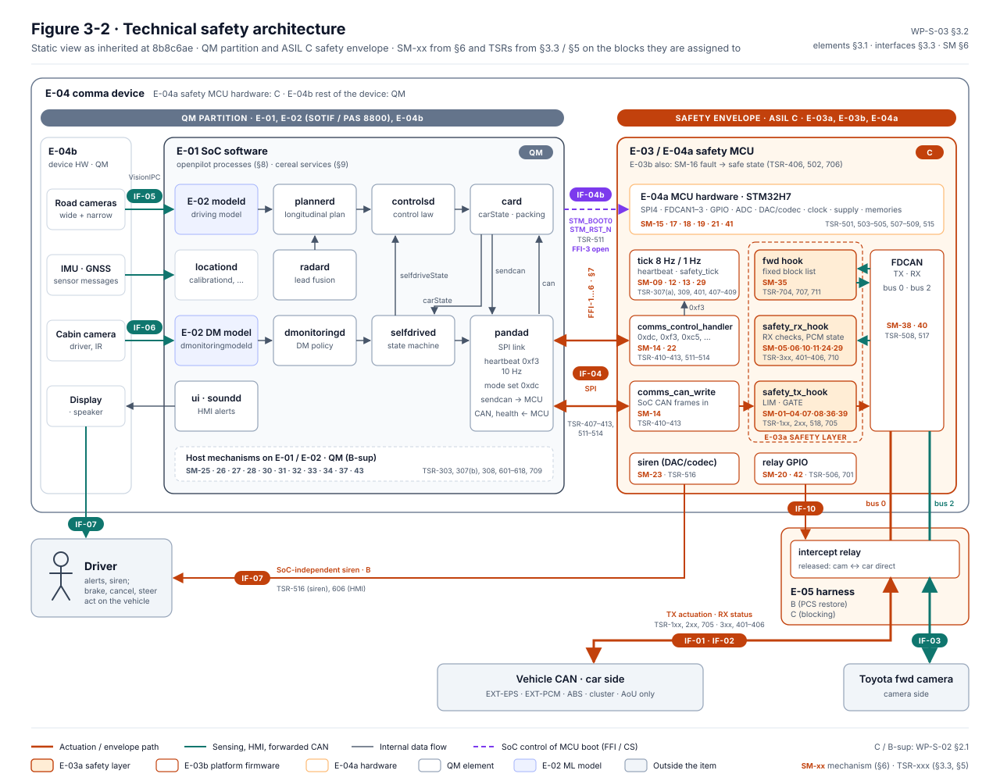
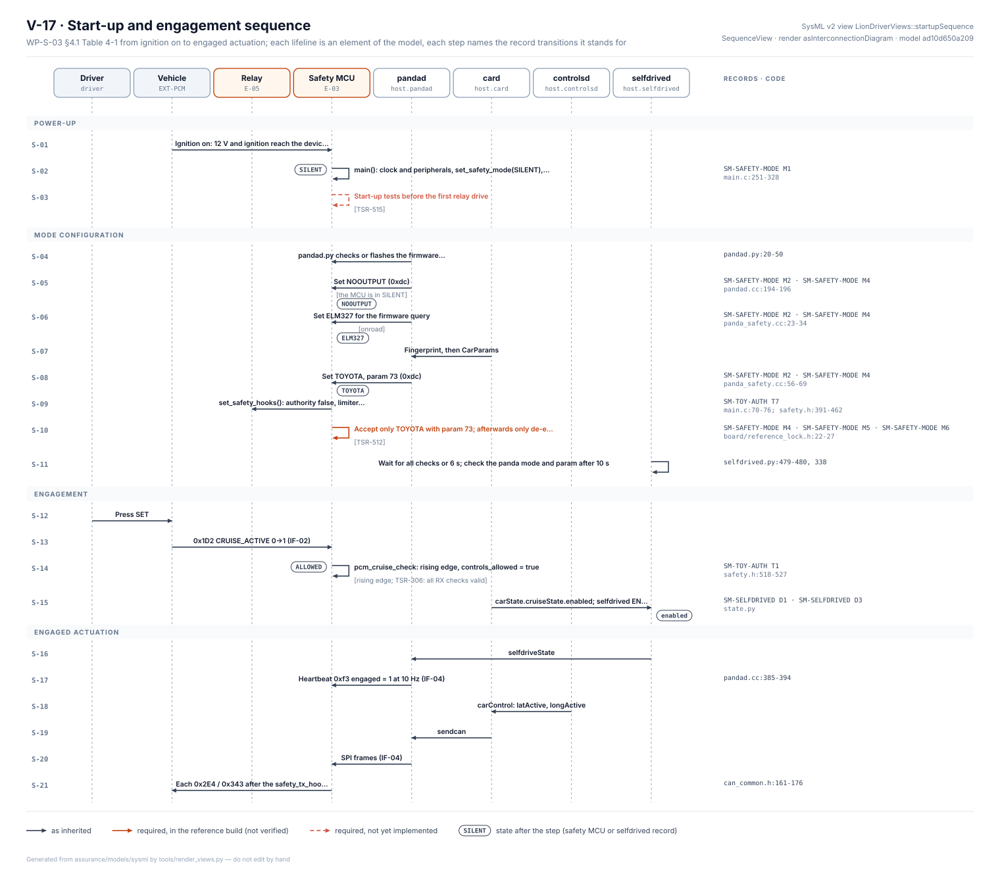

# WP-S-03 Technical Safety Concept and System Architectural Design

| Field | Value |
|---|---|
| Work product | WP-S-03 Technical safety concept and system architectural design |
| Standard reference | ISO 26262-4:2018 §6 (technical safety concept, system architectural design, safety mechanisms, FFI/independence by reference to ISO 26262-9 §6–§7); ISO 21448:2022 §8 (architecture-level functional modifications, by reference); ASPICE 4.0 SYS.3 |
| Version | 0.19 (§4.1: the start-up and engagement sequence as Table 4-1 with its lifelines; Figure 4-1 is now SysML view V-17, generated from the model, and replaces the hand-drawn figure and its text version (SY-06); 2026-10-26). 0.18 (§7: Figure 7-1, the interference and dependent-failure claims with their status, generated from the §7 table; 2026-10-25). 0.17 (§3.4 Figure 3-3, the functional flow, and §4.5 Figure 4-5, the envelope's states, both generated and checked against §8–§9 and the state-machine records of WP-W-05 §5; 2026-10-25). 0.16 (§3, §6: the tables of §3.1, §3.3 and §6 are mirrored in the SysML model and checked cell by cell (SY-05, DQ-186); 2026-10-24). 0.15 (§6: Figure 6-2, the safety mechanisms by element, generated from the catalogue; SM-13 status brought up to §4.4 (TSR-408 in the reference build); 2026-10-24). 0.14 (§5: TSR-635 allocated to E-01; 2026-10-20). 0.13 (§5: TSR-517, 518, 519, 711 (envelope) and 634, 713 (SoC) allocated, they were missing; Figure 3-1 lists generated from §5 and §6 by `fig_s03_hierarchy.py`, which fails CI on an unallocated TSR; Figures 4-1 and 4-4 relabelled ASIL C (OI-6 had left them at B‡); Figure 4-4 and §4.4 show the TSR-408 command-arrival check of the reference build (opendbc `273f44e`); 2026-10-19). 0.12 (OI-6 done: envelope elements E-03a, E-03b, E-04a and the interfaces they serve changed from B‡ to ASIL C in §3.1, §3.3, §5, Figures 3-1 and 3-2 and the SysML model; E-05 C (blocking) / B (PCS restore); OI-6 closed; 2026-10-16). 0.11 (DQ-341 applied: envelope elements ASIL C; OI-6 now to be done; 2026-10-16). 0.10 (scope line: SG-02, SG-03 and SG-06 ASIL C, SG-08 ASIL A, per WP-C-03 v0.4 and WP-S-02 v0.24; 2026-10-16). 0.9 (lead decisions of 2026-10-14 recorded: override backs off (DQ-053, SM-05), EPS-fault siren persistence ≤ 0.7 s (DQ-048), relay stuck in intercept warns and blocks engagement (DQ-064, SM-20), fallback limiter decided after the tests (DQ-050, OI-3); 2026-10-16). 0.8 (Figure 6-1 added, generated from the trace data of §5 and §6; 2026-10-13). 0.7 (§3.1 element hierarchy added as Figure 3-1; 2026-10-13). 0.6 (heartbeat-loss siren, panda `c33343b`; EPS-siren worst case 1.26 s; 2026-10-13). 0.5 (§3.2, §4.1 and §4.4 diagrams redrawn as Figures 3-2, 4-1 and 4-4; text versions kept; 2026-10-13). History: 0.4 (status update 2026-10-12: reference-build column in §4.3, status of SM-06, -09, -11, -12, -15, -22, -23, -36, -39 and of FFI-2, -5, -6 at `bf6ce8c`; OI-4 trigger reached; nothing verified on hardware or reviewed independently); 0.3 (SM-43; SM-23, -30, -31, -35 extended for WP-S-02 v0.3; watchdog ≤ 0.1 s; 2026-10-12) |
| Status | Draft |
| ASIL / scope | Up to ASIL C (SG-02, SG-03, SG-06 since WP-C-03 v0.4; SG-01 until re-rated); ASIL A for SG-08. The envelope is hardened to ASIL C (WP-C-04 §4, decided DQ-341) |
| Author | Assurance team (initial draft) |
| Reviewer(s) | TBD (I1); independent review (I2) of §5 and §7 |
| Approver | Safety manager |
| Baseline | `bf6ce8c` (status update 2026-10-12; opendbc `7993399`, panda `b790fca`). Architecture described as inherited at `8b8c6ae` (opendbc `229dc70`, panda `92eb565`); dated notes give the reference-build status |

## 1. Purpose

This document describes the LD-SDA system architecture for the reference configuration and the technical safety concept that implements the [TSRs (WP-S-02)](WP-S-02-technical-safety-requirements.md):

- the static view: elements, their interfaces, and which ones are safety-related (§3);
- the dynamic views: engagement, fault reaction, heartbeat and timeouts (§4);
- the allocation of TSRs to elements (§5);
- the catalogue of safety mechanisms with diagnostic-coverage targets, latent-fault handling and start-up tests (§6);
- the freedom-from-interference and independence claims and where they are analysed (§7);
- the mapping of openpilot processes and cereal services to architecture elements (§8, §9).

It describes the architecture **as inherited at the baseline** and marks where the TSRs require it to change. The ASIL notation (C, B, B‡, A, QM (C-sup), QM (B-sup)) is defined in [WP-S-02 §2.1](WP-S-02-technical-safety-requirements.md). **HARA v0.4:** the envelope elements E-03a, E-03b and E-04a, and the interfaces they serve, carry ASIL C, because most of their TSRs also serve SG-02, SG-03 or SG-06 (WP-S-02 v0.24). On 2026-10-16 the project lead chose to harden the envelope to ASIL C rather than decompose it (DQ-341, option A); §3, §5, the SysML model and Figures 3-1 and 3-2 show C (OI-6, closed).

## 2. Architectural principles

| ID | Principle | Basis |
|---|---|---|
| AP-1 | **Safety envelope.** All actuation passes through one element, the safety MCU (E-03), which enforces the safety goals regardless of the commands of the QM SoC | [WP-M-01 §4](../01-management/WP-M-01-assurance-strategy.md#4-safety-architecture-argument-the-central-strategy) |
| AP-2 | **Fail-silent.** On any detected fault, the item stops actuating and hands back to the driver; there is no fail-operational mode | [WP-C-04 §6](../02-concept/WP-C-04-functional-safety-concept.md) |
| AP-3 | **Reduced authority.** Envelope limits are chosen so that worst-case actuation inside them is controllable (C1 target), which makes ASIL B sufficient for the envelope. *Since HARA v0.4 this holds for SG-01 only: SG-02, SG-03 and SG-06 are ASIL C, and the envelope is hardened to C (WP-C-04 §4, DQ-341)* | FSC §4.2 option (c) |
| AP-4 | **De-energise to safe.** Loss of power or drive releases the harness relay and restores the stock camera path | TSR-506, TSR-702, TSR-706 |
| AP-5 | **QM SoC does not configure or control the safety element.** Configuration (mode, parameter, limits) is fixed in the envelope; the SoC can only request de-escalation | TSR-511…514. **Not true at the baseline** (GAP-09, GAP-38). 2026-10-12: mode/parameter lock and car-mode request gating in the reference build (TSR-512, 513, `board/reference_lock.h`); boot control (GAP-38) open |
| AP-6 | **Driver as an independent channel.** The driver's brake, cancel and steering act on vehicle elements outside the item, and the envelope follows the PCM cruise state | TSR-301, 302, 309, 310 |
| AP-7 | **SOTIF measures in the QM stack.** Model insufficiencies are bounded by AP-1/AP-3 and managed under ISO 21448 and ISO/PAS 8800 | [WP-C-05](../02-concept/WP-C-05-sotif-hazard-identification.md), [WP-C-11](../02-concept/WP-C-11-ai-system-definition-and-safety-requirements.md) |

## 3. Static view

The tables of §3.1, §3.3 and §6 are held cell by cell in the [SysML model](../models/sysml/README.md) (SY-05, check T1): change a cell there too, until the model review makes the model their record and the tables are generated from it.

### 3.1 Elements

| Element | Description | Integrity | Main sources |
|---|---|---|---|
| E-01 SoC software | openpilot processes on AGNOS Linux (Qualcomm SoC); §8 | QM | `openpilot/system/manager/process_config.py:70-121` |
| E-02 ML models | Driving model, DM model | QM (SOTIF/PAS 8800) | `openpilot/selfdrive/modeld/` |
| E-03a Safety layer | opendbc safety core + Toyota mode, compiled into the panda firmware | C | `opendbc_repo/opendbc/safety/{safety.h,lateral.h,longitudinal.h,helpers.h,modes/toyota.h}` |
| E-03b Panda platform firmware | main loop, tick handler, CAN/SPI drivers, comms handlers, harness/relay driver, fault handling, bootstub | C | `panda/board/{main.c,main_comms.h,can_comms.h,drivers/*,sys/*,stm32h7/*,bootstub.c}` |
| E-04a Safety MCU hardware | STM32H7 with clock, supply, memories, SPI4, FDCAN1–3, ADC, GPIO, DAC/codec siren path | C | [WP-H-02](../04-hardware/WP-H-02-hardware-design.md) |
| E-04b Device hardware (rest) | SoC, cameras, IMU, display, speaker, power supply, enclosure | QM | WP-H-02 |
| E-05 Harness | Toyota TSS2 harness with intercept relay, ignition line, orientation sense | B (PCS restore), C (blocking) | WP-H-02 |
| EXT-EPS, EXT-PCM, EXT-CLU | Toyota EPS, PCM/brake, cluster | AoU only | [WP-C-04 §11](../02-concept/WP-C-04-functional-safety-concept.md) |


*Figure 3-1.* The elements of this table on the ISO 26262-1 hierarchy (3.39 element), below the system node of [WP-C-01](../02-concept/WP-C-01-item-definition.md) Figure 3-1: E-03a/E-03b refine E-03 and E-04a/E-04b refine E-04 of WP-C-01. Integrity tags are those of this table; TSR tags are the §5 allocation as written there (TSR-xxx, ranges as given; E-02 and E-04b have none, OPS 801–818 no element); SM tags are the §6 mechanisms whose Element column names that element alone, the twelve that name two elements are listed separately. E-01 is decomposed into the processes of §8 with their §8 role and TSRs. No implementation or verification status is shown. The TSR and SM lists are generated from §5 and §6 by [`figures/fig_s03_hierarchy.py`](figures/fig_s03_hierarchy.py), which also fails CI when a TSR of WP-S-02 or WP-S-06 is not allocated in §5; the layout and the §3.1 and §8 content are hand-drawn in [`figures/fig_s03_hierarchy_template.svg`](figures/fig_s03_hierarchy_template.svg), so change that together with §3.1 and §8. Output: [`figures/fig-s03-3-1-system-element-hierarchy.svg`](figures/fig-s03-3-1-system-element-hierarchy.svg).

### 3.2 Block diagram



*Figure 3-2.* The device E-04 is split into the QM partition and the ASIL C safety envelope (DQ-341); inside the MCU, E-03a blocks are shaded, E-03b blocks outlined and E-04a is the hardware strip. Each block carries the safety mechanisms of §6 and the TSRs of §3.3 and §5 that are assigned to it; host mechanisms of E-01/E-02 are listed together because §6 assigns them to E-01 as a whole. It shows the architecture as inherited at `8b8c6ae`. Source: [`figures/fig-3-2-tsc-block-diagram.svg`](figures/fig-3-2-tsc-block-diagram.svg); change it together with §3.1, §3.3, §5 and §6.

<details><summary>Text version of Figure 3-2</summary>

```
                                   ┌──────────────── comma device (E-04) ───────────────────────────────────────┐
 road cam ─┐                       │  E-01 SoC (QM)                                  E-03/E-04a safety MCU (C)   │
 cabin cam ┼─VisionIPC─▶ modeld,   │  ┌───────────────────────────────────────┐     ┌────────────────────────┐  │
           │  dmonitoringmodeld ──▶│  │ plannerd ─▶ controlsd ─▶ card ─sendcan─┼─┐   │ comms_control_handler  │  │
 IMU/GNSS ─┘  locationd, calib…    │  │   ▲           ▲          │  ▲          │ │SPI│  (0xdc,0xf3,0xc5,…)    │  │
                                   │  │ radard    selfdrived ◀───┘  │ can     │ └──▶│ comms_can_write ─▶     │  │
                                   │  │           (state machine)   │         │     │  safety_tx_hook (LIM,  │  │
                                   │  │ dmonitoringd ─▶ selfdrived  │         │◀────│  GATE) ─▶ FDCAN TX ────┼──┼─▶ bus 0 car side
                                   │  │ ui/soundd (HMI)        pandad ◀──────┘ │SPI  │ FDCAN RX ─▶ fwd hook ──┼──┼─▶ bus 2 camera side
                                   │  │                    (heartbeat 10 Hz,  │     │   ─▶ safety_rx_hook    │  │
                                   │  │                     mode set 0xdc)    │     │ tick 8 Hz / 1 Hz:      │  │
                                   │  └───────────────────────────────────────┘     │  heartbeat, safety_tick│  │
                                   │   STM_BOOT0, STM_RST_N (GPIO) ────────────────▶│ relay GPIO ─────────┐  │  │
                                   │                                                │ siren (DAC/codec)   │  │  │
                                   │                                                └─────────────────────┼──┘  │
                                   └──────────────────────────────────────────────────────────────────────┼─────┘
                                                                             E-05 harness relay ◀───────────┘
                         vehicle CAN (EPS, PCM, ABS, cluster) ◀══ bus 0 ══╗   ╔══ bus 2 ══▶ Toyota forward camera
                                                                          ╚═══╝  (relay released: direct link)
```

</details>

### 3.3 Interfaces

| ID | Interface | Between | Content | Safety relevance | TSRs | Detail |
|---|---|---|---|---|---|---|
| IF-01 | Car-side CAN TX | E-03 → EPS, PCM | `0x2E4`, `0x343`, `0x412`, `0x1D2` cancel, (`0x750` tester present) | C actuation | 1xx, 2xx, 705 | WP-S-05 §5 |
| IF-02 | Car-side CAN RX | EPS, PCM, ABS → E-03 | `0xAA`, `0x260`, `0x1D2`, `0x226` (+ `0x262`, `0x1D3`, `0xB4` proposed) | C gating/limiting | 3xx, 401–406 | WP-S-05 §5 |
| IF-03 | Camera-side CAN | camera ↔ E-03 | forwarding | B (SG-07) | 704, 707 | WP-S-05 §5 |
| IF-04 | SoC ↔ MCU SPI | E-01 ↔ E-03 | control requests, CAN streams, health | C (FFI) | 407–413, 511–514 | WP-S-05 §4 |
| IF-04b | SoC → MCU boot/reset GPIO | E-01 → E-04a | `STM_BOOT0`, `STM_RST_N` | C (FFI, CS) | 511 | WP-S-05 §7 |
| IF-05/06 | Cameras | → E-01/E-02 | images | SOTIF | — | — |
| IF-07 | HMI | E-01 ↔ driver; E-03 siren | alerts | QM; B for siren | 516, 606 | — |
| IF-08 | Power, ignition | vehicle → E-04, E-05 | 12 V, ignition line | B | 505, 510 | WP-S-05 §6 |
| IF-09 | Network | E-01 ↔ back end | athena, updates | CS only (AOU-11) | — | [WP-S-07](WP-S-07-cybersecurity-requirements-architecture.md) |
| IF-10 | Relay drive / harness sense | E-04a ↔ E-05 | relay GPIO, SBU sense | C/B | 506, 701 | WP-S-05 §6 |

### 3.4 Functional flow


*Figure 3-3.* The functions in the order they act, by partition rather than by hardware: Figure 3-2 shows where they run, this figure what flows between them. Each process carries the item functions it realises (WP-C-01 §2.1) and the AI error types of WP-C-11 §5 that enter there. Every error type enters in the QM partition, and the envelope bounds only the size of what leaves it: a wrong curvature or a missed lead inside the limits passes every envelope check (WP-C-11 §4). Generated by [`figures/fig_s03_functional_flow.py`](figures/fig_s03_functional_flow.py), which checks every process against §8, every service against §9, every function against WP-C-01 §2.1 and every error type against WP-C-11 §5; CI fails if it is stale.

## 4. Dynamic views

### 4.1 Start-up and engagement



*Figure 4-1.* The steps of Table 4-1 as a sequence diagram: SysML view V-17, generated from the model, which takes the steps from the table below (check B1) and holds every lifeline to an element of the architecture and every record transition to the state-machine records of WP-W-05 §5 (B2). Steps marked "required" are drawn in their status colour. The ignition-off changes of OI-4 are not part of the sequence. It replaces the hand-drawn figure of v0.5 (SY-06, DQ-187).

**Lifelines.**

| Lifeline | Element |
|---|---|
| Driver | `driver` |
| Vehicle | `EXT-PCM` |
| Relay | `E-05` |
| Safety MCU | `E-03` |
| pandad | `host.pandad` |
| card | `host.card` |
| controlsd | `host.controlsd` |
| selfdrived | `host.selfdrived` |

**Table 4-1. Start-up and engagement.** Code references at `8b8c6ae` unless the record names a later one.

| Step | Phase | From | To | Message or action | Condition | State after | Status | Records | Code |
|---|---|---|---|---|---|---|---|---|---|
| S-01 | Power-up | Vehicle | Safety MCU | Ignition on: 12 V and ignition reach the device (IF-08) | | | as inherited | | |
| S-02 | Power-up | Safety MCU | Safety MCU | main(): clock and peripherals, set_safety_mode(SILENT), CAN transceivers on, 8 Hz tick, SPI | | Safety MCU: SILENT | as inherited | SM-SAFETY-MODE M1 | `main.c:251-328` |
| S-03 | Power-up | Safety MCU | Safety MCU | Start-up tests before the first relay drive | TSR-515 | | required, not implemented | | |
| S-04 | Mode configuration | pandad | Safety MCU | pandad.py checks or flashes the firmware signature, then pandad (C++) starts | | | as inherited | | `pandad.py:20-50` |
| S-05 | Mode configuration | pandad | Safety MCU | Set NOOUTPUT (`0xdc`) | the MCU is in SILENT | Safety MCU: NOOUTPUT | as inherited | SM-SAFETY-MODE M2, SM-SAFETY-MODE M4 | `pandad.cc:194-196` |
| S-06 | Mode configuration | pandad | Safety MCU | Set ELM327 for the firmware query | onroad | Safety MCU: ELM327 | as inherited | SM-SAFETY-MODE M2, SM-SAFETY-MODE M4 | `panda_safety.cc:23-34` |
| S-07 | Mode configuration | card | pandad | Fingerprint, then CarParams | | | as inherited | | |
| S-08 | Mode configuration | pandad | Safety MCU | Set TOYOTA, param 73 (`0xdc`) | | Safety MCU: TOYOTA | as inherited | SM-SAFETY-MODE M2, SM-SAFETY-MODE M4 | `panda_safety.cc:56-69` |
| S-09 | Mode configuration | Safety MCU | Relay | set_safety_hooks(): authority false, limiter state reset; relay driven | | | as inherited | SM-TOY-AUTH T7 | `main.c:70-76`; `safety.h:391-462` |
| S-10 | Mode configuration | Safety MCU | Safety MCU | Accept only TOYOTA with param 73; afterwards only de-escalation | TSR-512 | | required, in the reference build | SM-SAFETY-MODE M4, SM-SAFETY-MODE M5, SM-SAFETY-MODE M6 | `board/reference_lock.h:22-27` |
| S-11 | Mode configuration | selfdrived | selfdrived | Wait for all checks or 6 s; check the panda mode and param after 10 s | | | as inherited | | `selfdrived.py:479-480, 338` |
| S-12 | Engagement | Driver | Vehicle | Press SET | | | as inherited | | |
| S-13 | Engagement | Vehicle | Safety MCU | `0x1D2` CRUISE_ACTIVE 0→1 (IF-02) | | | as inherited | | |
| S-14 | Engagement | Safety MCU | Safety MCU | pcm_cruise_check: rising edge, controls_allowed = true | rising edge; TSR-306: all RX checks valid | Safety MCU: ALLOWED | as inherited | SM-TOY-AUTH T1 | `safety.h:518-527` |
| S-15 | Engagement | card | selfdrived | carState.cruiseState.enabled; selfdrived ENABLE | | selfdrived: enabled | as inherited | SM-SELFDRIVED D1, SM-SELFDRIVED D3 | `state.py` |
| S-16 | Engaged actuation | selfdrived | pandad | selfdriveState | | | as inherited | | |
| S-17 | Engaged actuation | pandad | Safety MCU | Heartbeat `0xf3` engaged = 1 at 10 Hz (IF-04) | | | as inherited | | `pandad.cc:385-394` |
| S-18 | Engaged actuation | controlsd | card | carControl: latActive, longActive | | | as inherited | | |
| S-19 | Engaged actuation | card | pandad | sendcan | | | as inherited | | |
| S-20 | Engaged actuation | pandad | Safety MCU | SPI frames (IF-04) | | | as inherited | | |
| S-21 | Engaged actuation | Safety MCU | Vehicle | Each `0x2E4` / `0x343` after the safety_tx_hook limits, FDCAN TX to the EPS and PCM (IF-01) | | | as inherited | | `can_common.h:161-176` |

### 4.2 Driver override and disengagement

| Driver action | Signal path | Envelope reaction | Host reaction | Timing |
|---|---|---|---|---|
| Brake | `0x226` BRAKE_PRESSED (and PCM drops cruise) | revoke on rising edge / pressed while moving (`safety.h:354-356`) | USER_DISABLE | ≤ 25 ms detect (TSR-302) |
| Cancel / main off | `0x1D2` CRUISE_ACTIVE → 0 | revoke (`safety.h:520-521`) | USER_DISABLE | ≤ 30 ms detect |
| Accelerator | `0x1D2` GAS_RELEASED → 0 | longitudinal inactive only (`longitudinal.h:3-5`) | overriding state | ≤ 30 ms |
| Steering | `0x260` STEER_TORQUE_DRIVER | **none today** (GAP-02) → TSR-304 | `lat_active` false if \|τ\| ≥ 500 raw (`carcontroller.py:83`) | target ≤ 0.2 s |

After revocation the envelope rejects further actuation frames. Under TSR-109 it must also transmit an explicit zero-torque `0x2E4`; at the baseline the EPS sees a drop-out (NF-02).

### 4.3 Fault reaction sequences

| Fault | Detected by | Detection (baseline → required) | Reaction (baseline → required) | Reference build 2026-10-12 (`bf6ce8c`; not verified on hardware) |
|---|---|---|---|---|
| Lateral command out of limits | E-03 `steer_torque_cmd_checks` | per frame → per frame | frame dropped → latch SS-L + zero-torque frame (TSR-108, 109) | unchanged |
| RX message lost | E-03 `safety_tick` | 1–2 s → ≤ 0.2 s (TSR-401) | revoke → revoke + reason code (TSR-406) | 5 periods at 100 Hz: ≤ 0.16 s (`0x262` ≈ 0.21 s); revoke (TSR-401) |
| RX checksum wrong | E-03 `rx_msg_safety_check` | per frame | revoke | also on `0x262`, `0x1D3` |
| RX stuck/inserted/implausible | none → TSR-403…405 | — → ≤ 0.2 s | — → revoke | TSR-405(c) only: cruise active with main off refused at once, revoked after 150 ms |
| SoC heartbeat lost | E-03 tick | 4–5 s → ≤ 0.3 s (TSR-407) | SILENT + siren → revoke at 0.3 s, SILENT after ≤ 2 s, siren (TSR-516) | revoke at 0.3 s (≤ 0.31 s, TSR-407); SILENT still after 5 s. Siren: 2026-10-13, at the revocation when authority was granted, ≈ 0.56 s after the last heartbeat, all builds (TSR-516, panda `c33343b`; WP-S-04 T-07a); otherwise after 5 s |
| SoC control loop frozen, pandad alive | none → TSR-408/409 | — → ≤ 50 ms | EPS drop-out only → SS-L | unchanged (TSR-408/409 open) |
| Host/panda engaged mismatch | E-03 tick; selfdrived | 2–3 s / 2 s → ≤ 0.3 s (TSR-307) | revoke / immediate disable | unchanged |
| MCU hang | none (GAP-07) → IWDG | — → ≤ 0.1 s (TSR-501) | relay stays in last state (GAP-43) → reset → SS-S | IWDG reset ≈ 90 ms nominal after the first relay drive (TSR-501); LSI tolerance open |
| MCU fault (ECC, clock, interrupt rate…) | report-only → TSR-502/503 | various → ≤ 0.2 s | none (GAP-08) → SS-S | unchanged (report-only); watchdog reset reported as `watchdogReset` |
| Relay stuck released | E-03 `stock_ecu_check` | 1–2 s window | block TX/fwd; host immediate disable | unchanged |
| Relay stuck intercepting | none → TSR-506 readback | — → ≤ 0.3 s | — → SS-S + warning (GAP-43) | unchanged |
| SoC input stale (model, plan) | selfdrived `commIssue` | 10 periods (0.5 s for modelV2) | soft disable 3 s → immediate disable (TSR-601) | unchanged |
| EPS LKA fault | host carstate | 1.5 s hysteresis | lat inactive + warning → also envelope revoke (TSR-110) | LKA torque refused on receipt of the fault frame (TSR-110), `epsFault` reported; siren after 1 s persistence, ≤ 1.26 s worst case after onset (TSR-516(b); WP-S-04 OI-8); persistence to be ≤ 0.7 s (DQ-048), firmware not yet changed |

### 4.4 Heartbeat and timeout chain


*Figure 4-4.* Part A shows both paths with the freshness limit at each stage and the required changes in red. Part B puts heartbeat loss and engaged mismatch on one time axis; the 1 Hz tick phase is arbitrary, so the baseline times are ranges (4–5 s, 2–3 s, as in WP-S-04 T-05/T-06), and the dashed red lines are the required limits of TSR-407, TSR-510 and TSR-307. Source: [`figures/fig-4-4-heartbeat-timeout-chain.svg`](figures/fig-4-4-heartbeat-timeout-chain.svg); change it together with §4.3, §4.4 and [WP-S-04](WP-S-04-timing-ftti-budget.md) §4–§5.

<details><summary>Text version of Figure 4-4</summary>

```
controlsd 100 Hz ─carControl─▶ card 100 Hz ─sendcan─▶ pandad send thread ─SPI─▶ MCU safety_tx_hook ─▶ EPS/PCM
   (alive: 0.1 s,                (sends only if          (drops if older            (no command-freshness
    card.py:234)                  carControl alive)       than 1 s, pandad.cc:79)    check today → TSR-408)

selfdrived 100 Hz ─selfdriveState─▶ pandad main 10 Hz ─0xf3 engaged─▶ MCU heartbeat_counter (1 Hz tick)
   (engaged = alive&&valid&&enabled, pandad.cc:389)                    mismatch 3 ticks → revoke (main.c:182-186)
                                                                       5 ticks w/o heartbeat → SILENT (main.c:193)
```

</details>

Required changes (WP-S-04 §5): heartbeat evaluated at ≥ 10 Hz with a 0.3 s timeout and control-loop evidence (TSR-407, 409); command-frame freshness in the MCU (TSR-408); `sendcan` age ≤ 20 ms (TSR-614).

Status 2026-10-12 (`bf6ce8c`, not verified on hardware): the MCU's 100 Hz safety task revokes authority 0.3 s after the last `0xf3` in a car mode (`drivers/heartbeat_monitor.h`, panda `c2e5d93`); the 1 Hz mismatch and 5 s SILENT paths are unchanged. *2026-10-13:* the same task sounds the siren at that revocation when authority was granted, ≈ 0.56 s after the last heartbeat, in all builds (`drivers/heartbeat_siren.h`, panda `c33343b`; WP-S-04 T-07a; not verified on hardware). *2026-10-16:* the same task revokes authority when `0x2E4` has not reached the TX hook for > 50 ms, or `0x343` for > 100 ms with openpilot longitudinal (TSR-408, `safety.h` `tx_arrival_ok`, opendbc `273f44e`; WP-S-04 T-34; not verified on hardware). TSR-409 and TSR-614 are open.

### 4.5 The envelope's states


*Figure 4-5.* The two envelope state machines at system level: the safety mode of the panda and, in the Toyota mode, its authority to actuate (`controls_allowed`). The reference build grants authority only when the host's engaged heartbeat arrives within 1 s of the cruise edge (T1a, T1b), so a host that refuses to engage, as in the driver lockout, never gets authority on the car. The panel on the right reads the host engagement state against authority: they disagree while the driver steers against the item (T10e and T12 not in the code) and while the host soft-disables (GAP-16, TSR-601), and briefly after an immediate disable (T6a, 0.3 s). Generated by [`figures/fig_s03_envelope_states.py`](figures/fig_s03_envelope_states.py) from the state-machine records of [WP-W-05](../05-software/WP-W-05-software-unit-design.md) §5, whose tables stay normative and give the code reference of every transition; CI fails if it is stale or if a mode, a revoking transition or a host state of the records is not drawn.

## 5. Allocation of TSRs to elements

| Element | TSRs | Highest ASIL |
|---|---|---|
| E-03a safety layer | 101–110, 201–207, 301, 302, 304–307(a), 309, 311, 401–406, 408, 518, 704, 705, 710 | C |
| E-03b panda firmware | 407, 409 (check), 410–413, 501–503, 506 (logic), 507, 508, 510–516, 517 (detection), 519, 632, 701, 706, 707, 711, 712 (detection, latch) | C |
| E-04a MCU hardware (configured by E-03b) | 501, 503–505, 507–509, 511 (option bytes), 515, 517 (readback path), 519 (interrupt configuration) | C |
| E-05 harness | 506 (relay), 701–703, 706, 712 (readback) | C/B |
| E-01 SoC (QM) | 303, 307(b), 308, 409 (content), 410/411 (sender side), 601–631, 633–635, 709, 712 (warning), 713 | QM (B-sup) |
| EXT | 111, 208, 310, 708 | AoU |
| OPS | 801–818 | — |

Refinement: E-03 TSRs → SWSR in [WP-W-02](../05-software/WP-W-02-software-safety-requirements.md); E-04a/E-05 TSRs → HWSR in [WP-H-01](../04-hardware/WP-H-01-hardware-safety-requirements.md).

## 6. Safety mechanism catalogue

Diagnostic coverage (DC) values are **targets** for the FMEDA ([WP-H-03](../04-hardware/WP-H-03-hardware-safety-analysis-fmeda.md)) and the software safety analysis ([WP-W-04](../05-software/WP-W-04-software-safety-analysis.md)), using the low / medium / high classes of ISO 26262-5 Annex D. They are not demonstrated. "Latent" states how the mechanism itself is checked.

| SM | Mechanism | Covers (fault / failure mode) | Element | TSR | Status | DC target | Latent-fault handling / start-up test |
|---|---|---|---|---|---|---|---|
| SM-01 | Torque magnitude limit (speed-dependent) | excessive torque command from SoC | E-03a | 101, 102 | Partial | high (for SoC command faults) | T-SIL each release; table CRC in TSR-503 |
| SM-02 | Torque rate and RT-window limit | high-rate torque command | E-03a | 103 | Impl | high | as SM-01 |
| SM-03 | Measured-torque tracking | command diverging from EPS output | E-03a | 104 | Impl | medium (depends on `0x260` integrity) | as SM-01 |
| SM-04 | Authority gating (PCM edge, brake, gas, steer request) | actuation when not engaged; no release on driver action | E-03a | 105–107, 203, 301–306 | Impl/Partial | high | T-SIL; T-VEH at installation (INS-28) |
| SM-05 | Driver-torque override monitor | actuation opposing driver | E-03a | 304, 628 | New | medium | T-SIL; periodic T-VEH |
| SM-06 | EPS status monitor | EPS LKA fault while engaged | E-03a | 110, 607 | New at baseline; **Partial** 2026-10-12 (reference build: LKA refused on LKA_STATE fault codes, `epsFault` reported; code set unconfirmed; not verified) | medium | log check |
| SM-07 | Longitudinal bounds and jerk limits | excessive accel/decel or onset | E-03a | 201–207 | Partial | high | T-SIL |
| SM-08 | Active safe-state frame | torque persisting after rejection | E-03a | 108, 109 | New | high | T-HIL each release |
| SM-09 | RX timeout | lost/delayed RX | E-03a | 401 | Partial at baseline; **Impl** 2026-10-12 (Toyota RX set, 5 periods at 100 Hz; `0x262` marginal; `0xB4` not in the set; not verified) | medium (alone) | T-SIL, FI |
| SM-10 | RX checksum + length | corrupted RX (`0x260`, `0x1D2`) | E-03a | 402 | Partial | low (8-bit additive) | T-SIL |
| SM-11 | RX rate, frozen-content and cross-checks | repeated/inserted/masqueraded RX | E-03a | 403–405 | New at baseline; **Partial** 2026-10-12 (TSR-405(c) in the reference build; 403, 404, 405(a)(b)(d) open) | medium (combined with SM-09/10) | LOG, FI |
| SM-12 | Heartbeat + control-loop liveness | SoC hang, frozen control loop | E-03b | 407, 409 | Partial (2026-10-12: 0.3 s revoke implemented, TSR-409 open) | medium | FI |
| SM-13 | Command-frame freshness | SoC stops sending commands | E-03a/b | 408, 614 | New at baseline; **Partial** 2026-10-16 (TSR-408 in the reference build, opendbc `273f44e`, not verified on hardware; TSR-614 not met) | high | FI |
| SM-14 | SPI CRC + sequence counter + bounds checks | corrupted/stale/oversized SoC transfers | E-03b | 410–413 | Partial | high (with CRC-16/32) | FI |
| SM-15 | Independent watchdog | MCU program-flow stall | E-04a/E-03b | 501 | New at baseline; **Impl, not verified** 2026-10-12 (IWDG1, window, ≈ 90 ms nominal; LSI tolerance and HIL open) | medium (timeout only) / high (window + logical checkpoint) | IWDG reset-path test at defined interval (TSR-515) |
| SM-16 | Fault → safe state | any detected platform fault | E-03b | 406, 502, 706 | New | — (enabler) | FI |
| SM-17 | RAM ECC, flash CRC, register checks | memory/register corruption | E-04a/E-03b | 503 | Partial | high (ECC), medium (register) | start-up CRC; ECC event counting |
| SM-18 | Clock monitor (CSS + cross-check) | clock loss/drift | E-04a | 504 | Partial | medium | start-up check |
| SM-19 | Supply monitor (BOR, PVD, input voltage) | under/over-voltage | E-04a | 505 | Unknown | medium | start-up check |
| SM-20 | Relay readback and latch | relay stuck either way | E-04a/E-05 | 506, 710, 712 | Partial (one direction, indirect) | high (with readback) | relay test at start-up (TSR-515) |
| SM-21 | MPU isolation | comms handler corrupting safety data | E-04a | 507 | New | medium | — |
| SM-22 | Configuration lock and command gating | SoC selects wrong mode/param; debug commands | E-03b | 511–514, 619, 620 | New at baseline; **Partial** 2026-10-12 (TSR-512/513 in the reference build; 511, 514, 619, 620 open) | high | release-build check (TSR-514), INS-17/23 |
| SM-23 | SoC-independent siren | warning when the SoC is lost, on every envelope revocation that is not a driver action, and when a fault-induced ACC cancel has no effect | E-03b/E-04a | 516 | Partial (2026-10-12: EPS-fault siren after 1 s persistence in the reference build; 2026-10-13: siren when heartbeat loss revokes granted authority, ≈ 0.56 s after the last heartbeat, all builds, panda `c33343b`) | — (warning) | siren test at start-up (TSR-515) |
| SM-24 | Relay malfunction detection (traffic-based) | relay stuck released / camera on car bus | E-03a | 710 | Impl | medium | INS-27 |
| SM-25 | Host fault classification and freshness | stale/invalid inputs on SoC | E-01 | 601–604, 606, 615, 616 | Partial | QM | T-SIL |
| SM-26 | Driver monitoring | inattention (misuse) | E-01/E-02 | 608–612 | Partial | QM (SOTIF) | DM validity (TSR-609) |
| SM-27 | Excessive-actuation detector | vehicle response beyond 2× limits | E-01 | 617 | Impl | QM | — |
| SM-28 | Controller margin | operation at envelope boundary | E-01 | 605 | Partial | QM | — |
| SM-29 | Engagement follows PCM cruise; revoke on SoC "not engaged" | engagement state of the envelope differs from the PCM or from the SoC | E-03a/E-03b | 307(a), 309 | Impl (309) / Partial (307(a): 2–3 s) | high | T-SIL; T-VEH (cluster indication, AOU-12) |
| SM-30 | Engagement and authority mismatch detection (SoC side) | envelope blocks or never grants authority while engaged; PCM cruise differs from the item's state | E-01 | 307(b), 308, 621, 626 | Partial (2 s; `cruiseMismatch` 6 s, no reaction) | QM (B-sup: SM-08, SM-23) | T-SIL, FI |
| SM-31 | HMI path liveness and audible minimum | hung render loop, stalled or muted audio, so the take-over request is not perceived | E-01 (HMI) | 622, 623, 627 | Partial (crash only) | QM (B-sup: SM-23 siren, SM-29 cluster) | FI; volume check at engagement |
| SM-32 | Announced, bounded item-initiated deceleration | deceleration not caused by traffic (DM no-response, soft disable) applied without warning or as a step | E-01 | 624 | Partial | QM (B-sup: SM-07) | T-SIL |
| SM-33 | FCW input freshness and false-alarm rate | FCW from stale or invalid inputs; false FCW causing reflex braking | E-01 | 625 | Partial | ASIL A on QM element (open, WP-C-04 OI-9) | T-SIL; LOG fleet false-rate monitoring |
| SM-34 | PCM ACC-fault reaction | PCM does not execute ACC (ACC or cruise fault) | E-01 | 618 | Impl | QM (B-sup: SM-29) | T-SIL |
| SM-35 | Forwarding with fixed block list and forwarding supervision | camera-side frames lost, delayed or altered; block list wrong | E-03a/E-03b | 704, 707, 711 | Impl (704) / Not verified (707) / Not impl (711) | high (block list, design); medium (overflow counting) | T-HIL each release |
| SM-36 | PCS and DSU message TX gate | item originates or alters frames used by the stock PCS | E-03a | 705 | **Not met** (GAP-42) at baseline; **Met (reference build)** 2026-10-12 (other builds keep `0x411`; not verified on hardware) | high (when implemented) | T-SIL |
| SM-37 | Stock AEB/FCW event indication | driver not told that the stock system intervened | E-01 | 709 | Impl | QM | — |
| SM-38 | Post-load TX read-back | approved actuation frame altered in FDCAN message RAM, FDCAN core or transceiver | E-03b/E-04a | 517 | New | high | FI each release |
| SM-39 | Per-ID TX rate supervision | actuation frames sent faster than nominal (burst, duplicated frames) | E-03a | 518 | New at baseline; **Impl (reference build)** 2026-10-12 (budgets to be confirmed on logs; not verified) | medium | T-SIL |
| SM-40 | Car-side transceiver supervision | transceiver transmitting from reset; bus-off or persistent TX failure while authority is granted | E-04a/E-03b | 508 | Partial | medium | start-up check (TSR-515) |
| SM-41 | MCU die-temperature monitor | MCU outside its specified temperature range | E-04a/E-03b | 509 | Partial (report only) | medium | start-up check |
| SM-42 | Harness orientation and connection detection | harness flipped, not connected or partly inserted; wrong CAN routing or relay pin | E-04a/E-05 | 701 | Partial | medium | before the relay is first driven (TSR-515) |
| SM-43 | ACC cancel on every fault-induced disengagement | driver not told by an independent cue that the item disengaged on a fault | E-01 | 303 | Impl (host) | QM (B-sup: SM-23 via TSR-516(c), SM-29) | T-VEH (cluster and PCM cue, AOU-12) |

Notes:

- **FSRs without an item safety mechanism, by design.** FSR-03.06, FSR-05.07 and FSR-07.04 are external measures of the PCM (TSR-208, TSR-310, TSR-708, AOU-03R/04R/05R); they are verified by vehicle tests (WP-S-09), not covered by an item mechanism. FSR-03.04 refers to the shared mechanisms of FSR-01.05…01.12 (SM-04, SM-09…SM-17). With SM-29…SM-43 every other FSR of [WP-C-04](../02-concept/WP-C-04-functional-safety-concept.md) v0.2 has at least one catalogued mechanism ([RR-2026-005](reviews/RR-2026-005.md) F-03).
- **TSRs that are not safety mechanisms.** TSR-111 (EPS, external), TSR-311 (initial state), TSR-515 (start-up tests; they appear in the latent-fault column), TSR-519 (interrupt and timing scheme), TSR-613 (build configuration), TSR-702 and TSR-703 (harness design) and the OPS block 801–818 are design, configuration or verification constraints. They are allocated in §5 but not listed here.
- SM-01…SM-08 act within one frame and are not limited by detection times. SM-09…SM-14 are bounded by the timing of [WP-S-04](WP-S-04-timing-ftti-budget.md).
- The combined RX strategy (SM-09/10/11) cannot reach "high" coverage without vehicle-side counters. The residual is argued in [WP-A-04](../08-analyses/WP-A-04-system-fta-fmea.md), with the driver and the PCM cruise drop on brake (AOU-03R) as independent paths.
- **Latent-fault interval:** one drive cycle for start-up tests (TSR-515); continuous for mechanisms exercised in normal operation (limits, gating, timeouts). The ISO 26262-5 latent-fault metric uses these in [WP-H-04](../04-hardware/WP-H-04-hardware-metrics.md).


*Figure 6-1.* The layers are those the allocation of §5 supports: a TSR counts in the host layer when its Alloc names SoC, in the envelope when it names P-SW, P-HW or HAR (E-03, E-04a and E-05 together, because many TSRs are allocated to P-SW with P-HW or HAR), in the vehicle layer when it names EXT, and in operation when it names OPS; a TSR with two allocations counts in both. The vehicle and driver layers add the assumptions of use the goal credits (its own and its hazardous events' AoU dependency, and AoUs named in the baseline status of its TSRs) and the driver layer the HARA controllability ratings; they are drawn as assumed, unverified. Operation is drawn apart because its procedures are preconditions for every layer, not a barrier between fault and hazard. Status comes from each TSR's "Impl" text with the conservative rule stated in the figure; "implemented" means the baseline code does it, nothing is verified. Drawn from the trace data: `tsr.yaml` (WP-S-02 §3–§9, WP-S-06), `goals.yaml` and `hazards.yaml` (WP-C-03), `aou.yaml` (WP-C-01 §7). Generated by [`figures/fig_s03_defence_in_depth.py`](figures/fig_s03_defence_in_depth.py); CI fails if it is stale.


*Figure 6-2.* The catalogue above, one tile per mechanism, on the first element of its Element column; a second element is a tag on the tile. Status is the latest the Status column gives (the reference build where it says so): Impl or Met is implemented, Partial is partly, New or Not is not implemented; a cell with mixed statuses counts as partly. Nothing is verified, so implemented is drawn blue. Generated by [`figures/fig_s03_mechanisms.py`](figures/fig_s03_mechanisms.py) from §3.1 and §6; CI fails if it is stale.

## 7. Freedom from interference and independence


*Figure 7-1.* The claims of the table below, each with the mechanisms required to stop it and its status at the reference build (the latest dated note of the Baseline column). Two are not met: the SoC can still replace the MCU firmware through its boot and reset lines (FFI-3), and a malformed SPI transfer can still corrupt MCU memory (FFI-4). Two of the shared causes are not yet analysed (DFA-1, DFA-3). Generated by [`figures/fig_s03_ffi.py`](figures/fig_s03_ffi.py) from the table; CI fails if it is stale or a status cannot be classified.

| Claim | Interference path | Mechanisms (required) | Baseline | Analysed in |
|---|---|---|---|---|
| FFI-1 | QM SoC sends wrong or excessive commands | SM-01…08 | Partial | [WP-A-02](../08-analyses/WP-A-02-coexistence-freedom-from-interference.md) |
| FFI-2 | QM SoC reconfigures the safety element (mode, param, relay, CAN config) | SM-22 (TSR-512, 513) | **Not met** (GAP-09, NF-05); 2026-10-12: **Partial** (reference build lock and gating; other builds unchanged) | WP-A-02 |
| FFI-3 | QM SoC replaces MCU firmware via BOOT0/NRST or softloader | TSR-511 | **Not met** (GAP-24, GAP-38) | WP-A-02, [WP-S-07](WP-S-07-cybersecurity-requirements-architecture.md) |
| FFI-4 | QM SoC corrupts MCU memory through malformed SPI transfers | SM-14 bounds checks, SM-21 MPU | **Not met** (NF-04) | WP-A-02 |
| FFI-5 | QM SoC timing faults (hang, frozen loop) | SM-12, SM-13 | Partial (slow); 2026-10-12: Partial (0.3 s revoke; TSR-408 open) | WP-A-02 |
| FFI-6 | Comms ISRs on the MCU starve safety processing | interrupt-rate monitors with reaction, SM-15 with logical checkpoint | report-only; 2026-10-12: Partial (IWDG, explicit equal priorities; no WCET; rate faults report-only) | WP-A-02, [WP-W-03](../05-software/WP-W-03-software-architecture.md) |
| DFA-1 | Shared power supply of SoC and MCU | SM-19, de-energise-to-safe relay (AP-4) | Unknown | [WP-A-03](../08-analyses/WP-A-03-dependent-failure-analysis.md) |
| DFA-2 | Shared PCB, enclosure, thermal environment | SM-15, TSR-509 | Partial | WP-A-03 |
| DFA-3 | Shared speaker/codec between SoC audio and MCU siren | TSR-516 analysis | Open | WP-A-03 |
| DFA-4 | Driver and envelope both rely on PCM cruise state | AOU-03R (brake works mechanically), TSR-405(b) | Partial | WP-A-03 |
| IND-1 | (Fallback, FSC §4.3) second limiter independent of E-03 | not present | — | [WP-A-01](../08-analyses/WP-A-01-asil-decomposition.md) |

## 8. openpilot processes mapped to architecture elements

From `openpilot/system/manager/process_config.py:70-121` (reference configuration: car, comma hardware, no webcam).

| Process | Run condition | Element | Role in safety concept | Safety-related? |
|---|---|---|---|---|
| `pandad` (Python wrapper + C++) | always | E-01 | FW signature check/flash; SPI link; heartbeat; mode set; `sendcan` forwarding | Yes (FFI interface; TSR-409, 614) |
| `card` | onroad | E-01 | CAN parsing (carState), command packing (sendcan), CarParams | Yes (QM, B-sup) |
| `controlsd` | onroad, not joystick | E-01 | lateral/longitudinal control law | Yes (QM, B-sup; TSR-602, 604, 605) |
| `selfdrived` | onroad | E-01 | state machine, event/fault classification, alerts | Yes (QM, B-sup; TSR-601, 603, 606, 615) |
| `plannerd` | onroad, not long maneuver | E-01 | longitudinal plan | Yes (QM) |
| `radard` | onroad | E-01 | lead fusion | Yes (QM, SOTIF) |
| `modeld` | onroad | E-01/E-02 | driving model | Yes (QM, SOTIF/AI; TSR-616) |
| `dmonitoringmodeld`, `dmonitoringd` | driverview (onroad) | E-01/E-02 | driver monitoring | Yes (QM, SOTIF; TSR-608–612) |
| `locationd`, `calibrationd`, `paramsd`, `torqued`, `lagd`, `sensord`, `camerad` | onroad | E-01 | pose, calibration, vehicle params, sensors | Yes (QM inputs) |
| `ui`, `soundd` | always / driverview | E-01 (HMI) | alerts | Yes (QM, TSR-606) |
| `hardwared` | always | E-01 | thermal/power, `deviceState.started` | Indirect (onroad gating) |
| `loggerd`, `encoderd`, `deleter`, `uploader`, `logmessaged`, `proclogd`, `journald`, `tombstoned`, `timed`, `micd`, `qcomgpsd`/`ubloxd`, `modem` | various | E-01 | logging, telemetry, support | No (interference sources for FFI) |
| `manage_athenad`, `updated` (offroad), `webrtcd`, `stream_encoderd`, `bridge` | daemon / offroad / livestream / notcar | E-01 | remote access, update, streaming | No (CS; FFI sources) |
| `joystickd`, `joystick`, `maneuversd`, `lateral_maneuversd` | debug params | E-01 | developer control paths | **Must be absent** (TSR-613) |

## 9. Interfaces to cereal services

Frequencies from `openpilot/cereal/services.py:21-95`. "Alive" = 10 × period (`openpilot/cereal/messaging/__init__.py:265`).

| Service | Hz | Publisher → main subscribers | Safety use | Alive limit |
|---|---|---|---|---|
| `can` | 100 | pandad → card | vehicle state input | — (card socket timeout 20 ms, `card.py:67`) |
| `sendcan` | 100 | card → pandad | actuation commands | pandad drops > 1 s (TSR-614: 20 ms) |
| `pandaStates` | 10 | pandad → selfdrived, card | envelope mode, authority, faults | 1 s |
| `carState` | 100 | card → selfdrived, controlsd | vehicle state | 0.1 s |
| `carControl` | 100 | controlsd → card | actuator request | 0.1 s (card gate) |
| `carOutput` | 100 | card → controlsd | applied limits | 0.1 s |
| `selfdriveState` | 100 | selfdrived → controlsd, pandad | engaged/active, soft-disable | 0.1 s |
| `onroadEvents` | 1 | selfdrived → controlsd, card | override events | 10 s |
| `modelV2` | 20 | modeld → controlsd, plannerd, selfdrived | path/curvature | 0.5 s |
| `longitudinalPlan` | 20 | plannerd → controlsd | accel target | 0.5 s |
| `radarState` | 20 | radard → plannerd, selfdrived | leads | 0.5 s |
| `driverStateV2` | 20 | dmonitoringmodeld → dmonitoringd | DM model output | 0.5 s |
| `driverMonitoringState` | 20 | dmonitoringd → selfdrived, controlsd | DM alerts, force decel | 0.5 s |
| `extrinsicsCalibration`, `deviceMotion`, `vehicleParameters`, `lateralTorqueParameters`, `lateralDelay` | 4–20 | locationd/calibrationd/paramsd/torqued/lagd → controlsd | calibration and vehicle model | 2.5 s – 0.5 s |
| `lateralManeuverPlan` | 20 | lateral_maneuversd → controlsd | debug override of curvature | must be absent (TSR-613) |
| `deviceState` | 2 | hardwared → pandad, selfdrived | onroad, thermal | 5 s |
| `carParams` | 0.02 | card → all | configuration | — (Params store) |

The messaging layer has no authentication (GAP-20); any local process can publish. This is a cybersecurity and FFI matter handled in WP-S-07 and WP-A-02.

## 10. Open items

| ID | Item | Owner | Needed by |
|---|---|---|---|
| OI-1 | Confirm the DC targets of §6 in the FMEDA (WP-H-03) and software safety analysis (WP-W-04) | Safety engineer | G3 |
| OI-2 | Write WP-A-02 and WP-A-03 for FFI-1…6 and DFA-1…4 | Safety engineer | G2 |
| OI-3 | Decide whether the fallback independent limiter (IND-1) is needed, after the SG-01 re-rating. 2026-10-14: the project lead decided to make this decision after the controllability tests, with no work before (register DQ-050) | Maintainer | G2 |
| OI-4 | Update §4 sequences once TSR-512 (mode lock) changes the start-up flow (ELM327 → TOYOTA). 2026-10-12: trigger reached (lock in the reference build). The start-up flow ELM327 → TOYOTA/73 is accepted unchanged; the ignition-off sequence changes (`0xe7` refused in TOYOTA, accepted after NOOUTPUT; mode-lock impact record §3). §4 sequences still to be redrawn | SW lead | G3 |
| OI-5 | Record the architecture in `docs/contributing/architecture.md` or replace that empty file with a pointer to this WP | Maintainer | G2 |
| OI-6 | **Closed 2026-10-16** (DQ-341, option A: envelope hardened to ASIL C): element and interface ASILs of §3 and §5 changed from B‡ to C, with the `Integrity` values of the SysML model (`Architecture.sysml`, new level `C`), its generated views, WP-W-03 §3.1 and §3.3, and the labels of Figures 3-1 and 3-2 | Safety engineer | G2 |
