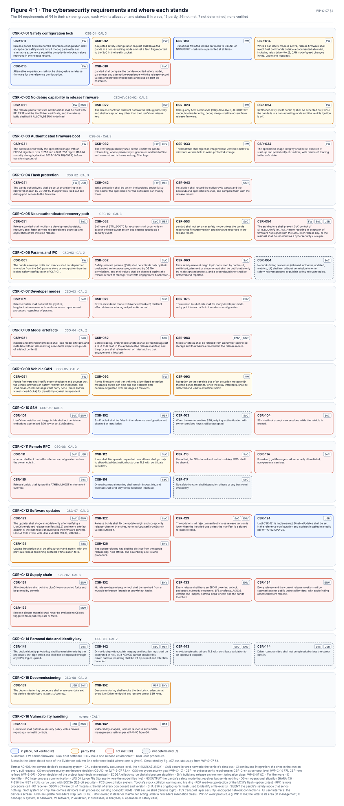

# Cybersecurity requirements and architecture

The cybersecurity requirements, [WP-S-07](../WP-S-07-cybersecurity-requirements-architecture.md), take the sixteen
concept-level requirements of the [cybersecurity concept](../../02-concept/cybersecurity/README.md) down to 64
detailed ones and place each on an element: the panda firmware, the host software on the comma device, the build and
release environment, or a procedure for the owner. They also set out the security architecture: the zones, the trust
boundaries between them, the secure boot chain, the safety-mode lock, the update path and the remote surface.

<!-- terms:start (generated by assurance/trace/tools/terms.py; do not edit by hand) -->

Terms on this page (24)

| Term | Meaning |
|---|---|
| CAN | controller area network: the vehicle's data bus |
| CI | continuous integration: the checks that run on every pull request |
| CS-nn | cybersecurity architecture decision CS-AD-nn (WP-S-07 §3.4) |
| CSG-nn | cybersecurity goal (WP-C-10) |
| CSR-nn | cybersecurity requirement: CSR-C-nn at concept level (WP-C-10 §7), CSR-nnn refined (WP-S-07) |
| DQ-nn | decision of the project lead (decision register) |
| ECDSA | elliptic-curve digital signature algorithm |
| GAP-nn | gap found by the gap assessment |
| GD-nn | private record of an unfixed weakness's code locations and mechanism, held until its control is verified (WP-O-05 §4.4) |
| MCU | microcontroller: the panda safety processor (STM32H7) |
| NOOUTPUT | the panda's safety mode that receives but sends nothing |
| OI-nn | open item of the document it appears in |
| P-256 | the NIST elliptic curve used with ECDSA (128-bit security) |
| ROM | read-only memory |
| SHA-256 | a cryptographic hash used to identify a file exactly |
| SILENT | the panda's safety mode that sends nothing |
| SoC | system on chip: the comma device's main processor, running openpilot (QM) |
| SSH | secure shell (remote login) |
| SysML | Systems Modeling Language: the system model in models/sysml |
| TARA | threat analysis and risk assessment (ISO/SAE 21434) |
| TB-nn | trust boundary (WP-S-07 §3.2) |
| TSR-nn | technical safety requirement (WP-S-02) |
| V-nn | view of the SysML model (V-01…V-20) |
| WP-nn | work product, e.g. WP-C-04; the letter is its area (M management, C concept, S system, H hardware, W software, V validation, P processes, A analyses, O operation, K safety case) |

All terms: [abbreviations and record codes](../../terms.md).

<!-- terms:end -->

This page walks through it with its figures. The document is the source of record, and every figure here is generated
from it or from the SysML model that mirrors it.

**The requirements in five lines.**

1. **Only the safety MCU has to survive an attack.** Everything on the comma device's main processor (the SoC) is
   assumed compromisable. Controls there reduce the likelihood of an attack; they are never the last line of defence
   for a safety goal (§3.2).
2. **64 requirements, none verified.** 7 are in place, 16 partly, 34 not met, and 7 not yet determined.
3. **One boundary is open.** The SoC drives the MCU's boot and reset lines, so with root on the SoC it can start the
   ROM bootloader and rewrite the firmware (TB-2, GAP-38). Whether a read-protection level closes this is open
   (CS-AD-02, OI-2).
4. **The boot chain is weak today.** Its signature scheme is below the strength required, and it checks against
   comma's key (details: private records GD-01 and GD-02, WP-O-05 §4.4). ECDSA P-256 with SHA-256 and a LionDriver
   key are decided (DQ-191 A), not built.
5. **The remote surface is shrinking.** Athena is not started in LionDriver builds (DQ-121 A), SSH is off, and updates
   are installed by hand until a signed update manifest exists.

| Where it comes from | The requirements | Where it goes |
|---|---|---|
| [TARA (WP-C-09)](../../02-concept/tara/README.md): assets, threats and attack paths · [Cybersecurity concept (WP-C-10)](../../02-concept/cybersecurity/README.md): goals CSG-01…08, claims, CSR-C-01…16 | Zones and trust boundaries; secure boot, mode lock, update path, remote surface; CSR-011…CSR-162 with allocation, safety relation and verification | [Implementation and verification (WP-W-11)](../../05-software/WP-W-11-cybersecurity-implementation-verification.md) · [Validation (WP-V-06)](../../06-validation/WP-V-06-cybersecurity-validation.md) |
| [TSRs (WP-S-02)](../WP-S-02-technical-safety-requirements.md) that need the same mechanisms (TSR-511…514) | | [Installation (WP-O-01)](../../09-production-operation/WP-O-01-installation-and-provisioning-control.md) and [release management (WP-P-10)](../../07-supporting/WP-P-10-release-management.md): keys, provisioning |

## 1. Zones and trust boundaries

*The zones (§3.1, §3.2; SysML view V-11).* Seven zones, from the trusted safety MCU (Z1) through the host processes
on the SoC (Z2), the network-facing ones (Z3) and the network itself (Z4), to the vehicle bus (Z5), the offline
release environment (Z6) and the physical device (Z7). Seven boundaries join them.

| Boundary | What crosses it | Why it matters |
|---|---|---|
| TB-1 SoC → MCU commands | safety mode, relay, CAN configuration, softloader, CAN frames | the SoC could reconfigure the envelope; the mode lock and the command allow-list answer it |
| TB-2 SoC → MCU boot lines | boot mode and reset | **open**: firmware substitution with SoC root (§3.4) |
| TB-3 network ↔ device | athena, uploads, SSH, updates | the way in for a remote attacker |
| TB-4 local integrity | params, messages, model files | a compromised network-facing process could tamper with what the host reads |
| TB-5 MCU ↔ vehicle CAN | received signals, actuation, forwarding | injection on the car's bus |
| TB-6 release → device | signed images and manifests | the keys never cross it |
| TB-7 physical | data and keys at rest | theft, loss, resale |

## 2. The firmware: boot, flash and the boot lines

The target boot chain (§3.3) is: an offline LionDriver release key; ECDSA P-256 with SHA-256; a release bootstub
built without debug support that accepts no other key; anti-rollback; the bootstub sector write-protected and the
flash read-protected at provisioning; and a runtime check of the image.

The boot lines are the hard part (§3.4). Signature checks in the bootstub do not help if the SoC can start the ROM
bootloader and erase the flash. Four architecture decisions are proposed:

- **CS-AD-01:** remove the automatic development-bootstub recovery from release builds.
- **CS-AD-02:** find out from the reference manual which read-protection level, if any, stops the ROM bootloader from
  rewriting the flash, and choose it, accepting that field recovery is lost.
- **CS-AD-03:** if no level closes it, record that firmware substitution needs SoC root, as a claim and a residual
  risk.
- **CS-AD-04:** in the ROM bootloader the relay is released, which is the safe direction; the threat is substitution,
  not the bootloader state.

## 3. The safety-mode lock

The SoC sets the panda's safety mode and parameter through one control request, `0xdc`, from a params store anyone
on the SoC can write (§3.5). The lock fixes the car configuration at compile time, allows only the step down to
NOOUTPUT or SILENT from the car mode, and refuses the commands that could change actuation, the relay or the CAN
configuration while a car mode is active. The reference build implements it (TSR-512, TSR-513). A refused request is
counted but does not drop the panda to a non-actuating mode; the lead decided to keep it that way (DQ-082 B), so that
part of CSR-012 stays a residual (OI-9). Every control request the SoC can send is drawn in
[WP-S-05 Figure 4-1](../hsi/README.md).

## 4. Updates, remote access and local integrity

- **Updates (§3.6).** Today the updater fetches whatever branch a param names and trusts hashes from the same
  unsigned tree. The target is a release manifest signed with an offline key, checked before staging. Until it exists,
  updates are installed by hand.
- **Remote surface (§3.7).** Athena is disabled by default (and not started in LionDriver builds), SSH is off with the
  installer's CI key path removed, live streaming stays local, and uploads to comma are opt-in.
- **Params and messages (§3.8).** The SoC's params store and message bus have no authentication. The design does not
  try to secure them against root. It makes the envelope independent of them, limits who may write the
  safety-relevant keys, and removes developer modes from release builds.

## 5. The requirements and where they stand

*The requirements (§4, Figure 4-1).* One tile per requirement, in the groups of its concept-level parent, with where it
is allocated and how far it has got. The configuration lock is mostly in place in the reference build, and the
debug-removal group partly. Authenticated boot, flash protection and the recovery path, which together close the
firmware-substitution threat, are mostly not met. So is the whole supply-chain group. The personal-data group cannot be
judged yet: each of its requirements still has to be checked against the device.

Where a requirement and a safety requirement state the same mechanism, one implementation serves both and the stricter
verification applies (§8). The main pairs are the firmware signature (TSR-511), the mode lock (TSR-512), command
gating (TSR-513) and the release build (TSR-514).

## 6. Open items

The ones that can change the architecture are below; the full list is at the end of WP-S-07.

- **OI-2:** which read-protection level, if any, closes the boot lines (CS-AD-02); decided with the safety manager.
- **OI-4:** the bootstub's ECDSA verification, its key provisioning and the update manifest format.
- **OI-8:** the assessor's agreement that SoC-side controls count for likelihood reduction only.
- **OI-9:** a refused safety-mode request does not drop the panda to a non-actuating mode (DQ-082 B); carried as a
  residual in the cybersecurity case.

## Where the figures come from

This folder has no files of its own besides this page. The figures live next to their sources:

| Figure | Generator |
|---|---|
| WP-S-07 Figure 4-1, the requirements | [`fig_s07_csr_status.py`](../figures/fig_s07_csr_status.py), from §4; each status is listed with a phrase from its evidence cell, and CI fails when the cell changes |
| SysML view V-11, the security zones | [`render_views.py`](../../models/sysml/tools/render_views.py), from the SysML model, which mirrors WP-S-07 §3 |
