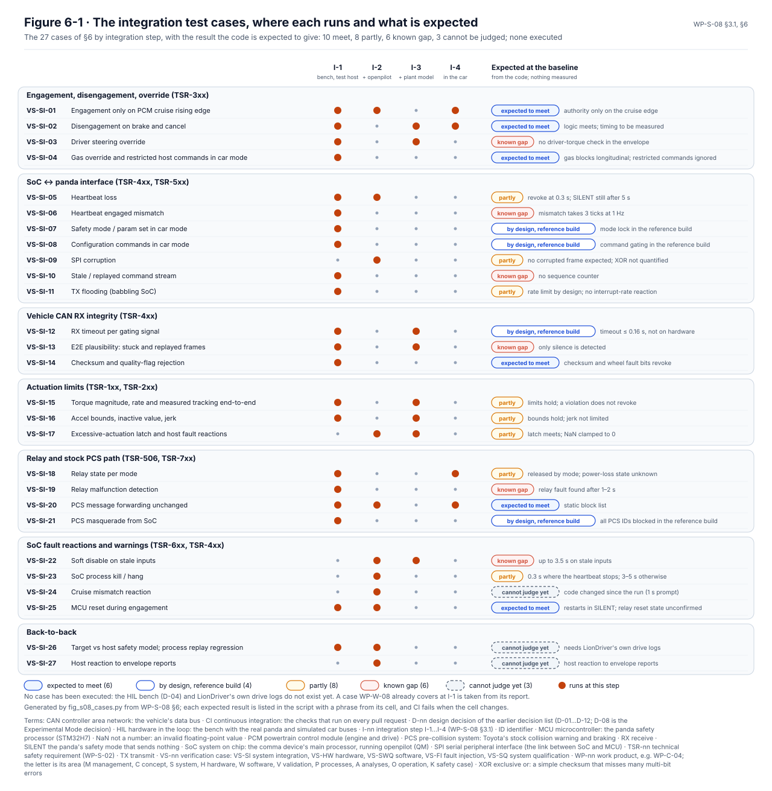

# System integration and test

The system integration and test specification, [WP-S-08](../WP-S-08-system-integration-test.md), says how the
LionDriver elements are put together into the item and how the integrated item is tested against the technical safety
requirements and the interfaces. It sets the integration steps, the bench they run on, the pass and regression rules,
and 27 test cases, each traced to its requirements. None of them has been run: the bench they need does not exist
yet.

<!-- terms:start (generated by assurance/trace/tools/terms.py; do not edit by hand) -->

Terms on this page (18)

| Term | Meaning |
|---|---|
| CAN | controller area network: the vehicle's data bus |
| CI | continuous integration: the checks that run on every pull request |
| D-nn | design decision of the earlier decision list (D-01…D-12; D-08 is the Experimental Mode decision) |
| EPS | electric power steering |
| FSR-nn | functional safety requirement (FSC) |
| GAP-nn | gap found by the gap assessment |
| GC-nn | global pass criterion of every integration test (WP-S-08 §5) |
| HIL | hardware in the loop: the bench with the real panda and simulated car buses |
| I-nn | integration step I-1…I-4 (WP-S-08 §3.1) |
| OI-nn | open item of the document it appears in |
| PC | personal computer |
| QM | quality managed: no ASIL; ordinary quality processes suffice |
| SoC | system on chip: the comma device's main processor, running openpilot (QM) |
| SysML | Systems Modeling Language: the system model in models/sysml |
| TSR-nn | technical safety requirement (WP-S-02) |
| V-nn | view of the SysML model (V-01…V-23) |
| VS-nn | verification case: VS-SI system integration, VS-HW hardware, VS-SWQ software, VS-FI fault injection, VS-SQ system qualification |
| WP-nn | work product, e.g. WP-C-04; the letter is its area (M management, C concept, S system, H hardware, W software, V validation, P processes, A analyses, O operation, K safety case) |

All terms: [abbreviations and record codes](../../terms.md).

<!-- terms:end -->

This page walks through it with its figures. The document is the source of record, and the figures are generated from
it or from the SysML model.

**Integration in five lines.**

1. **Four steps, bottom up.** The panda firmware on the bench with a test host (I-1), then with openpilot on the SoC
   (I-2), then in closed loop with a model of the car (I-3), then installed in the car, standing still (I-4). Each
   step passes before the next starts.
2. **27 cases, none executed.** The hardware-in-the-loop bench (D-04) and LionDriver's own drive logs (D-03) do not
   exist yet, and no system integration evidence exists under LionDriver's control today.
3. **The expected results are written down.** From reading the code: 10 cases should pass (4 of them by design in the
   reference build), 8 partly, 6 should fail on a known gap, and 3 cannot be judged yet.
4. **A known gap is a fail, not a waiver.** It is recorded as "Fail (known GAP-nn)" and linked to its problem report.
5. **Two rules hold in every test.** No actuation frame outside the envelope's limits may ever reach the car (GC-1),
   and Toyota's own collision-braking frames pass unchanged whenever the item is not meant to intercept them (GC-2).

| Where it comes from | The specification | Where it goes |
|---|---|---|
| [TSRs (WP-S-02)](../WP-S-02-technical-safety-requirements.md) and [FSRs (WP-C-04)](../../02-concept/fsc/README.md): what each case verifies · [Timing (WP-S-04)](../timing/README.md): the pass times | Steps I-1…I-4, bench, pass and regression rules, cases VS-SI-01…27, report template | [System verification (WP-S-09)](../WP-S-09-system-verification.md): the hand-over to tests on the road |
| [HIL bench (WP-H-06 §2)](../../04-hardware/WP-H-06-hardware-integration-verification.md) · [Embedded software tests (WP-W-08)](../../05-software/WP-W-08-embedded-software-testing.md), whose I-1 results are reused | | [Fault injection (WP-V-05)](../../06-validation/WP-V-05-fault-injection.md): the detailed fault procedures |

## 1. The integration steps

*The build-up (§3.1; SysML view V-12).* Each step adds one element or interface:

| Step | What is added | What it shows |
|---|---|---|
| I-1 | The panda firmware on the reference device, driven by a test host instead of openpilot | the envelope on its own hardware, independent of the QM stack |
| I-2 | Full openpilot on the SoC, with recorded drives replayed on the CAN side | how the SoC and the envelope work together: fault reactions, warnings, heartbeat |
| I-3 | A model of the Corolla on the bench PC, answering the steering and acceleration commands | the dynamic behaviour at the limits, and timing with a real plant response |
| I-4 | The device and harness in the car, standing still | the real EPS, engine and camera, before any driving |

A case that the embedded software tests (WP-W-08) already cover at I-1 is not run again here; their report is the I-1
result.

## 2. The cases

*The test cases (§6, Figure 6-1).* One row per case, a dot at each step it runs at, and what the code is expected to
do:

- **Expected to fail on a known gap (6):** the driver steering against the item (GAP-02), the engaged mismatch at
  1 Hz (GAP-06), no sequence counter on the SoC link (GAP-10), stuck or replayed car messages (GAP-01), the relay
  fault found only after 1–2 s (GAP-12), and up to 3.5 s of actuation on stale inputs (GAP-16).
- **Partly (8):** for example heartbeat loss revokes at 0.3 s but reaches the silent mode only after 5 s, the
  acceleration bounds hold but the jerk is not limited, and the relay's state on power loss is unknown.
- **By design in the reference build (4):** the mode lock, the command gating, the message timeout and blocking all
  of Toyota's collision-braking messages from the SoC.
- **Cannot be judged yet (3):** the cruise-mismatch code changed after the case was written, the back-to-back test
  needs LionDriver's own drive logs, and the host's reaction to envelope reports has not been run.

The pass criteria come from the requirements, not from what the code does today. A case whose expected result is a
known gap therefore stays a fail until the gap is closed.

## 3. Methods and bench

- **Methods (§3.2).** Requirements-based tests for every case; interface tests on the SoC link and the forwarding;
  fault injection for ten cases, detailed in WP-V-05; back-to-back between the firmware on the target and the
  host-built safety code; timing tests against the budgets; and boundary values at, just below and just above each
  limit.
- **Bench (§4).** The reference comma device, a Toyota harness with an instrumented relay box, a three-channel CAN
  interface, a programmable supply, an oscilloscope, and a bench-PC model of the Corolla for I-3. Times come from the
  CAN interface's hardware clock.
- **Regression (§5).** Any change to a safety-relevant file re-runs the cases the impact analysis names.

## 4. Open items

The ones that decide when testing can start are below; the full list is in WP-S-08 §9.

- **OI-2:** build the HIL bench (D-04) and the Corolla plant model, and record the model's validation.
- **OI-3:** record LionDriver's own Corolla drive logs and process-replay references (D-03, GAP-30).
- **OI-4:** set the latency bound for forwarding Toyota's collision-braking messages (VS-SI-20).
- **OI-5:** decide whether to adapt the openpilot simulator to the Toyota and route it through a real panda, which
  would close the I-3 loop with the real envelope.
- **OI-6:** re-baseline the expected results once the envelope hardening has landed.

## Where the figures come from

This folder has no files of its own besides this page. The figures live next to their sources:

| Figure | Generator |
|---|---|
| WP-S-08 Figure 6-1, the test cases | [`fig_s08_cases.py`](../figures/fig_s08_cases.py), from §6; each expected result is listed with a phrase from its cell, and CI fails when the cell changes |
| SysML view V-12, the integration build-up | [`render_views.py`](../../models/sysml/tools/render_views.py), from the SysML model |
