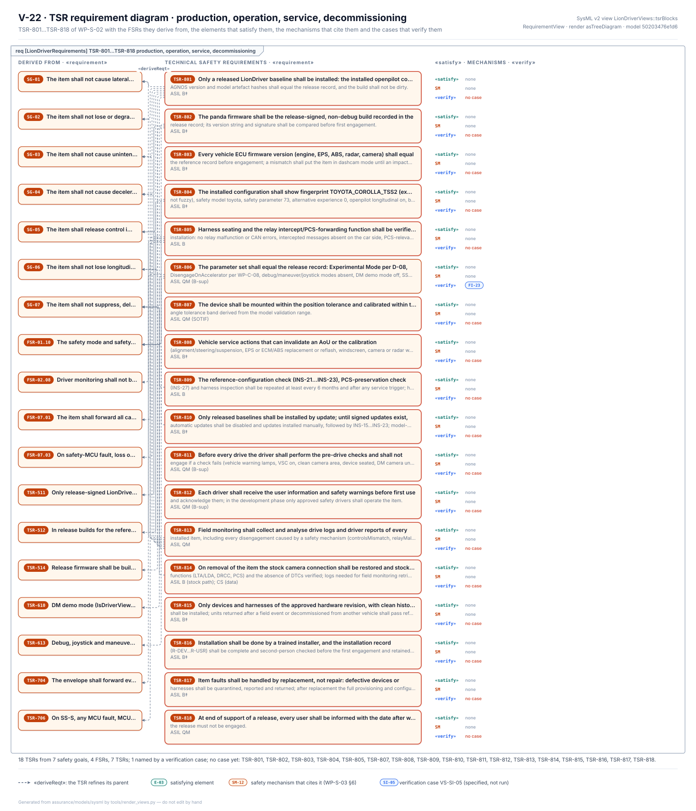

# Production and operation requirements

The production and operation requirements,
[WP-S-06](../WP-S-06-requirements-production-operation.md), say what has to happen around the item, not inside it,
for the safety concept to hold in the field: how it is installed and configured, what the driver checks before a drive,
what a workshop must re-check after working on the car, how software is updated, and how the item is removed. They are
technical safety requirements, TSR-801…TSR-818, carried out by the procedures of the operation work products.

<!-- terms:start (generated by assurance/trace/tools/terms.py; do not edit by hand) -->

Terms on this page (17)

| Term | Meaning |
|---|---|
| ASIL | Automotive Safety Integrity Level, A (lowest) to D (highest), from ISO 26262 |
| CI | continuous integration: the checks that run on every pull request |
| DQ-nn | decision of the project lead (decision register) |
| ECU | electronic control unit |
| FSR-nn | functional safety requirement (FSC) |
| GAP-nn | gap found by the gap assessment |
| OI-nn | open item of the document it appears in |
| PCS | pre-collision system: Toyota's stock collision warning and braking |
| QM | quality managed: no ASIL; ordinary quality processes suffice |
| SOTIF | safety of the intended functionality (ISO 21448): hazards with nothing failing |
| SysML | Systems Modeling Language: the system model in models/sysml |
| T-nn | code-derived detection or reaction time (WP-S-04 §4); in WP-M-01 and WP-S-06, a tailoring decision T-01…T-08 (WP-M-01 §5) |
| TSC | technical safety concept |
| TSR-nn | technical safety requirement (WP-S-02) |
| V-nn | view of the SysML model (V-01…V-27) |
| VS-nn | verification case: VS-SI system integration, VS-HW hardware, VS-SWQ software, VS-FI fault injection, VS-SQ system qualification |
| WP-nn | work product, e.g. WP-C-04; the letter is its area (M management, C concept, S system, H hardware, W software, V validation, P processes, A analyses, O operation, K safety case) |

All terms: [abbreviations and record codes](../../terms.md).

<!-- terms:end -->

This page walks through them with SysML views of the [system model](../../models/sysml/README.md). The document is the
source of record; its requirements and the life of the item they belong to are generated into the model, and every
figure below is drawn from it.

**Production and operation in five lines.**

1. **Production means installation.** LionDriver does not build hardware (tailoring T-07). "Production" is fitting a
   bought comma device and harness to a reference car, loading the released software and firmware, and checking the
   configuration.
2. **18 requirements, all procedures.** Seven have a defined procedure with nothing missing. Eight wait on an input:
   the release channel, a message list, a tolerance band, a hardware revision, a record template, a key-wipe tool,
   Toyota's service information, and the field-monitoring work product (WP-O-04). None has been carried out on a car.
3. **One is blocked by the design.** The panda firmware cannot be checked as LionDriver-signed and non-debug until
   LionDriver has its own key and a release build (TSR-802; GAP-24, GAP-25).
4. **Two lean on the design now.** Debug, manoeuvre and joystick modes are absent from the reference build by
   construction (TSR-806, DQ-131 A), and the item reads the steering and stability-control fault codes itself before
   allowing engagement (TSR-811, TSR-629, DQ-132 A). The driver's checks stay as a second barrier.
5. **Some checks are the only control in other builds.** In the reference build the firmware fixes the safety mode
   (TSR-512) and the configuration check confirms it. A build without that lock depends on the check alone, and the
   relay depends on a six-monthly manual check until it is tested at every power-up (TSR-506, TSR-515).

| Where it comes from | The requirements | Where it goes |
|---|---|---|
| [TSC (WP-S-03)](../tsc/README.md) and [TSRs (WP-S-02)](../WP-S-02-technical-safety-requirements.md): what the concept assumes about the installed item · the assumptions of use in the [item definition](../../02-concept/item/README.md): the car, its maintenance, the driver | TSR-801…818 by phase: installation and provisioning, operation, service, updates, decommissioning; the design measures that can replace manual checks (§4) | [Installation (WP-O-01)](../../09-production-operation/WP-O-01-installation-and-provisioning-control.md) · [Operation, service, decommissioning (WP-O-02)](../../09-production-operation/WP-O-02-operation-service-decommissioning.md) · [User information (WP-O-03)](../../09-production-operation/WP-O-03-user-information-safety-warnings.md) · [Field monitoring (WP-O-04)](../../09-production-operation/WP-O-04-field-monitoring.md) · [Incident response and updates (WP-O-05)](../../09-production-operation/WP-O-05-cybersecurity-incident-response-updates.md) |
| Tailoring T-07 ([WP-M-01 §5](../../01-management/WP-M-01-assurance-strategy.md)): production is installation | | |

## 1. The life of an installed item

*The life of the item as an activity (V-23).* Each phase of §3 is an action of the model, and each requirement is a
procedure step inside the phase that carries it. The arrows are the successions of the model: installation leads to
operation, operation goes to service or to a software update and comes back, and ends in decommissioning. Check B4
holds the model to one step per requirement and every phase reachable from the start. Some things stand out:

- **Installation is half the work.** Nine of the 18 steps happen once, before the first drive, and six of them are
  waiting on an input or blocked.
- **Operation is where it loops.** Every service job and every update comes back through operation, so the re-checks
  of TSR-808 and TSR-810 run as often as the car is serviced or updated.
- **Almost nothing is verified yet.** Only TSR-806 is named by a verification case (VS-FI-23); the other 17 are
  checked by their record, not by a test.

## 2. Where the requirements come from

*The production and operation requirements (V-22, 8xx).* The same requirement diagram as the other TSR blocks on the
[technical safety requirements](../technical-safety-requirements/README.md) page. They derive from seven safety goals,
four FSRs and seven TSRs: a procedure here protects a design measure there, such as the safety-mode lock (TSR-512) or
the release-signed firmware (TSR-511, 514). None has a satisfying element or a mechanism: they are allocated to
processes, not to elements of the item, so they are carried by the procedure steps of V-23 instead. All but TSR-806 are
outlined red, with no verification case.

## 3. The requirements by phase, with their status

*The requirements (§3, §4, Figure 3-1).* One tile per requirement in its phase, with what it protects and the
procedure steps that carry it. Some things stand out:

- **Installation carries most of the weight.** Nine of the 18 requirements are checks at installation: the released
  software and firmware, the car's own ECU firmware versions, the safety mode and parameter, the harness and relay, the
  parameter set, the camera mounting and calibration, the hardware revision and the installation record.
- **The car must stay the car that was characterised.** A workshop job on the steering, brakes, windscreen, camera or
  radar, a reflash or a collision repair invalidates an assumption, so the item is not engaged again until the
  re-check for that job is done (TSR-808).
- **Updates are manual.** Until signed updates exist, automatic updates are off, and every update repeats the
  installation checks (TSR-810).
- **Removal restores the car.** Decommissioning reconnects the stock camera, checks that Toyota's own lane, cruise
  and collision-braking functions are back without fault codes, and wipes the device's data and keys (TSR-814).

## 4. Why procedures can be safety requirements

The concept assumes things that only installation and operation can make true or keep true (§2): the envelope runs
the released firmware with the reference mode; the car's steering and engine behave as characterised; the harness and
relay work in both directions; the camera sits where the model expects it; the driver is briefed; debug paths are
absent. A procedure that establishes one of these is part of the safety argument, so it gets an ASIL. Most
installation checks are ASIL B‡; the harness and relay checks are B; the driver's pre-drive check and briefing are
QM (B-sup); camera mounting is a SOTIF matter.

## 5. Turning manual checks into system measures

Every manual check is a chance for it not to be done. §4 lists the design changes that turn a check into something the
item does itself:

| Manual check | Design measure | Status |
|---|---|---|
| Safety mode and parameter at installation | TSR-512: fixed in the firmware | in the reference build, not verified on hardware |
| Steering and stability-control lamps before a drive | TSR-629: the item reads the fault codes | in the host software, not verified on the car |
| Firmware build type at installation | TSR-514: the build type readable from the panda | not met (GAP-25) |
| Relay function every six months | TSR-506, TSR-515: readback and start-up test | not met (GAP-12, GAP-43) |
| Configuration copied by hand from the log | WP-O-01 OI-5 extraction script | not started |

## 6. Open items

The ones that keep requirements from being met are below; the full list is in WP-S-06 §6 and in the operation work
products.

- **OI-1:** define the LionDriver release channel, key and build pipeline, so that TSR-801 and TSR-802 can be met in
  substance.
- **OI-2:** set the six-monthly relay check as the latent-fault interval in WP-H-04, and replace it by the start-up
  test (TSR-515) once that exists.
- **OI-3:** add a column to WP-O-01 and WP-O-02 that names the TSR-8nn each step carries.
- **Inputs the procedures wait for:** the PCS message list (WP-O-01 OI-7), the calibration tolerance band (WP-O-01
  OI-2), the record template (WP-O-01 OI-3), the approved hardware revision (WP-C-01 OI-2), Toyota's service
  information (WP-O-02 OI-6), the key-wipe tool (WP-O-02 OI-5) and field monitoring (WP-O-04).

## Where the figures come from

This folder has no files of its own besides this page.

| Figure | Generator |
|---|---|
| SysML view V-23, the life of an installed item | [`render_arch.py`](../../models/sysml/tools/render_arch.py), from the SysML model; WP-S-06 §3 is generated into it by [`gen_behaviour.py`](../../models/sysml/tools/gen_behaviour.py) |
| SysML view V-22, 8xx | [`render_requirements.py`](../../models/sysml/tools/render_requirements.py), from the SysML model; the TSRs are generated into it by [`gen_requirements.py`](../../models/sysml/tools/gen_requirements.py) |
| WP-S-06 Figure 3-1, the requirements by phase | [`fig_s06_lifecycle.py`](../figures/fig_s06_lifecycle.py), from §3 and §4; each status is listed with a phrase from its cell, and CI fails when the cell changes |
